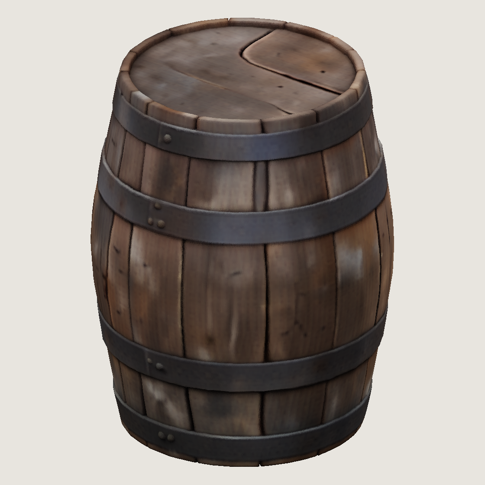

# Проверка генерации 3D: бочка, сид 1

## Результат

2026-10-20, dev-ubuntu, RTX 3090 24 ГБ, 46 ГиБ RAM без swap. **TRELLIS image-large и TRELLIS.2-4B 512 создали `raw.npz` и `meta.json`.** Оба результата скопированы на Mac в `~/.local/share/gothic-ai/content-staging/mesh3d-pilot/smoke/`, подкаталоги `trellis/` и `trellis2-512/`; SHA-256 локальных NPZ совпадают с серверными. Gemma/Decider восстановлены и отвечают, Voxtral/VoxCPM не останавливались. Суммарный простой двух окон — **592 с (9 мин 52 с)**.

Вход — настоящий концепт `~/.local/share/gothic-ai/content-sources/mesh3d-pilot/barrel-v1.png` из [PR #312](https://github.com/kaifaty/GothicAI/pull/312), RGBA 1297×1212, альфа 0…255. SHA-256: `fd2e697f9c5627fdcdb5e9c828812e5708c2a3cb1761f1ea616b69fe7d4ee84f`. Сид **1**, CLI — `both`. GLB и запекания нет; запрещённые растеризаторы и удаление фона не устанавливаются и не импортируются.

```sh
pgrep -lx Gothic2Notr || echo no game
scripts/content/mesh3d/run-mesh3d.sh \
  --image ~/.local/share/gothic-ai/content-sources/mesh3d-pilot/barrel-v1.png \
  --seed 1 --model both
```

Перед обоими окнами: `no game`. Успешное второе окно выполнялось в порядке **v1 → TRELLIS.2 512**, по одному варианту каждого генератора. Каскад 1024 повторно не запускался: первый прогон показал потребность в RAM выше нового жёсткого лимита даже за вычетом исключённых весов.

| Показатель | TRELLIS v1 | TRELLIS.2 512, low_vram | TRELLIS.2 1024_cascade, первое окно |
|---|---:|---:|---:|
| Попыток | 1 | 1 | 1 |
| Результат | ok | ok | SIGKILL 137, global host OOM |
| Секунды по `meta.json` | 52,999 | 95,233 | не сохранились; процесс 349 с |
| Пик torch allocated, MiB | 10 776,698 | 3 681,035 | не записан |
| Пик torch reserved, MiB | 15 422 | 5 322 | не записан |
| Пик RSS процесса, MiB | 5 775,484 | 16 642,469 | 29 103,18 анонимного RSS при kill, не пик |
| Пик cgroup, MiB, включая файловый кэш | 9 625,117 | 20 480 | лимита не было |
| Вершины | 508 102 | 2 681 081 | — |
| Треугольники | 1 016 242 | 5 701 048 | — |
| `raw.npz`, байт | 14 607 063 | 84 924 332 | — |

Секунды успешных вариантов включают загрузку моделей, инференс, извлечение/сэмплинг атрибутов, сохранение, очистку и финальный `nvidia-smi`; по событиям launcher процессы заняли 56/98 с. В `meta.json` записаны ревизии источников и весов, лицензии, сид, параметры sampler, оси (+Z вверх), номинальный масштаб −0,5…0,5 без физической калибровки и `nvidia-smi` до/после. CPU-проверка обоих NPZ: индексы допустимы, все числа finite, типы `vertices/color` f32 и `faces` i32; цвет линейный 0…1. У TRELLIS.2 `metallic`/`roughness` — f32 по вершине, диапазоны 0…0,835145 / 0,765128…0,826158; атрибуты взяты из ближайших центров разреженных вокселей без растеризатора.

SHA-256 `raw.npz`:

- v1: `e5a64e5817d2734eb398cffdf03ff4fda1844c25bca1196366cfc1f029ecbcda`.
- TRELLIS.2 512: `5943a5b309cba2959bdd541aacfdfde0525dbe22ee217b9327fef540072a5ced`.

## Изоляция памяти во втором окне

До остановки сервисов проверены делегирование `memory` в пользовательском cgroup-v2 manager и фактические ограничения отдельного тестового scope. `MemAvailable` — **27 696 108 KiB = 26,413 ГиБ**, выше требуемых 26 ГиБ. Каждый рабочий Python повторно проверяет собственный scope перед `exec`:

```text
systemd-run --user --scope -p MemoryMax=20G -p MemorySwapMax=0
memory.max       = 21474836480
memory.swap.max  = 0
memory.oom.group = 1
```

`memory.oom.group` выставляется в файле собственной делегированной cgroup: установленная версия systemd не поддерживает свойство `MemoryOOMGroup`. Лимиты пользовательского manager и чужих процессов не меняются. Генератор и его потомки ограничены своим scope; launcher и наблюдатель находятся снаружи. `meta.json` создаётся до загрузки модели; RSS и torch current/peak allocated/reserved сохраняются каждую секунду в атомарный JSON и `memory.jsonl` с `fsync`. Внешний наблюдатель пишет cgroup current/peak/events, в том числе когда нативный код удерживает GIL. При SIGKILL остаются последние сохранённые значения; это не гарантирует захват последней доли секунды.

У TRELLIS.2 cgroup достигла лимита: `memory.events max=3753`, но **oom=0, oom_kill=0, oom_group_kill=0**. У v1 все эти счётчики 0. Cgroup peak включает файловый кэш, поэтому превышает RSS. В журнале ядра за второе окно новых OOM-kill/global OOM **0**.

Загрузчик использовал только нужные flow-веса: у 512 исключены оба flow 1024 (по 2,58 ГБ). Для каскада можно исключить лишь texture flow 512, 2 584 672 728 байт (2464,94 MiB). Прежние 29 103 MiB анонимного RSS минус эти веса дают оценку около **26 638 MiB**, всё ещё выше лимита **20 480 MiB**. Поэтому повтор 1024 не был допущен по памяти; это оценка по первому прогону, не новый замер.

## Окна и восстановление

Успешный run ID: `20261020T123646Z-seed1-59108`; серверные варианты — `~/gothic-ai/mesh3d/runs/<run-id>/trellis/` и `trellis2-512/`. События — `events.tsv`, простой — `downtime.tsv` в папке mesh3d. Общий замок — прежний `~/gothic-ai/materials/gpu.lock`.

| Событие второго окна | UTC |
|---|---|
| Preflight памяти / окно открыто | 12:36:47 |
| Gemma stop-request / stop | 12:36:48 |
| Decider stop-request / stop; v1 start | 12:36:49 |
| v1 exit 0; TRELLIS.2 512 start | 12:37:45 |
| TRELLIS.2 exit 0; обоим сервисам отправлен start | 12:39:23 |
| Gemma отвечает | 12:39:29 |
| Decider отвечает; окно закрыто, exit 0 | 12:40:05 |

Простой считаем от `stop-request` до успешного ответа:

| Окно | Gemma, с | Decider, с | Общий интервал, с |
|---|---:|---:|---:|
| Первое, неуспешное 1024 | 357 | 394 | 395 |
| Второе, v1 + 512 | 161 | 196 | 197 |
| Суммарно | **518** | **590** | **592** |

Полная длительность второго окна — 198 с, предел дополнительного окна — 1380 с (23 мин), суммарный предел простоя — 1800 с. Launcher отводит до 780 с генерации и резервирует 600 с для восстановления с учётом прежнего простоя. После окна все четыре юнита active: Gemma `/health` HTTP 200, Voxtral `/health` HTTP 200, Decider и VoxCPM HTTP 426 (живой WebSocket-сервер отвечает отказом без Upgrade), backend VoxCPM `/health` HTTP 200. GPU до и после второго окна — **18 981 MiB**.

Первый run ID — `20261020T121151Z-seed1-11485`, окно 12:11:52–12:18:28 UTC. `1024_cascade` закончил сэмплинг формы и материала, но ядро убило Python при декодировании: `constraint=CONSTRAINT_NONE`, `global_oom`, анонимный RSS 29 801 656 KiB (28,42 ГиБ). Выборочный максимум всей GPU был ≥19 373 MiB, включая ASR/TTS; это нижняя граница, а не пик torch. `raw.npz`/`meta.json` тогда не созданы, утраченные пики torch восстановить нельзя. Во втором окне эта неограниченная схема не использовалась; повторных ошибок генератора 0.

## CPU-превью цвета вершин

`preview_raw.py` на Mac, matplotlib Agg, одинаковая ортографическая камера, +Z вверх, без света; линейный цвет переводится в sRGB. Показаны все треугольники без упрощения, цвет грани — среднее трёх вершин. Это превью исходного меша, не запекание текстуры. PNG 1120×1120.

| TRELLIS v1 | TRELLIS.2 512 |
|---|---|
|  |  |

У v1 заметнее швы досок, у TRELLIS.2 512 — более плоские переходы цвета и четыре обруча; это визуальное наблюдение по данному ракурсу, не оценка готовности игрового ресурса. Оба результата содержат миллионы треугольников; дальнейшая подготовка мешей остаётся отдельной задачей Blender.

Проверки: `sh scripts/content/mesh3d/check-generate.sh` — **9 passed за 1,88 с**, без GPU/сети, включая сохранение текущих метаданных до завершения модели; синтаксис Bash и `git diff --check` прошли. `assert_clean_imports()` прошёл в обеих успешных генерациях. Дополнительных инференсов и сидов не было.
