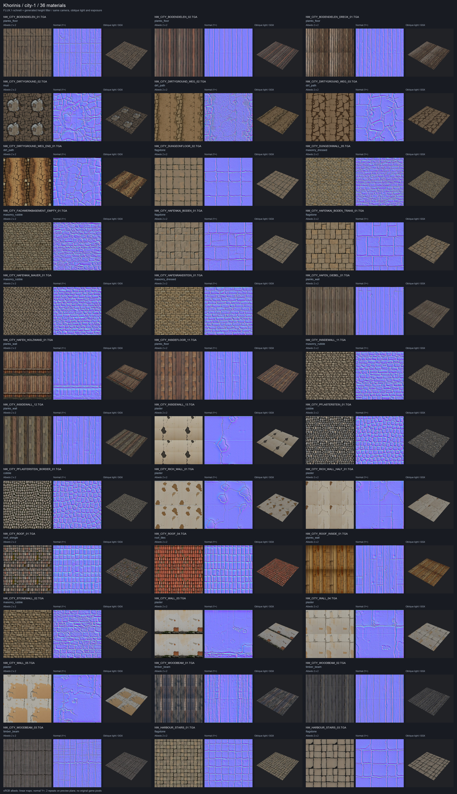
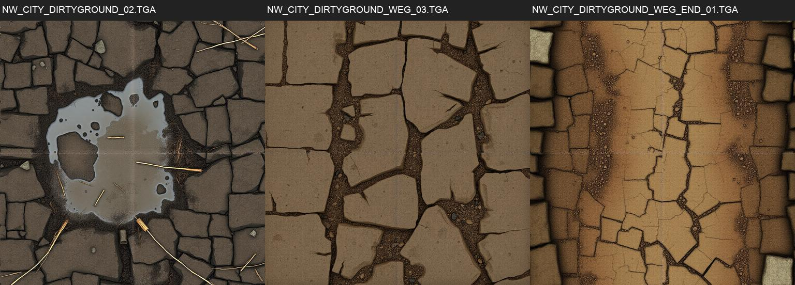

# Первый набор материалов Хориниса — city-1

**Нужно решение по трём грунтам.** Сгенерированы и сохранены 36 черновых кандидатов для всех `include` [таблицы](../../../data/content/city-materials.csv). После визуальной проверки 33 соответствуют классу. У трёх грунтов FLUX во всех трёх разрешённых попытках рисует поверхность, похожую на каменное мощение. Шаблон промпта и лимит попыток сохранены; для продолжения нужно выбрать текущие кандидаты для съёмки либо разрешить уточнить промпты и сделать дополнительные попытки.

Набор находится только в `~/.local/share/gothic-ai/content-staging/city-1/`: исходные PNG попыток и `materials/materials.json` + 108 DDS. Рабочий `~/.local/share/gothic-ai/content` не изменялся. Все записи — `status: draft`; включение остаётся за пользователем.

## Материалы

[Полный лист 36 материалов](materials.jpg): цвет с повтором 2×2, нормаль, превью при одинаковом косом свете; подписи — текстура и класс.



Проблемные третьи попытки: `NW_CITY_DIRTYGROUND_02.TGA` (`mud`), `NW_CITY_DIRTYGROUND_WEG_03.TGA` и `NW_CITY_DIRTYGROUND_WEG_END_01.TGA` (`dirt_path`). Это сохранённые кандидаты для решения, их соответствие классу не подтверждено. В реестре — `generation.visual_review.outcome: needs_decision`.



Источник — только текст: ядро класса, состояние строки, общий хвост из принятой [библии](../../../docs/content-style.md). Оригинальные изображения, кадры и геометрия на вход генератору не передавались.

- Модель: `black-forest-labs/FLUX.1-schnell`, ревизия `741f7c3ce8b383c54771c7003378a50191e9efe9`, Apache-2.0.
- 1024×1024, 4 шага, guidance 0, max sequence 256; NF4 с double quantization, BF16, раздельная жизнь T5/transformer и CPU offload, circular VAE padding и периодический сдвиг латентов — тот же адаптер, что в сравнении.
- Сид: первые 32 бита SHA256 строки `UPPERCASE_TEXTURE:номер_попытки`, big endian. Каждый сид, промпт, параметры, шесть карт и поправка яркости сохранены в [реестре](../../../data/content/registry.jsonl).
- Яркость: среднее линейного RGB с весами 0,2126/0,7152/0,0722; если вне диапазона класса — общий множитель RGB до середины диапазона. Геометрия рисунка не меняется. В реестре есть исходное/итоговое среднее, коэффициент, целевой уровень и доля отсечения каналов.
- Карты — свой периодический фильтр. Шероховатость ограничена диапазоном класса с учётом округления в 8 бит, металличность 0. DDS: DXT1 для цвета/ORM, DXT5nm для нормали, 11 mip-уровней; масштаб из CSV.


| Текстура | Класс | Scale | Попыток | Средняя яркость до → после | Множитель | Проверка класса |
|---|---|---:|---:|---:|---:|---|
| `NW_CITY_BODENDIELEN_01.TGA` | `planks_floor` | 2.17 | 1 | 0.1061 → 0.1061 | 1.0000 | узнаваем |
| `NW_CITY_BODENDIELEN_02.TGA` | `planks_floor` | 2.14 | 1 | 0.0864 → 0.0864 | 1.0000 | узнаваем |
| `NW_CITY_BODENDIELEN_DRECK_01.TGA` | `planks_floor` | 2.36 | 1 | 0.1032 → 0.1032 | 1.0000 | узнаваем |
| `NW_CITY_DIRTYGROUND_02.TGA` | `mud` | 1.67 | 3 | 0.0325 → 0.0849 | 2.6667 | нужно решение |
| `NW_CITY_DIRTYGROUND_WEG_02.TGA` | `dirt_path` | 1.67 | 2 | 0.1377 → 0.1377 | 1.0000 | узнаваем |
| `NW_CITY_DIRTYGROUND_WEG_03.TGA` | `dirt_path` | 1.67 | 3 | 0.2439 → 0.1100 | 0.4510 | нужно решение |
| `NW_CITY_DIRTYGROUND_WEG_END_01.TGA` | `dirt_path` | 1.59 | 3 | 0.1278 → 0.1278 | 1.0000 | нужно решение |
| `NW_CITY_DUNGEONFLOOR_02.TGA` | `flagstone` | 0.95 | 1 | 0.1816 → 0.1816 | 1.0000 | узнаваем |
| `NW_CITY_DUNGEONWALL_05.TGA` | `masonry_dressed` | 1.10 | 1 | 0.3481 → 0.1700 | 0.4883 | узнаваем |
| `NW_CITY_FACHWERKBASEMENT_EMPTY_01.TGA` | `masonry_rubble` | 1.75 | 1 | 0.2671 → 0.1300 | 0.4867 | узнаваем |
| `NW_CITY_HAFENKAI_BODEN_01.TGA` | `flagstone` | 2.00 | 1 | 0.1935 → 0.1935 | 1.0000 | узнаваем |
| `NW_CITY_HAFENKAI_BODEN_TRANS_01.TGA` | `flagstone` | 1.58 | 1 | 0.1778 → 0.1778 | 1.0000 | узнаваем |
| `NW_CITY_HAFENKAI_MAUER_01.TGA` | `masonry_rubble` | 8.43 | 1 | 0.2777 → 0.1300 | 0.4681 | узнаваем |
| `NW_CITY_HAFENRANDSTEIN_01.TGA` | `masonry_dressed` | 1.50 | 1 | 0.2667 → 0.1700 | 0.6375 | узнаваем |
| `NW_CITY_HAFEN_GIEBEL_01.TGA` | `planks_wall` | 1.50 | 1 | 0.3113 → 0.1000 | 0.3213 | узнаваем |
| `NW_CITY_HAFEN_HOLZWAND_01.TGA` | `planks_wall` | 1.50 | 1 | 0.1547 → 0.1001 | 0.6464 | узнаваем |
| `NW_CITY_INSIDEFLOOR_11.TGA` | `planks_floor` | 1.89 | 1 | 0.1115 → 0.1115 | 1.0000 | узнаваем |
| `NW_CITY_INSIDEWALL_11.TGA` | `masonry_rubble` | 1.92 | 1 | 0.1481 → 0.1481 | 1.0000 | узнаваем |
| `NW_CITY_INSIDEWALL_12.TGA` | `planks_wall` | 1.79 | 1 | 0.1435 → 0.1000 | 0.6968 | узнаваем |
| `NW_CITY_INSIDEWALL_13.TGA` | `plaster` | 1.81 | 1 | 0.6028 → 0.3250 | 0.5391 | узнаваем |
| `NW_CITY_PFLASTERSTEIN_01.TGA` | `cobble` | 3.00 | 1 | 0.1365 → 0.1365 | 1.0000 | узнаваем |
| `NW_CITY_PFLASTERSTEIN_BORDER_01.TGA` | `cobble` | 2.85 | 1 | 0.1501 → 0.1501 | 1.0000 | узнаваем |
| `NW_CITY_RICH_WALL_01.TGA` | `plaster` | 1.51 | 1 | 0.6780 → 0.3250 | 0.4794 | узнаваем |
| `NW_CITY_RICH_WALL_HALF_01.TGA` | `plaster` | 0.95 | 2 | 0.6468 → 0.3246 | 0.5025 | узнаваем |
| `NW_CITY_ROOF_01.TGA` | `roof_shingle` | 4.31 | 1 | 0.1156 → 0.1156 | 1.0000 | узнаваем |
| `NW_CITY_ROOF_04.TGA` | `roof_tiles` | 3.30 | 1 | 0.1241 → 0.1241 | 1.0000 | узнаваем |
| `NW_CITY_ROOF_INSIDE_01.TGA` | `planks_wall` | 3.67 | 1 | 0.1172 → 0.1172 | 1.0000 | узнаваем |
| `NW_CITY_STONEWALL_02.TGA` | `masonry_rubble` | 1.27 | 1 | 0.2606 → 0.1299 | 0.4988 | узнаваем |
| `NW_CITY_WALL_03.TGA` | `plaster` | 1.24 | 1 | 0.6928 → 0.3251 | 0.4691 | узнаваем |
| `NW_CITY_WALL_04.TGA` | `plaster` | 1.59 | 1 | 0.6588 → 0.3253 | 0.4934 | узнаваем |
| `NW_CITY_WALL_05.TGA` | `plaster` | 0.99 | 1 | 0.5712 → 0.3250 | 0.5690 | узнаваем |
| `NW_CITY_WOODBEAM_01.TGA` | `timber_beam` | 0.48 | 1 | 0.0202 → 0.0850 | 4.2037 | узнаваем |
| `NW_CITY_WOODBEAM_02.TGA` | `timber_beam` | 0.85 | 1 | 0.0654 → 0.0654 | 1.0000 | узнаваем |
| `NW_CITY_WOODBEAM_03.TGA` | `timber_beam` | 1.87 | 2 | 0.0161 → 0.0850 | 5.2721 | узнаваем |
| `NW_HARBOUR_STAIRS_01.TGA` | `flagstone` | 1.24 | 1 | 0.1724 → 0.1724 | 1.0000 | узнаваем |
| `NW_HARBOUR_STAIRS_03.TGA` | `flagstone` | 0.54 | 1 | 0.1823 → 0.1823 | 1.0000 | узнаваем |

## Перегенерации и время

Всего **45 попыток на 36 материалов**, из них 9 отклонены с причинами в `generation.attempts`. 30 материалов оставлены с первой попытки, 3 — со второй, 3 достигли лимита и требуют решения. Сумма измеренного времени генерации и фильтра по всем попыткам — **395.489 с** (без загрузки модели и ожидания Mac).

| Материал | Что произошло |
|---|---|
| `NW_CITY_DIRTYGROUND_02.TGA` | 1: Visual review: cobbled paving rather than damp compacted mud; 2: Visual review: stone-like plates dominate the wet mud. Итог: лимит 3/3, нужно решение |
| `NW_CITY_DIRTYGROUND_WEG_02.TGA` | 1: Visual review: paved slabs rather than packed earth path. Итог: вторая попытка соответствует классу |
| `NW_CITY_DIRTYGROUND_WEG_03.TGA` | 1: Visual review: cobblestone grid rather than packed earth path; 2: Visual review: paving blocks dominate the packed earth. Итог: лимит 3/3, нужно решение |
| `NW_CITY_DIRTYGROUND_WEG_END_01.TGA` | 1: Visual review: stone paving strip rather than packed earth path; 2: Visual review: masonry strip dominates the packed earth. Итог: лимит 3/3, нужно решение |
| `NW_CITY_RICH_WALL_HALF_01.TGA` | 1: Visual review: exposed block masonry rather than lime plaster. Итог: вторая попытка соответствует классу |
| `NW_CITY_WOODBEAM_03.TGA` | 1: Visual review: blue painted boards rather than dark old timber. Итог: вторая попытка соответствует классу |

Остановки на dev-ubuntu (UTC, от запроса остановки до успешной проверки порта):

| Юнит | Остановка | Запуск | Порт проверен | Окно |
|---|---|---|---|---:|
| `gothic-gemma` | 08:43:30 | 08:49:32 | 08:49:38 | 368 с |
| `gothic-gemma` | 08:51:50 | 08:53:19 | 08:53:26 | 96 с |
| `gothic-gemma` | 09:02:18 | 09:03:15 | 09:03:21 | 63 с |

Сумма этой задачи — **527 с (8 мин 47 с)**. Вместе с прежними окнами в каталоге материалов — 1160 с, меньше 3600 с. Перед каждым окном проверялась игра на Mac; третье окно ждало её примерно 8 минут. `gothic-decider` не останавливался. После окон все четыре юнита (`gothic-gemma`, `gothic-decider`, `gothic-voxtral`, `gothic-voxcpm`) активны; раннер проверил ответ порта Gemma сразу после запуска. Один дополнительный запуск раннера вернул 75 на занятом собственном `gpu.lock`, до остановки юнитов и запуска модели. Токен явно передавался только загрузчикам FLUX, в вывод и реестр не попадал. Всё на dev-ubuntu — в `~/gothic-ai/materials/`.

## Игровая проверка — ожидает решения

Снимки, перепись с подменами и FPS **не выполнены**: три материала не прошли визуальную проверку после предельных трёх попыток, а менять утверждённый промпт или превышать лимит без решения нельзя. Замера Mac и отдельного ожидания его слота для FPS не было; это не случай пропуска FPS после 40 минут ожидания.

Подготовлен [новый сценарий](../../../scripts/content/city.bench): исходная точка «город» из `rf.bench`, рынок `MARKT`, гавань `NW_CITY_HABOUR_06_B`, верхний квартал `NW_CITY_UPTOWN_PATH_13`, дом `NW_CITY_MERCHANT_HUT_02_IN_02`; 12:00 и 23:00. [Раннер](../../../scripts/content/capture-city.sh) использует source-matching кеш движка на Ryzen, отдельные runtime/сейв/скрипты, `gq`, явный пустой baseline и `OPENGOTHIC_CONTENT` на копию staging-набора. Он требует все целевые подмены в `OPENGOTHIC_CENSUS` и ноль открытий этих оригинальных `.TGA`/`-C.TEX`, сохраняет 10 уменьшенных пар JPG. Игры на Ryzen в этой задаче не запускались, заявок `gq` не подавалось.

Mac-бинарник текущего worktree собран успешно: `CMAKE_BUILD_PARALLEL_LEVEL=4 scripts/build-engine.sh`, 1208 шагов Ninja, exit 0. Исходники движка и шейдеры не менялись. Режим `--mac-city-fps` ждёт свободный Mac до 2400 с и измеряет исходное окно города (6 с установления, затем 20 с обычных кадров).

После решения команды для завершения:

```sh
scripts/content/capture-city.sh \
  --content-root "$HOME/.local/share/gothic-ai/content-staging/city-1" \
  --output /ABS/OUTSIDE-GIT/city-set-1-captures

BIN="$PWD/OpenGothic/build/opengothic/Gothic2Notr" \
GOTHIC_DIR="/path/to/Gothic II" \
scripts/content/capture-city.sh --mac-city-fps \
  --content-root "$HOME/.local/share/gothic-ai/content-staging/city-1" \
  --output /ABS/OUTSIDE-GIT/city-set-1-mac-fps
```

## Конвейер и проверки

`generate.py prepare` получает `--mapping` и `--bible`, фиксирует хэши входов и сохраняет прежний прогресс при повторе; изменённые входы требуют нового имени набора. `run-materials.sh city` готовит и генерирует `city-1` на dev-ubuntu с отдельным `city-1.jsonl`, GPU-lock, восстановлением сервисов и общим бюджетом. `generate.py reject --id … --reason …` сохраняет отвергнутую попытку. `pack_materials.py --set city-1` проверяет полный охват `include`, класс, масштаб, уникальность и запрещает вывод в рабочий каталог контента. `material_preview.py --set city-1` строит лист.

```sh
uv run --no-project --with pytest --with numpy --with pillow --with scipy \
  python -m pytest scripts/content/test_*.py -q
python3 scripts/content/registry.py check
python3 scripts/content/map_textures.py check

uv run --no-project --with numpy --with pillow python scripts/content/pack_materials.py \
  --registry data/content/registry.jsonl \
  --content-root "$HOME/.local/share/gothic-ai/content-staging" \
  --set city-1 --output "$HOME/.local/share/gothic-ai/content-staging/city-1"
uv run --no-project --with numpy --with pillow python scripts/content/material_preview.py \
  --registry data/content/registry.jsonl \
  --content-root "$HOME/.local/share/gothic-ai/content-staging" \
  --set city-1 --output reports/content/2026-10-city-set-1
```

- Тесты конвейера и реестра: **140 passed**. При отладке исправлены выход за границу яркости после 8-битного округления и захват городских записей командой `bakeoff.py enable-flux`; целевые повторы прошли.
- `registry.py check`: **86 записей**, 50 прежних + 36 городских, `draft`. Все попытки сохранены вложенными объектами, ID материала один на строку `include`.
- `map_textures.py check`: **71 строка, 36 include, 35 exclude**, включённая площадь 94 498,41 / 130 704,10 м² (72,30%). Таблица не менялась.
- Проверка файлов: выбранные **216 PNG 1024²**, яркость и шероховатость в диапазонах классов, металличность 0. Упаковка — **108 DDS + 1 materials.json**, 36 имён и масштабы из таблицы; коррекция отрицательного Z нормалей — 0 пикселей у всех выбранных материалов.
- `bash -n` для обоих раннеров — exit 0. Интервал ожидания свободного Mac в GPU-раннере сокращён с 30 до 5 с; время ожидания и правила остановки/восстановления не менялись.

Следующий шаг требует решения по трём грунтам. Рабочий каталог контента и включение набора остаются за пользователем.
