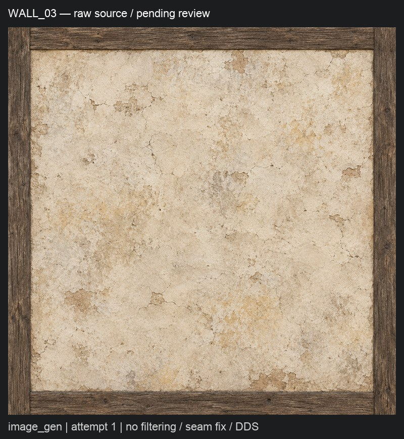

# city-3: исходники сохранены, набор ожидает решения

Готова резервная копия исходников. Полный городской набор пока не собран: для двух непрозрачных классов в библии нет численных параметров фильтра, а задание запрещает выбирать отсутствующее решение самостоятельно.

## Что сделано

Постоянное хранилище на Mac — `~/.local/share/gothic-ai/content-sources/`; копия — `dev-ubuntu:~/gothic-ai/content-backup/sources/`. Сохранены **149 уникальных PNG, 370 288 482 байта**:

- 13 исходников встроенного imagegen из сравнения и один новый исходник city-3;
- 74 исходника FLUX city-1 и 41 исходник FLUX city-2;
- 10 исходников FLUX и 10 SDXL из первого сравнения генераторов.

Все **179 ссылок** на эти исходники в **131 рецепте** [реестра](../../../data/content/registry.jsonl) имеют относительный `source_png` и `source_sha256`. Пути считаются от постоянного хранилища, независимо от каталога обработанных карт. В staging и у 13 прежних файлов `$CODEX_HOME/generated_images/` оставлены относительные символические ссылки; новый PNG также перенесён с сохранением ссылки. Исходники FLUX первого и второго пилотов перенесены из существующих архивов без их изменения. Рабочий каталог контента не менялся.

[`registry.py check`](../../../scripts/content/registry.py) теперь проверяет байты каждого зарегистрированного исходника, включая невыбранные попытки. [`backup-sources.sh`](../../../scripts/content/backup-sources.sh) сначала проверяет Mac, копирует только свою папку через `rsync --checksum` без удаления старых файлов, затем сверяет копию тем же валидатором и реестром. Любая ошибка даёт ненулевой exit. CLI [`import_imagegen.py import`](../../../scripts/content/import_imagegen.py) вызывает копирование после записи партии в реестр; библиотечный импорт остаётся без сетевых действий.

## Генерация

**1 вызов встроенного `image_gen.imagegen`, 1 PNG, 0 ошибок инструмента.** На входе был только текст. Для `NW_CITY_WALL_03.TGA` заново описаны стойки, верхняя и нижняя обвязки, широкое штукатурное заполнение и физическая пропорция 2,00×2,06 м. Промпт включает дословный запрет из [библии](../../../docs/content-style.md#промпт): `flat albedo only, no painted shadows, no shading under beams or overhangs, no dark contact lines, no ambient occlusion, no highlights`, а также отдельное требование не затемнять штукатурку рядом с балками.

Исходник — `content-sources/city-3/NW_CITY_WALL_03-attempt-1.png`, **1254×1254**, SHA-256 `e0a9f8fcfbf6b5b4347c1735804706f76b6e846d50172994e4d01bdec4bf6bf0`. Полный промпт, время и источник записаны в рецепте `city-3-nw-city-wall-03`. Вызов начат 2026-10-19 17:53:56,484 UTC; замер от подготовки промпта до ответа — 26,657 с, включая очередь инструмента. Модель, ревизия и seed инструментом не раскрываются; seed и ревизия остаются `null`.

Рама и штукатурка присутствуют; под верхней балкой всё ещё заметна тонкая тёмная линия. Это **не принятый материал**: запись `pending`, обработка карт не выполнялась. Шов-фикс, коррекция яркости/насыщенности и упаковка DDS не запускались; попытка сохранена для дальнейшего сравнения, лимит — ещё две попытки.

## Охват и пропуски

В [таблице](../../../data/content/city-materials.csv) 60 строк `include`/`module`/`panel`/`strip`: 16/27/10/7. Шесть текстур пропускаются по требованию о прозрачности и остаются оригинальными:

| Текстура | Причина |
|---|---|
| `NW_CITY_FLAG_01.TGA` | ткань, сохранение прозрачного контура |
| `NW_CITY_IVY_BORDER_01.TGA` | листва, альфа-контур |
| `NW_CITY_IVY_FULL_01.TGA` | листва, альфа-контур |
| `NW_CITY_ROPE_01.TGA` | верёвка, прозрачные промежутки |
| `NW_HARBOUR_ROPEWALL_01.TGA` | верёвки, прозрачные промежутки |
| `NW_HARBOUR_ROPEWALL_02.TGA` | верёвки, прозрачные промежутки |

Сети уже относятся к 11 строкам `exclude`, которые остаются вне набора. Ожидаемый охват до дополнительной проверки альфы — **54 материала**. Решения и значения CSV не менялись; недостающие `target_luminance` ещё предстоит измерить. В отчёте сравнения прямо отмечено запечённое затемнение у `WALL_03`, `WINDOW_03`, `FACHWERKBASEMENT_EMPTY_01` и `ROOF_01`: эти четыре материала требуют новых генераций. Остальные восемь сравнительных материалов ещё не переносились и требуют просмотра перед переиспользованием.

## Что требует решения

[`content-style.md`](../../../docs/content-style.md) определяет состав, масштаб и раскладку, но не roughness/metallic для:

- `iron_panel` — `NW_HARBOUR_CANONHOLE.TGA`;
- `banded_metal_tile` — `NW_HARBOUR_CANON_01.TGA`.

Нужно задать шероховатость и металличность, включая правило для потёртых металлических поясов и окисленной поверхности: константы на всю карту или маску фильтра. Правило «металличность 0» в библии относится к однородным классам этапа 1; распространение его на эти металлические модули было бы новым решением.

## Проверки и игра

- Проверки резервного копирования: первоначально **148/148 PNG** сверены на обеих машинах; после первого вызова — **149/149**, exit 0.
- `uv run --no-project --with pytest --with numpy --with pillow --with scipy python -m pytest -q scripts/content/` — **344 passed**, 19,57 с, exit 0.
- `python3 scripts/content/registry.py check` — **131 рецепт, 149 PNG**, exit 0; `python3 scripts/content/map_textures.py check` — **71 строка**, exit 0.
- `scripts/content/backup-sources.sh` — **149 PNG** сверены на dev-ubuntu, exit 0; `bash -n scripts/content/backup-sources.sh` — exit 0.
- Съёмка на Ryzen через `gq`, перепись подмен и FPS на Mac **не запускались**: DDS-набор отсутствует. Ни одного материала city-3 в игру не подключено.

Продолжение: утвердить параметры двух металлических классов, измерить недостающую яркость, подготовить и генерировать набор партиями примерно по десять, копировать и коммитить каждую; затем упаковать и выполнить весь заданный обход и FPS. Включение остаётся за пользователем.
