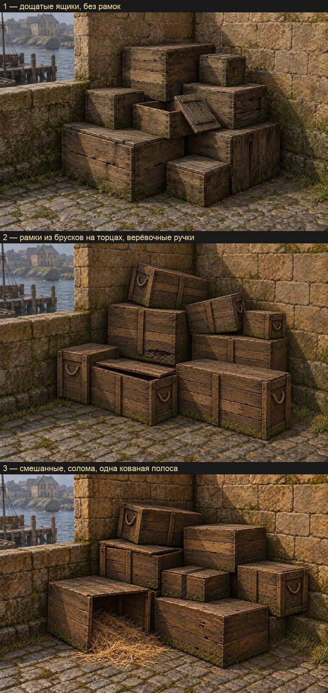

# Ящики порта заново: по замыслу

21 октября 2026 года. Пользователь посмотрел набор рынка: ящики не читаются как деревянные ящики Готики, это «коробки из Counter-Strike». Переделываем два визуала с нуля по скиллу [`object-design`](../../../.claude/skills/object-design/SKILL.md): одиночный ящик `NW_HARBOUR_CRATE_01` (пилот) и кучу ящиков `NW_HARBOUR_CRATEPILE_01` (набор рынка). Это первый предмет, сделанный по этому скиллу.

## Что было не так

Нижний ряд листа: оригинал слева, наша куча после двух проходов цвета справа.
- **Оригинал** грубый, это просто кубы, а у кучи они ещё и вдавлены друг в друга. Но цвет у него того же семейства, что двор вокруг: оливково-бурое дерево, тёмная грязь, пятна мха, как на стене и между камнями брусчатки. Рамка из брусков и доски только нарисованы и издали почти не видны.
- **Наш ящик** повторил нарисованную рамку чистой ровной геометрией. На все восемь углов он получил железные уголки, которых у оригинала нет. Дерево — серая пилотная плитка, растянутая до среднего цвета оригинала. Светлые кромки обводят каждый ящик. Все ящики кучи одного вида и тона и стоят ровно.

## Замысел

**Общее для ящиков порта и рынка.** Одно дерево — грубо пиленая сосна, тёмная, тёплая, с оливковым оттенком от сырости. Одна грязь — почти чёрная в стыках и щелях. Один мох — зелёный, на нижних досках и в трещинах верхних. Без краски и надписей.

**Роль в игре.** Декор и местами укрытие. Ящики говорят игроку, что это бедный порт, через который идёт товар: их таскают между кораблём, складом и рынком, грузят снова и снова, не чинят, пока не развалятся. Это не MOB, открыть их нельзя.

**Место.**
- Одиночный ящик — 105 копий: ряды у пристани и складов порта, рядом бочки, бухты каната, мешки. Часто в тени или в полутёмном складе.
- Куча — 132 копии, из них 5 на рынке: углы дворов у стен из тёсаного охристо-бурого камня, на брусчатке с мхом и травой в швах. Днём, на солнце и в тени стены.
- Игрок проходит мимо в 3–10 м. Сверху ящики видны с лестниц и стен.

**Сохранить.**
- Цвет оригинала: тёмное тёплое дерево с оливковым оттенком, грязь, мох. Ящик — того же семейства цвета, что стена и мостовая.
- Нарисованную у оригинала конструкцию — бруски и доски — как грубую плотницкую работу.
- Небрежную кучу: ящики сдвинуты, не по линейке.

**Улучшить.**
- Настоящие доски и бруски вместо нарисованных; разные размеры ящиков в куче; ящики не проваливаются друг в друга.
- Следы жизни: сбитый угол, треснувшая или заменённая доска, у одного ящика сдвинута крышка.

**Происхождение и конструкция.** Ящики сколотили портовые плотники из того, что было.
- Доски 2–2,5 см, ширина разная, 12–25 см, кромки неровные, щели до сантиметра.
- Бруски 6–8 × 3 см на торцах. Концы просто наложены друг на друга и прибиты, без запилов на ус. На длинных гранях — одна-две поперечные планки или ничего.
- Гвозди с тёмными коваными шляпками, по два-три на конец доски.
- У некоторых ящиков верёвочные ручки на торцах. Железа почти нет: одна-две кованые полосы на весь порт, не уголки на каждом ящике.
- Размеры одиночного ящика — по цели: 1,2 × 1,0 × 1,0 м. В куче три-четыре размера: около 1,2 × 1,0 × 1,0, 0,9 × 0,7 × 0,7 и 0,6 × 0,5 × 0,5 м; куча в целом 3,1 × 2,1 × 2,9 м.

**Как стареет.** Углы и верхние кромки стёрты и затемнены руками и волочением. Низ сырой, тёмный, с мхом. Верх слегка посерел на солнце, но грязный. Доски разного тона: одна светлее (заменённая), одна темнее (гнилая).

**Цвет словами.** Темнее стены, теплее серого, с оливковым оттенком; грязь в стыках почти чёрная; мох как в швах мостовой. Числа оригинала — ограничитель: средний линейный RGB граней 0,0588 / 0,0482 / 0,0244. Матовый, без светлой обводки кромок.

**Чего избегать.** Ровная одинаковая рамка на каждой грани, железные уголки на всех углах, чистое серое дерево, все ящики одного размера и тона, ровные стопки, светлые кромки, вид контейнера для перевозок.

## Концепты

Три варианта кучи на её месте — угол двора у каменной стены, — свежий тред Codex с `image_gen`, только текст замысла выше. Выбор варианта за пользователем. По выбранному варианту делаются виды для модели кучи и одиночного ящика и общая плитка дерева, затем модели и проверка в игре. PNG — в `~/.codex/generated_images/01a15b58-…`; в реестр они войдут вместе с видами выбранного варианта.

1. **Дощатые ящики без рамок.** Доски прибиты к брускам изнутри, на крышках две поперечные планки. Самый грубый и тихий вариант, ближе всего к оригиналу по характеру: куча сливается со двором. Стопка вышла ступенями, ровнее, чем просили.
2. **Рамки из брусков на торцах, верёвочные ручки.** Сильнее всего читается как «ящики для товара». Рамка тут грубая плотницкая и только на торцах, поэтому от игрового ящика она далеко. Верхние ящики стоят косо, как просили.
3. **Смешанный.** Ящики обоих видов, один на боку с рассыпанной соломой, у одного кованая полоса на крышке. Самый живой, но и самый пёстрый, и солому пришлось бы делать отдельной деталью.

Во всех трёх вариантах дерево тёмно-бурое и тёплое, мох внизу, и цвет того же семейства, что стена и мостовая. Тред сам отметил, где вышло ровнее, чем просили, и где на кромках есть светлая обводка. В модели и атласе это поправимо: кромки без светлой обводки, куча небрежнее.
