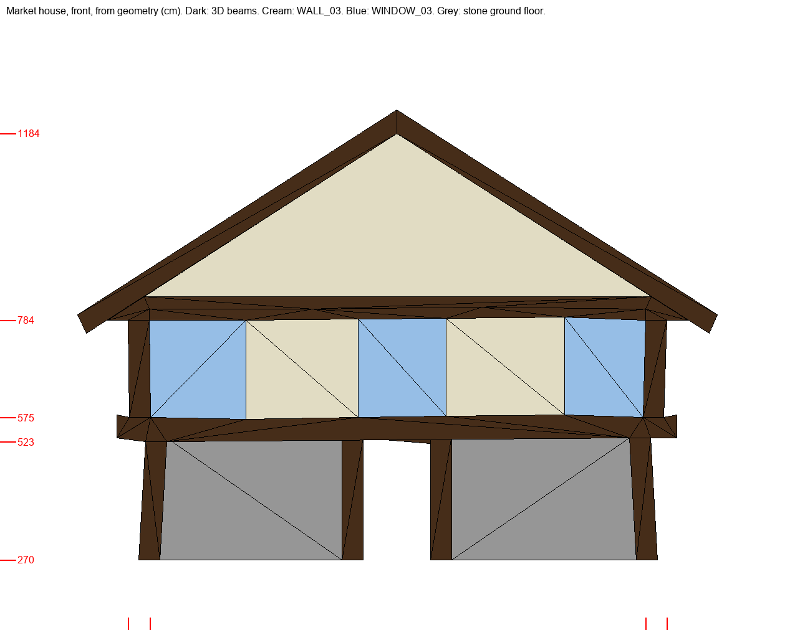

# Дом у рынка: концепция здания

Черновик 21 октября 2026, ждёт решения пользователя. Пилот качества 3 сделал материалы по одной текстуре с числами и потерял дом (вердикт пользователя: «нет единой концепции, текстуры налепленные на стену»). Здесь сначала описано здание, а текстуры выводятся из него. Оригинал служит для понимания, как дом устроен; его пиксели генератор не получает.

Размеры взяты из геометрии фасада (`texture-intent/market-house-measurement.json`, сантиметры игры). Тёмное — объёмные балки (`WOODBEAM_02`), кремовое — `WALL_03`, голубое — `WINDOW_03`, серое — каменный низ.

## Что это за дом

Дом торговца у рынка, ему лет восемьдесят. Внизу каменная лавка и склад: камень не боится сырости и огня. Наверху жилой этаж в дубовом каркасе, под крышей чердак для товара. Хозяин дом бережёт и раз в несколько лет обновляет побелку. Но портовая сырость и дым из труб каждый раз берут своё: дом чистый, хотя и не новый.

## Как построен

| Часть | Как устроена | Размер, см |
|---|---|---|
| Нижний этаж | бутовый камень на известковом растворе, внизу два ряда крупного тёсаного камня; посередине дверной проём; маленькое окно в каменном обрамлении | высота 265, отступ 40 под выносом |
| Стойки нижнего этажа, угловые стойки | дуб, объёмная геометрия | 45 |
| Поясная балка | один массивный дубовый брус, на нём верхний этаж выступает вперёд на 40 | 52 |
| Верхний этаж | дубовый каркас, пять полей слева направо: окно ≈200, стена ≈240, окно ≈190, стена ≈250, окно ≈175 | высота 210, ширина 1055 |
| Промежуточные стойки, нижние и верхние ригели полей | нарисованы в текстурах; на каждом краю текстуры половина стойки, на стыке двух полей получается одна стойка | 8 на краю текстуры, 16 на стыке |
| Подкосы | в каждом поле стены два коротких подкоса в нижних углах: от стойки на ~40% высоты вниз к нижнему ригелю ~25% ширины от края | 14 |
| Окно | небольшой проём в своей раме: перемычка, два косяка, подоконник; над перемычкой полоса штукатурки; по бокам окна стена; закрытая двустворчатая дощатая ставня на кованых петлях | проём ≈90 × 80, рама 10–12 |
| Фронтон | ещё один вынос на 70; тот же язык каркаса, нарисованный в `WALL_03` с повтором ~5,4 раза: стойки через ~250, средний ригель, пары подкосов; стропила — объёмная геометрия | 1368 × 400 |
| Крыша | деревянный гонт | — |

Главное правило: объёмное дерево тяжёлое (45–52 см), нарисованное лёгкое (стойки 16, подкосы 14, рама окна 10–12). Нарисованное не повторяет объёмное: где у геометрии уже есть балка, текстура её не рисует. Раз `WALL_03` одновременно и поле этажа, и весь каркас фронтона, края текстуры несут ровно половину стойки.

## Из чего сделано и как стареет

- **Дерево.** Дуб, тёмный серо-коричневый. Грани, на которые льёт дождь, выцветают до серебристо-серого. Вдоль волокон глубокие трещины усыхания, торцы темнее; в узлах круглые деревянные нагели. Нарисованное дерево того же тона и волокна, что объёмные балки.
- **Заполнение.** Плетень из прутьев, обмазанный глиной с соломой, сверху известковая штукатурка и побелка. Поверхность заглажена вручную: матовая, чуть волнистая, без «кракелюра» и узора. Старение:
  - мягкие облачные серо-зелёные пятна сырости идут от верха каждого поля, куда с балки стекает вода;
  - зелёный налёт в верхних углах;
  - тонкая тёмная щель там, где штукатурка усохла и отошла от дерева;
  - редкие небольшие места, где побелка облетела и видна серо-охристая обмазка;
  - внизу полей брызги грязи.

  Пятна крупные и мягкие, не крапины.
- **Камень.** Серо-бурый бутовый камень неровными рядами, швы раствора утоплены и темнее, у земли сырость и зелень.
- **Ставни и рамы окон.** То же дерево, доски вертикальные, железо тусклое, ржавые потёки под петлями.

Светлее всего на доме штукатурка, но не белая: средне-светлая серо-кремовая, средний цвет `WALL_03` ≈ `#8c8b77`. Дерево очень тёмное, камень средне-тёмный.

## Концепт фасада

Два вызова `image_gen` по тексту выше в чистом треде; вторая попытка исправила штукатурку: была мелкая «лишайниковая» крапина, стала гладкая с мягкими пятнами. [Попытка 1](facade-concept-attempt-1.jpg). Исходные PNG и точные промпты лежат в `content-sources/market-house-concept/`, копия на dev-ubuntu.

Что концепт задаёт для текстур: одно дерево на объёмных балках и на нарисованных стойках, тонкие стойки и подкосы рядом с тяжёлыми поясом и углами, маленькие окна в своей раме со стеной вокруг, гладкую побелку с мягкой сыростью сверху полей, бут с крупным камнем внизу.

Что игра так показать не сможет:
- **Фронтон.** В игре это одна грань, по которой `WALL_03` повторяется ≈5,4 раза по ширине и 1,7 по высоте (поле ≈250 × 235 см). Своего рисунка с ригелем и V-подкосами у него быть не может: фронтон в игре — ряды тех же полей стены, срезанные скатами. Рисунок поля надо выбирать так, чтобы и повтор на фронтоне выглядел каркасом.
- **Дверь, кронштейны под поясом, гонт на скатах.** Это отдельная геометрия или другие текстуры; концепт показывает их только для цельности дома.

## Как отсюда получатся текстуры

1. Концепт фасада: одно изображение `image_gen` только по тексту этой концепции, в чистом треде. Пользователь правит или принимает.
2. Текстуры дома выводятся из принятого концепта в том же треде, как правки его изображения: `WALL_03`, `WINDOW_03`, `FACHWERKBASEMENT_*`, `WOODBEAM_02`. У всех одна штукатурка, одно дерево, одна грязь.
3. Средний цвет и пределы детали служат только ограничителями. Подгонка детали больше не усиливает картинку к цели.
4. Приёмка в игре глазами по концепту: читается ли стена как побелённая штукатурка, окно как окно, а дерево как один каркас.
