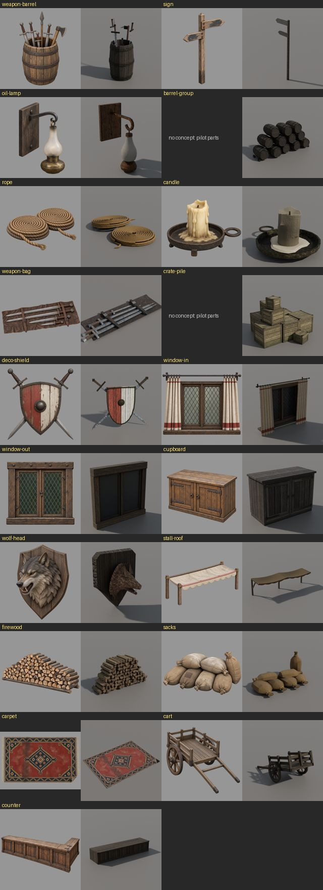
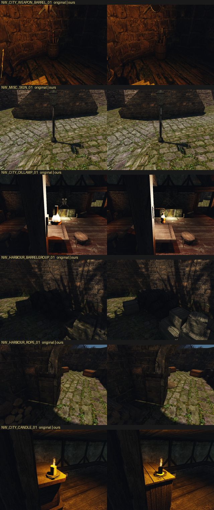
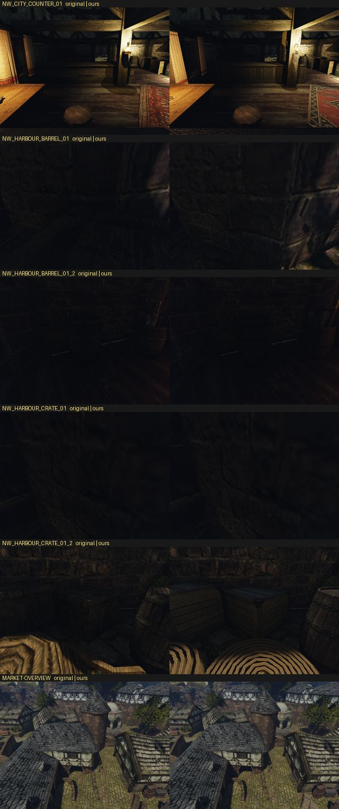

# Набор рынка Хориниса: первый цельный набор этапа 2

20 октября 2026 года. Первый набор этапа 2 [плана своего контента](../../../docs/own-content.md#этап-2-предметы-и-постройки): 21 визуал, которые закрывают 80% предметов района рынка `NW_CITY_MERCHANT`. Это 136 из 170 vob района по [переписи мешей](../2026-10-world-meshes/README.md). Сначала перепись предложила район канала, но это канализация под городом; пользователь заменил его рынком (#328).

Все модели построены по скиллу [`blender-3d`](../../../.claude/skills/blender-3d/SKILL.md):
- оригинал → задумка словами и числами;
- концепт `image_gen` только по тексту, в отдельном треде Codex;
- модель по частям в Blender;
- свой атлас из плиток этапа 1 в цвете замеров оригинала;
- проверка в игре.

Нейросети-генераторы 3D не использовались. Пиксели и вершины оригинала не попадали ни в `image_gen`, ни в Blender. Из оригинала брались только числа: bbox, происхождение, число треугольников, средний цвет текстур и отдельные габариты частей. Ещё смотрели на снимки в игре.

Набор лежит вне рабочей папки контента и по умолчанию не включён. Включение решает пользователь.



Слева — концепт `image_gen`, справа — модель со своим атласом. У группы бочек и кучи ящиков своего концепта нет: это облегчённые бочки и ящики, построенные своим кодом (`barrel_group.py`, `crate_pile.py`) по образцу бочки и ящика пилота.



## Кто что строил

- **Ведущая сессия** («Этап 2: свои статичные меши в glTF»), 13 предметов: тележка, группа бочек, куча ящиков, ковёр, канаты, поленница, свеча, лампа, щит со скрещёнными мечами, мешки, бочка с оружием, связка клинков, голова волка.
- **Сессия «Рынок: мебель и окна в Blender»**, 6 предметов: шкаф, прилавок, окно с улицы, окно изнутри со шторами, указатель, навес прилавка. Её заметки по каждому предмету — в общей папке сессий `market-set/<item>.md`.
- **Бочка `NW_HARBOUR_BARREL_01` и ящик `NW_HARBOUR_CRATE_01`** — пилот ([бочка](../2026-10-barrel-from-concept/README.md), [ящик](../2026-10-crate-from-concept/README.md)). В набор они входят своими пакетами без изменений.

## Предметы

`NW` — экземпляры в Хоринисе, `рынок` — в районе. Треугольники — у оригинала и у нас (бюджет из цели).

| Предмет | Визуал | NW / рынок | Треуг. оригинал → наш (бюджет) | Атлас, покрытие | Что лучше оригинала |
|---|---|---:|---|---|---|
| тележка | `NW_CITY_CART_01` | 40 / 2 | 760 → 1528 (3000) | 2048, 26% | дощатое дно со щелями, перила на стойках, колёса со спицами, ступицей и шиной, оглобли на земле, железные уголки |
| группа бочек | `NW_HARBOUR_BARRELGROUP_01` | 55 / 6 | 660 → 5760 (6000) | 2048, 22% | пирамида 5-4-3 лежащих бочек: клёпки отдельными частями, четыре обруча, утопленные днища, клинья |
| куча ящиков | `NW_HARBOUR_CRATEPILE_01` | 132 / 5 | 135 → 5112 (6000) | 2048, 17% | девять ящиков разного размера, рамки, утопленные доски, уголки, мох |
| ковёр | `NW_CITY_CARPET_03` | 32 / 2 | 50 → 480 (600) | 2048, 76% | свой рисунок (вид сверху своего концепта), бахрома, загнутый угол |
| канаты | `NW_HARBOUR_ROPE_01` | 47 / 6 | 177 → 3880 (4000) | 2048, 14% | две бухты каната по спирали, вторая лежит на первой, концы |
| поленница | `OC_FIREWOOD_V3` | 12 / 3 | 438 → 1968 (3000) | 2048, 28% | 90 поленьев (кругляк, половинки, четвертинки), кора, торцы с кольцами вокруг сердцевины |
| свеча | `NW_CITY_CANDLE_01` | 157 / 5 | 124 → 1394 (1600) | 1024, 35% | железная плошка на ножках с кольцом, толстая свеча, потёки, лужица воска |
| лампа | `NW_CITY_OILLAMP_01` | 223 / 9 | 138 → 970 (1000) | 1024, 59% | дощечка, кованый кронштейн с завитком, латунный резервуар, стекло-«груша» |
| щит со скрещёнными мечами | `NW_CITY_DECO_SHIELD_01` | 46 / 4 | 326 → 408 (1500) | 1024, 72% | щит из четырёх досок, окрашенный в две половины без герба, обод и умбон, мечи за щитом |
| мешки | `OC_SAECKE_01` | 98 / 3 | 252 → 2268 (2500) | 2048, 47% | семь мешков с перевязанными горловинами |
| бочка с оружием | `NW_CITY_WEAPON_BARREL_01` | 36 / 15 | 1048 → 784 (3000) | 1024, 45% | открытая бочка с ободом, три меча, короткий меч, топор и копьё |
| связка клинков | `NW_CITY_WEAPON_BAG_01` | 27 / 5 | 366 → 552 (1500) | 1024, 44% | кожаная обёртка, четыре клинка, ремни с пряжками |
| голова волка | `NW_CITY_DECO_WOLFHEAD_01` | 31 / 3 | 174 → 524 (2500) | 1024, 62% | щит-табличка из трёх досок, голова с открытой пастью, клыки, уши, грива |
| шкаф | `NW_CITY_CUPBOARD_POOR_02` | 89 / 3 | 112 → 924 (2000) | 2048, 41% | см. заметку сессии |
| прилавок | `NW_CITY_COUNTER_01` | 10 / 2 | 199 → 1384 (2500) | 2048, 22% | каркас с досками, полки со стороны продавца, откидная крышка |
| окно с улицы | `NW_CITY_WINDOW_WOOD_OUT_01` | 43 / 4 | 70 → 404 (1200) | 2048, 64% | рама, две створки с ромбовидным переплётом |
| окно изнутри | `NW_CITY_WINDOW_WOOD_IN_01` | 63 / 4 | 176 → 1740 (2000) | 2048, 36% | рама, переплёт, штанга и две шторы со складками |
| указатель | `NW_MISC_SIGN_01` | 54 / 11 | 36 → 82 (1000) | 1024, 20% | доска-указатель на столбе |
| навес | `NW_CITY_MARKETSTALL_ROOF_01` | 7 / 3 | 278 → 2288 (2500) | 2048, 36% | полотно на столбах с подкосами, верёвки |

На 95 экземплярах этих 19 визуалов в районе рынка треугольников стало 155 тыс. вместо 34 тыс.


## Как сделано

- **Цели.** `scripts/content/mesh3d/market_targets.py` → `data/content/mesh3d-market.json`: bbox в метрах glTF, начало координат, треугольники и копии оригинала, бюджет, зоны материалов. Тот же декодер и та же запись, что у пилота (`measure_targets.py`).
- **Снимки оригиналов** сделаны на Ryzen сценарием с камерой у каждой копии в районе. Для этого `scripts/meshes/world-meshes.cpp` дописали в рабочей копии так, чтобы он выводил позиции; в репозиторий эта правка не вошла.
- **Концепты.** 41 изображение `image_gen`, 17 предметов. Брифы — только текст: части, их число, размеры в метрах и общий абзац стиля. Каждый предмет — отдельный тред Codex в пустой папке. Регистрация — `market_concepts.py` (записи `mesh3d-market-<item>-v1-<вид>`), исходники сверены с копией на dev-ubuntu.
- **Плитки** (`market_tiles.py`, спецификации `market-tiles-*.json`):
  - семь новых плиток своим `image_gen` по тексту: мешковина, парусина, канат, мех, кора, торец полена, кожа (записи `mesh3d-market-tile-*`);
  - процедурные воск, стекло и кость без `image_gen`;
  - дерево и железо — копии плиток пилота;
  - панель ковра — прямоугольник, вырезанный из нашего же концепта.

  Плитка задаёт рисунок и рельеф. Цвет каждой зоны атлас приводит к замеренному среднему цвету оригинала.
- **Модели** — `scripts/content/mesh3d/blender/<item>.py` с настройками `<item>.json` на общем `parts.py`.
- **Атлас** — общий `bake_atlas.py` с `<item>-atlas.json`. После исправления #334 у каждой грани свой материал, звук и физика, а нижние грани получают усиление своей зоны. Весь набор перепечён на Ryzen в очереди `gq batch`.
- **Сторона.** У настенных предметов (лампа, щит, голова волка, окна, шкаф, прилавок) лицо смотрит в +Y Blender (glTF −Z), стена — с −Y. Щит сначала был построен зеркально и в игре утонул в стене. Теперь он отражается в конце сборки.
- **Пакет** — `pack_prop.py` для каждого предмета, `market_pack.py` сводит пакеты в один корень `OPENGOTHIC_CONTENT`: `~/.local/share/gothic-ai/content-staging/market-set/content`, 21 меш.

## Проверка в игре

Сценарий [`own-mesh-market.bench`](../../../scripts/bench/own-mesh-market.bench) на Ryzen (3950X / RTX 3080, 800×600):
- по кадру на визуал с копией в районе;
- перепись;
- кадр рынка сверху;
- 30 секунд обычного темпа кадров.

Два прогона на одной сборке — `OPENGOTHIC_CONTENT=` (оригинал) и с корнем набора.

- **Перепись.** С набором заменены все 21 меш, и ни один из этих 21 оригинальных `.MRM` не открыт. Без набора открыты все 21 оригинал, замен нет.
- **FPS** на Ryzen не изменился. В тихом классе `gq` (`RYZEN_BENCH_CLASS=quiet`) без набора 148,2, с набором 148,0, по 30 с. Прогоны в обычном классе разбросаны от 100 до 153 из-за соседних задач на машине. Замер на Mac (M1 Pro) — отдельная задача.




## Что осталось слабым

- **Бочка с оружием.** Клинки и рукояти тоньше и темнее, чем у оригинала, у которого крупные пёстрые рукояти. Головки топора и копья маленькие.
- **Лампа** заметно меньше оригинального светящегося шара: стекло — узкая «груша», как на концепте. В интерьере свет читается слабее.
- **Свеча.** Потёки едва видны. Это вторая неудачная попытка, по правилу скилла остановились.
- **Голова волка** проще концепта: нет глаз и чёрного носа, мех в замеренном коричневатом цвете оригинала.
- **Канаты.** Сечение пятигранное, на атласе около 2 пикселей на сантиметр: пряди с близи размыты. Бухты ниже bbox оригинала на 11 см.
- **Куча ящиков** светлее оригинала, хотя средний цвет совпадает. У оригинала тёмный мох и зелень.
- **Мешки** короче bbox оригинала в глубину на 40 см.
- **Окно с улицы:** стекло тёмное, как у замера оригинала, и переплёт издали не читается.
- Кадры **указателя и прилавка** на стенде мало что показывают: копии стоят у фонарного столба и в тёмной лавке.

## Как повторить

Шаги для одного предмета `<item>`:

```sh
BL=/Applications/Blender.app/Contents/MacOS/Blender
ST=~/.local/share/gothic-ai/content-staging/market-set
$BL -b --factory-startup -P scripts/content/mesh3d/blender/<item>.py -- scripts/content/mesh3d/blender/<item>.json $ST/build/<item>
$BL -b --factory-startup -P scripts/content/mesh3d/blender/bake_atlas.py -- scripts/content/mesh3d/blender/<item>-atlas.json $ST/build/<item>/atlas
uv run --offline --no-project --with numpy --with pillow python scripts/content/mesh3d/pack_prop.py --bake $ST/build/<item>/atlas --visual <VISUAL> --name market-<item> --output $ST/packs/<item>
python3 scripts/content/mesh3d/market_pack.py --output $ST/content $ST/packs/*
```

Проверка в игре:

```sh
BENCH_HOST=ryzen WORLD=NEWWORLD.ZEN OPENGOTHIC_CONTENT=$ST/content OPENGOTHIC_CENSUS=<abs out>/census.json scripts/bench.sh own-mesh-market <abs out>
```

Плитки перед запеканием:
1. `market_tiles.py --spec scripts/content/mesh3d/blender/market-tiles-base.json`;
2. `market-tiles-imagegen.json` — новые плитки и панель ковра из сохранённых исходников `content-sources/mesh3d-market/tile-*.png` (при первом импорте был `--import-sources`);
3. `market-tiles-procedural.json`;
4. `market-tiles-derived.json`.
