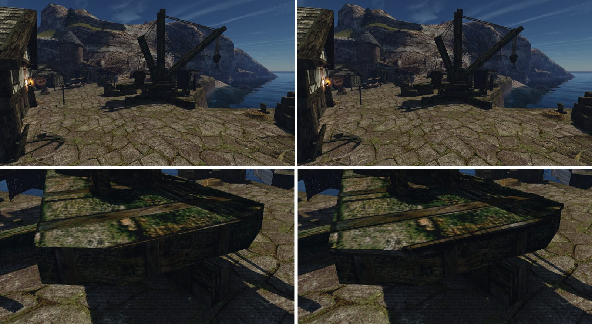

# Настил портовых кранов

Шаг М2 [плана проработки мира](../../../../docs/world-detail-plan.md#план-выполнения), пункт «кромки настилов кранов», 2026-10-30. Лист замысла — [intent.md](intent.md), исполнение — [concept.md](concept.md). Не включено: ждёт приёмки и ворот пользователя по кварталу.

## Почему краны

Деревянных причалов в порту нет: набережная и пирс к кораблю каменные. `HARBOUR_WOOD_IRON_01` («доски с железом») лежит в порту на четырёх деревянных кранах; самая заметная его часть — дощатый настил крана. Его кромку и накладки и сделали. Ведущая сессия подтвердила замену 2026-10-30; силуэт и размеры кранов не меняются, это главная деталь.

## Что сделано

[`crane_deck.py`](../../../../scripts/content/world/crane_deck.py) — правка М1 на кусках четырёх кранов:
- доски выходят на 3 см за бок плиты, толщина 8 см, под ними тень; на торцах доски расходятся на 2 см по нарисованным швам и выступают каждая по-своему (ещё 0–1,5 см); углы закрыты клином;
- четыре нарисованные накладки поднялись на 2 см над досками и загибаются через кромку.

Настилы A и B лежат через границу кусков: правка читает их из соседних кусков базы через новое `ctx.base_chunks` инструмента М1.

Набор — `harbour-volume-1`: части `working-8` и `cranedeck-1`.

## Цена

| Кусок | Настил | До | После | Δ треугольников |
|---|---|---:|---:|---:|
| `NEWWORLD/-2_-2` | A | 7 099 | 7 611 | +512 |
| `NEWWORLD/-2_-3` | край B | 15 457 | 15 617 | +160 |
| `NEWWORLD/-2_-4` | B | 898 | 1 242 | +344 |
| `NEWWORLD/-1_-1` | C | 1 301 | 1 813 | +512 |
| `NEWWORLD/-1_0` | D | 1 556 | 2 068 | +512 |

Время кадра: Ц1 на порту для трёх правок М2 вместе (`working-8 → harbour-volume-4`) — Δ p95 −0,05 %, в шуме, +16 тыс. треугольников на кадр (+1,3 %) ([отчёт](../../../performance/2026-10-30-content-cost/working-8-vs-harbour-volume-4/report.md)).

## Приёмка

Пакеты слепых пар `lightfix-1 | наше`, порядки `order-1` и `order-2` (вне git):
- `~/.local/share/gothic-ai/remaster/harbour-crane-deck/reviews/r3l-crane-far/`
- `~/.local/share/gothic-ai/remaster/harbour-crane-deck/reviews/r3l-deck-mid/`
- `~/.local/share/gothic-ai/remaster/harbour-crane-deck/reviews/r3l-deck-close/`

Кадры: `~/.local/share/gothic-ai/remaster/harbour-crane-deck/captures/{original,harbour-volume-1}/`. Камера `crane-a` (кран A у корабля) снята, но настил там в тени корабля — пакета по ней нет.

## Доработка после первой приёмки (2026-10-30)

По пунктам сохранения настилы прошли во всех шести вердиктах, свойство P1 «торцы досок видны» вблизи — нет у всех трёх рецензентов: торец кромки нёс полосу доски, растянутую по высоте в холодные вертикальные штрихи, а в 6,6 см от срезанного угла был прорезан шов. Теперь у граней кромки своя развёртка (бок — доска в масштабе, торец — сжатая доска), концы досок разведены на 2 см и выступают по-своему, у углов швов нет. Пары сняты против `working-8`.

## Что спорно

- Накладки: по имени текстуры — железо, по рисунку — бурые полосы с гвоздями. Объём 2 см читается и так и так; цвет нарисованный.
