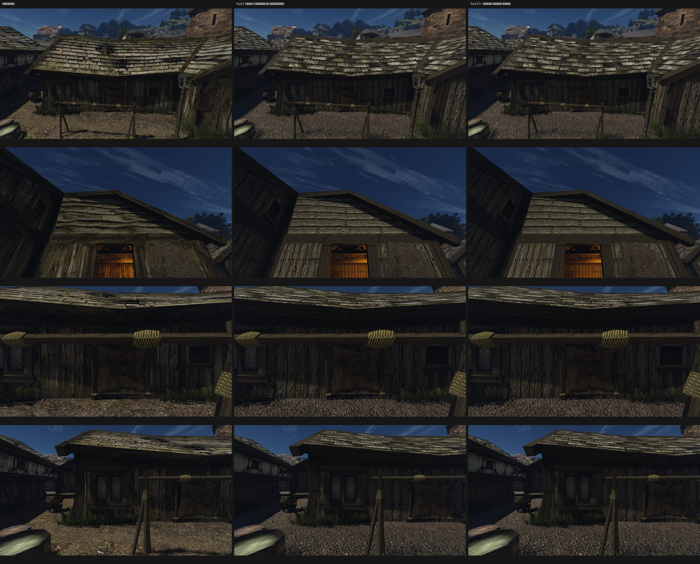

# Хижина бедного квартала порта

Ассет [конвейера ремастера](../../../../docs/remaster-pipeline.md), блок B037. В этой папке:
- [лист замысла](intent.md), [концепция](concept.md), [журнал решений](decisions.md);
- спецификация сборки `build.json`, манифест `asset.json` (исходники с SHA-256 и C2PA, выбор, вердикты, ворота);
- вердикты рецензента в `reviews/`.

## Наборы

| Набор | Что в нём | Итог |
|---|---|---|
| `hut-1` | доски, большое свинцовое окно, нарисованное в текстуре `HOLZWAND_02`, фронтон из досок с корой | Ошибка замысла. Большое окно оригинала — модель `NW_CITY_WINDOW_WOOD_OUT_01`, текстура несёт маленький тёмный проём. В игре вместо бедного проёма вышло второе нарядное окно |
| `hut-2` | маленький проём, как в оригинальной текстуре, на тех же досках, что `HOLZWAND_01`; фронтон из восьми рядов гладких досок | Рецензент Р3, три кадра, оба порядка: отказ (ниже) |
| `hut-3` | `hut-2`, рельеф досок и фронтона ×0,35 (`relief` в `build.json`) | Доски перестали читаться корой. Рецензентом не проверен |

Все три набора собраны поверх `house-2`: 58 записей, 4 замены, остальные 54 записи совпадают побайтно. Источники — 18 PNG, все сгенерированы одной моделью: C2PA «ChatGPT gpt-image».

## Рецензент о hut-2

| Кадр | Вердикт | Что решило |
|---|---|---|
| Длинная сторона | REJECT | Доски ровнее и одной ширины, гвозди ровными рядами. Угловая стойка читается корой и светлее досок (`WOODBEAM_02` из house-2). На крыше втрое меньше мха, нет провалов, у гонта другой масштаб (`ROOF_01`) |
| Фронтон вблизи | REJECT | Кромки досок почти прямые (rms шва 1,1–2,1 px против 3,2–4,6 у оригинала), доски читаются корой, фронтон светлее. На стыке с ветровой доской светлый пунктир |
| Стена у окна | REJECT | Доски на 34–40% шире оригинала, повторяется одинаковая накладка, внизу бугристый рельеф. Мха у нас больше, это в нашу пользу (см. ниже) |

Пары в обоих порядках дали одинаковый итог. Окно-проём на месте и нужного размера: пункты 1, 2, 2a и 2b пройдены.

## Что дальше

1. **Доски стены.** Узкие, около 13 на 3 м, неровной ширины, гвозди не сеткой. Повторяющиеся детали вроде накладок убрать: на повторе текстуры они видны дважды.
2. **Фронтон.** Волнистая кромка с обзолом, как у попытки 1, но гладкие лица досок, как у попытки 4. Мха больше, с тёмными пятнами, как у оригинала. Рельеф ×0,35.
3. **Общие текстуры — решение пользователя.**
   - Кровля `ROOF_01` и балка `WOODBEAM_02` общие с домом у рынка и половиной города. Сделать их как в оригинале (замшелая кровля с провалами, тёмный тёсаный брус) значит поменять и принятый house-2.
   - Тот же вопрос у большого окна: это модель (этап 2), своя `window-out` есть в наборе рынка.
4. **Конвейер.** Пункт «мха не меньше» должен быть направленным: «нет» засчитывается, только если меньше у нас. Сейчас симметричный пункт ловит и обратное.
