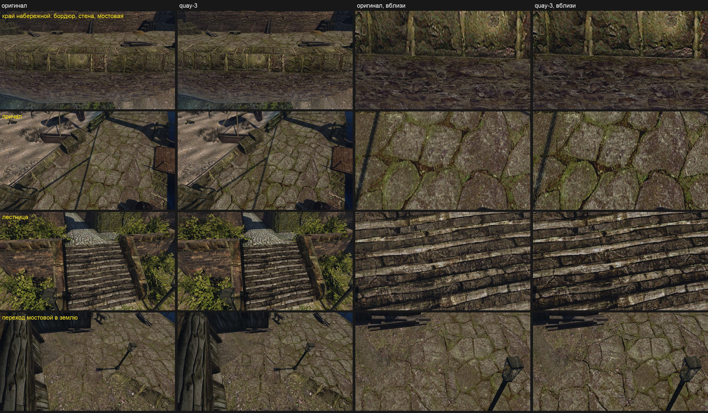

# Набережная порта

Ассет [конвейера ремастера](../../../../docs/remaster-pipeline.md) и первый пилот режима **Texture Only** (2026-10-24). Форма оригинальной текстуры верна, улучшается только ремесло: каждая из семи текстур — правка оригинала в `image_gen`, обработанная [`edit_texture.py`](../../../../scripts/content/edit_texture.py). Вход для генератора и бриф готовит [`texture_only.py`](../../../../scripts/content/texture_only.py). В этой папке:
- [лист замысла](intent.md), журнал решений `decisions.md`;
- спецификация сборки `build.json`, манифест `asset.json`;
- вердикты рецензента в `reviews/`.

## Как прошло

| Шаг | Что | Время |
|---|---|---|
| Оригиналы и обмер | `original_view.py` по семи текстурам; период UV, площадь и что нарисовано — из таблицы города | минуты |
| Входы и брифы | `texture_only.py prepare`: квадраты как есть, полосы (бордюр 8:1, брус 4:1) нарезаны и сложены в холст генератора | секунды |
| Правки | 14 вызовов `image_gen` параллельно, по два варианта; раскладку держат все | ≈ 10 минут |
| Отбор | сам, по листу и кропам: вариант 1 перехода добавил плит в землю, взят вариант 2 у всех | минуты |
| Обработка и сборка | `texture_only.py assemble`, `edit_texture.py`, `building_set.py build` | минуты |
| Съёмка | Mac, сценарий [`harbour-quay.bench`](../../../../scripts/content/harbour-quay.bench) из камер `city-intent.bench` | 2 минуты на набор |
| Рецензент Р3 | 5 ракурсов × 2 порядка, затем 2 × 2 на исправленном наборе | ≈ 2 минуты на вердикт |

## Наборы

| Набор | Что изменено | Итог |
|---|---|---|
| `quay-1` | семь правок, рельеф как у `market-15` | Р3: все пять ракурсов прошли или спорны только по оригиналу. Материал у нас лучше во всех десяти вердиктах. Наши изъяны: чешуйчатая рябь карты нормалей в тени, красная кайма в тёмных швах стены, сотовый узор на траве перехода |
| `quay-2` | рельеф от формы ≈ 2,5 см, его мельчайшая полоса сглажена на 1 см; в тёмных пикселях оригинала оттенок крупного пятна | рябь ушла, кайма почти та же |
| `quay-3` | оттенок читается не мельче половины пикселя оригинала | красных пикселей на стене в кадре 3,8% против 2,9% у оригинала и 8,4% у `quay-1`. Р3 бордюра: отказ в одном порядке — волнистые штрихи на подпорной стене `MAUER` |

Красная кайма шла не от правки: оригинал 512 px растягивался в 2048 по Ланцошу, а оттенок брался почти попиксельно и рисовал цветной звон фильтра вокруг каждого шва.

## Рецензент

| Ракурс | `quay-1` | `quay-3` | Что решило |
|---|---|---|---|
| Причал | PASS / REJECT — спорно | — | Отказ по оригиналу: мха меньше у него, пункт 3 симметричный |
| Край набережной | PASS / PASS | REJECT / PASS — спорно | `quay-3`: волнистые штрихи на `MAUER` — узор самой правки генератора |
| Переход в землю | PASS / PASS | PASS / REJECT — спорно | Отказ по оригиналу: мыльный, мха меньше |
| Лестница | PASS / PASS | — | Ступени резче, тон в пределах 1% |
| Брус с железом | PASS / PASS | — | Волокно чётче, у оригинала мыльное |

Детали в кадре (стандартное отклонение мелкой яркости) у нас на 4–21% больше, средний цвет текстур — в 1–5 единицах sRGB от оригинала, доля мха та же.

## Что вынесли

- **Режим работает.** Семь текстур от оригинала до проверенного набора — за один заход, без рисования раскладки. Рецензент вслепую называет материал нашим лучше в каждом вердикте.
- **Прибавка скромная.** В игре на этих дистанциях отличие видно в основном вблизи. Больше всего — у бордюра, ступеней и бруса, у которых оригинал мыльный.
- **Генератор рисует свой узор.** Траву — червячками, бут — волнистыми штрихами. Обработка убирает его из рельефа, но не из света, поэтому такую текстуру надо переделывать правкой.
- **Симметричный пункт «мха поровну?»** дважды дал отказ по оригиналу. Пункт должен быть направленным, как и записано у [хижины](../harbour-hut/README.md).

## Не сделано

- Не включено в рабочий контент: это решение пользователя.
- `MAUER_01`: волнистые штрихи правки — нужна новая правка (другой бриф или второй генератор).
- Второй генератор Qwen-Image-Edit на Ryzen: Ryzen 2026-10-24 не отвечал по ssh.
- Полосы `HAFENRANDSTEIN_01` и `HARBOUR_WOOD_IRON_01` упакованы квадратом 2048: `pack_materials.py` и запись DDS умеют только квадрат.
- Рецензенты Р1 и Р2: концептом в этом режиме служит сам оригинал.
