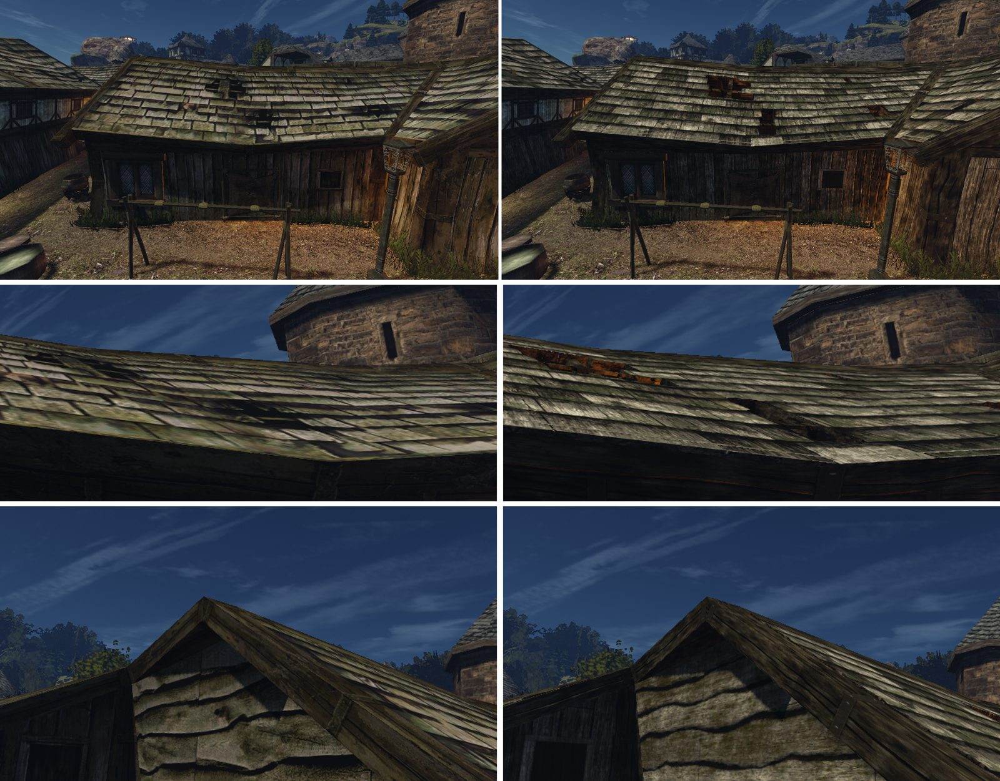

# Кромка гонтовой кровли хижин порта

Шаг М2 [плана проработки мира](../../../../docs/world-detail-plan.md#план-выполнения), 2026-10-30. Лист замысла — [intent.md](intent.md), исполнение — [concept.md](concept.md). Не включено: ждёт приёмки и ворот пользователя по кварталу.

## Что сделано

[`roof_edge.py`](../../../../scripts/content/world/roof_edge.py) — правка М1 на кусках хижин B031, B035–B037:
- **карниз:** каждая гонтина нижнего ряда — свой брусок со своим неровным торцом, на швах и линии торцов `roofs-8` (раскладка — тот же бейк, [`roof01-shingles.json`](../../../../data/content/world/roof01-shingles.json)); толщина 2,2–3,2 см по бейку, вылет за лобовую доску 3–6 см, под ними стартовый ряд 1,8 см со швами вразбежку;
- **фронтон:** торцы рядов пилой над ветровой балкой, вылет 2,5–4,5 см;
- торцы — затемнённая балка стенок провалов, верх — сам гонт.

На первой съёмке кромка читалась светлой новой планкой. Причина — не торцы: квадрат `roofs-8` по V кончается коньковой доской, и на карнизе (V 1,013–1,021) её полоска видна на 5–9 см. Теперь торцевые гонтины лежат поверх неё, а торцы — тёмным торцевым волокном. Пакеты собраны со второй съёмки.

Набор — `harbour-volume-2`: части `working-8`, где `roofholes-2` заменён на `roofedge-1`. Кусок `0_-1` в нём — провалы и кромка вместе, по реестру.

## Цена

| Кусок | До | После | Δ треугольников |
|---|---:|---:|---:|
| `NEWWORLD/0_-1` | 13 360 (с провалами) | 17 268 | +3 908 |
| `NEWWORLD/0_0` | 11 301 | 18 099 | +6 798 |

Время кадра — общий замер трёх правок М2 в журнале плана.

## Приёмка

Пакеты слепых пар, порядки `order-1` и `order-2` (вне git):
- `~/.local/share/gothic-ai/remaster/harbour-roof-edge/reviews/r3-front/`
- `~/.local/share/gothic-ai/remaster/harbour-roof-edge/reviews/r3-eave-close/`
- `~/.local/share/gothic-ai/remaster/harbour-roof-edge/reviews/r3-verge-close/`
- `~/.local/share/gothic-ai/remaster/harbour-roof-edge/reviews/r3-huts-east/`

Кадры: `~/.local/share/gothic-ai/remaster/harbour-roof-edge/captures/{original,harbour-volume-2}/`.

## Что спорно

- Пункт 4 списка (тон и мох гонта) сравнивает оригинальную текстуру с `roofs-8`, она уже в `working-8`; разница не от этой правки.
- Коньки не тронуты: там нарисована коньковая доска.
