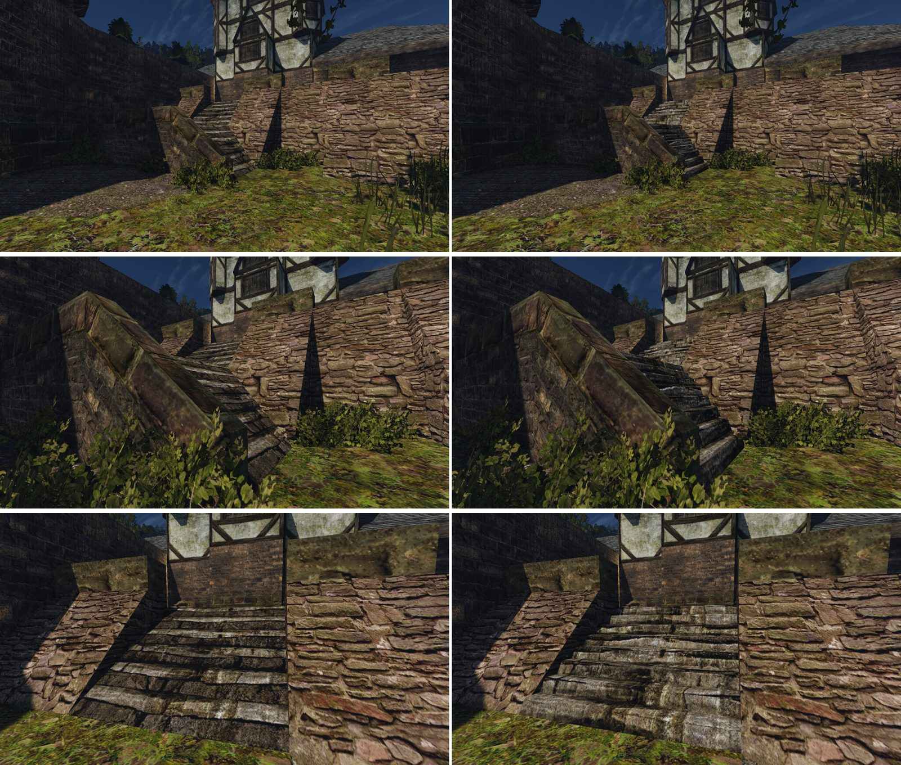

# Лестница от порта к казармам

Шаг М2 [плана проработки мира](../../../../docs/world-detail-plan.md#план-выполнения), пункт «лестница к казармам (`HARBOUR_STAIRS_01`, кусок 0_0)», 2026-10-30. Лист замысла — [intent.md](intent.md), исполнение — [concept.md](concept.md). Способ — [первой лестницы порта](../../2026-10-harbour-stairs/README.md). Не включено: ждёт приёмки и ворот пользователя по кварталу.

## Почему эта лестница

`HARBOUR_STAIRS_03` в порту нет: он стоит только у портала храма в землях троллей, вне квартала. Ведущая сессия 2026-10-30: имя в плане — ошибка; делать пандус `HARBOUR_STAIRS_01` у `NW_CITY_HABOUR_KASERN_07` тем же способом и с той же высотой и глубиной ступеней, что `stairs-3`.

Другие пандусы `HARBOUR_STAIRS_01` без ступеней в порту (не сделаны): кусок `0_0` у `NW_CITY_HABOUR_KASERN_19` (13 м²), кусок `1_0` у `NW_CITY_HABOUR_KASERN_20` (13 м²), кусок `0_-1` в секторе кузницы `S:SCHMIED` (3 м²).

## Что сделано

[`harbour_stairs_kasern.py`](../../../../scripts/content/world/harbour_stairs_kasern.py): два марша по 8 настоящих ступеней вместо пандусов, фаска 4 см, нижний марш — трапеция, как у оригинала. Подступенок 28,1 см — ближайший к первой лестнице (26,7) при подъёме марша 2,25 м; проступь 36–45 см (у первой 33,3): вынос марша — оригинала. Нарисовано 6 ступеней на марш, поэтому каждая ступень берёт один нарисованный период. Подступенок берёт светлую полосу камня: нарисованную тень с него сняли (урок первой лестницы).

Набор — `harbour-volume-3`: части `working-8` и `stairskasern-1`.

## Ходьба

[`harbour-stairs-kasern-walk.bench`](../../../../scripts/content/harbour-stairs-kasern-walk.bench), Ryzen, шагом по точкам `KASERN_06 → 07 → 08` и обратно:

| Точка | Оригинал (пандус) | Наше (ступени) |
|---|---|---|
| двор | 1871 300 4609 | 1871 300 4609 |
| площадка | 1709 525 5426 | 1616 525 5590 |
| верх | 2218 750 5798 | 2371 750 5858 |
| обратно на площадку | 1515 525 5303 | 1612 525 5375 |
| обратно во двор | 2006 300 4348 | 1968 300 4326 |

Высоты те же: ступени по 28,1 см с наклонёнными подступенками герой проходит вверх и вниз.

## Цена

| Кусок | До | После | Δ треугольников |
|---|---:|---:|---:|
| `NEWWORLD/0_0` | 11 301 | 11 393 | +92 |

Время кадра: Ц1 на порту для трёх правок М2 вместе (`working-8 → harbour-volume-4`) — Δ p95 −0,05 %, в шуме, +16 тыс. треугольников на кадр (+1,3 %) ([отчёт](../../../performance/2026-10-30-content-cost/working-8-vs-harbour-volume-4/report.md)).

## Приёмка

Пакеты слепых пар `lightfix-1 | наше`, порядки `order-1` и `order-2` (вне git):
- `~/.local/share/gothic-ai/remaster/harbour-stairs-kasern/reviews/r3l-stairs-yard/`
- `~/.local/share/gothic-ai/remaster/harbour-stairs-kasern/reviews/r3l-stairs-close/`
- `~/.local/share/gothic-ai/remaster/harbour-stairs-kasern/reviews/r3l-stairs-landing/`

Кадры: `~/.local/share/gothic-ai/remaster/harbour-stairs-kasern/captures/{original,harbour-volume-3}/`, ходьба — `…/walk/`.

## Доработка после первой приёмки (2026-10-30)

Со двора лестница отклонена: нижний марш на 23 % темнее оригинала, подступенки почти чёрные и холодные. Вертикальный подступенок в тени стены видит вдвое меньше неба, чем наклонный пандус. Теперь подступенки наклонены назад на 25° (верх на 11 см глубже), видимая проступь 21–29 см. Свет вершин (`COLOR_0`) ступеней теперь ставит инструмент М1 от соседних вершин базы; до исправления экспорта весь кусок, кроме первого материала, выходил с белым светом, и тон всех трёх правок судился по неверному свету. Пары сняты против `lightfix-1` (`working-8` с исправленным светом).

Тон со двора (медиана яркости L и b/r, кадр `stairs-yard`):

| Вариант | Нижний марш | Верхний марш |
|---|---|---|
| оригинал (пандус) | 53,1; 0,69 | 50,8; 0,74 |
| `lightfix-1` (пандус, `working-8`) | 51,1; 0,68 | 47,2; 0,74 |
| вертикальные подступенки (первая приёмка) | 40,8; 0,74 | 51,8; 0,73 |
| подступенки 15°, фаска 8 см (проба) | 43,8; 0,71 | 55,8; 0,70 |
| **подступенки 25°, фаска 4 см (выдано)** | **46,4; 0,74** | **58,1; 0,69** |

Нижний марш стоит в тени стены, верхний — на солнце: наклон поднимает оба, нижний остаётся на 12,6 % темнее оригинала, верхний выходит на 14 % светлее. Ровнее настоящие ступени здесь не встают; вопрос тона — пользователю.

## Что спорно

- Сверху ступени светлее нарисованного пандуса: проступи ловят свет, а подступенки без нарисованной тени. Так было и у первой лестницы (`stairs-3`, принята пользователем).
