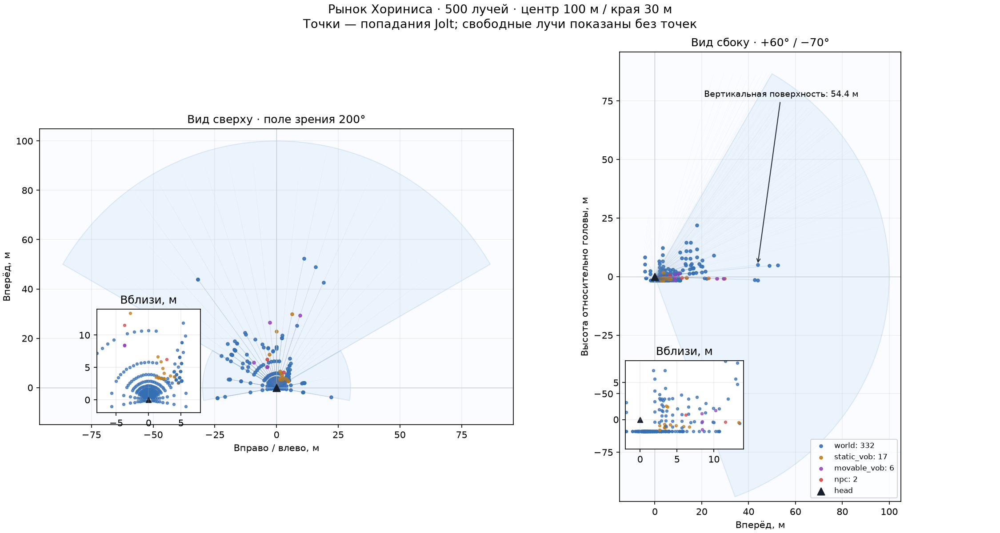
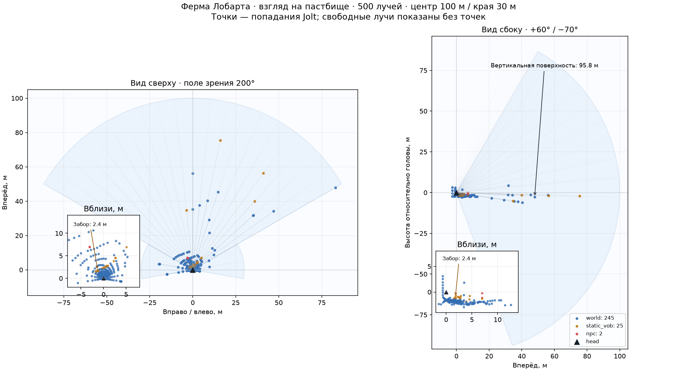

# Навигационный глаз NPC: калибровка и цена

2026-10-16, [слой 3 навигации](../../../docs/navigation.md#слой-3-что-npc-видит-и-помнит).

**Для первого обучения брать 238 лучей и центр 100 м:** на Ryzen 20 NPC требуют 14,1–15,5% одного ядра, 50 NPC — 37,7–39,4%. Раскладки 500 и 1036 примерно в 2,1 и 4,2 раза дороже; с 1036 лучами 50 NPC уже не поддерживают реальное время на Ryzen. Предел для игры на Mac остаётся открытым: короткий замер пропущен из-за запущенной игры.

## Что считает глаз

Отдельный [NavigationEye](../../../OpenGothic/common/game/navigationeye.cpp), без изменений 16 лучей тела боя, ходьбы и протокола моста. Лучи начинаются в применённой кости головы после анимации, gaze и поправок позы; направление берётся из этой же кости. Глаз не обращается к сети путей или карте: точки мира использует только стенд для размещения участников.

Jolt проверяет физические формы мира, статических и подвижных вобов, предметов, тел NPC и поверхность воды. Визуальные дубликаты коллизий исключены; собственное тело NPC исключено фильтром. Дверь или подъёмник определяется как подвижный воб по фактическому типу физического тела.

| Выбор в команде | Лучей | Азимуты: центр + края | Вертикальных рядов | Шаг центра / края | Шаг по вертикали |
|---|---:|---:|---:|---:|---:|
| 250 | **238** = 182 + 56 | 13 + 4 | 14 | 10° / 20° | 10° |
| 500 | **500** = 420 + 80 | 21 + 4 | 20 | 6° / 20° | 6,842° |
| 1000 | **1036** = 812 + 224 | 29 + 8 | 28 | 4,286° / 10° | 4,815° |

Центр — от −60° до +60° включительно, края — до ±100°. Задний сектор 160° пуст. Все ряды покрывают от −70° до +60° относительно головы. Внутри каждого участка шаг угла постоянен на любой дистанции: точек на далёком объекте получается меньше.

Центр достигает 100 м, края — 30 м. В варианте центра 20 м края также ограничены 20 м; при центре 50 и 100 м края остаются 30 м. **Граница частот — 10 м:** этот отрезок каждого луча обновляется на каждом решении, 10 Гц; свободное продолжение обновляется 2 Гц. Если близкое препятствие перекрыло луч, дальний запрос не нужен. Первое обновление полное, после него сохранённая даль хранит исходную позицию головы и время своего измерения. Это старое наблюдение, которое можно перенести в будущую карту памяти.

Для луча сохраняются расстояние, `world / static_vob / movable_vob / npc / water / none`, нормализованная знаковая вертикальная компонента нормали, начало, направление, точка попадания и времена ближнего и дальнего замеров. `none` означает свободный луч до его предела. **Множитель максимальной дальности один, `rangeMultiplier=1`; ночь и туман не моделируются.** Граница частот 10 м от него не зависит.

## Калибровка

Оба PNG — свежий полный глаз из **500 лучей**, с видом сверху, сбоку и увеличением ближней области. Точки — настоящие попадания; бледные линии без точек — свободные лучи. Углы и расстояния не получены из картинки игры.

**Рынок Хориниса**, `NW_CITY_MERCHANT_PATH_01`: 357 попаданий, в том числе 2 в NPC, 17 в статические и 6 в подвижные вобы. Шесть попаданий в вертикальные поверхности дальше 30 м; самое дальнее — **54,4 м**.



**Ферма Лобарта, снаружи забора пастбища:** опорная точка около `(14385, 1730, −15968)` см, взгляд к `FP_ROAM_FARM1_SHEEP_09`. Она находится со стороны амбара, примерно в 2,5 м перед местом подтверждённого застревания Малета; точка `NW_FARM1_PATH_01` уже внутри пастбища и применяется только для замера поля. Глаз даёт **13 ближних попаданий в почти вертикальную поверхность статического воба** в центральных 120°; ближайшее — **2,39 м**, забор отмечен на увеличении. Девять вертикальных попаданий дальше 30 м, геометрия мира видна до **95,8 м**.



[Полные лучи обеих калибровок и проверки стены](raw/snapshots.jsonl) содержат также нормали, позу головы и время. Это контроль геометрии датчика; качество обученной ходьбы с 238 лучами этим не проверялось.

## Стена сзади

В настоящем мире, около `DOWNTOWN`, один NPC остаётся на одной опорной точке и разворачивается перед одной стеной. Расстояние от головы до плоскости: **98,83 см спиной**, **101,17 см лицом**. При 1036 лучах **сзади 0 попаданий, спереди 652**. Попадания считаются по фактической плоскости стены с допуском 8 см, а не по условному маленькому прямоугольнику. Сохранены снимки `wall-back` и `wall-front`, [результат и координаты](raw/events.jsonl).

Проверена конечная стена. При поле 200° крайние 10° с каждой стороны заходят за боковую плоскость головы: достаточно широкая стена способна достичь периферии. Центральные задние 160° лучей не содержат.

## Цена

Ryzen 9 3950X, RelWithDebInfo, один `gothic-body-runner`, `--mode lockstep`, без окна, графического и аудиоустройства. Для каждого места и числа NPC одна база без глаза и девять окон с глазом: 3 раскладки × 3 дальности. Всего **54 конфигурации, 144 000 обновлений**. Везде фактически **10 Гц игрового времени**, полные обновления составили **20%**. Все 10/20/50 наблюдателей имели существующие Jolt-формы.

Ниже центр 100 м. Цена одного NPC объединена по участникам и обновлениям окна; медиана и p95 включают ближние и полные обновления. Процент ядра рассчитан по **средней** цене, включая даль: `сумма eye_us / игровые секунды / 10000`. 100% означает секунду работы одного ядра на секунду игры. `Runner ×` — отношение времени окна ко времени базы с теми же NPC; больше единицы означает замедление.

| Место | NPC | Лучей | Медиана, мкс | p95, мкс | % ядра на всех | Runner × |
|---|---:|---:|---:|---:|---:|---:|
| Рынок | 20 | 238 | 749,3 | 911,4 | 15,47 | 1,77 |
| Рынок | 20 | 500 | 1556,4 | 1894,6 | 31,99 | 2,60 |
| Рынок | 20 | 1036 | 3185,7 | 3838,4 | 65,42 | 4,26 |
| Рынок | 50 | 238 | 772,3 | 957,7 | 39,44 | 2,80 |
| Рынок | 50 | 500 | 1591,1 | 2003,9 | 81,56 | 4,73 |
| Рынок | 50 | 1036 | 3268,3 | 4086,2 | 167,12 | 8,66 |
| Поле Лобарта | 20 | 238 | 673,0 | 920,3 | 14,12 | 1,71 |
| Поле Лобарта | 20 | 500 | 1396,1 | 1912,6 | 29,17 | 2,48 |
| Поле Лобарта | 20 | 1036 | 2845,0 | 3930,2 | 59,65 | 4,01 |
| Поле Лобарта | 50 | 238 | 743,0 | 939,0 | 37,70 | 2,75 |
| Поле Лобарта | 50 | 500 | 1533,3 | 1955,4 | 77,93 | 4,61 |
| Поле Лобарта | 50 | 1036 | 3128,1 | 3981,3 | 159,55 | 8,37 |

**Полная матрица, включая 10 NPC и дальности 20/50/100 м:** [таблица всех 54 окон](raw/cost-table.md), [CSV](raw/cost.csv), [JSONL с агрегатами и базами](raw/spans.jsonl). В JSONL отдельно есть статистики ближних и полных обновлений, число реальных запросов, время процесса и частота.

Увеличение центра с 20 до 100 м изменило среднюю цену всего на **+0,35…1,34%** по 18 сопоставимым парам; медиана изменения +0,61%. В этих сценах основную цену определяет число ближних запросов, а сокращение дальности почти не экономит. Это один прогон с 10-секундными окнами, поэтому небольшие различия не следует считать точной оценкой причинного эффекта длины луча.

С 238 лучами 50 NPC дают **1,64–1,68 игрового времени в секунду** на Ryzen; с 500 — 0,97–1,00, с 1036 — 0,53–0,55. Это runner с полным миром и глазами, без графики и политики. Синхронный пакет из 50 глаз по 238 лучей занимает в среднем около 38–39 мс: при включении в живую игру обновления NPC следует распределить по кадрам.

## Условия и проверки

- Все тяжёлые действия на Ryzen шли под `~/gothic-ai/body-simulation.lock`, в собственной папке `~/gothic-ai/nav-eye/`; пути вывода абсолютные. Ожидание замка исключено из цифр. Исходники измеренного глаза — `6f43c618`; последующее уточнение позиции калибровки не меняло вычисления глаза или измеренные сцены.
- Полдень, рынок `NW_CITY_MERCHANT_PATH_01` и поле `NW_FARM1_PATH_01`. Разные реальные NPC стоят на настоящей опоре, в пределах 18,5 м от героя, с разными направлениями тела. Ближние жители заморожены одинаково для базы и глаза, дальняя часть мира работает обычно.
- Каждое окно: 2 с прогрева и 10 с измерения. Измеряется само обновление глаза, включая получение позы головы и работу кэша. Тайминги накапливаются в памяти, JSONL записывается после остановки таймера; снимки вызываются отдельно. Лишний журнал боя отключён `OPENGOTHIC_BODY_TRACE=0`; наблюдения тела выключены.
- **Сборка движка и runner прошла на Ryzen и Mac.** `check-navigation-eye` прошёл на обеих машинах: 238/500/1036 лучей, геометрия углов и дальностей, множитель, вода, статический/подвижный воб, стена спереди 105/256/508 попаданий и сзади 0 во всех раскладках. Реальная стена дополнительно проверена выше. Полный pytest и e2e не запускались; `server/` не менялся.
- **Mac M1 Pro, 32 ГБ:** короткий замер 20 NPC на рынке пропущен. `pgrep -fl Gothic2Notr` был непустым при исходной проверке и перед запуском готового runner; работала игра другой задачи. Поэтому численный предел NPC с глазом для Mac не установлен, переносить на него Ryzen-цифры нельзя.
- Обычный NPC вне области существующих живых Jolt-форм (примерно 20 м от героя) не попадёт в такой луч как NPC. Геометрия мира и вобов проверяется на полную дальность. Новые физические прокси и управление ходьбой в этой задаче не добавлялись.

## Повторить

[`run.sh`](run.sh) держит общий замок на протяжении сборки, короткой проверки подготовки, матрицы и отдельной калибровки забора. Нужны исходники этой ветки в `~/gothic-ai/nav-eye/source/`, общие данные игры и копия исходного `save_slot_1.sav` в папке задачи. Существующие каталоги результатов не перезаписываются.

На Ryzen:

```sh
TASK="$HOME/gothic-ai/nav-eye"
OUT="$TASK/runs/eye-$(date +%Y%m%d-%H%M%S)" \
  SAVE="$TASK/save_slot_1.sav" GOTHIC_DIR="$HOME/gothic-ai/game" \
  bash "$TASK/source/reports/navigation/2026-10-16-eye/run.sh" all
```

`build`, `matrix`, `calibrate` выполняют этапы отдельно. Полная матрица запрещена скриптом на Mac. Для короткого Mac-замера из корня worktree задаются абсолютные `BUILD`, `SAVE`, `GOTHIC_DIR` и `OUT`, затем вызывается `run.sh mac`: он сам проверяет `pgrep` и пропускает запуск при непустом результате.

После копирования каталога результатов в `RESULTS`:

```sh
uv run --with matplotlib python reports/navigation/2026-10-16-eye/render.py \
  "$RESULTS" reports/navigation/2026-10-16-eye/raw
```

[`render.py`](render.py) проверяет полноту матрицы, частоты, формы NPC, отсутствие устройств и результат стены, затем собирает таблицы, JSONL и PNG. Индивидуальные строки всех обновлений остаются в `eye-timing.jsonl` каждого запуска; в репозиторий включены агрегаты каждого окна и полные лучи калибровки.
