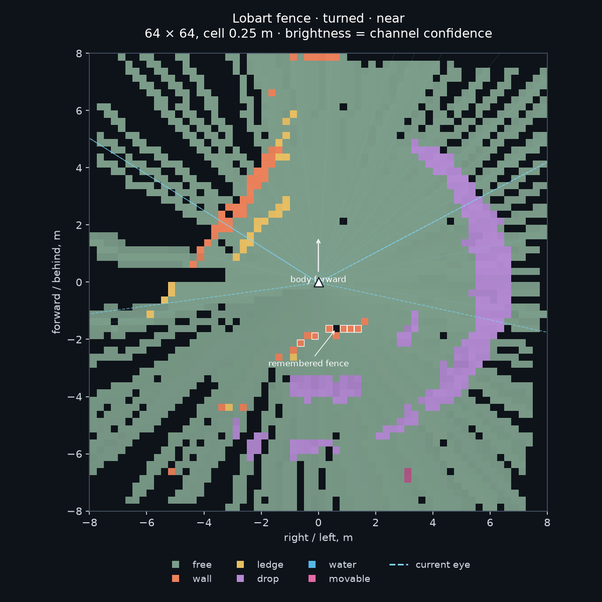
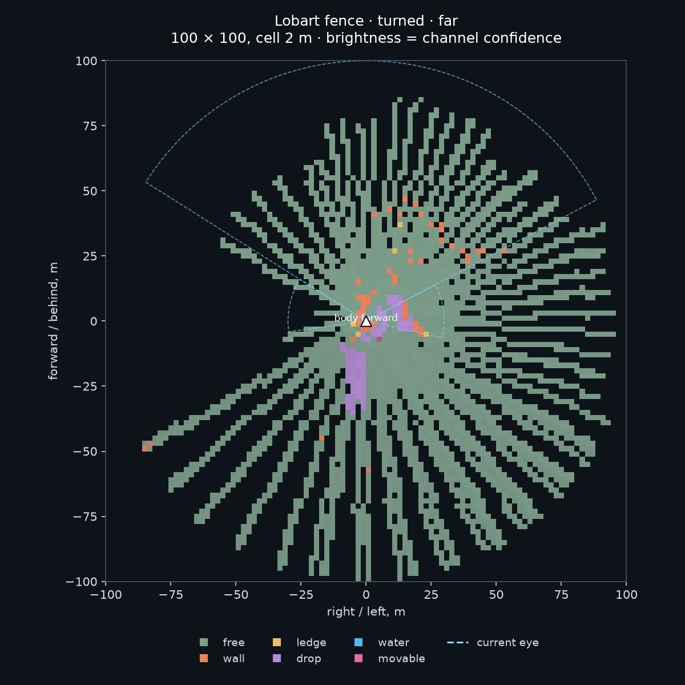
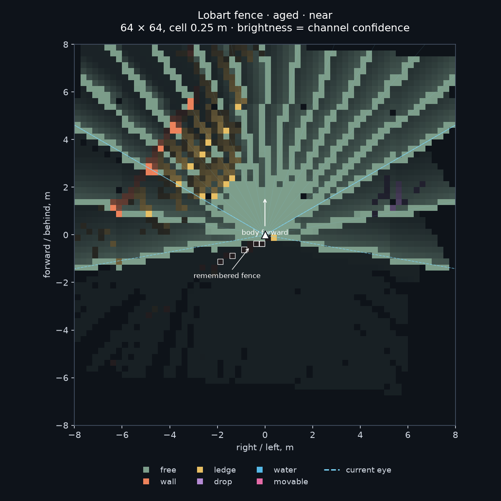
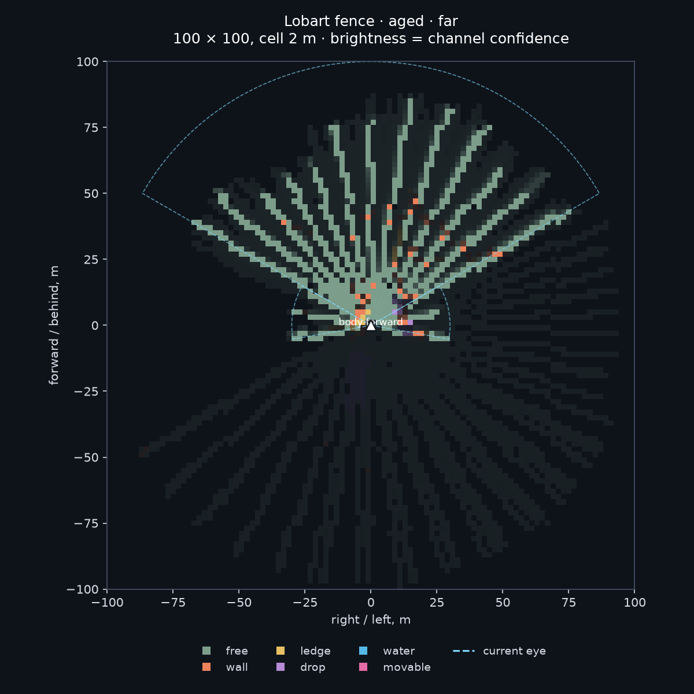

# Короткая зрительная память NPC

2026-10-16. Только стенд `gothic-body-runner`, [этап 4 навигации](../../../docs/navigation.md). Исходники движка: `94c2e5a4`.

**Память сохраняет увиденный забор за спиной:** после поворота на 180° — в 1,666 м, при пячении — в 0,745 м; все шесть опорных попаданий найдены с ошибкой не больше 24,1 см по координате. Текущий глаз в них не попадает. Два дальних попадания на 55,9 и 96,4 м тоже остаются. Ryzen: обновление памяти и выдача двух карт стоят **313/482 мкс** на NPC, медиана/p95 для 20 участников; **306/458 мкс** для 50. Цена глаза исключена.

Минутное забывание проверено с нейтральными клавишами: **0,772924 → 0,096816**. Полностью неподвижное стояние на этом склоне не получилось: штатное движение сдвинуло NPC на **2,282 м**, путь составил **2,339 м**. Память учитывает этот путь; чистое затухание только по времени отдельно проверено синтетическим контрактом. Ходьба и физика не менялись.

## Устройство и каналы

[NavigationMemory](../../../OpenGothic/common/game/navigationmemory.h) принимает только `NavigationEye::samples()` и собственную позу тела: ноги, направление, игровое время. В модуле нет доступа к миру, физике, навигационной сетке или сети путей. [Реализация](../../../OpenGothic/common/game/navigationmemory.cpp) хранит мировые координаты в двух кольцевых окнах:

| Масштаб | Размер | Клетка | Растр |
|---|---:|---:|---:|
| Ближний | 16×16 м | 25 см | 64×64 |
| Дальний | 200×200 м | 2 м | 100×100 |

Окна сдвигаются при ходьбе; покинувшие окно клетки удаляются. Поворот не вращает сохранённый растр. `view()` переносит центры мировых клеток в вид текущего тела: вперёд — направление тела, вправо — его правая сторона. При совмещении сохраняется максимум свидетельств, без размытия. Результат переиспользует выделенные массивы.

До попадания луч отмечает только пересечённые клетки как свободное пространство; свободный луч — до своего фактически наблюдённого конца. Между лучами ничего не достраивается. Неполный ближний луч не заполняет неувиденную даль. Кэшированный дальний луч использует собственные мировую позу и `sampledAtMs`; повторное получение и свежий `nearSampledAtMs` не освежают его. Путь учитывается на каждом тике тела, включая промежутки между решениями.

Выдаваемые каналы лежат в 0–1:

- `confidence`: максимум уверенности имеющихся свидетельств; 0 означает неизвестное.
- `free`: увиденный свободный отрезок либо земля в пределах шага от текущих ног.
- `wall`: попадание в почти вертикальную поверхность.
- `ledge`: сохранённая земля выше текущих ног на высоту шага и больше.
- `drop`: земля ниже ног больше чем на шаг, либо увиденный воздух ниже ожидаемого уровня земли без подтверждения опоры.
- `water`: вода; `movable`: подвижный воб или NPC.

Высота земли хранится абсолютной и пересчитывается относительно текущих ног при выдаче. Наклонная поверхность вне порогов земли/стены сохраняет уверенность без выдуманной категории. Разные высоты могут давать `free` и `wall` в одной проекции: свободный воздух над забором не разрешает пройти сквозь него. Новое свободное наблюдение стирает старое попадание только при прохождении в пределах **25 см от его реальной 3D-точки**. Одного совпадения двухметровой клетки и высоты недостаточно — это отдельно проверено контрактом.

Для каждого свидетельства:

`confidence = exp(-age_seconds / tau) × exp(-traveled_cm_after_observation / lambda_cm)`.

Все настройки собраны в `NavigationMemory::Constants`: **τ неподвижного = 30 с**, **τ подвижного = 5 с**, **λ = 30 м**, **шаг = 50 см**, земля при `normalY ≥ 0,7`, стена при `|normalY| ≤ 0,3`, допуск опровержения попадания **25 см**. Это стартовые числа для последующей настройки. Сетки занимают около **2,37 МиБ/NPC**, два выдаваемых массива — ещё **0,43 МиБ/NPC**, без небольших буферов времён и лучей.

[Команды стенда](../../../OpenGothic/common/game/navigationmemorybench.cpp): `memory on|off <actor>`, `memory snapshot <tag> <actor>`, `memory measure begin <tag>` / `memory measure end`. Число обозначает участника `eye setup`; также доступны `id:<текущий world ID>` и имя экземпляра. `all` включает весь подготовленный пул. После `off → on` память начинается заново. `memory keys` лишь передаёт команду существующему `keys` по актуальному ID; сам исполнитель клавиш не менялся. Снимки — `memory-snapshots.jsonl`, измерения — `memory-spans.jsonl` и `memory-timing.jsonl`. Мост не менялся.

## Таблица 1. Контракт без ассетов

Цель **`check-navigation-memory`**, [синтетические лучи](../../../OpenGothic/tests/navigation_memory_contract.cpp), [вывод проверки](raw/contract.txt). На Ryzen прошла целиком.

| Проверка | Результат |
|---|---|
| Камень в 5 м, поворот 180° | В виде сзади **5,125 м**, ошибка **12,5 см** при клетке 25 см |
| Помеха вне лучей | Уверенность **0**, промежутки между лучами неизвестны |
| До попадания | Пересечённые клетки свободны |
| Забывание по времени | За 5 с неподвижное **1 → 0,846482**, подвижное **1 → 0,367879** |
| Забывание по пути | На 10/20/30 м убывает строго монотонно; после 5 с и 30 м **0,311403** |
| Объект в 50 м и сдвиг окна на 30 м | Дальний масштаб сохраняет его впереди в **21 м**, ожидается 20 м, допуск 2 м |

Дополнительно прошли: старый дальний кэш после нового ближнего попадания, собственные времена/позы кэша, неполный луч, относительные высоты уступа/провала, отсутствие опоры по низкому лучу, сохранение низкой поверхности под высоким лучом, опровержение попадания проходящим через него лучом, две параллельные линии в одной дальней клетке с разносом 150 см, полный путь туда-обратно между решениями, позднее получение наблюдения и невосстановимость вытесненных клеток.

## Таблица 2. Забор Лобарта на runner

[Сценарий](fence.bench), реальная точка `lobart-fence`. После подготовки NPC одну секунду смотрит на забор, существующими клавишами за 2 с поворачивается ровно на 180°, затем пятится двумя отрезками по 250 мс. TTL поворота 2100 мс, явный отпуск через 2000 мс: последняя клавиша не истекает до последнего шага поворота. Снимок `turned` — после 300 мс завершения анимации.

Опора сравнения — шесть близких почти вертикальных попаданий в статический воб перед поворотом. Расстояние — медианная продольная координата этих точек относительно текущего тела; знак минус означает «сзади». Ошибка — максимальная разница координаты центра клетки и исходного попадания по X/Z, а не оценка по PNG. **На каждом снимке найдены все 6/6 точек в пределах одной клетки.**

| Снимок | Время от `front`, с | Забор относительно тела, м | Уверенность стены, средняя | Макс. ошибка X/Z, см | Текущих попаданий в опорные точки |
|---|---:|---:|---:|---:|---:|
| `front` | 0 | +1,785 | 0,997632 | 16,2 | 6 |
| `turned` | 2,300 | −1,666 | 0,962994 | 22,5 | **0** |
| `unseen` | 2,600 | −1,650 | 0,954521 | 24,1 | **0** |
| `back-1` | 2,867 | −1,198 | 0,930419 | 19,0 | **0** |
| `back-2` | 3,133 | **−0,745** | **0,908025** | 18,6 | **0** |
| `stopped` | 3,633 | −0,719 | 0,892103 | 20,3 | **0** |
| `stand-start` | 6,133 | −2,457 | 0,772924 | 18,4 | **0** |
| `aged` | 66,133 | −0,522 | **0,096816** | 23,5 | **0** |

Таким образом, при пячении NPC ещё «знает» о заборе в **74,5 см позади**, с уверенностью 0,908. Память пассивна: решение остановиться она не принимает.

**Честность:** после поворота стенд добавляет нового NPC сзади, на 150 см назад и 175 см в сторону, вне пути пячения. В снимке `unseen` текущих попаданий в него **0**, максимум `movable` в радиусе 60 см от нового тела **0**. Его координаты доступны только подготовке стенда и проверке, в `NavigationMemory` они не передаются.

**60 секунд:** после пячения NPC клавишами отходит вперёд от забора и отпускает их. Это оставляет запас для нативного дрейфа на склоне: около забора через минуту столб начинал попадать в периферические лучи, что освежало память. Между `stand-start` и `aged` ровно **60 000 игровых мс**, новые опорные попадания отсутствуют. Пройдено 233,902 см: формула предсказывает множитель **0,125184**, измерено по среднему шести клеток **0,125259** (небольшая разница от выбора клеток при выдаче). Уверенность через минуту также ниже, чем сразу после поворота: **0,962994 → 0,096816**. Строго неподвижного натурного замера здесь нет; ошибка ходьбы не исправлялась.

**Даль:** два настоящих вертикальных попадания на **55,902 и 96,400 м** до поворота остаются в дальней карте после него. Максимальные ошибки X/Z **119,0 и 106,9 см**, обе меньше клетки 2 м; уверенность стены **0,906686**. Форма и название объекта по лучам не угадываются.

## Карты PNG

Вперёд по телу — вверх, вправо — вправо; NPC — белый треугольник. Голубой пунктир показывает **текущий глаз головы**, включая центральные 120° до 100 м и периферию до 30 м. Яркость — уверенность показанного канала; незнакомое тёмное. Контуры белых клеток отмечают сохранённые попадания забора. При совпадении свободного воздуха и препятствия рисунок показывает препятствие; все числовые каналы сохраняются отдельно.

Сразу после поворота:





После минуты нейтральных клавиш (`aged`; перемещение тела на склоне учтено):





## Таблица 3. Цена памяти отдельно от глаза

RelWithDebInfo, `gothic-body-runner --mode lockstep`, реальные наблюдения **238 лучей**, решения 10 Гц, глаз: ближние 10 Гц / дальние 2 Гц. Пул — поле Лобарта. На каждую конфигурацию один прогон: 2 с после включения памяти, ещё 2 с прогрева измерителя и **8 с измерения**. Таймер обновления включает все обновления собственной позы между решениями; цена выдачи — обе карты. Получение лучей, поиск fixture-участника и запись JSONL в таймер не входят. Буферы прогреты, снимки вне измеряемого окна.

| Машина | NPC | Решений | Обновление, медиана/p95, мкс | Вид, медиана/p95, мкс | Вместе, медиана/p95, мкс | Доля одного ядра на всех, 10 Гц |
|---|---:|---:|---:|---:|---:|---:|
| Ryzen 3950X | 20 | 1600 | 64,6 / 238,3 | 242,3 / 368,9 | **313,4 / 481,9** | **7,15%** |
| Ryzen 3950X | 50 | 4000 | 64,5 / 228,1 | 232,9 / 354,6 | **306,4 / 458,2** | **16,46%** |
| Mac M1 Pro | 20 | 1600 | 46,3 / 162,3 | 96,4 / 142,6 | **148,4 / 282,2** | **3,51%** |

Медиана/p95 суммы вычислена по суммам каждого решения, не сложением квантилей. Доля ядра — по средней цене суммы: 357,466 / 329,293 / 175,557 мкс соответственно. Небольшую разницу между пулами 20 и 50 не следует считать ускорением от числа NPC: это короткие отдельные окна.

Mac: один короткий прогон для 20 NPC, непосредственно перед ним `pgrep -f '^[^ ]*Gothic2Notr -g'` пуст. В каждом runner `graphics_device_created`, `window_created`, `audio_device_created` — `false`. Все тяжёлые действия Ryzen шли под общим `~/gothic-ai/body-simulation.lock`; сборка делилась на пачки до 90 с, стенд и каждый размер пула брали замок отдельно.

## Проверки, данные и повторение

- На Ryzen собраны **Gothic2Notr и gothic-body-runner**, прошёл **check-navigation-memory**, натурный сценарий и оба пула цены.
- Финальная компиляция **Gothic2Notr и gothic-body-runner на Mac** прошла. Полный pytest, e2e, LLM и модели не запускались.
- [Компактные измерения](raw/measurements.json) содержат опорные точки, сопоставленные клетки, уверенности и агрегаты всех трёх окон. [Лог контракта](raw/contract.txt) — исходный вывод проверки. Совокупно меньше 50 КБ.
- Полные снимки (4 058 631 байт), все индивидуальные тайминги и журналы оставлены на Ryzen: **`~/gothic-ai/nav-memory/runs/fence-v5/`**, **`~/gothic-ai/nav-memory/runs/perf20-v2/`**, **`~/gothic-ai/nav-memory/runs/perf50-v2/`**. Короткий Mac-прогон также скопирован в **`~/gothic-ai/nav-memory/runs/mac/`**. В Git полные снимки не включены.

[run.sh](run.sh) выполняет одну пачку: `build`, `fence`, `perf20`, `perf50` или `mac`. На Ryzen исходники располагаются в `~/gothic-ai/nav-memory/source/`, сборка — `build/`, save — `save_slot_1.sav`, игровые данные — общие `~/gothic-ai/game`. Каждый `OUT` должен быть новым абсолютным путём. При коде 124 сборку запускают следующей пачкой после освобождения замка; код 75 означает, что замок не получен.

```sh
TASK="$HOME/gothic-ai/nav-memory"
bash "$TASK/source/reports/navigation/2026-10-16-memory/run.sh" build
OUT="$TASK/runs/fence-repeat" bash "$TASK/source/reports/navigation/2026-10-16-memory/run.sh" fence
OUT="$TASK/runs/perf20-repeat" bash "$TASK/source/reports/navigation/2026-10-16-memory/run.sh" perf20
OUT="$TASK/runs/perf50-repeat" bash "$TASK/source/reports/navigation/2026-10-16-memory/run.sh" perf50
```

Для PNG и компактного итога соберите локальные подкаталоги `fence/`, `perf20/`, `perf50/`, при наличии `mac/`, затем:

```sh
uv run --with matplotlib python reports/navigation/2026-10-16-memory/render.py \
  /absolute/path/to/results reports/navigation/2026-10-16-memory/raw
```

[render.py](render.py) проверяет поворот, шесть опорных клеток, отсутствие текущих попаданий, невидимого NPC, минутный интервал и сохранение дальней отметки; строит четыре PNG из чисел. Для короткого Mac-прогона `run.sh mac` нужны абсолютные `BUILD`, `SAVE`, `GOTHIC_DIR`, `OUT`; перед запуском он сам проверяет `pgrep`.

Открыто: строго неподвижное стояние на склоне при нейтральных клавишах; подбор констант и качество будущей политики ходьбы. Двухмерная проекция совмещает высоты, а вращаемый вид ограничен сохранённым мировым окном; это не полная геометрия прохода. **Знакомые дороги и подключение памяти к обученной политике остаются следующими шагами.**
