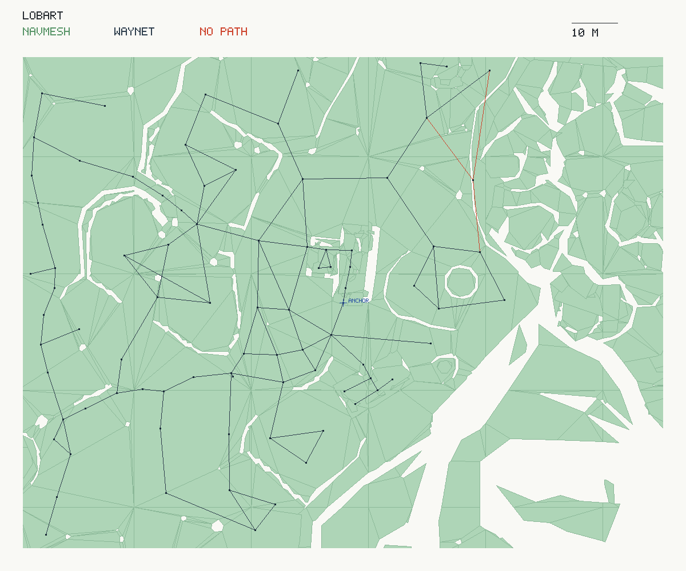
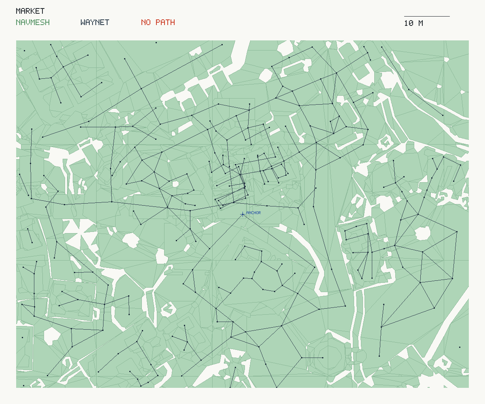

# Recast по NEWWORLD: покрытие и прямой ход против углов пути

2026-10-16, этап 2а [навигации](../../../docs/navigation.md).

В 204 одинаковых парах прямой ход завершился успешно 61 раз (29,90%), ход по углам Recast — 155 раз (75,98%). Сетка покрыла 3368 из 3402 рёбер родной сети путей (99,00%). Контрольный Малет дошёл по сетке без застревания.

## Геометрия, параметры и кэш

Использованы Recast и Detour v1.6.0, commit 6dc1667f580357e8a2154c28b7867bea7e8ad3a7, zlib; [запись о вендоринге](../../../OpenGothic/lib/VENDORED.md). В игре сетка пока не строится и не загружается. Все команды находятся в стенде, [NavBench](../../../OpenGothic/common/navbench.cpp).

Геометрия выгружается из созданных Jolt тел через DynamicWorld: мировые треугольники статического ландшафта и статических C_Object с их масштабом и трансформациями, отдельно C_Water. Compound shapes раскрывает Jolt; рендерные меши не используются. Динамические, кинематические и живые тела в сетку не входят. В обоих вариантах до загрузки мира зафиксировано movable_vobs=0: исходные коллизионные меши предметов остаются статическими C_Object. Остальные NPC продолжают обычные распорядки.

Профиль человека взят у BAU_954_MALETH из фактической legacy-капсулы [DynamicWorld](../../../OpenGothic/common/physics/dynamicworld.cpp), шаг и уклон — из гильдейских значений [MoveAlgo](../../../OpenGothic/common/game/movealgo.cpp). Формула радиуса: min(H/2, W, D)/2; цилиндр max(H−2r−H/2, 0). Центр капсулы находится на H/2 + H/4 + 15 см над ногами. Поэтому Recast берёт высоту верхней границы капсулы над землёй, консервативно заполняя промежуток под ней.

| Параметр | Значение |
|---|---:|
| Радиус физической капсулы | 8,172 см |
| Полная высота физической капсулы | 62,591 см |
| Центр капсулы над ногами | 108,886 см |
| Высота агента Recast | 140,182 см; 15 вокселей = 150 см |
| Максимальный шаг | 60 см; 6 вокселей. Запасное значение MoveAlgo 50 см здесь не используется |
| Максимальный уклон | 50° |
| Глубокая вода | глубже 140 см, по water_depth_chest; исключаются также донные поверхности, потолок пещеры экранирует воду |
| Размер вокселя | 20 см по XZ, 10 см по Y |
| Радиус после округления в воксели | 1 воксель = 20 см |
| Тайл | 128 × 128 ячеек = 25,6 × 25,6 м; граница 4 ячейки |
| Области и контуры | minRegionArea 64, mergeRegionArea 400 ячеек; maxSimplificationError 1,3; до 6 вершин полигона |
| Статические треугольники / вода | 1 395 670 / 10 530 |
| Непустые тайлы / полигоны | 1537 / 48286 |

NEWWORLD построен целиком: 10,246 с (хеш + Recast/Detour), выгрузка Jolt отдельно 0,090 с. Загрузка из файлового кэша с повторным хешированием — 0,087 с, выгрузка геометрии для проверки ключа ещё 0,089 с. Загрузка самого сохранения в эти числа не входит. Кэш — 11 266 644 байт (10,74 МиБ). Ограничение 10 минут и региональный запасной вариант не понадобились.

Ключ `dbf24e265365ef39`: хеш имени мира, всех статических и водных треугольников с трансформациями и параметров, включая версию алгоритма. Файл содержит независимые тайлы Detour, версию формата, порядок байтов и контрольные суммы тайлов. Переходы, прыжки и off-mesh links не добавлялись.

## 1. Покрытие родной сети путей

Проверены все неориентированные рёбра родной сети WayMatrix, каждое ровно один раз. Концы запроса — groundPos точек; длина ребра — штатная Conn::len графа. Длина пути — 3D-длина string-pulled маршрута между проекциями. Ближайший полигон ищется в пределах 1 м по XZ и 2 м по Y; расстояния проекции сохранены в JSONL. Неполный путь Detour считается отсутствием пути.

| Показатель | Рёбер | Доля всех рёбер |
|---|---:|---:|
| Есть полный путь | 3368 / 3402 | 99,00% |
| Нет пути | 34 / 3402 | 1,00% |
| Путь длиннее ребра более чем в 1,5 раза | 2 / 3402 | 0,059% |

Среди рёбер с путём доля удлинений — 0,059%. У 29 провалов причина disconnected, у 2 start_off_mesh, у 3 end_off_mesh.

### Топ-20 рёбер без пути

Порядок — по убыванию штатной длины ребра. Места сопоставлены строго через points[waypoint] в [places.json](../../../server/src/gothic_ai/gamedata/places.json). Это кандидаты для последующей пробы переходов; тип перехода этим запросом не устанавливается.

| Откуда | Куда | Место | Длина, м | Причина |
|---|---|---|---:|---|
| `NW_CITY_HABOUR_SHIP_01` | `NW_CITY_PIRATESCAMP_01` | набережная Хориниса → стоянка Скипа на берегу | 93,89 | disconnected |
| `NW_LAKE_GREG_TREASURE_01` | `NW_LAKE__WATER_04` | озеро у большой фермы | 38,01 | disconnected |
| `NW_FARM1_OUT_10` | `NW_FARM1_OUT_15` | двор фермы Лобарта | 24,34 | disconnected |
| `NW_FARM1_OUT_07` | `NW_FARM1_OUT_10` | двор фермы Лобарта | 17,06 | disconnected |
| `NW_FARM1_MILL_04` | `NW_FARM1_OUT_10` | мельница фермы Лобарта → двор фермы Лобарта | 16,05 | disconnected |
| `NW_PATH_TO_MONASTER_AREA_04` | `NW_PATH_TO_MONASTER_AREA_05` | окрестности дороги к монастырю | 13,98 | disconnected |
| `NW_PATH_TO_MONASTER_AREA_04` | `NW_PATH_TO_MONASTER_AREA_10` | окрестности дороги к монастырю | 12,30 | disconnected |
| `NW_FOREST_PATH_66` | `NW_FOREST_PATH_67` | лес с кострищами | 10,48 | end_off_mesh |
| `NW_CITY_KANAL_07` | `NW_CITY_KANAL_08` | проходы канализации Хориниса | 10,30 | disconnected |
| `NW_PATH_TO_MONASTER_AREA_03` | `NW_PATH_TO_MONASTER_AREA_04` | окрестности дороги к монастырю | 9,45 | disconnected |
| `NW_CITY_MERCHANT_PATCH_45` | `NW_CITY_MERCHANT_PATCH_45_B` | проход от городских ворот к рынку | 9,10 | disconnected |
| `NW_PATH_TO_MONASTERY_06` | `NW_PATH_TO_MONASTER_AREA_04` | дорога к монастырю → окрестности дороги к монастырю | 7,58 | disconnected |
| `NW_PATH_TO_MONASTER_AREA_04` | `NW_PATH_TO_MONASTER_AREA_09` | окрестности дороги к монастырю | 6,91 | disconnected |
| `NW_LIGHTHOUSE_IN_15` | `NW_LIGHTHOUSE_IN_16` | внутренние помещения маяка | 6,00 | disconnected |
| `NW_CITY_MERCHANT_PATCH_45_B` | `NW_CITY_MERCHANT_PATCH_45_C` | проход от городских ворот к рынку | 5,96 | disconnected |
| `NW_CASTLEMINE_TROLL_04_A` | `NW_CASTLEMINE_TROLL_04_B` | стоянка лесоруба Грома | 5,78 | disconnected |
| `NW_LIGHTHOUSE_IN_11` | `NW_LIGHTHOUSE_IN_13` | внутренние помещения маяка | 5,71 | end_off_mesh |
| `NW_LIGHTHOUSE_IN_10` | `NW_LIGHTHOUSE_IN_11` | внутренние помещения маяка | 5,67 | disconnected |
| `NW_LIGHTHOUSE_IN_13` | `NW_LIGHTHOUSE_IN_14` | внутренние помещения маяка | 5,51 | start_off_mesh |
| `NW_TROLLAREA_PORTALTEMPEL_27` | `NW_TROLLAREA_PORTALTEMPEL_DEADALLIGATOR` | храм древнего портала | 5,28 | disconnected |

## 2. Одинаковые пары: напрямую и по сетке

204 уникальные пары, по 34 на место. Источник — точка родной сети, цель — FP_* на расстоянии 10–40 м в 3D. Выбор из отсортированных имён перемешан mt19937 с семенем 7; пары между местами не повторяются. Все проходы выполняет один и тот же человек BAU_954_MALETH, шагом.

Каждый вариант каждой пары получает заново созданные GameSession и World из одного chapter-one save_slot_1.sav, семя 7 и время 10:00. NPC ставится на groundPos вейпоинта, герой — на 5 м в стороне по Z и затем неподвижен. Цепочка может выйти за радиус полного ИИ 30 м; это сохраняет обычную политику движка. Во время хода телепортаций нет.

Прямой вариант вызывает тот же AiQueue::aiGoToPoint(FP), что npcgo. Для сетки добавлен минимальный Npc::goToPosition: цель хранится по значению в существующем GT_Point, без поиска по графу; координата земли переводится в координату центра для существующей проверки близости. Допуск промежуточной точки — 20 см, включая состояние после отскока. Следующая точка задаётся после завершения предыдущей; в конце остаётся обычный прямой ход к исходной цели. MoveAlgo и физическая ходьба DynamicWorld не переписаны.

Успех — расстояние от ног до groundPos цели строго меньше 100 см за 90 000 мс. Время ниже — игровые секунды, не ускоренное настенное время runner; таймауты входят в медиану всех как 90 с. Медианы дошедших рассчитаны по успешным ходам своего варианта.

События — существующий OPENGOTHIC_STUCK_LOG: менее 50 см прогресса за 3 с, восстановление после движения более 1 м. Учитываются только sample измеренного прохода и BAU_954_MALETH, включая эпизоды на границе окна. Один ход может дать несколько эпизодов, поэтому частота на 100 бывает больше 100. Отсутствие пути тоже является неуспехом, даже если детектор не увидел активного движения.

| Место | Вариант | Дошли | Доля | Застреваний / 100 | Медиана всех, с | Медиана дошедших, с | Нет пути |
|---|---|---:|---:|---:|---:|---:|---:|
| Рынок | прямо | 8/34 | 23,53% | 185,29 | 90,00 | 21,43 | — |
| Рынок | сетка | 22/34 | 64,71% | 20,59 | 64,65 | 33,28 | 1 |
| Гавань | прямо | 7/34 | 20,59% | 141,18 | 90,00 | 26,03 | — |
| Гавань | сетка | 29/34 | 85,29% | 5,88 | 53,78 | 50,93 | 0 |
| Ферма Онара | прямо | 12/34 | 35,29% | 138,24 | 90,00 | 31,88 | — |
| Ферма Онара | сетка | 29/34 | 85,29% | 14,71 | 45,73 | 43,90 | 0 |
| Ферма Лобарта | прямо | 20/34 | 58,82% | 97,06 | 43,60 | 32,65 | — |
| Ферма Лобарта | сетка | 30/34 | 88,24% | 23,53 | 36,13 | 35,42 | 1 |
| Узкие улицы портового квартала | прямо | 6/34 | 17,65% | 152,94 | 90,00 | 29,90 | — |
| Узкие улицы портового квартала | сетка | 31/34 | 91,18% | 5,88 | 52,12 | 50,87 | 1 |
| Узкие улицы Верхнего квартала | прямо | 8/34 | 23,53% | 208,82 | 90,00 | 15,53 | — |
| Узкие улицы Верхнего квартала | сетка | 14/34 | 41,18% | 8,82 | 90,00 | 24,35 | 1 |
| Все места | прямо | 61/204 | 29,90% | 153,92 | 90,00 | 26,13 | — |
| Все места | сетка | 155/204 | 75,98% | 13,24 | 49,10 | 39,87 | 4 |

| Исход одной и той же пары | Пар |
|---|---:|
| Дошли оба | 61 |
| Дошёл только вариант по сетке | 94 |
| Дошёл только прямой вариант | 0 |
| Не дошли оба | 49 |

На 61 паре, где дошли оба, медианы времени: 26,13 с напрямую и 24,13 с по сетке; медиана попарной разницы «сетка − прямо» равна 0,00 с. Всего зарегистрировано 314 эпизодов напрямую и 27 по сетке.

Осталось 49 неуспешных сеточных ходов: 4 без пути и 45 при полном пути Detour. В Верхнем квартале дошли только 14/34 даже по сетке. Низкая частота застреваний сама по себе не означает, что NPC достиг цели.

Погони пропущены: come ведёт NPC к герою, approach — героя к NPC. Готового стенда «NPC за другим NPC по распорядку» и перестроения сеточного пути к движущейся цели нет; 50 таких погонь не подменялись статическими целями.

### Топ-10 мест застревания прямого хода

Место берётся из ближайшего вейпоинта именно начала эпизода, через points[waypoint], а не из начальной точки всего маршрута. «Ходов» — уникальные прямые проходы с эпизодом в этом месте; один проход может встретиться в нескольких местах. Контрольный Малет в рейтинг не входит.

| Место | Эпизодов | Ходов с эпизодом | Из них не дошли |
|---|---:|---:|---:|
| бедные дома портового квартала | 46 | 30 | 30 |
| дома Верхнего квартала у лавки Лютеро | 36 | 15 | 15 |
| улицы Верхнего квартала | 25 | 9 | 9 |
| дома и склад у гавани | 17 | 8 | 7 |
| рыночная площадь Хориниса | 16 | 8 | 8 |
| бордель портового квартала | 16 | 6 | 6 |
| кухня большой фермы | 15 | 6 | 5 |
| покои Ли и Халеда | 12 | 5 | 5 |
| дорога от фермы Лобарта к Хоринису | 11 | 6 | 5 |
| проход от городских ворот к рынку | 10 | 2 | 2 |

## 3. Контроль: Малет и забор пастбища

Подготовка точно повторяет [intentional.bench](../2026-10-16-stuck/intentional.bench): герой у NW_FARM1_ENTRANCE_03, put Малета 0 0 −1400, затем герой у NW_FARM1_ENTRANCE_01 и 1 с ожидания. Цель FP_ROAM_FARM1_SHEEP_09. Оба варианта также получают отдельный свежий мир.

| Вариант | Дошёл <1 м | Время / лимит, с | Осталось до цели, м | Застреваний |
|---|---|---:|---:|---:|
| Прямо | нет | 90,00 / 90 | 12,532 | 1 |
| По сетке | да | 23,77 / 90 | 0,986 | 0 |

Маршрут Detour содержит три точки: старт, один промежуточный угол и финиш. По сетке Малет приходит в пределах 0,986 м от цели без эпизода застревания; прямой вариант остаётся у прежнего забора, около (14112, 1800, −15989) см.

## Вид сверху

Проекция XZ всех слоёв: X вправо, Z вверх. Зелёное — полигоны Recast, тёмное — родная сеть путей, красное — рёбра без пути по сетке. Синий крест — центр кадра. Отдельные крыши и другие несвязанные поверхности тоже видны в проекции; связность проверена Detour, а не цветом изображения.

Ферма Лобарта: центр NW_FARM1_ENTRANCE_01, ширина кадра 140 м.



Рынок: центр NW_CITY_MERCHANT_PATH_20, ширина кадра 100 м.



## Данные, повторение и проверки

[summary.json](summary.json) содержит все числа, параметры, контроль, причины отсутствия пути и сводку по местам. Сохранены [все 3402 ребра](raw/coverage.jsonl), [204 пары](raw/pairs.jsonl), [410 проходов с числами эпизодов](raw/trials-with-stuck.jsonl): всего 874 047 байт JSONL. Исходный stuck.jsonl со всеми окружающими NPC занимает 3 228 733 байта и по лимиту 1 МБ не включён; в сводке сохранены результаты только испытуемого NPC. Полигонная выгрузка для PNG и файл кэша также не коммитятся.

Запускать из этой копии репозитория на Ryzen. [run.sh](run.sh) берёт общий body-simulation.lock на всё время серии, работает по одному runner и использует абсолютные пути. Код возврата 75 означает занятый Ryzen. Исходные данные и сборка этой задачи находятся только в ~/gothic-ai/nav-mesh/.

```sh
RUNNER=/absolute/build/opengothic/gothic-body-runner \
SAVE=/absolute/save_slot_1.sav GOTHIC_DIR=/absolute/game \
OUT=/absolute/navmesh-repeat bash reports/navigation/2026-10-16-navmesh/run.sh
python3 scripts/navmesh_measure.py summarize \
  --output /absolute/navmesh-repeat --report /absolute/navmesh-repeat/summary
```

Для отдельного контроля есть --control-only, для продолжения той же серии — --measure-only --resume. Сохранённые пары при продолжении переиспользуются. Кэш по умолчанию лежит в OUT/cache; CACHE позволяет вынести его в отдельный абсолютный каталог. Локальный Gothic.ini стенда фиксирует movable_vobs=0, настройки пользовательской игры не меняются.

Проверено на Ryzen 3950X: сборки Gothic2Notr и gothic-body-runner, контракт gothic-navmesh-contract (обход стены через тайлы, недостижимый остров, кэш и его инвалидация/повреждение, глубокая и мелкая вода, пещера, экспорт), 3402 запроса покрытия, 204 пары и контроль Малета. Окончательная выгрузка штатных длин рёбер получена отдельным запуском из того же кэша; ключ кэша, признаки полноты и длины всех 3402 запросов совпали. На Mac выполнена одна финальная сборка Gothic2Notr, nice 19, два задания; игру и стенд на Mac не запускали. Полный pytest и e2e не запускались.

Данные относятся к legacy-ходьбе NPC этого worktree. Переход NPC на CharacterVirtual и учитель по сетке на стенде (этап 2б) остаются отдельными задачами. В игру сетка не идёт: NPC ходит по знакомым дорогам и своими глазами ([концепт](../../../docs/navigation.md#решения)).

## Вывод

Ход по углам повысил доходимость с 29,90% до 75,98% и снизил частоту эпизодов со 153,92 до 13,24 на 100 ходов, сохранив успех на каждой из 61 пары с успешным прямым ходом. Для этапа 2б это подходящая основа, но одного безусловного прохода по цепочке недостаточно: нужны контроль достижения и прогресса, перепрокладка и запасной путь, особенно для оставшихся 49 пар и Верхнего квартала. Для переходов сначала нужны нативные пробы 34 разрывов, в том числе маяка, канализации, фермы Лобарта и дороги к монастырю, с отдельным учётом принятого запрета глубокой воды.
