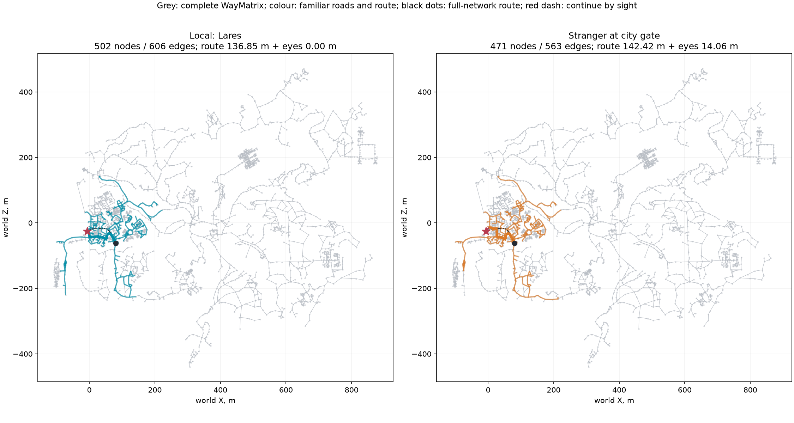
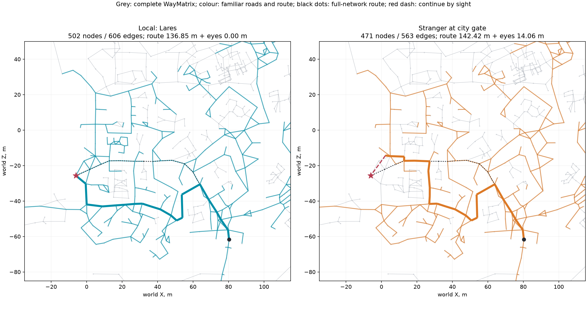

# Знакомые дороги NPC

2026-10-16. [Этап 4 навигации](../../../docs/navigation.md). Реализован `KnownRoads`, пока только для команд стенда. Граф взят из штатной `WayMatrix`, книга мест прочитана без изменений. Движение NPC, глаз, память, навигационная сетка и протокол моста не менялись.

**Ларес строит путь через знакомый боковой проход: 136,85 м до цели. Чужак из тех же ворот проходит 142,42 м по знакомым улицам, затем остаётся 14,06 м «глазами».** Полная сеть даёт 113,94 м: даже местный не знает всех сокращений. После добавления городской таверны остаток у Лобарта падает **7,80 → 0 м**. Ryzen, 50 NPC: постройка знания **371/885 мкс**, один запрос **8,59/32,87 мкс**, медиана/p95.

## Как устроено

[KnownRoads](../../../OpenGothic/common/game/knownroads.h) хранит общий неизменяемый граф и отдельные маски знакомых узлов и рёбер на NPC. [Реализация](../../../OpenGothic/common/game/knownroads.cpp) не обращается к миру, физике или сетке. Координаты и длины внутри — сантиметры, штатные длины рёбер сохранены.

- Все TA за сутки читаются существующим `Npc::forEachRoutine`, сортируются по времени; учитывается и переход от последней точки к первой. Свободная точка TA привязывается к ближайшему настоящему узлу сети. Между соседними TA запоминается кратчайший путь по штатному графу. Вокруг каждой TA запоминаются узлы на расстоянии до **40 м по сети** и рёбра между ними.
- Большое ребро — оба конца имеют `kind=road|street` через `places.json: points[name] → places[index]`. Радиус **300 м по сети** считается от всей 40-метровой окрестности TA; добавляются только большие рёбра и их узлы. Расстояние радиуса может пройти через маленькое ребро, но само оно от этого знакомым не становится.
- NPC без разрешённых TA текущего мира либо с явным `stranger` получает только большие дороги в радиусе **300 м от точки появления**, без окрестности TA и ежедневных маршрутов.
- `add` для вейпоинта открывает его 40-метровую окрестность; для места — окрестности всех относящихся к нему узлов (при их отсутствии используется ближайший узел к якорю/центру). К прежнему знанию добавляется кратчайший соединитель **только по большим дорогам**, без ограничения первоначальными 300 м. Если такого соединителя нет, окрестность остаётся отдельным знакомым участком, команда возвращает `major_connection=false`.

Поиск начинается в ближайшем **знакомом** узле. Dijkstra пропускает любое незнакомое ребро; среди достижимых знакомых узлов выбирается ближайший к цели по прямой. Ответ содержит узлы и рёбра, длину грубой части, смещение от заданного старта до первого узла, прямой остаток и единичное направление к цели. `goal_in_known` означает совпадение цели со знакомым узлом с допуском **1 см**; знакомый, но несвязный участок не становится достижимым. Если знания нет, весь прямой остаток отдаётся глазам.

При запросе неизвестные координаты и топология не участвуют в выборе пути, остатка и флага. Полная сеть используется для приобретения знания; отдельный эталон полной сети вычисляет только стенд.

## Один старт, одна цель: местный и чужак

[Сценарий](acceptance.bench), NEWWORLD, сохранение первой главы, время 12:00, seed 7. Начало обоих **запросов** — `NW_CITY_ENTRANCE_MAIN`; цель — `NW_CITY_HABOUR_PUFF_02_01` в портовом квартале. Стенд передаёт одинаковые координаты, NPC не телепортируются и не идут этим маршрутом: проверяется именно грубый путь.

Местный — **Ларес**, `VLK_449_LARES`, его обе TA находятся в `NW_CITY_HABOUR_02_B`. Чужак — `VLK_458_RUPERT`, явно помеченный `stranger` с появлением у главных ворот; его собственные TA при построении знания игнорируются.

| Знание | Рёбер в пути | Грубый путь, м | Дальше глазами, м | Цель в знакомом | Смещение старта, м |
|---|---:|---:|---:|---|---:|
| Полная сеть | 18 | **113,94** | 0 | да | 0 |
| Ларес | 19 | **136,85** | **0** | да | 0 |
| Чужак | 22 | **142,42** | **14,0554** | нет | 0 |

Ларес заканчивает маршрут через `NW_CITY_HABOUR_POOR_AREA_01 → NW_CITY_HABOUR_PUFF_03 → NW_CITY_HABOUR_PUFF_02_01`. Последние **два ребра не большие**: он знает этот боковой проход по окрестности своего распорядка. Чужак уходит по улице вдоль гавани и заканчивает в **`HAFEN`**. Его остаток — **14,0554 м**, направление XYZ **`[-0,590526; -0,000445; -0,807018]`**. Все его 22 ребра — большие.

Важная особенность исходной книги: **`CITY_HABOUR_POOR` целиком имеет вид `street`**, поэтому и чужак знает многие портовые переулки. Различие здесь дают настоящий боковой проход и окрестность Лареса; специальной фильтрации по названию переулков нет. Более короткий маршрут полной сети также не подмешивается в знание местного.

## Сколько знает каждый

Всего в `WayMatrix` **2 959 узлов, 3 402 уникальных ненаправленных ребра**. Свободные точки не включены, изолированные штатные узлы входят в знаменатель. Больших рёбер **1 035 (30,42%)**. Доли ниже — от всей сети, до каких-либо добавлений.

| NPC | Узлов | Доля узлов | Рёбер | Доля рёбер |
|---|---:|---:|---:|---:|
| Лобарт, `BAU_950_LOBART` | 455 | 15,38% | 549 | 16,14% |
| Малет, `BAU_954_MALETH` | 428 | 14,46% | 517 | 15,20% |
| Стражник главных ворот, `MIL_309_STADTWACHE` | 495 | 16,73% | 587 | 17,25% |
| Торговец рынка Йора, `VLK_408_JORA` | 593 | 20,04% | 691 | 20,31% |
| Ксардас, `NONE_100_XARDAS` | 47 | 1,59% | 47 | 1,38% |
| Ларес | 502 | 16,97% | 606 | 17,81% |
| Чужак у ворот | 471 | 15,92% | 563 | 16,55% |

Стражник имеет две TA в `NW_CITY_ENTRANCE_GUARD_01`; Йора — постель гостиницы, торговую точку и пивную площадь; Ксардас — две TA в `NW_XARDAS_TOWER_IN1_28`. Полные имена и времена TA сохранены в снимках.

## Добавленное место и честность пути

Лобарту передано **`CITY_HABOUR_TAVERN01`**. Старт обоих запросов — `NW_FARM1_LOBART`, цель места — `NW_CITY_HABOUR_TAVERN01_01`. До добавления узел цели ему неизвестен; после добавления появился полный знакомый путь.

| Лобарт | Знакомых узлов / рёбер | Грубый путь, м | Остаток, м | Конечная точка |
|---|---:|---:|---:|---|
| До | 455 / 549 | 291,86 | **7,7967** | `NW_CITY_PATH_HABOUR_12` |
| После `roads add` | 492 / 598 | 276,03 | **0** | `NW_CITY_HABOUR_TAVERN01_01` |
| Полная сеть | 2 959 / 3 402 | 236,85 | 0 | та же цель |

Добавлено **37 узлов и 49 рёбер**, `major_connection=true`. Прежнее знание полностью сохранено.

В четырёх записанных путях независимо сопоставлены **все 127 прохождений рёбер** с маской знания соответствующего снимка: **0 незнакомых рёбер**. Дополнительно проверены соседство каждой пары узлов, сумма длин и кратчайший путь в знакомом подграфе. Для местного и чужака отдельный обход подтвердил, что конечная точка имеет минимальный прямой остаток среди всех достижимых знакомых узлов. [Проверка и отрисовка](render.py), [исходные пути](raw/roads-paths.jsonl), [маски знания](raw/roads-snapshots.jsonl).

## Карты сверху

Серым показана вся штатная сеть, голубым — знакомое Ларесу, оранжевым — чужаку. Толстая линия — грубый путь, чёрный пунктир — эталон полной сети; красный пунктир — остаток глазами. Круг — одинаковый старт, звезда — одинаковая цель. Оси — мировые X/Z в метрах, этажи накладываются в проекции.





## Цена и проверки

Ryzen 9 3950X, **16 ядер / 32 потока**, GCC **15.2.0**, RelWithDebInfo, `gothic-body-runner --mode lockstep`, без окна и графического устройства. Все сборки и прогоны выполнены под общим `body-simulation.lock`, отдельными пачками; файлы только в `~/gothic-ai/nav-roads/`.

Взяты **50 разных NPC с TA**, первые по имени экземпляра, **20 повторов**, итого **1 000 построений знания и 1 000 запросов** к одной портовой цели. Исходные позиции NPC различаются. Таймер постройки включает выделение масок и поиск маршрутов распорядка, окрестностей и дорог; чтение TA и привязка их имён к графу подготовлены заранее. Копирование общей `WayMatrix`, чтение книги, эталон полной сети и запись JSON исключены из таймеров. [Каждый замер](raw/roads-timing.jsonl).

| Операция на NPC | Медиана, мкс | p95, мкс | Среднее, мкс |
|---|---:|---:|---:|
| Построить знание | **371,28** | **885,42** | 403,94 |
| Один запрос пути | **8,586** | **32,872** | 11,386 |

По средним: построить знание для всех 50 — **20,20 мс**, один запрос на каждого — **0,569 мс**. Это цена этого набора распорядков и цели, без движения, глаза и памяти. На Mac замер не запускался: для цены достаточно Ryzen.

Отдельная цель **`check-navigation-roads`** собирает только модуль и [искусственный граф](../../../OpenGothic/tests/navigation_roads_contract.cpp), без движка и игровых ассетов. [Контракт прошёл](raw/contract.txt): границы 40/300 м по сети, короткий по прямой дальний обход, суточный цикл, явный и автоматический чужак, добавление места и дальнего соединителя, незнакомый разрыв между большими дорогами, несвязный знакомый остров, пустой граф, **16 одинаковых перестроений**. Замена неизвестных координат и рёбер на очень выгодные сокращения не меняет ответ запроса.

Сборки **`Gothic2Notr` и `gothic-body-runner` на Ryzen прошли**. Финальная компиляция **`Gothic2Notr` на Mac прошла** (RelWithDebInfo, два задания сборки, игра не запускалась). Полный pytest и e2e не запускались: серверный Python и общий протокол не менялись.

## Команды и повторение

[Команды стенда](../../../OpenGothic/common/game/knownroadsbench.cpp):

```text
roads load <absolute_places.json>
roads on <instance|id:N|eye-index|player> [spawn_waypoint]
roads stranger <actor> [spawn_waypoint]
roads add <actor> <place|waypoint>
roads path <actor> <place|waypoint> [start_waypoint]
roads snapshot <tag> <actor>
roads actors [instance-substring]
roads bench 50 <goal> [repeats]
```

`on` перестраивает знание из TA, `stranger` — без них; добавления живут до следующего перестроения/загрузки мира. Необязательные старт и появление задают координаты расчёта и не двигают NPC. После загрузки другого мира нужно снова `roads load`. Граф записывается один раз в `roads-graph.json`, остальные данные — JSONL.

На Ryzen разместить этот checkout в `~/gothic-ai/nav-roads/source/`, копию книги — в `~/gothic-ai/nav-roads/places.json`, сохранение — `save_slot_1.sav` рядом с ней; общие ассеты читаются из `~/gothic-ai/game/`. Из checkout:

```bash
bash reports/navigation/2026-10-16-roads/run.sh build
# При коде 124 повторить: 90-секундная пачка освобождает общий замок.
OUT="$HOME/gothic-ai/nav-roads/runs/repeat" \
  bash reports/navigation/2026-10-16-roads/run.sh run \
  "$PWD/reports/navigation/2026-10-16-roads/acceptance.bench"
```

Выводы и входы абсолютные; `OUT` должен быть новым. `TASK`, `BUILD`, `SAVE`, `PLACES`, `GOTHIC_DIR` можно переопределить. Для финальной компиляции на Mac: `BUILD="$PWD/OpenGothic/build" bash reports/navigation/2026-10-16-roads/run.sh build`.

Скопировать `roads-*` из вывода в `raw/`, затем `uv run --no-project --with matplotlib python reports/navigation/2026-10-16-roads/render.py reports/navigation/2026-10-16-roads/raw`. Исходные данные вместе с выводом контракта занимают **457 783 байта**, меньше 1 МБ; [сводные числа](summary.json) и PNG воспроизводятся из них.
