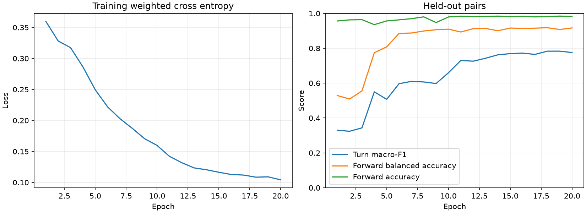

# Первая политика ходьбы: подражание учителю

2026-10-17, пункт 1 «Обучение» и этап 5 [навигации](../../../docs/navigation.md).

**Проверка по записям пройдена.** На **31 отложенной паре / 16 826 решениях** GRU даёт macro-F1 поворота **0,7834** против **0,3092** у «всегда вперёд» и **0,2478** у поворота по знакомой дороге. Точность головы «вперёд» — **98,19% против 96,34%** у обеих баз; средняя полнота её наблюдаемых классов — **91,80% против 50,00%**. На 1000 последовательных шагах ошибка logits numpy относительно torch — **3,81×10⁻⁶**, состояния GRU — **1,64×10⁻⁶**, допуск **10⁻⁴**.

Цена — **1 015 368 MAC** на решение. Ryzen 3950X, один поток CPU: медиана numpy **504,54 мкс**, torch **343,02 мкс**. **Ходьба в мире остаётся открытой следующей задачей.** Здесь предыдущие клавиши взяты из записей учителя; собственные действия ученика и накопление ошибки в замкнутом контуре ещё не проверялись.

## Данные и вход

Источник: `ryzen:/home/kaifaty/gothic-ai/nav-demos/episodes/`, [отчёт о записях](../2026-10-17-demos/README.md). Признак успеха — строго `success: true` из итогового `episode.json`. Из 191 эпизода взяты **156 успешных / 97 198 решений, 10 Гц**. Все 35 неуспешных исключены до подготовки признаков и разбиения.

[Подготовка кэша](../../../scripts/nav_bc_data.py) вызывает только `nav_demos.learner_input()` для признаков. `keys` идут отдельно в цели. `teacher_hint`, `position_cm`, `body_yaw_deg`, время и идентификаторы маршрута в сеть не передаются. Тест меняет подсказку, мировую позу, текущие цели действий и абсолютную высоту памяти и проверяет неизменность признаков.

| Часть входа | Преобразование |
|---|---|
| Глаз | 238 лучей × 9: расстояние / дальность конкретного луча; 6 значений one-hot вида попадания; вертикальная доля нормали; признак попадания. Порядок — луч, затем его 9 признаков. |
| Ближняя память | 64×64 → 32×32, среднее по 2×2, все 7 вероятностных каналов. |
| Дальняя память | 100×100 → 25×25, среднее по 4×4, те же 7 каналов. |
| Земля в обеих картах | Ещё 2 канала: средняя относительная высота среди известных клеток / 200 см, ограниченная ±10; доля клеток с известной высотой. Неизвестная высота — 0. |
| Знакомые дороги, 10 чисел | Направления следующей точки и цели; расстояния до них и остаток видимого участка / 1000 см, ограниченные [0,50]; признак цели в знакомом. |
| Тело, 14 чисел | Скорость / 500 см/с, ограниченная ±4; 5 флагов; нормаль опоры; уклон / 90°; углы головы / 180° и / 90°. |
| Прошлые клавиши, 8 чисел | Три оси, два нормированных угла головы, walk/jump/climb. |

В записи высота земли абсолютная. Нулевой уровень ученика определяется **ближайшей известной клеткой ближней памяти**, при отсутствии — дальней. Выбор использует расстояние клетки до центра датчика; координаты NPC не читаются. Из высот обеих карт сначала вычитается этот общий уровень, затем берётся среднее. Вертикальный перенос сцены не меняет вход.

Итог: карты **9×32×32** и **9×25×25**, вектор **2174** числа. Кэш: `ryzen:/home/kaifaty/gothic-ai/nav-bc/cache/`, **298 493 100 байт (284,67 МиБ)** вместе с индексом. Вероятности и доля известных высот — `uint8`, округление `round(255*x)`; высоты и вектор — `float16`; после чтения — `float32`. Каждый эпизод хранится отдельным сжатым NPZ. Подготовка читает исходные записи по 32 шага, весь корпус в память не загружается.

## Разбиение

Группировка — точная пара `(start, goal)`, seed **17**, **31/156 пар (19,87%)** в проверке. Число пар по местам распределено методом наибольших остатков. Пары сначала сортируются, затем внутри места применяется перестановка NumPy с заданным seed. Шаги и варианты одной пары сохраняют одно назначение.

| Место | Пар обучение / проверка | Шагов обучение / проверка |
|---|---:|---:|
| Рынок | 22 / 5 | 15 458 / 3347 |
| Гавань | 22 / 6 | 15 554 / 3126 |
| Онара | 23 / 6 | 13 398 / 2250 |
| Лобарта | 24 / 6 | 10 962 / 2266 |
| Улицы порта | 23 / 6 | 13 595 / 3616 |
| Верхний квартал | 11 / 2 | 11 405 / 2221 |
| **Всего** | **125 / 31** | **80 372 / 16 826** |

Отложенные номера: `003, 010, 014, 015, 033, 044, 048, 049, 051, 060, 066, 077, 078, 079, 084, 095, 101, 103, 104, 111, 121, 129, 131, 138, 144, 145, 152, 162, 167, 174, 185`. Полный индекс остаётся рядом с кэшем на Ryzen. Отложенные пары использованы для выбора контрольной точки; отдельного независимого тестового набора здесь нет.

## Архитектура и обучение

[Модель и экспорт](../../../scripts/nav_bc_model.py), [обучение и оценка](../../../scripts/nav_bc_train.py).

| Слой | Выход | MAC на решение |
|---|---|---:|
| Ближняя карта: Conv 3×3, stride 2, padding 1, 9→8; ReLU | 8×16×16 | 165 888 |
| Conv 3×3, stride 2, padding 1, 8→16; ReLU | 16×8×8 | 73 728 |
| AdaptiveAvgPool 2×2, flatten | 64 | — |
| Дальняя карта: те же слои, отдельные веса | 8×13×13 → 16×7×7 → 64 | 165 960 |
| Вектор: Linear 2174→128, ReLU | 128 | 278 272 |
| Конкатенация 64+64+128; Linear 256→128, ReLU | 128 | 32 768 |
| GRU, один слой, вход 128, состояние 256 | 256 | 294 912 |
| 6 линейных голов, размеры 3+3+3+2+2+2 | 15 logits | 3840 |
| **Итого** | **615 247 параметров** | **1 015 368** |

Оси forward/strafe/turn классифицируются в `[-1,0,1]`, walk/jump/climb — в `[0,1]`; `walk=1` означает шаг. Взгляд головы на выходе не обучается. MAC учитывает матричные операции, включая нулевые края свёрток. Отдельно остаются 768 поэлементных умножений ворот GRU, bias, активации и усреднение; до 2 млн есть запас.

**20 эпох**, AdamW, learning rate **3×10⁻⁴**, weight decay **10⁻⁴**, batch **8 эпизодов**, truncated BPTT по **64 шага (6,4 с)**, норма градиента ограничена **1**. Эпизоды перемешиваются между эпохами, отрезки внутри эпизода идут последовательно. Состояние переносится через границы отрезков с `detach`, сбрасывается при новом эпизоде. Дополнение коротких эпизодов маскируется в loss.

Cross entropy взвешена по классам: `sqrt(N/(K_present*n_class))`, ограничение **[0,5; 3]**. Для отсутствующих классов вес 1, положительных целей у них нет. Для forward веса `[-1,0,1]` — **[1; 3; 0,7237]**, для turn — **[2,1507; 0,6249; 2,1186]**. Веса голов: **2,1,2,1,1,1**, сумма делится на 8. Проверочные метки в расчёт весов классов не входят.

Выбрана **18-я эпоха** по среднему `turn macro-F1` и `forward balanced accuracy`. Loss снизился с **0,3599** до **0,1041** к 20-й эпохе. Время эпох вместе с их оценкой — **262,8 с**, без импорта процессов и ожидания замка. Первые 3 эпохи прошли на CPU, оставшиеся 17 — на свободной RTX 3080. Замок освобождался после каждой эпохи; между ними выполнялись чужие прогоны. Максимальный RSS обучения — **2848 МиБ (2,78 ГиБ)**, ниже 12 ГБ.



Числа каждой эпохи: [history.json](history.json).

## Метрики и базы

Accuracy — доля верных решений. Macro-F1 усредняется **по всем классам заданной головы**, включая отсутствующие, для которых F1=0. Balanced accuracy — средняя полнота классов с ненулевой поддержкой. Поэтому у однообразных голов macro-F1 равен 1/3 или 1/2 даже при 100% accuracy; качество отсутствующих действий этими данными не установлено.

Обе базы всегда идут вперёд шагом, не жмут strafe/jump/climb. Первая не поворачивает. Вторая поворачивает к следующей точке **знакомой** дороги: `angle=atan2(next_direction.x,next_direction.z)`, `turn=-sign(angle)` вне фиксированного порога **5°**. При нулевом направлении поворота нет. Порог не подбирался по проверке; сеточные подсказки базы не используют.

| Голова | GRU accuracy | GRU macro-F1 | Вперёд accuracy | Вперёд macro-F1 | Дорога accuracy | Дорога macro-F1 |
|---|---:|---:|---:|---:|---:|---:|
| Вперёд / назад | **98,19%** | **0,5883** | 96,34% | 0,3271 | 96,34% | 0,3271 |
| Вбок | 100,00% | 0,3333 | 100,00% | 0,3333 | 100,00% | 0,3333 |
| Поворот | **91,73%** | **0,7834** | 86,47% | 0,3092 | 30,60% | 0,2478 |
| Шаг / бег | 100,00% | 0,5000 | 100,00% | 0,5000 | 100,00% | 0,5000 |
| Прыжок | 100,00% | 0,5000 | 100,00% | 0,5000 | 100,00% | 0,5000 |
| Залезть | 100,00% | 0,5000 | 100,00% | 0,5000 | 100,00% | 0,5000 |

Forward на проверке: **616 остановок / 16 210 движений вперёд / 0 назад**. Верно распознаны **523 остановки (84,90%)** и **15 998 движений (98,69%)**. Balanced accuracy **91,80%**, у обеих баз **50,00%**. Превосходство выполнено и по обычной accuracy, и по средней полноте классов.

В успешных записях нет назад, strafe, бега, jump и climb. Эти выходы пока повторяют наблюдаемые константы. Для остальных действий понадобятся новые успешные примеры.

Матрица ошибок поворота, строки — учитель, столбцы — модель:

| Учитель \ модель | −1 | 0 | +1 |
|---|---:|---:|---:|
| −1 | 750 | 310 | 20 |
| 0 | 353 | 13 774 | 423 |
| +1 | 12 | 274 | 910 |

Все головы, матрицы, поддержки и базы: [metrics.json](metrics.json).

## Где ошибается

| Место | Шагов | Accuracy вперёд | Accuracy поворота | Macro-F1 поворота |
|---|---:|---:|---:|---:|
| Рынок | 3347 | 97,82% | 91,57% | 0,8042 |
| Гавань | 3126 | 97,73% | 91,55% | 0,7875 |
| Онара | 2250 | 98,84% | 93,11% | 0,7811 |
| Лобарта | 2266 | 98,46% | 92,54% | 0,7704 |
| Улицы порта | 3616 | 98,26% | 89,99% | 0,7535 |
| Верхний квартал | 2221 | 98,33% | 92,80% | 0,7968 |

На улицах порта поворот слабее всего: **10,01% ошибок**, macro-F1 **0,7535**. В Верхнем квартале проверены только 2 пары; качество на всём квартале этим не установлено.

| Ситуация | Шагов | Accuracy вперёд | Accuracy поворота | Macro-F1 поворота |
|---|---:|---:|---:|---:|
| У стены | 560 | 98,04% | 87,86% | 0,6993 |
| Учитель поворачивает | 2276 | 89,15% | 72,93% | 0,5568 |
| Первые 2 с эпизода | 620 | 93,23% | 87,10% | 0,7552 |

Стена определяется глазами: попадание ближе 100 см, горизонтально ±30° от тела, вертикально ±20°, `abs(normal_y)<0,5`. Углы лучей поправлены на угол головы. «Поворот» — ненулевой целевой turn; начало — первые 20 решений. Это только признаки разбора; в сеть они не передаются. Группы могут пересекаться. В строке «Учитель поворачивает» нет нейтральных целевых классов, что также снижает macro-F1 при усреднении по трём классам.

Из **1392 ошибок поворота**: **584 пропущенных поворота**, **776 лишних**, **32 противоположного знака**. Главная проблема — момент включения/выключения поворота. При повороте учителя ошибка составляет **27,07%**, в forward — **10,85%**; на всех шагах это **8,27%** и **1,81%**. В начале эпизода forward тоже слабее среднего. Это согласуется с трудностью смены движения и начала истории; причинное влияние памяти отдельно не измерялось.

## Экспорт, эталон и цена

Веса: **`ryzen:/home/kaifaty/gothic-ai/nav-bc/run/policy.navbc`**, **2 471 583 байта**. Одна UTF-8 строка JSON содержит архитектуру, преобразования входа, раскладку лучей и таблицу `{name, shape, dtype, offset, nbytes}`; далее сырые `float32` little-endian в C-order. Смещения — от первого байта после перевода строки заголовка. Linear хранится OI, convolution — OIHW. Все bias сохранены.

[Чистый numpy-проход](../../../scripts/nav_bc_numpy.py) читает файл без torch. `NumpyPolicy.step(near, far, vector, hidden)` возвращает logits и следующее состояние `[256]`; `hidden=None` сбрасывает GRU. Ворота — reset/update/new; reset применяется к hidden-части кандидата вместе с bias, как в torch. AdaptiveAvgPool дальней карты учитывает перекрывающиеся окна 7×7 → 2×2.

Проверены **первые 1000 последовательных решений отложенного эпизода 033**, без сброса состояния внутри последовательности. На каждом шаге сравнивались 15 logits и 256 значений hidden. Максимальные абсолютные ошибки **3,8147×10⁻⁶** и **1,6391×10⁻⁶**. Входы, logits torch, hidden и маска сброса для будущей C++-сверки: **`ryzen:/home/kaifaty/gothic-ai/nav-bc/run/reference-1000.npz`**, **6 282 862 байта**.

Ryzen 9 3950X, Python **3.12.13**, numpy **2.5.4**, torch **2.11.0+cu128**, CPU float32. `OPENBLAS_NUM_THREADS=1`, `OMP_NUM_THREADS=1`, `MKL_NUM_THREADS=1`, torch intra/inter-op = 1. Для времени: 30 прогревочных решений и 1000 измерений, batch=1/time=1, перенос GRU, повтор одного подготовленного входа. Измеряется весь вызов модели с Python-обвязкой, без загрузки весов и подготовки датчиков.

| Проход | Медиана, мкс | Среднее, мкс | p95, мкс |
|---|---:|---:|---:|
| numpy | 504,54 | 504,68 | 515,90 |
| torch CPU | 343,02 | 344,69 | 354,86 |

Подробности: [verification.json](verification.json). Кэш, контрольные точки, эталонные тензоры и веса остаются на Ryzen. В git — код, отчёт, метрики и кривые.

## Проверки и повторение

- **10 точечных тестов прошли на Ryzen за 2,91 с:** признаки без утечек, относительная высота, pooling, знак поворота, разбиение, успешные эпизоды, экспорт, перенос/сброс GRU, torch/numpy.
- **`python3 -I scripts/nav_demos.py check`** на эпизодах 001, 051, 185: **3 эпизода / 2891 решение**, `validated=true`. Подмножество — реальные каталоги со ссылками на исходные файлы; исходные записи только читались.
- Отложенные метрики, допуск эталона и лимит MAC пройдены. Полный pytest, e2e и игра не запускались.

Код для Ryzen: `/home/kaifaty/gothic-ai/nav-bc/scripts/`. Собственное окружение через `~/.local/bin/uv`; установлены numpy, torch, matplotlib и pytest. Для нового окружения сначала установить numpy/matplotlib/pytest с обычного индекса, затем torch с `https://download.pytorch.org/whl/cu128`.

```bash
# На Ryzen; перед обучением проверить свободное место и занятость GPU.
BC_ROOT=/home/kaifaty/gothic-ai/nav-bc
df -h ~
nvidia-smi
flock /home/kaifaty/gothic-ai/body-simulation.lock \
  "$BC_ROOT/.venv/bin/python" -I "$BC_ROOT/scripts/nav_bc_data.py" prepare \
  --source /home/kaifaty/gothic-ai/nav-demos --output "$BC_ROOT/cache"

# Одна эпоха за захват замка. При занятом GPU выбрать --device cpu.
# Для чистого повторения нужен свободный каталог run; здесь сохранён исходный.
BC_RESUME=''
for BC_EPOCH in $(seq 1 20); do
  if [ -f "$BC_ROOT/run/last.pt" ]; then BC_RESUME=--resume; fi
  flock /home/kaifaty/gothic-ai/body-simulation.lock \
    env OPENBLAS_NUM_THREADS=1 OMP_NUM_THREADS=6 MALLOC_ARENA_MAX=2 \
    "$BC_ROOT/.venv/bin/python" -I "$BC_ROOT/scripts/nav_bc_train.py" train \
    --cache "$BC_ROOT/cache" --output "$BC_ROOT/run" --device cuda \
    --epochs "$BC_EPOCH" $BC_RESUME
done

for BC_COMMAND in evaluate verify plot; do
  flock /home/kaifaty/gothic-ai/body-simulation.lock \
    env OPENBLAS_NUM_THREADS=1 OMP_NUM_THREADS=1 MKL_NUM_THREADS=1 \
    "$BC_ROOT/.venv/bin/python" -I "$BC_ROOT/scripts/nav_bc_train.py" "$BC_COMMAND" \
    --cache "$BC_ROOT/cache" --output "$BC_ROOT/run" --device cpu
done
```
