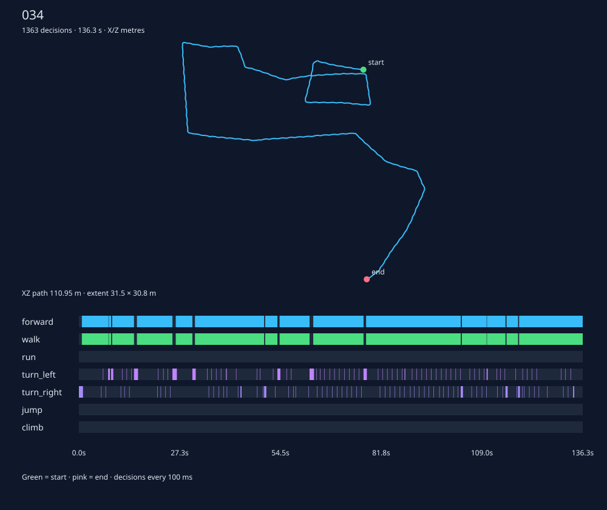

# Учитель клавишами и записи наблюдений

2026-10-17, подготовка этапа 5 [навигации](../../../docs/navigation.md).

**Порог доходимости не пройден.** Во второй проверке завершён **191 из 204 эпизодов: 156 успехов, 35 неуспехов**. Даже успех всех оставшихся 13 пар даст **169/204**, меньше требуемых 170. По правилу остановки после двух неудачных проверок дальнейшие прогоны и настройка прекращены. Полный корпус на 204 пары не получен.

Сохранено **173 692 решения, 2,951 ГБ** основного набора. **20/20 повторов** совпали по конечной точке и всей записанной траектории: максимальное отклонение **0 см**. Из **50 боковых стартов дошли 45 (90%)**, их отдельный корпус содержит ещё **29 249 решений, 0,482 ГБ**. Подражание не обучалось и остаётся открытым.

## Исполнитель

[NavKeyTeacher](../../../OpenGothic/common/navkeyteacher.cpp) — функция от текущей позы, скорости, состояния тела и пути с переходами до цели. Путь — единственное сохраняемое состояние ведения; индекса пройденного угла, фазы восстановления и таймера действия нет. Текущий отрезок и положение относительно link восстанавливаются геометрически. Новый путь можно построить из произвольной позы, включая состояния ученика.

Учитель поворачивается к следующему углу и идёт шагом. На jump/climb/drop выбирается бег; jump и climb выдаются у начала перехода при опоре и подходящем повороте, climb ждёт стоящего тела. В полёте решение восстанавливается по положению, скорости и флагам тела. При отклонении от маршрута путь прокладывается заново. Запасной вариант использует авторские дороги Waynet с отрезками Detour и сеточным хвостом; исполняется теми же клавишами. Если сеточный отрезок дороги полный, сохраняются все его углы и links.

[Стенд](../../../OpenGothic/common/navdemos.cpp) принимает решение каждые **100 мс**. Клавиши удерживаются через `NpcKeys::set`; существующий `NpcKeys::applyKeys` применяет их на каждом кадре runner (30 Гц, 33/33/34 мс). Скорость в наблюдении — разность физических позиций ног за последний кадр. Счётчики прогресса нужны только для диагностики и не выбирают действия.

NPC — `BAU_954_MALETH`. Использованы [исходные 204 пары 2а](../2026-10-16-navmesh/raw/pairs.jsonl), без новой выборки; каждая выполненная пара начинает свежий сохранённый мир, seed 7, 10:00. Лимит — 240 000 мс симуляции. Успех — ноги ближе 100 см к `goal.groundPos` в 3D, без полёта и подъёма. Герой стоит в 5 м по +Z от старта.

Шаг задан по умолчанию. Флаг CharacterVirtual не переопределялся: контроллер был активен **310372/520906 кадров (59,58%)** при штатном переключении по расстоянию до героя. `movable_vobs=0` унаследован от существующего навигационного runner. `roads on` включается на идущем Малете **до телепортации**: знакомство с местом остаётся его собственным, в городе и на чужой ферме он остаётся чужаком.

Минимальные точки доступа: `NavBench::navigationMesh` возвращает сетку только для чтения; `KnownRoadsBench::readPath` читает путь из включённых знаний именно этого NPC; два const-метода в `npc.h` читают нормаль опоры и состояние подъёма MoveAlgo. Сам глаз, память, клавиши, знания дорог и алгоритмы движения не изменены. В `testbench.cpp` добавлена регистрация команды, tick/reset и ожидание активного эпизода. `npc.cpp`, файлы боевой сессии, мост и серверный Python не затронуты.

## Доходимость

Колонка 2б — исторический составной результат обычного исполнителя CV=0 при 240 с, **177/204**; она приведена для ориентира, физика с тех пор обновлена.

| Место | Клавиши: дошло / выполнено | Не выполнено из 34 | Обычный ход 2б |
|---|---:|---:|---:|
| Рынок | 27/34 (79,41%) | 0 | 29/34 |
| Гавань | 28/34 (82,35%) | 0 | 30/34 |
| Ферма Онара | 29/34 (85,29%) | 0 | 32/34 |
| Ферма Лобарта | 30/34 (88,24%) | 0 | 29/34 |
| Улицы порта | 29/34 (85,29%) | 0 | 31/34 |
| Верхний квартал | 13/21 (61,90%) | 13 | 26/34 |
| **Всего** | **156/191 (81,68%)** | **13** | **177/204** |

Первая проверка остановлена на **151/186**: уже 35 неуспехов, верхняя граница 169/204. Найдена ошибка запасного маршрута: при заблокированном теле полные сеточные отрезки авторской дороги заменялись прямыми. Исправление сохраняет найденные Detour-отрезки. После него пары **72 и 108** стали успешными, **96** стала неуспешной; остальные общие исходы совпали. Первая часть второй проверки дала **152/186**.

Все 143 затронутых эпизода первой проверки собраны заново; 43 эпизода без запасного пути сохранены, поскольку исправленная ветка в них не выполнялась. Добавление ожидания стоящего тела не изменило сохранённые действия: в ранних эпизодах climb не выдавался. Затем выполнены пять новых пар 186–190. После обнаружения второго отрицательного результата команда остановки успела после завершения пары 190: окончательный итог **156/191**, граница по полным 204 — **169 (82,84%)**. Прерванная пара 191 исключена из корпуса; пары 191–203 не засчитаны.

## Причины неуспехов

Как в 2б, диагноз опирается на фактическое движение за последние ≤10 с, а не только на строку `failure`.

| Наблюдение | Случаев |
|---|---:|
| Нет полного пути (`no_path`) | 2 |
| Путь тела за окно ≤0,5 м | 19 |
| Путь >0,5 м, итоговое смещение ≤0,5 м | 3 |
| NPC выведен из строя до лимита | 4 |
| Продолжал двигаться у лимита | 7 |
| **Всего** | **35** |

Четыре ранних окончания — `isDown()` на парах **82, 86, 123, 127**: при неуспехе до 240 с это единственная ветка завершения стенда. Исходное `failure` там сохранило более раннее `body_blocked`; оно не использовано как диагноз. Состояние здоровья и конкретный источник поражения в запись не входят. Для неподвижных остановок конкретный предмет-помеха по сохранённым данным не установлен.

Ниже «путь / смещение» — 3D-длина движения и расстояние между концами окна. «Угол XZ / ΔY» — расстояние до последнего отладочного угла **сетки**, измеренное от позы последнего решения; при запасном пути этот угол может отличаться от исполняемого угла дороги. Все расстояния — метры. «Двигался» не означает, что обход был оптимальным или гарантированно закончился бы при большем лимите.

| Пара | Старт → цель | Наблюдение | До цели, м | Последние ≤10 с: путь / смещение, м | Угол XZ / ΔY, м |
|---:|---|---|---:|---:|---:|
| 0 | `NW_CITY_MERCHANT_PATH_38` → `FP_SWEEP_CITY_OV_03` | Двигался до лимита | 25,34 | 8,32 / 7,82 | 15,34 / 0,04 |
| 2 | `NW_CITY_MERCHANT_TEMPLE_IN` → `FP_ITEM_OV_02` | Локальное движение | 11,55 | 2,70 / 0,07 | 3,15 / 1,74 |
| 5 | `NW_CITY_MERCHANT_SHOP03_IN_05` → `FP_SMALLTALK_CITY_11` | Нет движения | 28,63 | 0,15 / 0,00 | 4,74 / -0,34 |
| 7 | `NW_CITY_MERCHANT_PATH_47` → `FP_ITEM_HERB_08` | Локальное движение | 32,32 | 0,75 / 0,04 | 1,52 / 0,04 |
| 17 | `NW_CITY_MERCHANT_PATCH_45_B` → `FP_ROAM_CITY_TO_FOREST_15` | Нет движения | 27,41 | 0,31 / 0,00 | 27,31 / 2,19 |
| 18 | `NW_CITY_MERCHANT_PATH_23` → `FP_SMALLTALK_CITY_37` | Двигался до лимита | 60,05 | 8,27 / 7,78 | 4,59 / 0,04 |
| 21 | `NW_CITY_MERCHANT_PATH_24` → `FP_CITY_WEAPON_05` | Нет движения | 3,32 | 0,00 / 0,00 | 2,75 / 0,04 |
| 40 | `NW_CITY_HABOUR_KASERN_03` → `FP_ROAM_KANAL_RATTEN_08` | Нет движения | 70,23 | 0,00 / 0,00 | 3,45 / -0,96 |
| 41 | `NW_CITY_HABOUR_POOR_AREA_PATH_18` → `FP_SMALLTALK_SCHREINER_01` | Нет движения | 37,64 | 0,00 / 0,00 | 7,88 / 0,19 |
| 42 | `NW_CITY_HABOUR_HUT_03_IN_06` → `FP_ROAM_KANAL_RATTEN_08` | Нет движения | 70,18 | 0,00 / 0,00 | 3,44 / -0,96 |
| 62 | `NW_CITY_HABOUR_PUFF_IN_08` → `FP_STAND_LARES` | Нет движения | 21,62 | 0,00 / 0,00 | 18,43 / 0,69 |
| 64 | `NW_CITY_HABOUR_HUT_08_IN_C` → `FP_ROAM_CITY_SHEEP_04` | Нет движения | 29,26 | 0,00 / 0,00 | 9,43 / -0,15 |
| 67 | `NW_CITY_HABOUR_HUT_08_IN` → `FP_ROAM_CITY_SHEEP_02` | Нет движения | 31,54 | 0,00 / 0,00 | 9,40 / -0,15 |
| 68 | `NW_BIGFARM_CHAPEL_06` → `FP_ROAM_NW_BIGFARM_SHEEP1_05` | Нет движения | 9,68 | 0,00 / 0,00 | 9,67 / 0,57 |
| 71 | `NW_BIGFARM_KITCHEN_03` → `FP_ROAM_NW_BIGFARM_SHEEP1_10` | Нет движения | 34,78 | 0,00 / 0,00 | 7,79 / 0,10 |
| 82 | `NW_BIGFARM_FELDREUBER4` → `FP_ROAM_NW_BIGFARM_FELDREUBER16` | NPC выведен из строя | 17,84 | 8,93 / 7,56 | 12,61 / 0,91 |
| 86 | `NW_BIGFARM01_RIGHTFIELD_02_MONSTER` → `FP_ROAM_NW_BIGFARM_FELDREUBER10` | NPC выведен из строя | 1,62 | 8,75 / 1,10 | 1,64 / -0,02 |
| 96 | `NW_BIGFARM_KITCHEN_04` → `FP_ROAM_NW_BIGFARM_SHEEP1_06` | Локальное движение | 38,63 | 0,50 / 0,00 | 1,44 / 0,09 |
| 114 | `NW_FARM1_OUT_10` → `FP_ROAM_NW_FARM1_MILL_01_06` | Нет движения | 7,85 | 0,00 / 0,00 | 7,84 / 0,28 |
| 122 | `NW_FARM1_FIELD_08` → `FP_ROAM_FARM1_SHEEP_09` | Нет движения | 11,79 | 0,00 / 0,00 | 11,79 / 0,09 |
| 123 | `NW_FARM1_PATH_CITY_05` → `FP_ROAM_NW_FARM1_CITYWALL_RIGHT_02` | NPC выведен из строя | 14,73 | 8,40 / 2,00 | 14,70 / 2,70 |
| 127 | `NW_FARM1_OUT_13` → `FP_ROAM_NW_FARM1_CITYWALL_RIGHT_04_04` | NPC выведен из строя | 57,80 | 9,97 / 8,09 | 22,79 / -5,46 |
| 140 | `NW_CITY_HABOUR_POOR_AREA_PATH_11` → `FP_STAND_CITY_12` | Нет полного пути | 36,12 | 0,00 / 0,00 | 36,00 / 3,06 |
| 149 | `NW_CITY_HABOUR_POOR_AREA_PATH_12` → `FP_STAND_CITY_REGIS` | Нет движения | 19,41 | 0,00 / 0,00 | 4,14 / 0,04 |
| 153 | `NW_CITY_HABOUR_POOR_AREA_PATH_06_B` → `FP_ROAM_CITY_RATS_02` | Нет движения | 19,52 | 0,00 / 0,00 | 4,73 / 0,20 |
| 156 | `NW_CITY_HABOUR_POOR_AREA_HUT_03_B` → `FP_STAND_HAFEN_02` | Нет движения | 33,85 | 0,00 / 0,00 | 15,96 / 0,03 |
| 164 | `NW_CITY_HABOUR_POOR_AREA_PATH_09` → `FP_ROAM_FARM1_FORREST_SNAPPER_02` | Двигался до лимита | 2,69 | 8,57 / 8,47 | 2,64 / 0,62 |
| 172 | `NW_CITY_UPTOWN_HUT_05_ENTRY_B` → `FP_STAND_GUARDING_RAMIREZ` | Двигался до лимита | 29,12 | 8,64 / 8,55 | 10,26 / -0,13 |
| 175 | `NW_CITY_UPTOWN_HUT_05_ENTRY_B` → `FP_STAND_WEAPON_02` | Двигался до лимита | 20,47 | 8,53 / 8,44 | 20,54 / 0,06 |
| 177 | `NW_CITY_UPTOWN_PATH_08_B` → `FP_STAND_CITY_12` | Нет полного пути | 35,46 | 0,00 / 0,00 | 34,90 / -6,30 |
| 178 | `NW_CITY_UPTOWN_HUT_04_04` → `FP_CITY_WEAPON_03` | Двигался до лимита | 48,93 | 8,39 / 6,96 | 16,54 / 0,04 |
| 179 | `NW_CITY_UPTOWN_PATH_06_B` → `FP_ITEM_OV_02` | Нет движения | 28,73 | 0,00 / 0,00 | 0,88 / 0,04 |
| 182 | `NW_CITY_UPTOWNPARADE_12` → `FP_SMALLTALK_CITY_14` | Нет движения | 4,12 | 0,00 / 0,00 | 4,13 / -0,19 |
| 183 | `NW_CITY_UPTOWN_HUT_04_05` → `FP_STAND_WEAPON_03` | Двигался до лимита | 29,22 | 8,29 / 8,20 | 29,30 / 0,09 |
| 187 | `NW_CITY_UPTOWN_HUT_04_03` → `FP_SIT_CAMPFIRE_JOE` | Нет движения | 3,91 | 0,00 / 0,00 | 3,91 / 0,04 |

## Повтор записанных клавиш

Свежий мир и тот же seed 7; воспроизводятся только клавиши и длительность удержания, без решений учителя. Завершение идёт по записанному времени, чтобы раннее попадание в радиус цели не обрезало сравнение. Проверены первые 20 успешных эпизодов из сохранённой неизменившейся части набора, номера указаны ниже.

У всех 20 совпали временные метки. По **5554 точкам** (10 Гц плюс конечные) максимум, среднее, RMS и p95 ошибки положения — **0 см**; максимум ошибки поворота — **0°**. Конечные точки — **0 см**. Первого расхождения больше 1 мм или 10 см нет. Эти повторы покрывают шаг и поворот; прыжков и подъёмов в них нет.

| Пара | Сравнено точек | Конечная ошибка, см | Макс. по траектории, см | RMS, см |
|---:|---:|---:|---:|---:|
| 3 | 332 | 0 | 0 | 0 |
| 6 | 232 | 0 | 0 | 0 |
| 13 | 499 | 0 | 0 | 0 |
| 15 | 163 | 0 | 0 | 0 |
| 23 | 180 | 0 | 0 | 0 |
| 27 | 227 | 0 | 0 | 0 |
| 28 | 194 | 0 | 0 | 0 |
| 30 | 178 | 0 | 0 | 0 |
| 32 | 128 | 0 | 0 | 0 |
| 35 | 244 | 0 | 0 | 0 |
| 38 | 386 | 0 | 0 | 0 |
| 51 | 136 | 0 | 0 | 0 |
| 63 | 238 | 0 | 0 | 0 |
| 70 | 532 | 0 | 0 | 0 |
| 73 | 167 | 0 | 0 | 0 |
| 79 | 338 | 0 | 0 | 0 |
| 81 | 437 | 0 | 0 | 0 |
| 83 | 435 | 0 | 0 | 0 |
| 84 | 366 | 0 | 0 | 0 |
| 91 | 142 | 0 | 0 | 0 |

## Чужие состояния

50 детерминированно случайных стартов: выбирается исходная пара, середина длины её Detour-пути, боковое смещение 1–5 м по нормали к отрезку и абсолютный поворот тела в диапазоне −180…180°. Фактические модули смещения — **1,081–4,992 м**. Для каждого старта загружается свежий мир и путь строится из новой позы.

До начала управления отвергнуто **10** кандидатов без полного исходного пути или допустимой опоры (landRay, вертикальная нормаль ≥0,65). Отказы с нулевыми временем и решениями лежат отдельно в `dagger-rejected/`; повторная выборка воспроизводима по seed и номеру состояния. После начала управления ни один неуспех не заменялся. В итоговом корпусе ровно **50 физических эпизодов**, **45 успехов (90%)**, пять неуспехов. Порог ≥80% получен.

| Состояние | Исходная пара | Боковое смещение, м | Поворот, ° | До цели в конце, м | Наблюдение |
|---:|---:|---:|---:|---:|---|
| 20 | 178 | 3,99 | 0,89 | 3,81 | Нет движения |
| 24 | 187 | 1,20 | 9,12 | 3,91 | Нет движения |
| 25 | 179 | -3,58 | 153,96 | 11,71 | Локальное движение |
| 44 | 167 | -4,99 | 9,08 | 21,03 | Нет движения |
| 49 | 137 | -1,09 | 81,13 | 14,14 | Нет движения |

## Данные и схема

Основной корпус на Ryzen: **`~/gothic-ai/nav-demos/episodes/`**, 191 эпизод, **173 692 решения**. Сжатые наблюдения — **2 864 177 068 байт**, все файлы эпизодов — **2 950 511 174 байт (2,951 ГБ)**; несжатый поток наблюдений с заголовками — **30 194 276 008 байт**. ГБ здесь = 10⁹ байт. Целевые 204 эпизода не собраны из-за правила остановки.

Отдельно `dagger/`: 50 эпизодов, **29 249 решений**, **482 024 121 байт** со всеми файлами. Основной и боковой корпуса вместе — **241 эпизод, 202 941 решение, 3,433 ГБ**. Повторы, короткие замеры скорости, архивы прежних вариантов, source/build/cache в эти числа не входят. Данные в git не добавлялись. Неуспешные эпизоды сохранены с `success=false`; для подражания успешным проходам их можно отбирать по этому полю.

В эпизоде: `samples.bin.gz`, `episode.json`, `actions.txt`, `trajectory.txt`. Наблюдения — gzip уровня 1, внутри packed little-endian: 32-байтовый заголовок `<8s6I` (`NAVDEMO\0`, версия 1, размер записи 173838, 238 лучей, near=64, far=100, период 100 мс), затем записи фиксированной длины. Полный dtype — в [загрузчике](../../../scripts/nav_demos.py); код записи — [NavDemoWriter](../../../OpenGothic/common/navdemowriter.cpp).

| Поле | Форма и тип | Смысл и единицы |
|---|---|---|
| `time_ms` | uint64 | Абсолютное время симуляции, мс; шаг строго 100 мс |
| `body.velocity_cm_s` | float32[3] | Скорость ног, см/с, в системе тела |
| `body.flags` | uint8[5] | inAir, falling, sliding, climbing, swimming; биты |
| `body.ground_normal`, `ground_slope_deg` | float32[3], float32 | Нормаль опоры в системе тела; уклон 0…180° |
| `body.head_yaw_deg`, `head_pitch_deg` | 2 × float32 | Фактическое направление головы относительно тела, градусы |
| `roads.next_direction`, `next_distance_cm` | float32[3], float32 | Единичное направление к следующей точке грубого пути и расстояние, см |
| `roads.goal_direction`, `goal_distance_cm` | float32[3], float32 | Направление и расстояние до цели, см |
| `roads.remaining_visual_cm`, `goal_in_known` | float32, uint8 | Остаток пути «глазами», см; цель в знакомом месте |
| `previous_keys` | структура ключей | Предыдущая команда учителя |
| `keys` | структура ключей | **Метка действия**: forward/strafe/turn float32 в [−1,1], head yaw/pitch float32 в градусах, walk/jump/climb uint8 |
| `eye` | 238 × структура луча | distance_cm float32 ≥0; kind uint8; normal_y float32 [−1,1]; age_ms и near_age_ms uint32; complete/hit uint8 |
| `memory_near` | [64,64] × ячейка | 25 см/ячейка, вид памяти в системе тела |
| `memory_far` | [100,100] × ячейка | 200 см/ячейка, вид памяти в системе тела |
| Ячейка памяти | 7 × uint8 + float32 + uint8 | confidence/free/wall/ledge/drop/water/movable = round(255·p); ground_height_cm — мировая высота, см; height_valid — бит |
| `teacher_hint` | float32[3] + float32 | **Отладка**: следующий угол Detour в мировых см и длина остатка пути в см |
| `position_cm`, `body_yaw_deg` | float32[3], float32 | **Отладка**: мировая физическая поза ног и поворот тела |

Векторы тела и дорог: x — ось right, y — вверх, z — вперёд, как в существующем виде памяти; при мировом yaw θ ось right = (−sin θ,0,cos θ), forward = (cos θ,0,sin θ). Память индексируется `[forward,right]`. Направление может быть нулевым при совпадении точки с телом. Неизвестная высота хранится как `height=0, height_valid=0`, без NaN. Квантование вероятностей даёт ошибку не больше 1/510.

В `episode.json.eye_layout` лежат 238 троек yaw°, pitch°, max_range_cm относительно головы. Виды попадания: 0 none, 1 world, 2 static vob, 3 movable vob, 4 NPC, 5 water. Возраст луча сохраняет свежесть исходного выхода глаза. Если полного сеточного пути нет либо цель уже достигнута, длина подсказки равна 0; при отсутствии пути следующий угол — цель. На запасном пути подсказка всё равно относится к Detour, а не к привилегированной дороге.

`learner_input()` возвращает только body, roads, previous_keys, eye и оба вида памяти. Клавиши-метки, мировая поза и подсказка учителя остаются отдельно.

`actions.txt`: относительное время мс, forward, strafe, turn, walk, jump, climb, headYaw°, headPitch°. Последняя нейтральная строка закрывает интервал удержания и совпадает с `elapsed_ms`. `trajectory.txt`: относительное время мс, X/Y/Z ног в см, yaw°. Записи наблюдений заканчиваются на последнем решении; терминальная поза пишется отдельно в траекторию.

### Доли клавиш

Доли от всех 173 692 основных решений; признаки пересекаются. Шаг и бег считаются при поступательном движении.

| Действие | Решений | Доля |
|---|---:|---:|
| Вперёд | 159345 | 91,74% |
| Шаг при движении | 159345 | 91,74% |
| Бег при движении | 0 | 0,00% |
| Поворот | 26246 | 15,11% |
| Поворот влево | 12086 | 6,96% |
| Поворот вправо | 14160 | 8,15% |
| Прыжок | 0 | 0,00% |
| Залезание | 0 | 0,00% |
| Назад | 0 | 0,00% |
| Стрейф | 0 | 0,00% |
| Без движения и поворота | 4800 | 2,76% |

**Живых примеров переходов в корпусе нет:** бег, jump и climb не выбирались ни в основных, ни в 50 боковых эпизодах. Логика jump/climb/drop проверена контрактом на маленьком графе; её фактическое исполнение в этом корпусе не подтверждено. Это ограничение набора вместе с недостигнутой доходимостью остаётся открытым.



Эпизод 34: `NW_CITY_HABOUR_PUFF_PECK` → `FP_STAND_EATING_01`, 136,3 с, 1363 решения, до цели в конце 98,37 см. Путь показан по позам решений, лента — по интервалам 100 мс.

## Цена записи и скорость сбора

Среднее, взвешенное по 173 692 решениям: **1010,61 мкс**, максимум **7606,75 мкс**. Измеряется `NavDemoWriter::append`: проверка полей, кодирование, сжатие и `gzwrite`. Получение датчиков, построение вида памяти и пути, текстовые трассы и финальный flush/close в это число не входят.

По основным эпизодам один runner дал **45,97 решения/с** внутри эпизодов и **39,46 решения/с** с reset мира. Подготовка процесса/сетки и ожидание общего замка исключены.

Сравнение параллельности — одинаковые четыре среза по 10 с симуляции, 400 решений на опыт, с reset между эпизодами. Процессы и кэш подготовлены до барьера; время — максимум интервалов сбора работников после барьера.

| Параллельных runner | Решений | Время сбора, с | Суммарно решений/с |
|---:|---:|---:|---:|
| 1 | 400 | 22,707 | 17,62 |
| 2 | 400 | 12,125 | 32,99 |
| 4 | 400 | 6,894 | 58,02 |

Обычный сбор шёл одним runner, по два эпизода под общим замком `~/gothic-ai/body-simulation.lock`, с отпусканием между пачками. Несколько runner использованы только в коротком замере скорости. Перед каждой пачкой проверялся `df -h ~`; к остановке оставалось 107 ГБ. Чужие процессы и папки не менялись.

## Проверки и повторение

- На Ryzen собраны `Gothic2Notr`, `gothic-body-runner`, выполнен `check-navkeyteacher`. Контракт покрывает поворот, углы, перепрокладку из сторонней позы, jump/climb/drop, восстановление в воздухе, посадку и недопустимые входы.
- Python-проверка основного и бокового корпусов прошла через `python3 -I scripts/nav_demos.py check` на Ryzen: **191 + 50 эпизодов**, **173 692 + 29 249 решений**. Проверены заголовок/dtype/формы, диапазоны, отсутствие NaN/Inf, период, возраст лучей, прошлые клавиши, соответствие actions бинарным меткам и терминальное время.
- На Mac выполнена только компиляция движка: Ninja RelWithDebInfo, parallel=2; configure 9,17 с, полная сборка 315,09 с, код 0. Заключительная проверка актуальности сборки — `ninja: no work to do`.
- Полный pytest, e2e и живые модели не запускались. Дальнейшие игровые проверки остановлены после второго отрицательного результата.

C++ учителя и стенда проверялся на `4601451d`; последующие `f7537fad` и `dbd212a8` меняют подготовку боковой выборки и JSON-сводку загрузчика. [Сборщик](../../../scripts/collect_nav_demos.py) и [пачки с замком](../../../scripts/nav-demos-batch.sh) оставлены для воспроизведения.

Команды на Ryzen, все пути вывода абсолютные:

```bash
TASK="$HOME/gothic-ai/nav-demos"
flock "$HOME/gothic-ai/body-simulation.lock" \
  cmake --build "$TASK/build" --target Gothic2Notr gothic-body-runner check-navkeyteacher --parallel 8

args=(--runner "$TASK/build/opengothic/gothic-body-runner"
      --assets "$HOME/gothic-ai/game"
      --save "$HOME/gothic-ai/nav-mesh/save_slot_1.sav"
      --cache "$TASK/cache" --output "$TASK")

# Это команды воспроизведения; текущий сбор остановлен на 191 эпизоде.
bash "$TASK/source/scripts/nav-demos-batch.sh" collect "${args[@]}" --resume
bash "$TASK/source/scripts/nav-demos-batch.sh" replay "${args[@]}" --resume \
  --indices 3,6,13,15,23,27,28,30,32,35,38,51,63,70,73,79,81,83,84,91
bash "$TASK/source/scripts/nav-demos-batch.sh" dagger "${args[@]}" --resume
for parallel in 1 2 4; do
  bash "$TASK/source/scripts/nav-demos-batch.sh" performance "${args[@]}" \
    --parallel "$parallel" --count 4 --resume
done

flock "$HOME/gothic-ai/body-simulation.lock" \
  env PATH="$TASK/.venv/bin:$PATH" python3 -I "$TASK/source/scripts/nav_demos.py" \
  check "$TASK" --output "$TASK/dataset-summary.json"
flock "$HOME/gothic-ai/body-simulation.lock" \
  env PATH="$TASK/.venv/bin:$PATH" python3 -I "$TASK/source/scripts/nav_demos.py" \
  check "$TASK/dagger" --output "$TASK/dagger-summary.json"
```

Загрузчик требует только NumPy и стандартную библиотеку Python. Из корня репозитория:

```python
from pathlib import Path
from scripts.nav_demos import iter_chunks, learner_input

episode = Path.home() / "gothic-ai/nav-demos/episodes/034"
for rows in iter_chunks(episode):  # по 64 записи, без загрузки всего эпизода
    inputs = learner_input(rows)
    labels = rows["keys"]
```
