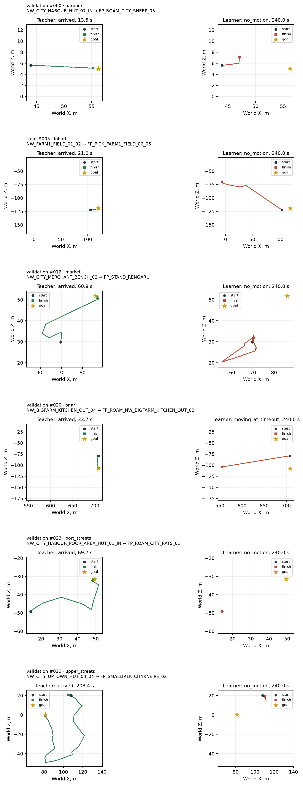

# Первая езда обученной GRU клавишами

2026-10-17, этап 5 [навигации](../../../docs/navigation.md).

**Ученик дошёл в 0 из 31 отложенной пары против 31/31 у учителя.** На отдельных 30 обучающих парах — **0/30**, у учителя 30/30. Контроль Малета у забора — **дошёл за 107,4 с**. Веса не менялись по результатам езды.

Прямой проход C++ совпал с `NumpyPolicy` на **1000 последовательных записанных шагах**: максимальная ошибка логитов **2,03×10⁻⁶**, GRU — **2,00×10⁻⁶**, допуск **10⁻⁴**. Все **62 поездки / 147 474 решения** проверены как NAVDEMO и сохранены на Ryzen для DAgger.

## Исполнение и вход

[NavPolicy](../../../OpenGothic/common/navpolicy.cpp) читает `.navbc` и выполняет две свёрточные ветви, линейные слои и GRU обычными циклами C++ float32. Новых библиотек нет; JSON разбирается уже имеющимся rapidjson. У каждого исполнителя своё состояние GRU, в начале эпизода оно нулевое. Действие — argmax каждой из шести голов на 10 Гц через существующий `NpcKeys`; взгляд NPC направлен прямо.

Вход берётся из того же `NavDemoWriter::Snapshot`, который тут же записывается. Сначала повторяется байтовое квантование вероятностей памяти, затем `encode_features`: уменьшение карт, относительная высота, нормировки, one-hot, дороги, тело и прошлые фактические клавиши. Политика не читает мировую позу, поворот тела в мире, позу памяти и подсказки учителя. Контракт меняет эти поля и проверяет неизменность входа и результата.

[NavDemos](../../../OpenGothic/common/navdemos.cpp) добавляет только режимы стенда `drive`, `drive-current`, `speed` и метрики. Глаз, память, знакомые дороги, клавиши, учитель и писатель записей не менялись. Новые точки доступа не понадобились. `npc.cpp`, `testbench.cpp`, файлы тела/симуляции, мост, игра и серверный Python не менялись.

## Пары и условия

Все отложенные пары (31) взяты из сохранённого `nav-bc/cache/index.json`. Из обучающей части выбрано по 5 разных пар из каждого из 6 мест, стандартным `random.Random(17)` по отсортированным спискам. Разбиение не менялось; все исходные эпизоды учителя успешны. [Полный список и исходы](pairs.csv), [метрики каждого эпизода](metrics.json). Учитель в сравнении — сохранённая исходная поездка с той же парой и seed, без нового прогона.

Каждая поездка: свежий reset сохранённого мира, seed 7, 10:00, `BAU_954_MALETH`, лимит 240 000 мс симуляции. Успех: расстояние до `goal.groundPos` в 3D <100 см, без полёта и подъёма. По умолчанию шаг, без изменения скорости. `roads on` включается до переноса NPC, поэтому его знакомство с дорогами остаётся прежним. В поездках с заданным стартом герой стоит в 5 м по +Z от старта; условия контроля описаны отдельно ниже. `movable_vobs=0`, штатное переключение CharacterVirtual по расстоянию. Общий замок Ryzen брался по 2 пары и отпускался между пачками.

Езда и сверка C++ выполнены на `e219ebe2`; веса: `ryzen:~/gothic-ai/nav-drive/policy.navbc`, копия исходных `nav-bc/run/policy.navbc`, SHA-256 `ace13a86c73564f5ab4682bc77237ca0c5e8321cee67c4e83339b90b9fef4038`.

## Доходимость, время и застревания

Время ученика — медиана всех поездок / медиана успешных; время учителя — медиана всех пар соответствующей строки. Каждый неуспешный ход ученика завершился у лимита 240 с. Полное время каждого хода есть в CSV.

| Выборка / место | Ученик | Учитель | Ученик, все / успехи, с | Учитель, с | Застреваний | Ходов с остановкой ≥3 с |
|---|---:|---:|---:|---:|---:|---:|
| Отложенные: все | 0/31 | 31/31 | 240,00 / — | 40,17 | 30 | 31 |
| Отложенные: Рынок | 0/5 | 5/5 | 240,00 / — | 40,17 | 2 | 5 |
| Отложенные: Гавань | 0/6 | 6/6 | 240,00 / — | 58,28 | 7 | 6 |
| Отложенные: Ферма Онара | 0/6 | 6/6 | 240,00 / — | 35,70 | 7 | 6 |
| Отложенные: Ферма Лобарта | 0/6 | 6/6 | 240,00 / — | 39,35 | 4 | 6 |
| Отложенные: Улицы порта | 0/6 | 6/6 | 240,00 / — | 57,37 | 0 | 6 |
| Отложенные: Верхний квартал | 0/2 | 2/2 | 240,00 / — | 111,00 | 10 | 2 |
| Обучающие: все | 0/30 | 30/30 | 240,00 / — | 44,53 | 14 | 30 |
| Обучающие: Рынок | 0/5 | 5/5 | 240,00 / — | 91,73 | 2 | 5 |
| Обучающие: Гавань | 0/5 | 5/5 | 240,00 / — | 57,13 | 2 | 5 |
| Обучающие: Ферма Онара | 0/5 | 5/5 | 240,00 / — | 35,63 | 5 | 5 |
| Обучающие: Ферма Лобарта | 0/5 | 5/5 | 240,00 / — | 39,43 | 2 | 5 |
| Обучающие: Улицы порта | 0/5 | 5/5 | 240,00 / — | 60,77 | 3 | 5 |
| Обучающие: Верхний квартал | 0/5 | 5/5 | 240,00 / — | 102,37 | 0 | 5 |

Застревание клавишами: за скользящие 3 с смещение в XZ <50 см и поступательное действие запрошено не меньше 1,5 с окна. Перекрывающиеся окна объединяются в эпизоды. Это отдельный счётчик стенда: штатному детектору `goTo` нужна цель нативного хода, которой у клавиш нет. Остановка ≥3 с в таблице также видит поворот на месте и нейтральные клавиши: 3D-смещение между концами 3-секундного окна ≤25 см.

У отложенных пар суммарно 2725,90 с застревания клавишами, максимум одного эпизода 225,90 с; у обучающих — 1168,90 и 213,50 с.

## Причины неуспехов

Как в отчёте учителя: диагноз определяется фактической 3D-траекторией за последние ≤10 с. Сначала выделяется отсутствие пути, затем досрочное окончание `isDown()`, затем неподвижность, локальное движение и движение у лимита. Строка `body_blocked` сама по себе диагнозом не считается. Конкретный предмет-помеха и причина поражения по этим данным не установлены.

| Наблюдение | Отложенные | Обучающие | Контроль |
|---|---:|---:|---:|
| Нет полного пути | 0 | 0 | 0 |
| NPC выведен из строя | 0 | 0 | 0 |
| Путь за последние ≤10 с ≤0,5 м | 30 | 28 | 0 |
| Путь >0,5 м, смещение ≤0,5 м | 0 | 0 | 0 |
| Двигался у лимита | 1 | 2 | 0 |

| Пара | Наблюдение | До цели, м | Последние ≤10 с: путь / смещение, м |
|---|---|---:|---:|
| train 000 | Путь за последние ≤10 с ≤0,5 м | 22,84 | 0,00 / 0,00 |
| train 001 | Путь за последние ≤10 с ≤0,5 м | 39,84 | 0,00 / 0,00 |
| train 002 | Путь за последние ≤10 с ≤0,5 м | 9,01 | 0,00 / 0,00 |
| train 003 | Путь за последние ≤10 с ≤0,5 м | 12,86 | 0,00 / 0,00 |
| train 004 | Путь за последние ≤10 с ≤0,5 м | 16,78 | 0,01 / 0,00 |
| train 005 | Путь за последние ≤10 с ≤0,5 м | 137,12 | 0,00 / 0,00 |
| train 006 | Путь за последние ≤10 с ≤0,5 м | 33,81 | 0,00 / 0,00 |
| train 007 | Путь за последние ≤10 с ≤0,5 м | 29,34 | 0,00 / 0,00 |
| train 008 | Путь за последние ≤10 с ≤0,5 м | 19,70 | 0,00 / 0,00 |
| train 009 | Путь за последние ≤10 с ≤0,5 м | 37,29 | 0,00 / 0,00 |
| train 010 | Путь за последние ≤10 с ≤0,5 м | 11,79 | 0,00 / 0,00 |
| train 011 | Путь за последние ≤10 с ≤0,5 м | 69,63 | 0,00 / 0,00 |
| train 012 | Путь за последние ≤10 с ≤0,5 м | 23,48 | 0,00 / 0,00 |
| train 013 | Двигался у лимита | 4,93 | 6,92 / 6,88 |
| train 014 | Двигался у лимита | 27,10 | 8,98 / 8,34 |
| train 015 | Путь за последние ≤10 с ≤0,5 м | 31,36 | 0,00 / 0,00 |
| train 016 | Путь за последние ≤10 с ≤0,5 м | 41,92 | 0,00 / 0,00 |
| train 017 | Путь за последние ≤10 с ≤0,5 м | 6,27 | 0,00 / 0,00 |
| train 018 | Путь за последние ≤10 с ≤0,5 м | 125,88 | 0,00 / 0,00 |
| train 019 | Путь за последние ≤10 с ≤0,5 м | 14,85 | 0,30 / 0,26 |
| train 020 | Путь за последние ≤10 с ≤0,5 м | 39,87 | 0,00 / 0,00 |
| train 021 | Путь за последние ≤10 с ≤0,5 м | 26,89 | 0,00 / 0,00 |
| train 022 | Путь за последние ≤10 с ≤0,5 м | 22,39 | 0,00 / 0,00 |
| train 023 | Путь за последние ≤10 с ≤0,5 м | 12,91 | 0,00 / 0,00 |
| train 024 | Путь за последние ≤10 с ≤0,5 м | 27,97 | 0,00 / 0,00 |
| train 025 | Путь за последние ≤10 с ≤0,5 м | 25,29 | 0,00 / 0,00 |
| train 026 | Путь за последние ≤10 с ≤0,5 м | 33,55 | 0,00 / 0,00 |
| train 027 | Путь за последние ≤10 с ≤0,5 м | 35,13 | 0,00 / 0,00 |
| train 028 | Путь за последние ≤10 с ≤0,5 м | 28,95 | 0,00 / 0,00 |
| train 029 | Путь за последние ≤10 с ≤0,5 м | 21,64 | 0,00 / 0,00 |
| validation 000 | Путь за последние ≤10 с ≤0,5 м | 9,40 | 0,00 / 0,00 |
| validation 001 | Путь за последние ≤10 с ≤0,5 м | 34,01 | 0,00 / 0,00 |
| validation 002 | Путь за последние ≤10 с ≤0,5 м | 30,11 | 0,00 / 0,00 |
| validation 003 | Путь за последние ≤10 с ≤0,5 м | 22,27 | 0,00 / 0,00 |
| validation 004 | Путь за последние ≤10 с ≤0,5 м | 40,42 | 0,00 / 0,00 |
| validation 005 | Путь за последние ≤10 с ≤0,5 м | 19,17 | 0,00 / 0,00 |
| validation 006 | Путь за последние ≤10 с ≤0,5 м | 21,41 | 0,00 / 0,00 |
| validation 007 | Путь за последние ≤10 с ≤0,5 м | 23,06 | 0,00 / 0,00 |
| validation 008 | Путь за последние ≤10 с ≤0,5 м | 66,81 | 0,00 / 0,00 |
| validation 009 | Путь за последние ≤10 с ≤0,5 м | 56,47 | 0,00 / 0,00 |
| validation 010 | Путь за последние ≤10 с ≤0,5 м | 18,06 | 0,00 / 0,00 |
| validation 011 | Путь за последние ≤10 с ≤0,5 м | 15,51 | 0,00 / 0,00 |
| validation 012 | Путь за последние ≤10 с ≤0,5 м | 25,73 | 0,50 / 0,48 |
| validation 013 | Путь за последние ≤10 с ≤0,5 м | 12,04 | 0,00 / 0,00 |
| validation 014 | Путь за последние ≤10 с ≤0,5 м | 26,20 | 0,00 / 0,00 |
| validation 015 | Путь за последние ≤10 с ≤0,5 м | 24,54 | 0,00 / 0,00 |
| validation 016 | Путь за последние ≤10 с ≤0,5 м | 14,25 | 0,00 / 0,00 |
| validation 017 | Путь за последние ≤10 с ≤0,5 м | 29,36 | 0,00 / 0,00 |
| validation 018 | Путь за последние ≤10 с ≤0,5 м | 35,99 | 0,01 / 0,00 |
| validation 019 | Путь за последние ≤10 с ≤0,5 м | 36,31 | 0,00 / 0,00 |
| validation 020 | Двигался у лимита | 154,06 | 8,63 / 8,48 |
| validation 021 | Путь за последние ≤10 с ≤0,5 м | 19,15 | 0,00 / 0,00 |
| validation 022 | Путь за последние ≤10 с ≤0,5 м | 12,04 | 0,00 / 0,00 |
| validation 023 | Путь за последние ≤10 с ≤0,5 м | 39,53 | 0,00 / 0,00 |
| validation 024 | Путь за последние ≤10 с ≤0,5 м | 33,58 | 0,00 / 0,00 |
| validation 025 | Путь за последние ≤10 с ≤0,5 м | 27,93 | 0,00 / 0,00 |
| validation 026 | Путь за последние ≤10 с ≤0,5 м | 37,60 | 0,00 / 0,00 |
| validation 027 | Путь за последние ≤10 с ≤0,5 м | 36,43 | 0,00 / 0,00 |
| validation 028 | Путь за последние ≤10 с ≤0,5 м | 10,13 | 0,00 / 0,00 |
| validation 029 | Путь за последние ≤10 с ≤0,5 м | 36,72 | 0,00 / 0,00 |
| validation 030 | Путь за последние ≤10 с ≤0,5 м | 10,14 | 0,00 / 0,00 |

Контроль подготовлен как [intentional.bench](../2026-10-16-stuck/intentional.bench): герой в `NW_FARM1_ENTRANCE_03`, Малет смещён `(0,0,-1400)`, герой перемещён в `NW_FARM1_ENTRANCE_01`, ожидание 1000 мс. Затем ученик ведёт из текущей позы к `FP_ROAM_FARM1_SHEEP_09`. Итог — **107,40 с, до цели 98,67 см, 0 застреваний поступательных клавиш**; одна остановка ≥3 с. Лимит ученика 240 с; исторический прямой нативный ход в исходном контроле длился 40 с и дал застревание 28,867 с. Это сравнение разных исполнителей.

## Траектории сверху



На каждой строке одинаковый масштаб двух панелей; круг — старт, квадрат — финиш, звезда — цель. Показаны неуспешные пары из всех шести мест: вторая строка — обучающая пара Лобарта, остальные — отложенные. Координаты в метрах; это отладочная визуализация, эти координаты не поступают политике.

## DAgger

Все записи лежат в `ryzen:~/gothic-ai/nav-drive/dagger/{validation,train,control}/`. `keys` — решение неизменённого учителя из текущего состояния ученика; `previous_keys` — фактическое действие ученика на предыдущем решении. `actions.txt` сохраняет фактические клавиши ученика и нейтральную терминальную строку. Формат `NAVDEMO` версии 1 и `learner_input()` не менялись.

Минимально расширена проверка [nav_demos.py](../../../scripts/nav_demos.py): при `episode.json.drive=true` прошлые клавиши сверяются с `actions.txt`, а метки остаются учительскими. Обычные демонстрации по-прежнему требуют совпадения действий и меток. Проверены расхождения внутри и между блоками чтения, включая испорченную запись.

`python3 -I scripts/nav_demos.py check` прошёл на **62 эпизодах / 147 474 решениях**, `validated=true`; сжатые записи — **2 005 810 214 байт (1,868 GiB)**. [Результат проверки](dagger-check.json).

Доля решений с несовпадением argmax ученика и ответа учителя в посещённом учеником состоянии:

| Голова | Отложенные | Обучающие | Контроль | Все 62 |
|---|---:|---:|---:|---:|
| Вперёд / назад | 54,55% | 39,59% | 48,42% | 47,20% |
| Вбок | 0,00% | 0,00% | 0,00% | 0,00% |
| Поворот | 73,92% | 65,14% | 73,93% | 69,64% |
| Шаг / бег | 0,00% | 0,00% | 0,00% | 0,00% |
| Прыжок | 0,00% | 0,00% | 0,00% | 0,00% |
| Залезть | 0,00% | 0,00% | 0,00% | 0,00% |
| Любая голова | 77,74% | 70,13% | 76,91% | 74,02% |

Неуспехи ученика сохранены полностью. Переобучение не выполнялось; `scripts/nav_bc_*` оставлены без изменений. Текущий `prepare` фильтрует `success=false`, поэтому следующий DAgger-раунд должен включить и неуспешные поездки ученика: их ответы учителя остаются валидной разметкой.

## Цена C++

Ryzen 3950X, один поток, сборка RelWithDebInfo, без fast-math и внешней математики. Каждые 100 мс одно живое наблюдение кодируется один раз и проходит через 20/50 отдельных состояний GRU. Это измерение цены прямого прохода для числа исполнителей; физика 20/50 разных тел не измеряется. Первые 30 решений — прогрев, следующие 100 тактов измерены. Загрузка весов, сбор датчиков, учитель и запись исключены из времени прохода.

| Состояний NPC | Измерено проходов | Проход, медиана / p95, мкс | Кодирование входа, мкс | Весь такт популяции, мс |
|---:|---:|---:|---:|---:|
| 20 | 2000 | 237,20 / 288,12 | 355,99 / 373,19 | 5,18 / 5,37 |
| 50 | 5000 | 232,94 / 259,07 | 352,98 / 369,64 | 12,11 / 12,53 |

Последний столбец включает одно общее кодирование входа; при разных живых NPC каждому требуется свой вход. [Точные числа](performance.json).

MacBook Apple M1 Pro, один поток, те же 13 с и 20 состояний: проход **263,33 / 296,59 мкс**, кодирование **138,98 / 152,42 мкс**, весь такт **5,48 / 5,78 мс**. Перед стартом `LC_ALL=C pgrep -f '^[^ ]*Gothic2Notr -g'` вернул пустой результат; guard сборщика проверил это повторно. [Числа Mac](performance-mac.json).

## Проверки

- На Ryzen собраны `Gothic2Notr` и `gothic-body-runner`; `check-navpolicy` прошёл на маленьких синтетических весах и 1000 шагах, ошибка логитов 1,86265×10⁻⁹.
- Реальная сверка: первые 1000 последовательных решений `nav-demos/episodes/000`, исходные обученные веса, один непрерывный GRU без сброса. Ошибка признаков 9.53674e-07, логитов 2.02656e-06, состояния 1.99676e-06. [Числа](parity.json). Fixtures остаются в `~/gothic-ai/nav-drive/parity-real/` и `build/navpolicy-fixture/`.
- Шесть точечных Python-тестов DAgger прошли за 0,57 с, включая сохранение дробных осей в прежних демонстрациях.
- На Mac собраны движок и runner, только компиляция, parallel=2; заключительная проверка актуальности сборки прошла.
- Короткий замер 20 состояний на Mac выполнен после завершения ранее запущенной игры и двух пустых проверок pgrep. Другие локальные вычисления моделей не запускались.
- Полный pytest, e2e и живые языковые модели не запускались. Веса и записи в git не добавлены.

## Повторение

[Сборщик и анализ](../../../scripts/nav_drive.py), [пачки с общим замком](../../../scripts/nav-drive-batch.sh), [генератор контракта](../../../scripts/check_nav_policy.py). Все команды выполняются на Ryzen; новая езда требует нового output или `--resume` для продолжения существующего набора.

```bash
task=/home/kaifaty/gothic-ai/nav-drive
export PATH=/home/kaifaty/gothic-ai/nav-bc/.venv/bin:$PATH
export OPENBLAS_NUM_THREADS=1 OMP_NUM_THREADS=1 MKL_NUM_THREADS=1
flock /home/kaifaty/gothic-ai/body-simulation.lock \
  cmake --build "$task/build" --target Gothic2Notr gothic-body-runner check-navpolicy --parallel 12
flock /home/kaifaty/gothic-ai/body-simulation.lock \
  python3 -I "$task/source/scripts/check_nav_policy.py" --output "$task/parity-real" \
    --weights "$task/policy.navbc" --source /home/kaifaty/gothic-ai/nav-demos --steps 1000
flock /home/kaifaty/gothic-ai/body-simulation.lock \
  "$task/build/opengothic/gothic-navpolicy-contract" "$task/policy.navbc" "$task/parity-real/parity.bin.gz"
python3 -I "$task/source/scripts/nav_drive.py" prepare --output "$task"
args=(--output "$task" --runner "$task/build/opengothic/gothic-body-runner"
      --assets /home/kaifaty/gothic-ai/game --save "$task/save_slot_1.sav"
      --cache "$task/cache" --weights "$task/policy.navbc")
bash "$task/source/scripts/nav-drive-batch.sh" "${args[@]}" --resume
flock /home/kaifaty/gothic-ai/body-simulation.lock \
  python3 -I "$task/source/scripts/nav_drive.py" speed "${args[@]}" --resume
flock /home/kaifaty/gothic-ai/body-simulation.lock \
  python3 -I "$task/source/scripts/nav_demos.py" check "$task/dagger"
flock /home/kaifaty/gothic-ai/body-simulation.lock \
  python3 -I "$task/source/scripts/nav_drive.py" analyze --output "$task"
flock /home/kaifaty/gothic-ai/body-simulation.lock \
  python3 -I "$task/source/scripts/nav_drive.py" plot --output "$task" --indices 0,36,12,20,23,29
```
