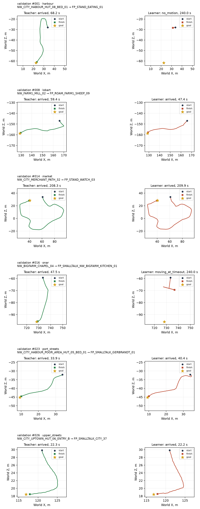

# BC2 с морковкой — 2026-10-18

**Цель достигнута: лучший раунд 2 дошёл на 19/27 отложенных пар (70,37%)**, где дошёл учитель v2. На прежних 30 обучающих парах — **17/30**, контроль **Малет у забора пройден за 29,0 с**. Раунд 0 дал 15/27, поэтому стоп-правило `<3/27` не сработало; проведены все три раунда DAgger. Последний раунд ухудшил результат до 7/27 и вернул кружение. Итоговыми выбраны веса раунда 2, эпоха 20.

## Данные и вход

Исходные записи только читались: `/home/kaifaty/gothic-ai/nav-demos-v2/` на Ryzen, 204 эпизода. В базовом наборе только **143 удачных эпизода / 87 884 решения**: **116 train / 75 613 решений**, **27 validation / 12 271 решение**. Неудачные обычные демонстрации учителя в обучение не включены. Разбиение по парам взято из `/home/kaifaty/gothic-ai/nav-bc/cache/index.json`; 20 удачных пар v2, отсутствовавших в старом индексе удачных демонстраций, добавлены в train. Прежние отложенные пары сохранены.

Из прежних 31 отложенных пар учитель v2 дошёл на 27; исключены четыре его неуспеха, исходные эпизоды 010, 152, 162, 185. Эталон здесь **27/27**, медиана времени успеха **35,633 с**. На тех же 30 обучающих парах, по пять на район, эталон учителя **25/30**, медиана успешных поездок **39,767 с**. Контроль Малета воспроизводит постановку у забора из прежнего стенда. Порог задачи — **14/27**. Выбор checkpoint использует эти же 27 отложенных пар; независимого тестового набора нет.

[Подготовка](../../../scripts/nav_bc_data.py), [обучение](../../../scripts/nav_bc_train.py) и [C++](../../../OpenGothic/common/navpolicy.cpp) используют `learner_input()` v2: глаз, две карты памяти, тело и десять чисел дороги в порядке `carrot_direction[3]`, `carrot_distance_cm/1000`, `goal_direction[3]`, `goal_distance_cm/1000`, `remaining_known_cm/1000`, `beyond_known`. Расстояния ограничены [0; 50]. Вектор — **2166 чисел**, карты — **9×32×32 и 9×25×25**. `previous_keys`, мировая поза и подсказка учителя не кодируются. Заголовок весов содержит `navdemo_version=2`, `roads_schema=carrot_v2`, порядок дорожных полей и состав входа; C++ выбирает схему по заголовку. Глаз, память, знакомые дороги, морковка, учитель, двоичный писатель записей, движение и мост не менялись.

## Обучение и сбор DAgger

Архитектура прежняя: CNN двух карт, линейный векторный вход, GRU 256, шесть голов; **614 223 параметра, 1 014 344 MAC**. Каждый раунд обучен с нуля с seed 17: **20 эпох**, AdamW, lr 3×10⁻⁴, weight decay 10⁻⁴, batch 8 эпизодов, TBPTT 64, grad clip 1. Веса классов и голов вычисляются прежним способом. Checkpoint выбирается по среднему turn macro-F1 и forward balanced accuracy; во всех четырёх раундах выбрана эпоха 20. Сумма времени эпох с оценкой, без импорта и очереди: **231,36 / 289,73 / 341,64 / 396,41 с** для раундов 0–3.

На каждом решении сбора независимый Bernoulli выбирает, чьи клавиши применить. GRU ученика обновляется всегда; ответ учителя записывается во всех посещённых состояниях. Отдельный RNG смешивания не расходует случайность мира. Использованы только прежние 30 train-пар; held-out и контроль не попадают в DAgger. Неудачные поездки DAgger сохраняются с учительскими метками. Раунд N использует исходные удачные демонстрации и все сборы 1…N; **в каждом пакете DAgger занимает не больше половины эпизодов и действительных размеченных шагов loss**.

| Раунд обучения | Политика сбора | β | Фактических решений учителя | Размеченных решений | Успех смешанного сбора | Эпизодов train, учитель + DAgger |
|---|---|---:|---:|---:|---:|---:|
| 0 | — | — | — | — | — | 116 + 0 |
| 1 | раунд 0 | 0,5 | 15 154 / 30 349 = 49,93% | 30 349 | 24/30 | 116 + 30 |
| 2 | раунд 1 | 0,25 | 7 343 / 29 428 = 24,95% | 29 428 | 25/30 | 116 + 60 |
| 3 | раунд 2 | 0 | 0 / 39 951 = 0% | 39 951 | 17/30 | 116 + 90 |

Итого **99 728 новых меток DAgger**. Успех смешанного сбора не используется как оценка доходимости ученика.

На записях учителя у лучшего раунда 2: forward accuracy **95,25%**, forward balanced accuracy **86,64%**, turn macro-F1 **0,49021**, все головы на 853 сменах **48,77%**. Матрицы, базы и разрезы — [offline-metrics.json](offline-metrics.json). Это отдельная офлайн-оценка.

## Чистая езда по раундам

Во всех **232 измерительных поездках** β=0, число решений под управлением учителя равно нулю; `dagger_collection=false`. Пары и seeds совпадают между раундами, лимит — **240 с** игрового времени. Полные метрики и результаты каждой пары: [раунд 0](metrics-round0.json), [раунд 1](metrics-round1.json), [раунд 2](metrics-round2.json), [раунд 3](metrics-round3.json).

Время — медиана по всем поездкам / только успешным. Застревания — штатные `blocked_spans` / `blocked_ms`, переведённые в секунды. Дополнительно показано число эпизодов, где есть 3-секундное окно со смещением его 3D-концов ≤25 см; такой детектор видит и поворот на месте, который счётчик застреваний при попытке идти может пропустить. Поворот на месте — доля решений с `turn≠0`, `forward=strafe=0`; это не все возможные петли траектории.

Смена действия — различие соседних ответов учителя хотя бы по одной из шести категориальных голов; первое решение исключено. Точность означает одновременное совпадение всех шести применённых голов с учителем на этих шагах. Расхождение считается по всем решениям каждой головы: **F** forward, **S** strafe, **T** turn, **W** walk, **J** jump, **C** climb. Доли объединены по решениям, а доходимость — по парам; длинные неудачи имеют большой вес в долях.

### 27 отложенных пар, успешных у учителя v2

| Раунд | Дошёл | Время все / успех, с | Застревания, шт. / с | Эпизоды с окном ≤25 см | Поворот на месте | Все 6 голов на сменах | Расхождение F / S / T / W / J / C, % |
|---|---:|---:|---:|---:|---:|---:|---|
| 0 | 15/27 (55,56%) | 66,3 / 33,3 | 17 / 2592,4 | 14/27 | 1,12% | 65/323 (20,12%) | 80,35 / 0,00 / 92,86 / 0,00 / 0,00 / 0,00 |
| 1 | 14/27 (51,85%) | 210,8 / 35,3 | 42 / 2836,4 | 16/27 | 4,33% | 197/547 (36,01%) | 78,77 / 0,00 / 83,28 / 0,00 / 0,00 / 0,00 |
| 2 | 19/27 (70,37%) | 47,4 / 40,4 | 27 / 1277,3 | 13/27 | 19,37% | 276/970 (28,45%) | 51,82 / 0,00 / 70,89 / 0,00 / 0,00 / 0,00 |
| 3 | 7/27 (25,93%) | 240,0 / 89,8 | 30 / 575,1 | 24/27 | 57,94% | 800/2632 (30,40%) | 37,02 / 0,00 / 66,41 / 0,00 / 0,00 / 0,00 |

### Прежние 30 обучающих пар

| Раунд | Дошёл | Время все / успех, с | Застревания, шт. / с | Эпизоды с окном ≤25 см | Поворот на месте | Все 6 голов на сменах | Расхождение F / S / T / W / J / C, % |
|---|---:|---:|---:|---:|---:|---:|---|
| 0 | 17/30 (56,67%) | 233,2 / 53,7 | 20 / 2872,7 | 15/30 | 0,87% | 214/702 (30,48%) | 61,35 / 0,00 / 74,31 / 0,00 / 0,00 / 0,00 |
| 1 | 18/30 (60,00%) | 137,5 / 40,5 | 21 / 1715,0 | 15/30 | 15,30% | 349/1062 (32,86%) | 48,55 / 0,00 / 70,77 / 0,00 / 0,00 / 0,00 |
| 2 | 17/30 (56,67%) | 119,5 / 36,3 | 19 / 1224,9 | 15/30 | 28,64% | 330/3131 (10,54%) | 28,83 / 0,00 / 47,32 / 0,00 / 0,00 / 0,00 |
| 3 | 4/30 (13,33%) | 240,0 / 166,7 | 39 / 1700,0 | 29/30 | 30,25% | 757/3549 (21,33%) | 57,56 / 0,00 / 74,74 / 0,00 / 0,00 / 0,00 |

### Контроль: Малет у забора

| Раунд | Дошёл | Время все / успех, с | Застревания, шт. / с | Эпизоды с окном ≤25 см | Поворот на месте | Все 6 голов на сменах | Расхождение F / S / T / W / J / C, % |
|---|---:|---:|---:|---:|---:|---:|---|
| 0 | 1/1 (100,00%) | 29,5 / 29,5 | 0 / 0,0 | 0/1 | 4,07% | 2/11 (18,18%) | 15,25 / 0,00 / 77,63 / 0,00 / 0,00 / 0,00 |
| 1 | 1/1 (100,00%) | 27,1 / 27,1 | 0 / 0,0 | 0/1 | 5,15% | 3/9 (33,33%) | 0,74 / 0,00 / 60,66 / 0,00 / 0,00 / 0,00 |
| 2 | 1/1 (100,00%) | 29,0 / 29,0 | 0 / 0,0 | 0/1 | 5,17% | 3/11 (27,27%) | 2,76 / 0,00 / 74,14 / 0,00 / 0,00 / 0,00 |
| 3 | 0/1 (0,00%) | 240,0 / — | 0 / 0,0 | 1/1 | 93,54% | 36/71 (50,70%) | 6,46 / 0,00 / 54,37 / 0,00 / 0,00 / 0,00 |

Раунд 2 по районам: порт **3/6**, Лобарт **5/6**, рынок **3/4**, Онар **3/6**, портовые улицы **4/4**, Верхний квартал **1/1**. Из восьми неудач шесть заканчиваются без движения в последние 10 с, одна — локальным движением, одна — движением до тайм-аута. Восстановление после застреваний остаётся открытым: поворот на месте занимает **19,37%** решений лучшего раунда. На его 19 успешных поездках расхождение forward/turn — **9,20% / 42,22%**; восемь неудач дают **19 200 из 28 927** решений, поэтому общие доли заметно выше.

Третий раунд не улучшил лучший: поворот на месте на отложенных вырос до **57,94%**, а у Малета — до **93,54%**. У Малета при этом `blocked_spans=0`, но окно малого смещения есть: один счётчик застреваний не описывает такое поведение. Следующих раундов нет; цель ≥50% выполнена весами раунда 2, восемь отложенных маршрутов ими ещё не пройдены.

## Шесть пар лучшего раунда

Слева учитель v2, справа ученик раунда 2, одинаковый масштаб в каждой паре. Показано по одной паре из шести районов: **001, 008, 014, 016, 023, 026**; четыре успеха и две неудачи ученика. У всех шести эталон учителя успешен. Круг — старт, квадрат — финиш, звезда — цель; координаты X/Z в метрах. Это примеры, общая доходимость посчитана по всем 27 парам.

## Проверки

`free(): invalid pointer` воспроизведён ASan при смешении старого `navpolicy.o` с новой раскладкой `NavPolicy` после добавления `demoVersion` (стек `bad-free → NavPolicy::Linear::~Linear → NavPolicy::~NavPolicy`, сдвиг 8 байт); полная чистая сборка из стабильной копии исходников устранила аварию, исходные веса и fixture проходят ASan/UBSan и обычную сборку под gdb. Стек получен контролируемым воспроизведением смешанного ABI; исходный core не сохранился. Лог — `/home/kaifaty/gothic-ai/nav-bc2/abi-repro-stack.log`.

C++/NumPy на **1000 последовательных реальных шагах NAVDEMO v2** с переносом hidden, отдельно для каждых весов:

| Раунд | max ошибка признаков | max ошибка logits | max ошибка hidden |
|---|---:|---:|---:|
| 0 | 1,90735×10⁻⁶ | 1,90735×10⁻⁶ | 8,94070×10⁻⁷ |
| 1 | 1,90735×10⁻⁶ | 2,86102×10⁻⁶ | 9,05246×10⁻⁷ |
| 2 | 1,90735×10⁻⁶ | 2,38419×10⁻⁶ | 1,01328×10⁻⁶ |
| 3 | 1,90735×10⁻⁶ | 1,90735×10⁻⁶ | 1,42306×10⁻⁶ |

Допуск признаков **10⁻⁵**, logits/hidden **10⁻⁴**. Разница признаков 1,9×10⁻⁶ возникает из порядка суммирования float32 при уменьшении дальней карты; это допустимое округление. Проверки утечки меняют прошлые клавиши, мировую позу, подсказку и неактивные дорожные поля другой версии, включая NaN.

- Синтетические контракты **v1 и v2**, по **1000 шагов**: признаки **0**, logits **2,79397×10⁻⁹**, hidden **5,58794×10⁻⁹**. v1 используется только для проверки совместимости C++, обучение принимает только v2.
- Torch/NumPy во всех четырёх раундах, по **1000 шагов**: максимумы logits **3,814697×10⁻⁶**, hidden **4,231930×10⁻⁶**. Для выбранных весов — [verification.json](verification.json).
- На Ryzen через `gq`: **60 тестов прошли за 2,49 с** — `scripts/tests/test_nav_bc_*`, `test_nav_drive.py`, `test_nav_demos.py`.
- Проверены **322 новые поездки / 452 808 решений**: 232 чистых замера и 90 сборов DAgger, все NAVDEMO v2. Во всех замерах проверены β=0 и нулевое число вмешательств учителя.
- На Ryzen чисто собраны **Gothic2Notr, gothic-body-runner, gothic-navpolicy-contract**; на Mac в финальной проверке выполнена **только компиляция Gothic2Notr и контракта**, успешно. Полный pytest и e2e не запускались; модели на Mac не исполнялись.

## Что оставлено на Ryzen

Лучшие веса: **`/home/kaifaty/gothic-ai/nav-bc2/round2/run/policy.navbc`** (2 467 646 байт). Рядом `best.pt`, `last.pt`, история и конфигурация. Веса остальных раундов — `round0…round3/run/`; чистые поездки и их учительские метки — `roundN/dagger/`, смешанные сборы — `collection1…collection3/dagger/train/`, кэши — `cache-r0…cache-r3/`, NumPy-fixture и численные сверки — `roundN/parity-real/`, `roundN/parity.json`. Все пути относительно **`/home/kaifaty/gothic-ai/nav-bc2/`**. Исходники и диагностические логи сохранены там же. Записей и весов в git нет.

Все тяжёлые фазы шли через `gq`: обучение — `batch`, по эпохе на заявку; сбор и езда — `batch`, по три поездки на заявку; короткие проверки — `quick`. Лимит памяти обучения **8 ГБ**, GPU-заявка **2 ГБ**. Перед каждым обучением выполнен `nvidia-smi`, перед сбором — `df -h ~`; допусков очереди дождались. Исходные `nav-demos*`, прежние `nav-drive`/`nav-dagger` и чужие каталоги не менялись. Своя **`build/` удалена после завершения**, все данные и веса оставлены; свободно около **72 ГБ**.
