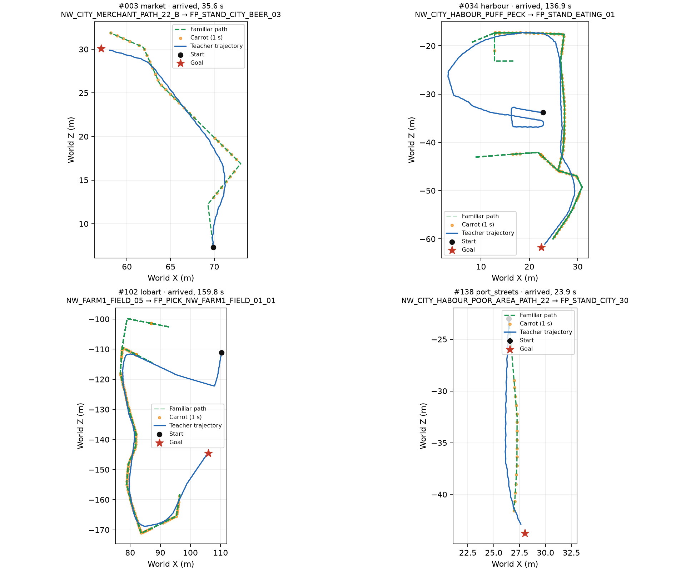

# Общая морковка ученика и учителя — 2026-10-18

**Согласованность прошла все три порога. Доходимость не прошла:** 143/204, а на общих с v1 парах — 135/191 против 156/191, потеря 21 успеха при допустимых 10. После второй отрицательной проверки механики работа остановлена по правилу задачи. Обучение и езда ученика не запускались.

## Устройство

[KnownRoads::updateGuidance](../../../OpenGothic/common/game/knownroads.cpp) хранит грубый знакомый путь и прогресс внутри эпизода. Полилиния состоит из знакомых узлов, без искусственного отрезка от стартовой позы к первому узлу. NPC проецируется на неё в 3D; прогресс — максимум прежнего и новой проекции. Морковка лежит на **L = 600 см** дальше по длине полилинии, а не на расстоянии L от тела по прямой. Сетка в расчёте не участвует.

Путь удерживается до ухода от полилинии **дальше 800 см**; тогда строится заново от текущей позы. Ровно 800 см перестройку не вызывает. Когда `progress + L` достигает конца знакомого пути, морковка становится самой целью, `beyond_known=1`; дальнейшее движение к цели не вызывает перестроек из-за удаления от последнего знакомого узла. Новая цель или эпизод сбрасывают состояние. Пустой путь сразу передаёт ведение к цели.

[Учитель v2](../../../OpenGothic/common/navkeyteacher.cpp) рулит к этой же морковке. `NavMesh::straightWalkable` проверяет наземный отрезок: при свободном отрезке цель руления — морковка, иначе используется короткий Detour-путь до неё. За знакомым путём Detour ведёт к конечной цели. Переходы выполняет прежний учитель. На земле v2 использует deadband `max(10°, turnSpeed × 0,05 с)`; прежний допуск движения вперёд — 28°. Действие вычисляется из текущего состояния, морковки и локального пути, без таймера спасения или истории действий. Учитель v1 и команда `start` сохранены; v2 выбирается `start-v2` / `--teacher-version 2`.

V2 вычисляет вход дороги и состояние учителя от одной физической позиции ног NPC. В запись попадает **фактический** `Decision::hint.nextCorner`, по которому выбраны клавиши, без повторного запроса пути для подсказки.

## NAVDEMO v2

[Загрузчик](../../../scripts/nav_demos.py) выбирает схему по версии заголовка и читает v1 и v2. Размер записи прежний — **173 838 байт**, заголовка — 32 байта. В `learner_input()` для v2 блок `roads` содержит:

- `carrot_direction`, `carrot_distance_cm` — единичное направление на морковку в системе тела и расстояние до неё;
- `remaining_known_cm` — остаток длины знакомой полилинии от проекции;
- `goal_direction`, `goal_distance_cm` — направление и расстояние до конечной цели;
- `beyond_known` — флаг передачи ведения к цели.

Оси тела: X вправо, Y вверх, Z вперёд. Мировая поза и подсказка учителя остаются диагностикой, в `learner_input()` не входят. Глаз, память, клавиши, `NavPolicy` и код обучения не менялись.

## 1. Согласованность новых записей

[Числа и метод](guidance-v2.json), [скрипт](../../../scripts/nav_guidance.py). Все **228 606 решений из 204 эпизодов**, включая неуспехи, без отбора удачных трасс. Формулы те же, что в [исходном разборе](../2026-10-18-guidance/README.md): угол к фактической цели руления и правило поворота с порогом 10°. Соседними считаются только решения одного эпизода с интервалом 100 мс.

| Метрика | V2 | Требование |
|---|---:|---:|
| Медиана 3D-угла морковка → цель руления | 0,000031° | ≤15° — пройдено |
| Совпадение правила с `turn`, все метки | 174 368 / 228 606 = **76,2745%** | ≥75% — пройдено |
| Совпадение среди ненулевых поворотов | 13 951 / 16 357 = **85,2907%** | дополнительный срез |
| Скачки направления >90° между решениями | 29 / 228 402 = **0,012697%** | <0,5% — пройдено |

Число скачков одинаково в 3D, горизонтальной проекции и мировом направлении; ни один не находится в последних 5 м до цели. Согласованность не абсолютная: угол >45° остаётся на 14,3645% решений, >90° — на 8,0173%. Это измеренный остаток расхождения, а не доказательство, что локальный обход уже выучится по глазу. Старые 79,12° / 28,31% получены на обучающем срезе прежнего корпуса; здесь выборка шире, но формулы сохранены.

## 2. Доходимость

Те же [204 пары](../2026-10-16-navmesh/raw/pairs.jsonl), Малет, seed 7, ходьба, свежий мир для каждой пары, лимит **240 с**. Использован тот же снимок сохранения, что у старых примеров: SHA-256 `c2852f4c009f23225e1c9c70f564ca36b4c12e8220736d1c72a1dbfce8d3372f`. Старые записи не перезаписывались; v1 ниже — исторические метаданные, повторного прогона v1 не было.

Время — **медиана всех исходов**, включая завершившиеся по лимиту. [Полные результаты](summary.json) содержат также медианы успешных заездов и каждую пару.

| Место | V1, успехи | V1, с | V2, успехи | V2, с |
|---|---:|---:|---:|---:|
| Рынок | 27/34 | 79,317 | 20/34 | 177,883 |
| Гавань | 28/34 | 73,734 | 30/34 | 78,583 |
| Онар | 29/34 | 48,133 | 29/34 | 45,334 |
| Лобарт | 30/34 | 44,117 | 29/34 | 48,784 |
| Улицы порта | 29/34 | 69,167 | 18/34 | 99,767 |
| Верхний квартал | 13/21 | 198,933 | 17/34 | 191,617 |
| Все имеющиеся записи | **156/191** | **64,867** | **143/204** | **69,817** |
| Только общие 191 пары | **156/191** | **64,867** | **135/191** | **68,967** |

На общих парах Верхнего квартала v2 имеет **9/21**, медиану 240 с; дополнительные 13 пар дали 8 успехов. Даже без выравнивания выборки 143 успеха меньше допустимых 146. Медиана времени только успешных общих заездов: v1 51,617 с, v2 49,033 с; для всех успехов v2 — 48,867 с.

61 неуспех: 51 `body_blocked`, 3 `no_path:disconnected`, 5 `path_timeout`, 2 `actor_down`. Это диагностические исходы стенда, не установленная причина каждой остановки.

После полного отрицательного прогона проверена одна правка обычного наземного управления: штатная точность поворота 4,5°/9° и движение вперёд только в пределах 10°, с сохранением воздушных действий и переходов. Пары **1, 8, 136, 139**: у v1 **4/4**, у первого v2 **0/4**, после правки снова **0/4**, каждая по 240 с. №1 закончилась `path_timeout`, остальные — `body_blocked`. Правка не восстановила эти проходы и отменена. Второй отрицательный результат остановил дальнейшие изменения механики; финальный код соответствует полному корпусу выше. Сырые контрольные записи оставлены в `~/gothic-ai/nav-carrot/precision-probe/`.

## Четыре пары сверху

Зелёный пунктир — знакомые пути, включая перестройки, оранжевые точки — морковка раз в секунду, синий — фактическая траектория учителя. Масштаб X/Z одинаковый. Пары **3, 34, 102, 138** автоматически выбраны из полных движущихся эпизодов с минимум тремя знакомыми узлами, по возможности из разных мест. Это иллюстрации устройства, не выборка для метрик.



## Данные и проверки

Корпус на Ryzen: **`/home/kaifaty/gothic-ai/nav-demos-v2/`**. [Результат `check`](dataset-check.json): NAVDEMO v2, **204 эпизода, 228 606 решений, validated=true**, неполных эпизодов 0. Файлы эпизодов — **3 894 519 358 байт (3,895 ГБ)**, из них `samples.bin.gz` — 3 790 377 839 байт; распакованные записи — 39 740 416 356 байт. Весь каталог с рабочими файлами сборщика — 3 916 565 458 байт. Все 212 967 решений с движением вперёд — ходьба; бега, живых меток jump/climb в корпусе нет.

На Ryzen через `gq`:

- собраны **Gothic2Notr и gothic-body-runner**;
- прошли **check-navigation-roads, check-navkeyteacher, check-navmesh**; контракт без ассетов покрывает монотонную проекцию, передачу цели, уход >8 м, точную границу 8 м, старт вне дороги, пустой путь и разные этажи;
- **32 теста** `scripts/tests/test_nav_demos.py` и `scripts/tests/test_nav_guidance.py` прошли за 0,42 с;
- `nav_demos.py check` всего корпуса — exit 0, 67,431 с; `nav_guidance.py` — exit 0, 57,262 с, RSS 79,461 МиБ;
- сбор — класс `batch`, по четыре пары, 2 потока / 3 ГБ на заявку; анализ — `quick`. Перед сбором проверялся диск.

На Mac в конце выполнена **только компиляция Gothic2Notr**, exit 0. Полный pytest, e2e, обучение и езда ученика не запускались. Своя Ryzen-папка `nav-carrot/build/` удалена после работы, данные оставлены. Старый `nav-demos/` не изменялся.

Сборщик: `scripts/nav-demos-batch.sh collect --teacher-version 2 --batch-size 4 --limit-ms 240000` с абсолютными `--runner`, `--assets`, `--save`, `--cache`, `--output`. Анализ внутри разрешённого `gq quick`:

```sh
python3 -I scripts/nav_demos.py check /home/kaifaty/gothic-ai/nav-demos-v2
python3 -I scripts/nav_guidance.py --source /home/kaifaty/gothic-ai/nav-demos-v2 --output /home/kaifaty/gothic-ai/nav-carrot/guidance-v2.json --no-lock --pause-seconds 0
python3 -I scripts/nav_carrot_report.py --source /home/kaifaty/gothic-ai/nav-demos-v2 --output /home/kaifaty/gothic-ai/nav-carrot/report --baseline /home/kaifaty/gothic-ai/nav-demos/episodes
```

Этап 5 остаётся открытым по доходимости. Общий видимый ориентир реализован и измерен; порог потери не больше десяти пар не достигнут.
