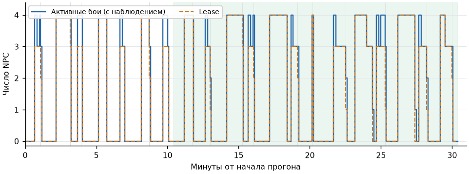
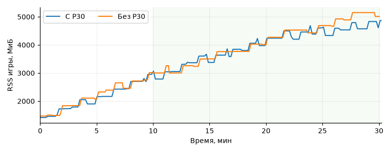

# P30: получасовой прогон полного мира

**Финальный прогон P30: `failed`.** Приняты 62,32% команд, RSS игры — 237,43 МиБ на загрузку, два аварийных конца. Release, RSS сервера, задержки сервиса и лог прошли. Семь отказов проверки загрузки оказались ложными; проверки исправлены, исходный результат сохранён.

## Финальный прогон после #279 и #281

Пользователь выполнил `.ryzen/soak4-p30/` на `41815fd6`: **1809,7 с**, 30 FPS, 21 волна, 70 боёв с lease, до четырёх сразу. Возврат далёких NPC (#279) уже включён. [Результат](final-result.json.gz), [JSONL](final.jsonl.gz), [выдержки сервера](final-server-events.txt); итог — строка **1003** JSONL.

| Проверка | Порог | Получилось | Итог |
|---|---|---|---|
| Сбои контура пилота | 0 | `acquire_uncertain` ×1, `policy_timeout` ×1; fallback и сирот 0 | **failed** |
| Захват подходящих нападающих | ≥95% | **70/73 = 95,89%** | done |
| Принятые команды / решения | ≥95% | **6611/10608 = 62,32%** | **failed** |
| Освобождение после боя | ≤2 с, без lease и `body` без lease | 70/70 подтверждений, максимум **0,441 с**, остаточных владельцев 0 | done |
| RSS игры на загрузку за последние 20 минут | Контроль 182,8 + 10% = **201,08 МиБ** | (4294,47 − 2632,43) / 7 = **237,43 МиБ** | **failed** |
| RSS сервера за последние 20 минут | Рост ≤5% | 241,89 → 245,55 МиБ, **+1,51%** | done |
| Сервис p95 / p99 | Оба ≤20 мс | **4,88 / 5,64 мс**, 61 645 `step` | done |
| Серверный лог | 0 трассировок и ошибок моста | 0 | done |
| Загрузки / новый lease и reset | Все проверки | Исходно **6/13**, семь ложных отказов; новый lease/reset **65/65** | **failed** в архиве, проверки исправлены |
| Ответы между волнами | Ответ получен | **21/21** | done |

Окно RSS — **615,409–1809,703 с**. Из отказов команд **3862 `stale_observation`**: пользователь установил причину в порядке кадра моста при 30 FPS; исправление — [codex/body-stale-fps](https://github.com/kaifaty/GothicAI/tree/codex/body-stale-fps). Рост памяти от загрузок мира и удержания освобождённой памяти glibc исправляется отдельно: [PR #280 (`malloc_trim`)](https://github.com/kaifaty/GothicAI/pull/280). Здесь движок и пилот не менялись.

Два аварийных конца — реальные аварийные пути пилота, а не ложные отказы проверок; неисправность подготовки стенда не подтверждена:

- **397,249 с, волна 5, BANDIT_1:** `acquire_uncertain`, одна заявка, ни одного подтверждённого lease и решения, отказ с пустым текстом (`server.log:187–189`, JSONL **208**). Это путь таймаута/неразрешённой заявки захвата; ожидание ответа моста ограничено 250 мс, границы — ещё до 1500 мс. Через две секунды NPC захвачен снова. Точного RPC и длительности неудачного ожидания лог не содержит; загрузка началась лишь на 440,974 с.
- **1566,401 с, волна 18, BANDIT_2:** `policy_timeout` до первого `step`, решений и таймаутов `step` 0; lease получен за **32,7 мс**, release подтверждён за **79,3 мс** (`server.log:711–714`, JSONL **848**). Это TCP connect или начальный reset с лимитом **100 мс**; эти фазы в p95/p99 `step` не входят. Лог их не различает. Последняя загрузка закончилась на 1501,274 с.

Семь ложных отказов загрузки разобраны по отдельным условиям:

| Волны / строки JSONL `load_check` | Не прошедшая подпроверка | Причина |
|---|---|---|
| 1, 5, 15, 17 / **39, 240, 724, 822** | Причина старого боя | `native_restored` с `target_changed_or_lost` после смерти героя вместо `hero_down`/`loading`; release подтверждён за **21–34 мс** |
| 4, 7 (плановая 10-минутная), 8 / **188, 342, 389** | `active_count=0`, пустой кэш и подписка | В старом мире уже нет lease, но в новом успели начаться пассивные наблюдения: **1** наблюдаемый NPC и **1** строка кэша; `body` без lease — 0 |

Теперь первая гонка допускается только для известной погибшей цели, с точной native-причиной, чистым release и без fallback. Во второй проверяются старые объекты и поколения; свежие пассивные наблюдения разрешены. Старые/владельческие строки, lease, незавершённые захваты и release по-прежнему проваливают проверку. `load_check` пишет итог каждой подпроверки и остатки с идентичностями. Архивные `ok=false` не переписывались.

Проверки загрузки и контрольный lifecycle — **83 passed**, ruff двух изменённых файлов прошёл; нового короткого или полного прогона в этом ходе нет. Общий итог остаётся `failed`.

## Первый полный прогон (архив)

19 октября 2026, Ryzen, `LLM=fake`, протокол 46, движок из `main` с исправлением release (#253). Запуск `20261019T041318Z-3574`, код сценария — `19b2d54e`:

```sh
BENCH_CLASS=quiet RYZEN_MAX=40m SCENARIO=neural-soak TIMEOUT=2400 scripts/ryzen.sh e2e
```

`GOTHIC_BODY_URL` передан из локальных настроек. Обычная новая игра без заморозки мира: герой, спутник-мечник, волны 3/4 бандитов `GIL_BDT` с одноручным оружием каждые ~90 с. Места чередовались: `NW_XARDAS_GOBBO_02` у Кавалорна и `NW_XARDAS_TOWER_VALLEY_09`. Использовался пул четырёх разных символов; герой лечился перед волнами.

Измерено **1813,6 с**: 20 обычных волн и короткая 21-я для проверки нового lease после последней смерти героя. Всего 71 бой с lease, до четырёх одновременно; 21/21 разговор с ответом. Герой погиб 18 раз, каждый раз загружался сейв перед волной. Боевые сейвы сделаны на 600,340 и 1209,349 с; обе плановые загрузки прошли посреди боя. Первые 20 волн кончились загрузкой, последняя — обычным уходом героя (`escape_duration`, 3,144 с); предел 75 с не понадобился.

Исходные данные: [результат сценария, gzip](full-result.json.gz), [весь JSONL, gzip](full.jsonl.gz), [каждый бой: команды, отказы, цель, застои и задержки](fights.csv). Номера строк ниже относятся к распакованному JSONL. Итог — строка **948**.

Первый замер провалил прежний порог RSS игры и 14 таймаутов моста; по новому правилу памяти он проходит: **160,3 ≤ 201,08 МиБ/загрузку**. Его исходные данные ниже оставлены для сравнения.

RSS сравнивается по 10-секундным отсчётам **622,209–1813,601 с** (1191,392 с): строки **330** и **947**. Ошибки — `body_events` / `TimeoutError`, исходные строки `server.log`: 85, 164, 249, 292–294, 336, 417, 464–466, 508, 684, 766; [все выдержки](server-errors.txt).

**Решение пользователя от 19 октября 2026 года:** прежний порог RSS игры ≤5% снят; сравниваем общий прирост в окне на число загрузок с контролем без P30, допуск 10%. Архив первого замера не переписывался; его 160,3 МиБ/загрузку проходят новое правило, а финальные 237,43 — нет. Рост памяти движка при загрузках и спавне — отдельная работа, вне этого PR.

`finish_deadline` — **0**, подтверждённых поздних release — **0**, максимум `release_late_seconds` — нет; `release_orphan_timeout` — **0**. Позднее подтверждение после `finish_deadline` считается отдельно и само по себе не является сбоем.

Проверка загрузок в исходном результате: **11/20 done, 9/20 failed** (ложные отказы сценария, исправлены после ревью). В девяти загрузках после смерти героя один старый бой успел закончиться с `hero_down`, тогда как проверка требует `loading` от всех старых боёв. Первый случай — строка **39** (`hero_down`, `loading`, `loading`); остальные — 88, 132, 369, 414, 691, 738, 822, 863. Во всех 20 проверках активных боёв, lease и старых наблюдений уже 0; новый lease после каждой загрузки получен, проверки нового соединения/reset — **67/67**. Обе плановые загрузки прошли полностью (строки **321**, **644**). Исходный результат не переписывался. Теперь `hero_down` допускается только для загрузки после смерти героя и боя с целью `hero`; остальные проверки сохранены.




Серые линии — загрузки, зелёный фон — последние 20 минут. `active_count` включает ожидающие захваты. Снято 184 отсчёта: максимумы `active_count`/lease — 4/4, максимальный интервал `t_game_ms` — 70 мс (максимальный оконный p95 — 64 мс), пачка — 4 строки, разброс игрового времени внутри пачки — 0 мс. Максимальные оконные p95/p99 сервиса — 6,31/17,99 мс.

## Память игры с P30 и без

Пользователь выполнил контроль без пилота на Ryzen из этой ветки после merge `main`
с #259 (`8d874b74`): `.ryzen/soak2-control`, **1802,1 с**, 20 волн, 17 загрузок,
20 ответов в разговорах. [Результат контроля, gzip](control-result.json.gz),
[полный JSONL контроля, gzip](control.jsonl.gz). Кривая P30 — прежний полный прогон выше.



| За последние 20 минут | С P30 | Без P30 |
|---|---:|---:|
| Интервал отсчётов, с | 622,209–1813,601 | 605,175–1802,105 |
| RSS игры, МиБ | 2786,84 → 4870,44 | 3002,94 → 5013,34 |
| Рост RSS игры | **74,77%** | **66,95%** |
| Загрузок в этом окне | 13 | 11 |
| Рост в окне / число загрузок, МиБ | **160,3** | **182,8** |
| Рост RSS сервера | 1,34% | 0,88% |

За весь прогон игра выросла на **3453,5 МиБ с P30** и **3544,7 МиБ без P30**.
МиБ на загрузку — общий прирост в окне, делённый на их число, вместе со спавном и
остальным миром; это не мгновенный скачок на загрузке. Отсчёты контроля — строки
**118 → 343** JSONL; итог — **344**. Рост памяти — игра (загрузки и спавн), не пилот.

Повтор P30 пользователем (`.ryzen/soak2-p30`) оборвался на **919 с**: спутник погиб (`target_down`), затем `npc_goto` на мёртвого NPC дал `GameError` (10:23:11); до падения 32 боя, 3750 решений, fallback/`lease_lost`/сирот 0, 3 терпимых таймаута опроса (максимальный промежуток 399 мс), release ≤0,785 с, до 4 lease, p95/p99 сервиса ≤5,9/19,0 мс.
Сценарий исправлен: смерть спутника завершает волну загрузкой `companion_death` с теми же проверками очистки и нового захвата, без команд мёртвому NPC; обе смерти имеют отдельные счётчики. Этот путь и поздняя смерть после исчезновения боя покрыты тестами.

Следующий пользовательский P30 (`.ryzen/soak3-p30`, `c1e08599`) оборвался на **1667 с** в `finally` `_m5b_player_weapon`: таймаут `body_watch([])` (`server.log:781–796`); до падения 63 боя, 4374 решения, fallback 0, 13 терпимых таймаутов опроса, подтверждённый release ≤0,36 с, до 4 lease, p99 ≤18,3 мс. Временное совпадение двух `finish_deadline` и двух сирот со сменой оружия **не подтверждено**: концы на 291,136/1191,366 с (JSONL 143/632), сироты в 10:53:59/11:09:00 (`server.log:133/540`) предшествуют `wave_end` на 296,632/1196,845 с (JSONL 157/647) и следующему вызову helper. Теперь только в `neural-soak` готовность оружия проверяется повтором `debug player_weapon`, без изменения подписки; остальные прямые `body_watch` выполняются только без пилота.

Причина оставшихся `finish_deadline`, сирот и отказа подписки найдена пользователем: после телепорта герой далеко, а движок не возвращает NPC под lease родному ИИ; исправление — отдельная задача `codex/body-release-far`, здесь движок не менялся.

## Захват и концы боёв

Подходящий NPC — живой человек с одноручным оружием в `ZS_ATTACK`, направленным на героя или спутника. Наличие места проверяется по слотам пилота, включая ожидающий захват и неподтверждённый release; уже выделенный самому NPC слот не отнимает место у него самого. Проверка оружия и цели выполняется в живом мире; результат кэшируется не больше 0,5 с.

Каждый пропуск подходящего нападающего (оба в короткой проверке после последней загрузки; из знаменателя не исключены):

| Волна / NPC | Причина | Окно подходящего состояния | Строка JSONL |
|---|---|---:|---:|
| 21 / `BANDIT_1` | `body acquire cancelled: target_invalid`; также один `target_invalid` | 0,572 с | 939 |
| 21 / `BANDIT_3` | `acquire_window_short` | 2,571 с | 941 |

Имена `BANDIT_N` здесь сокращены от `DIR_NPC_SOAK_BANDIT_N`. Ещё **11** незахваченных кандидатов — Кавалорн (`BAU_4300_ADDON_CAVALORN`), нападавший на постороннюю для пилота цель: все исключены как `target_not_allowed`, в знаменатель 73 не входят. Все случаи:

| Волна | Строка JSONL | Причина |
|---:|---:|---|
| 1 | 44 | `target_not_allowed` |
| 3 | 137 | `target_not_allowed` |
| 5 | 231 | `target_not_allowed` |
| 7 | 326 | `target_not_allowed` |
| 9 | 419 | `target_not_allowed` |
| 11 | 515 | `target_not_allowed` |
| 13 | 609 | `target_not_allowed` |
| 15 | 696 | `target_not_allowed` |
| 17 | 784 | `target_not_allowed` |
| 19 | 868 | `target_not_allowed` |
| 21 | 942 | `target_not_allowed` |

Отказы отдельных попыток, включая успешные впоследствии захваты и исключённых NPC: `target_not_allowed` — 679, `native_queue_busy` — 36, `body acquire cancelled: target_invalid` — 3, `stale_world` — 1, `target_invalid` — 1; `watch_refused` — 0. JSONL сохраняет также историю live-проверок и причины завершения попыток.

| Причина конца | Бои с lease | Попытки без lease |
|---|---:|---:|
| `loading` | 50 | 1 |
| `hero_down` | 16 | 0 |
| `target_lost` | 3 | 20 |
| `npc_unavailable` | 2 | 3 |
| `acquire_exhausted` | 0 | 26 |
| `attached` | 0 | 19 |
| **Всего** | **71** | **69** |

Отказы команд: `stale_observation` — 56, `target_invalid` — 42, `masked` — 18, `locked` — 5. Ещё 11 решений не имеют ни принятой команды, ни отдельной причины отказа в сводке; они остаются в знаменателе 5667.

## Застои и исходы

`stall_broken` — **19**, во всех случаях удар выполнен после 15,00–15,12 с без урона цели. У 19 из 71 боёв по одному застоявшемуся интервалу, у остальных 52 — 0. Сумма интервалов **399,74 с**, диапазон **15,46–39,56 с**: после единственного удара застой мог продолжаться. `wait_200` — **3255/5667 = 57,44%** решений. Числа и длительности по каждому бою — в [CSV](fights.csv).

Шесть боёв длились больше 60 с; в пяти цель упала. **Один без падения цели:** волна 6, `BANDIT_4` против спутника, **67,24 с**, конец `loading` после смерти героя (диагностика — строка **277**). Список `metrics.long_fights` в JSON отбирает по причине конца и содержит ещё три `loading`, у которых падение цели уже записано наблюдением; здесь оно проверено по диагностике боя.

Исходы считаются один раз на цель и мир в каждой волне, по фактическому пику одновременных lease:

| Нападающих на одну цель | Цель | Встреч | Цель упала | Другой исход |
|---|---|---:|---:|---|
| 3 | Герой | 20 | 18 | 2 плановые загрузки |
| 1 | Спутник | 10 | 0 | 9 `loading`, 1 `npc_unavailable` |
| 1 | Герой, короткая проверка | 1 | 0 | 1 `npc_unavailable` |

[Видео первой волны](wave.mp4): **25 с, 480×270, 512 147 байт**. Штатная запись bench, обычные игровые часы; временная шкала файла приведена к 25 с реального окна записи.

## Ограничения и проверки

¹ Старый счётчик проверял состояние через **2,017–2,785 с**, а при бегстве мог начать отсчёт после cleanup. Его `done` не доказывает строгие 2 с для всех концов боя; поле `release_seconds` отсчитывалось от внутреннего начала release. После ревью время считается от первого события падения или входа в завершение, а оба поля задержки ограничены 2 с независимо от текущего отсутствия lease. В исходных отсчётах `body` без lease — 0.

Сравнение «трое на одного» и одиночных не контрольное: разные цели, рядом работает родной ИИ, герой делает разрешённые удары. Внутренняя причина роста памяти в игре не исследовалась. Полный результат включает короткую 21-ю волну для нового lease после последней загрузки, поэтому длительность больше 30 минут на 13,6 с.

Короткие прогоны: ранее — 191/219 с и 200,9 с; после ревью — остановка на 54,885 с из-за одиночного `body_events` (исправлено в #259); подготовка контроля на 161,7 с — ошибочный детектор конца боя (исправлен), [контроль на 300 с](control-partial.jsonl.gz) остановлен по бюджету. После фикса спутника quiet/180 с (`20261019T073241Z-98782`) завершился за **200,5 с**, 5 волн, 4/4 загрузки, 5/5 ответов, новый lease/reset 11/11, release чистый, fallback/сирот 0, `companion_death=0`; итог **failed**: `body_watch_timeout` у TALKER (JSONL 44; `server.log:57`, 253,9 мс) и захват **15/17 = 88,24%** (JSONL 204, 206), команды 921/957 = 96,24%. [Результат](companion-short-result.json.gz), [JSONL](companion-short.jsonl.gz), итог — строка 213; повтор не запускался.

После правки оружия — один quiet/180 с (`20261019T082442Z-71360`, `ea396ce2`): **194,8 с**, 5 волн, 4/4 загрузки, 5/5 ответов, lease/reset 13/13, захват **17/17**, команды **616/647 = 95,21%**, fallback 0, p95/p99 **5,16/7,21 мс**. Итог **failed**, без падения сценария: один `finish_deadline` с `npc_unavailable` (JSONL 201, 182,454 с), одна сирота и отказ `body_watch` TALKER (JSONL 214, 186,144 с; `server.log:224–225`) снова раньше `wave_end` (JSONL 220, 187,932 с) и следующей смены оружия. Release подтверждён 16/17, максимум 0,363 с; оставшийся провалил проверку (JSONL 210). [Результат](weapon-short-result.json.gz), [JSONL](weapon-short.jsonl.gz), [строки сервера](weapon-short-errors.txt); итог — строка 225. Пилот не менялся, повторов и нового полного прогона не было.

Первый запуск с полной длительностью [оборвался на подготовке](setup-error.txt) **до первой волны** на 33,194 с измерителя: спутник погиб в подготовке, затем `npc_goto` вернул `npc not found or busy`. Исправлены только постановка NPC на землю и проверка живого спутника до начального ожидания и сейва; падение — вероятная, не доказанная трассой причина. После этого выполнен описанный выше замер. Движок, P30, веса и сервис не менялись; в пилот добавлен только `service_p99_ms`.

После ревью также добавлено исключение `out_of_range` для NPC дальше 2000 см и сохранена хотя бы одна плановая отметка для загрузки посреди боя; смерть героя больше не разрешает потратить её в паузе. Пилот и P30 не менялись.

После ревью F6 захват подтверждается и завершённой сводкой с lease своей волны: бой между опросами больше не теряется. Архивные числа не пересчитывались; 17 тестов захвата и ruff прошли, e2e не запускался.

Проверки кода: пилот — **272 passed** ранее; после ревью метрики — **25 passed**, захват — **14 passed**, загрузки — **17 passed**. Для контроля: метрики и стенные интервалы — **37 passed**, полный lifecycle с fake-миром и неверные native-ответы — **6 passed**, CLI — **45 passed**, shell — **2 passed**; ruff и `bash -n` прошли. После исправления смерти спутника — **36 passed**; после исправления смены оружия — **17 passed**. Новый порог RSS: метрики, стенные интервалы и контроль — **67 passed**, ruff двух изменённых файлов прошёл; e2e в этом ходе не запускался. Приёмка шага 5 остаётся **не пройдена**.
