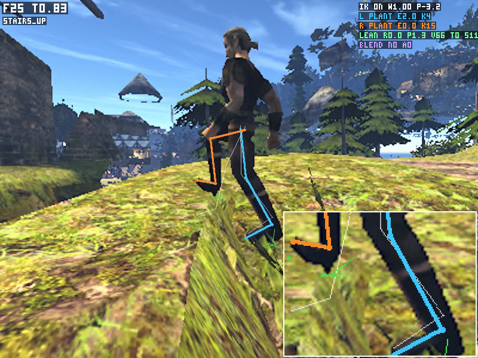

# CharacterVirtual: этап 5, шаг 1, проба руками

Герой ходит на `CharacterVirtual` под флагом, по умолчанию **0**. Полный парный стенд дал **8/8 ON / 6/8 OFF**, застревания >1 с **0 / 2**, новых падений ON **0**. После последней правки заново записаны крутой склон и лестница вниз ON: **2/2**, без застреваний и падений. Сглаживаются только разрывы высоты сверх движения по наклону опоры, за **100 мс**, только в `Run`; в `Slide` сглаживание выключено. При отставании свыше **10 см** модель догоняет сразу. На склоне максимальное отставание уменьшилось **41,734 → 0,00354 см**, на лестнице вниз **12,226 → 0 см**. Физические траектории сохранились точно, скорость спуска **6,236 см/кадр** не менялась. Предыдущее ревью убрало подъём на кружку: скачок таверны **12,477 → 0,0012 см**. Ограничение усилия уменьшило смещение стола 122 кг **179,10 → 11,80 см** за 3 с; кружка прошла **287,32 см**, бочка **78,17 см**. Прежний замер p95 OFF/ON **0,3575 / 0,3723 мс** (Δ **+0,0148 мс**), FPS **79,35 / 78,42** (−**1,17%**). Реальный mover принят с дрейфом **0,332 см**. Включение по умолчанию ожидает ручной пробы.

## Парные маршруты

Одинаковые начальные координаты, цели, seed 73013, время 12:00 и реальные удерживаемые клавиши в независимых процессах. Ближние NPC заморожены до первого тика, чтобы важные диалоги не перехватывали управление; это только подготовка стенда. Видео и кадровые метрики записаны с фиксированным шагом 30 Гц, **это не измерение FPS**. В итоговом дубле склона и лестницы вниз CV работал во всех **165/165** кадрах; прежний полный дубль подтвердил **510/510** кадров шести маршрутов ходьбы. По запросу переснят только ON, OFF сохранён с предыдущей сборки; маршруты со знаком † и кадр IK также относятся к предыдущей сборке. Прыжок и плавание используют прежний путь. Столбцы физики и модели разделены: `visual_y_cm` — фактическая трансляция модели после сглаживания, без анимационного движения костей. Для старых видео этот показатель не записывался и обозначен «—».

| Маршрут | Дошёл OFF / ON | Время, с OFF / ON | Застревания >1 с OFF / ON | Макс. ΔY физики, см OFF / ON | Макс. ΔY модели, см OFF / ON | Падения только ON | Видео |
|---|---|---:|---:|---:|---:|---:|---|
| Лестница вверх† | нет / да | 2,500* / 2,033 | 1 / 0 | 1,166 / 8,118 | 1,166 / 6,545 | 0 | [OFF](../../../.bench/character-virtual/review-final-off/stairs_up.mp4) / [ON](../../../.bench/character-virtual/review-final-on/stairs_up.mp4) |
| Лестница вниз | нет / да | 2,500* / 1,200 | 1 / 0 | 0,198 / 6,236 | 0,198 / 6,236 | 0 | [OFF](../../../.bench/character-virtual/review-final-off/stairs_down.mp4) / [ON](../../../.bench/character-virtual/step-blend-final-on/stairs_down.mp4) |
| Крутой склон вниз | да / да | 0,567 / 0,200 | 0 / 0 | 16,047 / 21,137 | 16,047 / 21,137 | 0 | [OFF](../../../.bench/character-virtual/review-slope-off/steep_slope.mp4) / [ON](../../../.bench/character-virtual/step-blend-final-on/steep_slope.mp4) |
| Край порта | да / да | 1,800 / 1,800 | 0 / 0 | 0,442 / 0,196 | — / — | 0 | [OFF](../../../.bench/character-virtual/port-off-open/port_edge.mp4) / [ON](../../../.bench/character-virtual/port-on-open/port_edge.mp4) |
| Узкий проём | да / да | 1,067 / 1,067 | 0 / 0 | 1,865 / 1,922 | — / — | 0 | [OFF](../../../.bench/character-virtual/routes-off-release/doorway.mp4) / [ON](../../../.bench/character-virtual/routes-on-release/doorway.mp4) |
| Таверна Корагона† | да / да | 1,900 / 2,000 | 0 / 0 | 0,0010 / 0,0012 | 0,0010 / 0,0010 | 0 | [OFF](../../../.bench/character-virtual/review-final-off/tavern.mp4) / [ON](../../../.bench/character-virtual/review-final-on/tavern.mp4) |
| Прыжок на уступ | да / да | 0,933 / 0,933 | 0 / 0 | 9,014 / 9,014 | — / — | 0 | [OFF](../../../.bench/character-virtual/routes-off-release/jump_ledge.mp4) / [ON](../../../.bench/character-virtual/routes-on-release/jump_ledge.mp4) |
| Вход в воду | да / да | 4,733 / 4,733 | 0 / 0 | 5,688 / 5,688 | — / — | 0 | [OFF](../../../.bench/character-virtual/routes-off-release/water_entry.mp4) / [ON](../../../.bench/character-virtual/routes-on-release/water_entry.mp4) |

\* Окно закончилось, цель не достигнута. Застревание — удерживаемый ход в радиусе 5 см более 1000 мс. Максимальный ΔY включает остановку после достижения цели. Падения сравниваются по нативному состоянию и месту; запланированный прыжок и вход в воду исключены. На склоне **64,453°** оба режима действительно вошли в `Slide` (`saw_slide=true`, порог гильдии 50°), у воды оба вошли в `Swim`. Быстрый спуск ON сохраняется по решению пользователя: несколько кадров подряд дают около **6 см** снижения, `Slide` идёт без сглаживания. Итоговая физическая траектория склона и лестницы вниз совпала с предыдущими ON записями покадрово: максимальное XYZ-расхождение **0 см**. Наклон опоры и её скорость объясняют непрерывное изменение высоты: `ΔYplane = S.y − (nx·(ΔX−S.x) + nz·(ΔZ−S.z))/ny`, где `S = groundVelocity × dt`. Используется интервал прогнозов прошлой и текущей нормали, сглаживается только остаток сверх **0,1 см**. Физическая точка и игровые матрицы не фильтруются.

| Отставание модели по Y | До, см | После, см | Итог ON |
|---|---:|---:|---|
| Крутой склон | 41,73413 | 0,00354 | дошёл за 0,200 с; 0 застреваний / падений |
| Лестница вниз | 12,22632 | 0,00000 | дошёл за 1,200 с; 0 застреваний / падений |

На самом крутом спуске первые **12/12** кадров имеют нулевое отставание; максимум **0,00354 см** появляется уже при последующем успокоении на поверхности. Ни один из **165** кадров не превысил лимит **10 см**. После слияния `main` физический XYZ и визуальный Y каждого кадра совпали с прогоном до слияния: оба максимальных расхождения **0 см**. На склоне рядом заморожен зверь, его столкновения остаются в сцене.

Итоговые данные и два ON-видео — `.bench/character-virtual/step-blend-final-on/{events.jsonl,character-frames.csv,steep_slope.mp4,stairs_down.mp4}`; сценарий `scripts/bench/character-virtual-step-blend.bench`. Данные «до» — `review-slope-on/` и `review-final-on/`. Верхняя лестница и таверна† — `review-final-{off,on}/`, склон OFF — `review-slope-off/`. Порт — `port-{off,on}-open/`, проём, прыжок и вода — `routes-{off,on}-release/`: они не переснимались при последней правке. Камеры уступа и воды подняты и отдалены, порт снят у открытого края `NW_CITY_HABOUR_06_B`. Подготовочные и прерванные дубли в таблицу не включены.

## Толчок и опоры

После ревью лёгкие динамические `Item` и movable vob **<10 кг** не служат опорой; горизонтальный толчок в исходную точку контакта сохраняется. Автошаг и подъём капсулы о бок бочки/стола запрещены, тяжёлая опора под уже стоящим героем и настоящие mover сохраняются. Нативные контракты: утварь 5,8 кг сдвинулась на **64,357 / 69,208 см** (Item / movable), подъём стоп **0,000 см**; низкий стол 122 кг остановил героя на **56,017 см** при центре стола **100 см**, подъём стоп **0,000 см**. Лёгкое тело без пола не удерживает героя. В игре маршрут таверны проходит через место прежней кружки без подъёма физического корня. На видео героя кратко закрывает стена в **0,65–0,80 с**; сам участок кружки в **0,95–1,70 с** виден.

Дозирование усилия сохраняется: общий бюджет импульса за один `move` — `min(mHero × g, 450 Н) × dt`. Все контакты, повторные проверки ступеней и все тела делят этот бюджет. На одно тело дополнительно приходится доля `mHero / (mHero + mBody)`; это непрерывная модель усилия при обычной ходьбе без упора, одинаковая для Item и vob. Импульс прикладывается в точку контакта с учётом инерции. Вертикальный вес `mHero × g` на опоре остаётся прежним. Один только native `mMaxStrength=450` дал столу 184,50 см: Jolt ограничивает отдельный контакт, а сопротивление пола для такого стола ниже 450 Н. Поэтому итог использует общий бюджет и долю по массе.

Одинаковые 0,7 с покоя и **3,0 с удержания хода**; смещение по горизонтали от исходной позиции тела. Последний стол не пропущен насквозь (`passed_through=false`), реальный контакт героя подтверждён у всех четырёх предметов. «После» — сборка с общим бюджетом усилия до правок опоры и сглаживания; этот отдельный стенд повторно не запускался.

| Предмет | Масса, кг | До, см | После, см | После / 3 с, см/с | Видео после |
|---|---:|---:|---:|---:|---|
| Item, лечебное зелье | 2,173 | 282,762 | 282,780 | 94,260 | [ON](../../../.bench/character-virtual/props-on-human-budget/push_item.mp4) |
| Кружка `ITFO_BEER` | 5,810 | 287,380 | 287,323 | 95,774 | [ON](../../../.bench/character-virtual/props-on-human-budget/push_mug.mp4) |
| Бочка | 27,091 | 80,944 | 78,172 | 26,057 | [ON](../../../.bench/character-virtual/props-on-human-budget/push_barrel.mp4) |
| Стол | 122,004 | 179,098 | 11,800 | 3,933 | [ON](../../../.bench/character-virtual/props-on-human-budget/push_table.mp4) |

Исходные числа и видео «до» — `.bench/character-virtual/props-on-final/`, промежуточный одиночный лимит — `props-on-450n/`, итог — `props-on-human-budget/`; в каждом есть `events.jsonl` и `character-frames.csv`. В итоговом стенде CV активен **867/867** кадров, включая **360** с удерживаемым ходом.

Настоящий `CEMENTARY_COFFIN_01` прошёл **28,406 см**, герой — **28,213 см**, относительный дрейф **0,332 см**, подъём обоих **23 см** — достаточная проверка по решению пользователя. [Видео mover](../../../.bench/character-virtual/props-on-human-budget/ride_mover.mp4). Искусственная кинематическая опора в таверне прошла **319,961 см**, герой — **295,808 см**, дрейф **28,013 см**: **известная проблема, в этом PR не исправляется**. [Видео](../../../.bench/character-virtual/props-on-human-budget/ride_kinematic.mp4). Динамическая опора прошла только **1,979 см**, герой **5,711 см**, дрейф **3,762 см**; перенос на большое расстояние этим диагностическим случаем не подтверждён. [Видео](../../../.bench/character-virtual/props-on-human-budget/ride_dynamic.mp4).

## Проверки

- Итоговая сборка `Gothic2Notr` (`RelWithDebInfo`, `OPENGOTHIC_ENABLE_APP_CADENCE=ON`) и `check-physics` после слияния `origin/main` (`974dcb20`, включая #108 и #106) — **PASS**; `check-aim` и `check-aimwalk` также **PASS**, лог `.bench-check-character-virtual-main106.log`. Конфликт полей стенда в `testbench.cpp` разрешён сохранением обоих наборов. Защита от края с луком из #106 применяется после принятого смещения и в legacy, и в CV; фильтр высоты при слияниях не менялся. Нативные контракты: ступени вверх 74 кадра / вниз 67, скольжение вдоль стены 750 см, 1 кг / 122 кг — **300,26 / 0,00 см**. Новые случаи утвари и низкого стола выше прошли. Два тела получили **36 + 9 = 45 Н·с** за 0,1 с, подтверждая общий лимит 450 Н. Примитивная кинематическая опора перенесла героя на 60 см по X и 18 см по Y; NPC не сдвинут. Лог: `.bench-check-character-virtual-main106.log`.
- Производительность до правок опоры и представления — **PASS**, повторно не измерялась: отдельные 30-секундные окна без видео и с неподвижной камерой, ход вперёд/назад. Завершённых app-кадров **2381 OFF / 2353 ON**, нативных отсчётов физики **3446 / 3432**. p95 **0,3575 / 0,3723 мс**, Δ **+0,0148 мс**; FPS **79,35 / 78,42**, потеря **1,17%**. Источники: `.bench/character-virtual/perf-{off,on}/appcadence.csv`, metadata `.json`, `character-frames.csv`.
- Сейв и загрузка новым процессом: корень **[18337,1992; 1097,86035; 1481,9519] см** одинаков в сейвах OFF/ON и сразу после загрузки; ошибка **0 / 0 см**. Первый снимок сделан до первого world tick. **Известное отличие после загрузки:** за следующие 0,533 с ON смещается на **4,215 см**: ΔXYZ **[+4,014; −0,751; −1,045] см**, OFF — на 0,00024 см по Y. Таким образом, вертикальная усадка только **0,751 см**, остальное — X/Z. Новый фильтр предназначен для вертикальной части; горизонтальный сдвиг остаётся известным отличием. Сериализация и физическая позиция не изменены, save/load после этих правок повторно не запускался. Источники: `save-{off,on}/events.jsonl`, `reload-{off,on}/events.jsonl` в `.bench/character-virtual/`.
- `m5b` на итоговой объединённой сборке, `LLM=fake`, флаг ON: **14/14**, **0 failed**, один запуск после слияния `main` до #106 включительно. Логи: `.bench/character-virtual/m5b-final-main106/{server.log,game.log,runner.log}`, начальный флаг `character_virtual=1` в изолированном `Gothic.ini`. Два более ранних контрольных запуска на сборках до слияний также дали **14/14** (`m5b-step-final/`, `m5b-integrated-final/`); при обновлении состава сборки финальный контроль выполнен заново.
- Полный pytest и общая e2e-регрессия не запускались. На Mac ожидались чужие игры и pytest, чужие процессы не останавливались. Видео, логи и сейвы лежат локально, большие файлы в git не добавлены.

Foot IK на предыдущей сборке, до фильтра разрывов высоты: `stairs_up`, кадр **25**, **0,833 с**, до финиша. `ik_valid=1`, `ik_on=1`, `ik_hardoff=0`, `ik_w=1`, `bad=0`; поверхности под ногами различаются на **33,27 см**. Поправка высоты левой/правой лодыжки **−6,15 / +25,10 см**, ошибка контакта **2,01 / 0 см**. Источник кадра — `review-final-on/stairs_up.mp4`. Тонкие белые кости — исходная анимация, цветные — результат IK.



## Как попробовать

Локальная macOS-сборка: `OpenGothic/build/opengothic/Gothic2Notr`. В `.bench/character-virtual/manual/` лежат копия исходного сейва и `Gothic.ini` с `character_virtual=0`. Дождаться свободной игры (`pgrep -fl Gothic2Notr`), затем из корня worktree:

```sh
cd .bench/character-virtual/manual
../../../OpenGothic/build/opengothic/Gothic2Notr \
  -g "/Volumes/DevSSD/Dev/games/Gothic II" -window -devmode -save 1
```

F2 → `toggle character_virtual`: сообщение показывает ON/OFF, переключать можно на ходу. Перед запуском — `[GAME] character_virtual=1`; исходное движение — `0`. Прыжок, падение, лазание, плавание и ныряние идут прежним путём. NPC, поиск пути и распорядки не меняются.

Телепортироваться в начало через F2, затем идти к цели. Yaw дан как ориентир направления. Лестницы — земляные ступени `NW_CITY_TO_FOREST_STAIRS01`, участок с общим перепадом 45,875 см.

| Маршрут | Команда в начало | Цель XYZ, см | Yaw |
|---|---|---|---:|
| Лестница вверх | `goto pos 18337.20 1097.86 1481.95` | 18161.69, 1143.74, 1386.05 | -151,35 |
| Лестница вниз | `goto pos 18161.69 1143.74 1386.05` | 18337.20, 1097.86, 1481.95 | 28,65 |
| Крутой склон вниз | `goto pos 26998.04 -1622.17 1762.53` | 27029.39, -1774.51, 1667.58 | -71,72 |
| Край порта | `goto pos -477.99 -170.01 391.69` | -477.99, -166.35, 691.69 | 90,00 |
| Узкий проём | `goto pos 14609.04 1540.04 -48.77` | 14863.60, 1540.04, 205.79 | 45,00 |
| Таверна Корагона | `goto pos 8526.89 128.06 1264.84` | 8526.89, 128.07, 1564.84 | 90,00 |
| Прыжок на уступ | `goto pos 13678.11 976.68 -1670.83` | 14008.11, 1045.98, -1670.83 | 0,00 |
| Вход в воду | `goto pos -3381.40 -481.83 12703.16` | -4733.70, -701.88, 13065.51 | 165,00 |

Сравнить подъём/спуск и положение стоп, скорость скольжения на склоне, прилипание у портового края, проход двери и мебели, переход к прыжку и воде. В таверне пройти место кружки на полу (z≈1400): герой должен толкать её без подъёма; проверить толчок стола и обычную ходьбу среди мебели. На ступенях сравнить только сглаживание разрыва высоты за 100 мс; на непрерывном склоне и в `Slide` модель должна сразу следовать физической высоте. Быстрый спуск ON остаётся прежним; лимит отставания 10 см, при превышении модель догоняет сразу. После save/load проверить отдельно вертикальную усадку и горизонтальное смещение ON. Решение о включении флага по умолчанию остаётся за пользователем после этой пробы.

**Проба руками, 2026-10-16:** пользователь прошёл маршруты, новое движение понравилось; флаг включён по умолчанию (`character_virtual=1`), отключение — `character_virtual=0`.

## Шаг 3 — опоры и загрузка

**Шаг не закрыт.** Опоры и загрузка прошли, но появилась регрессия ходьбы. После двух неудачных проверок исправление остановлено по правилу задачи. В ветке оставлена первая версия (`c42b90bb`); вторая проба, дополнительно сломавшая лестницу вверх, снята. `docs/physics.md` не менялся.

Причины измерены на исходной физике этой ветки, в новых процессах с обоими флагами ON. Старый кинематический случай воспроизвёл **319,960938 см / 295,807783 см / дрейф 28,012651 см** точно: стенд сдвигал опору после персонажа, оставляя **2,639938 см** непотреблённого переноса; последние **12 кадров** герой упирался в `NW_CITY_BEAMS_PUB_01.MRM` с нормалью **[−0,848048; 0; +0,529920]**. Балка отняла **21,828184 см по X** и дала скольжение **13,639530 см по Z**. Вместе это ошибка **[−24,467773; 0; +13,639526] см**. Это препятствие нельзя проходить прикреплением героя к столу. Синтетическая опора теперь обновляется до обоих персонажей и едет по проверенной свободной полосе. [Исходное видео](../../../.bench/cv-supports/props-before/ride_kinematic.mp4).

Динамический случай показал другую причину: `MoveAlgo` обновляется **до** native physics, поэтому прежнее `groundVelocity × dt` предсказывало движение ещё не заторможенной опоры. В отдельном повторе тело **122,003593 кг** получило **219,606461 Н·с**, первый шаг героя составил **5,88867 см**, последующий шаг тела — **[2,32032; −0,01329; −0,78393] см**. За 4 с прогноз превысил реальный перенос точки опоры по X на **4,819427 см**, проекция gravity добавила **0,744197 см**, recovery вычел **0,005893 см**: сумма **5,557731 см** против наблюдаемых **5,557617 см**. Полная ошибка локальной точки — **5,568141 см**. Исторические **1,979 / 5,711 / 3,762 см** в текущем состоянии мира точно не воспроизвелись; свежий полный исходный стенд дал перемещение тела **4,066885 см**, героя **11,377962 см**, прежнюю ошибку разности перемещений **7,325561 см**. Его малое перемещение также не подтверждает перенос на 50 см. [Исходное видео](../../../.bench/cv-supports/props-before/ride_dynamic.mp4).

Исправление передаёт фактическую дельту матрицы принятой опоры через обычный collision solver. После native physics выполняется дополнительный sweep только переноса, без второго root motion, веса, импульса и автошага; NPC clip сохраняется. Следующий основной тик не повторяет уже потреблённую дельту. Перенос не назначает позицию точки на опоре телепортом: контракт со стеной остановил персонажа на **64 см**, пока опора прошла **320 см**. Нативные контракты проверяют две точки, линейные **320 см**, поворот **120°**, динамику **122 кг**, обе очередности обновления, остановку/удаление опоры и неизменность скорости тела при carry. При каденсе **25/45/16/65 мс** старый прогноз за последний 65-мс кадр составил **8,474268 см** против фактических **4,349426 см**; ошибка нового переноса за весь контракт — максимум **0,000015 см**.

В игровом стенде измеряется максимум ошибки каждого из **120 кадров** движения, без паузы для догоняния:

| Опора | Движение | Максимальная ошибка, см | Видео |
|---|---:|---:|---|
| Кинематическая, герой | 320 см | 0,000977 | [ON](../../../.bench/cv-supports/props-on/ride_kinematic.mp4) |
| Кинематическая, NPC-человек | 320 см | 0,000977 | [ON](../../../.bench/cv-supports/props-on/ride_kinematic_npc.mp4) |
| Поворотная, герой | 100°; радиус 40 см | 0,003521 в локальных координатах | [ON](../../../.bench/cv-supports/props-on/ride_rotation.mp4) |
| Поворотная, NPC-человек | 100°; радиус 40 см | 0,003521 в локальных координатах | [ON](../../../.bench/cv-supports/props-on/ride_rotation_npc.mp4) |
| Динамическая, 122,004 кг | один импульс 5 м/с; 194,073 см | 0,009258 | [ON](../../../.bench/cv-supports/props-on/ride_dynamic.mp4) |
| `CEMENTARY_COFFIN_01` | 28,406 см | 0,007817; конечная ошибка 0 | [ON](../../../.bench/cv-supports/props-on/ride_mover.mp4) |

Сдвиг после загрузки объяснён проекцией `−g·dt` вдоль ходового склона при нулевом запросе анимации. У героя за **533 мс** фактическая ΔXYZ **[+4,013700; −0,750970; −1,044800] см** складывается из gravity **[+3,946935; −1,015068; −1,028301]** и recovery **[+0,063884; +0,265263; −0,016644]**; остаток меньше **0,003 см**. У NPC gravity объясняет практически все **0,538032 см**. В текущей версии оставлена нормальная составляющая gravity на принятой ходовой опоре, тангенциальная уравновешивается; вес тела передаётся отдельно как раньше. При загрузке не изменяются сейв, позиция или накопленное смещение. За ровно **1000 мс** герой ON: максимум **0,272902 см**, конечная ΔXYZ **[+0,064500; +0,264530; −0,016600] см**; это исходное проникновение **0,272668 см**, исправляемое первым тиком. NPC ON: **0 см**. OFF: герой **0,000240 см**, NPC **0,004640 см**. [Герой ON](../../../.bench/cv-supports/reload-hero-final-on/events.jsonl), [NPC ON](../../../.bench/cv-supports/reload-npc-final-on/events.jsonl), [герой OFF](../../../.bench/cv-supports/reload-hero-final-off/events.jsonl), [NPC OFF](../../../.bench/cv-supports/reload-npc-final-off/events.jsonl).

Регрессия ходьбы осталась открытой. Исходная сборка дала **8/8**, **0 застреваний / падений**, у порта максимальный физический ΔY **0,195816 см**. Первая версия также дала **8/8**, **0 застреваний / падений**, но ΔY порта вырос до **4,086761 см**: применять проекцию gravity во время ходьбы нельзя без изменения выбора контакта у края. [Порт до](../../../.bench/cv-supports/routes-before/port_edge.mp4), [первая версия](../../../.bench/cv-supports/routes-on/port_edge.mp4). Во второй пробе проекция включалась только при нулевом root input (`displacement² < 10⁻⁸ см²`): **7/8**, **одно застревание >1 с** на лестнице вверх, цель не достигнута за **2,5 с**, конечная точка **[18224,9766; 1142,42078; 1429,72131] см**. Скачок порта сохранился. [Неудачная лестница](../../../.bench/cv-supports/routes-final-on/stairs_up.mp4). После этого новые исправления и игровые проверки прекращены. Вторая проба не входит в PR.

Кружка / бочка первой версии: **287,732910 / 78,298332 см**, отклонение от исторических **287,323 / 78,172 см** — **+0,14% / +0,16%**. Стол: **9,603486 см** вместо исторических **11,800 см** (−18,61%); **свежий исходный бинарник дал те же 9,603486 см и побайтно те же конечные координаты героя и стола**, то есть это отличие уже есть до правок шага 3. Исторический критерий ±5% для стола не подтверждён. [Кружка](../../../.bench/cv-supports/props-on/push_mug.mp4), [бочка](../../../.bench/cv-supports/props-on/push_barrel.mp4), [стол после](../../../.bench/cv-supports/props-on/push_table.mp4), [стол до](../../../.bench/cv-supports/props-before/push_table.mp4).

Сборка `Gothic2Notr` (`RelWithDebInfo`, app cadence ON) и расширенный `check-physics` — **PASS**: [контракты](../../../.bench/cv-supports/check-physics-final.log). `m5b`, `LLM=fake`, оба флага ON: **не дошёл до проверок**, подготовка арены прервана с `ready.status=done`, `state=ZS_OBSERVEPLAYER`; **14/14 не подтверждено**. [Лог](../../../.bench/cv-supports/m5b-on/server.log). Полный pytest и общая e2e-регрессия не запускались. Ryzen не освободил общий замок за 120 с; проверки выполнены на Mac после ожидания чужих игр/pytest. Видео, исходные сейвы и покадровые данные сохранены в `.bench/cv-supports/`, большие файлы в git не добавлены.
