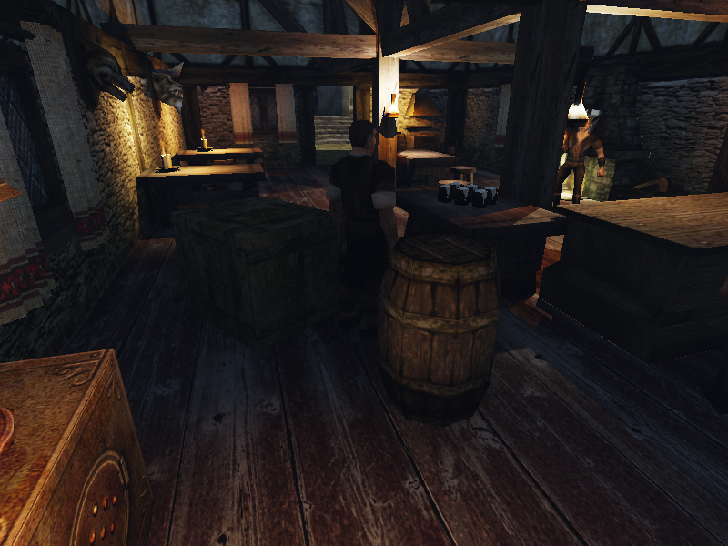
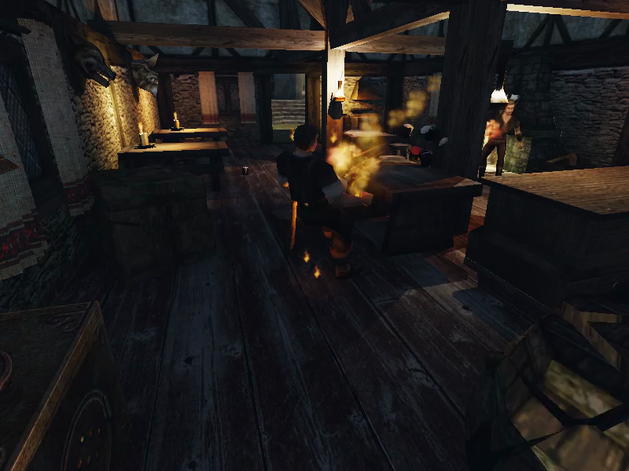

# Разрушение: этап 6, шаг 1 — 2026-10-16

Реализованы офлайн-резка, кэш и поломка ящиков/бочек с наследованием скорости и вращения, шумом #93, удалением прикреплённых стрел и отключением. На этом Mac собраны **6 визуалов / 72 выпуклых замкнутых куска**, резка **0,471087 с** суммарно; повтор даёт те же байты для **6/6** файлов. Игровой стенд: огненный шар ломает ящик и бочку в таверне Корагона на **24 куска**, все спят через **15,000 с**; ящик выдерживает **1 м**, ломается с **5 м** и от **4 стрел**; ходьба героя/NPC оставляет **100/100 HP**. NPC слышит поломку и поворачивается с ошибкой **1,196°**. Профильные регрессии прошли, заключительный `m5b` после слияния `main` с #135 — **14/14**, один запуск. На финальном бинарнике Ryzen пять вещей ломаются в одном шаге: **60/60 кусков спят через 15 с**, кадр поломки **8,241 мс**, шаг физики p95 **0,939 мс**, **170,028 FPS** против **175,071 FPS** без поломки (**−2,881%**). Игровые критерии разрушения пройдены. Доступ macOS к DevSSD восстановлен; на объединённой Linux-сборке заключительный `m5b` прошёл за **34 с**.

| Охват штатных миров | Видимых обычных mesh-vob | Ящиков и бочек по таблице |
|---|---:|---:|
| `NEWWORLD.ZEN` | 11 378 | 300 |
| `OLDWORLD.ZEN` | 4 261 | 198 |
| `ADDONWORLD.ZEN` | 4 647 | 110 |
| `DRAGONISLAND.ZEN` | 424 | 12 |
| Всего | 20 710 | 620 |

Обычных mesh-vob горшков не найдено, в том числе при просмотре имён POT/VASE/AMPH/JAR/CLAY/TOPF/KRUG/KUEBEL/BUCKET. Инвентарные предметы и интерактивные контейнеры не подменялись. Существующие ограничения подвижных vob на подвешенные/зажатые вещи сохранены: 620 — охват визуалов, а не число принудительно разблокированных тел.

| Визуал (basename) | Кусков | Резка, с | Объём оболочки, см³ | Сумма объёмов / оболочка | Повтор байтов |
|---|---:|---:|---:|---:|---|
| `AW_CRATE_01` | 12 | 0,054387 | 1 200 000,000 | 1,000000011 | идентичен |
| `NW_CITY_WEAPON_BARREL_01` | 12 | 0,151843 | 398 151,453 | 1,000000068 | идентичен |
| `NW_HARBOUR_BARREL_01` | 12 | 0,073156 | 451 518,619 | 1,000000038 | идентичен |
| `NW_HARBOUR_CRATE_01` | 12 | 0,062614 | 1 200 000,000 | 1,000000011 | идентичен |
| `OC_BARREL_V1` | 12 | 0,070032 | 451 518,619 | 1,000000038 | идентичен |
| `OC_BARREL_V2` | 12 | 0,059055 | 685 765,522 | 1,000000036 | идентичен |

Вороной по выпуклой оболочке, seed **601**, numpy **2.3.5**, scipy **1.16.3**. Проверены уже сериализованные float32-координаты: замкнутость, ориентация граней, выпуклость, конечные UV и диапазон объёма 0,9–1,1. Снаружи используются UV исходного материала, на срезах — его текстура с плоской развёрткой 128 см/тайл. Время в таблице — вычисление резки, без экспорта, проверки и записи. Шесть `.fracture` занимают **1 035 433 байта** в `~/.local/share/gothic-ai/fracture/`; геометрия и кэш не входят в git. Успешные команды: `scripts/fracture.sh cut` + `verify`, затем после подключения таблицы данных — `extract` + `verify`.

| Игровая проверка | Наблюдение | Результат |
|---|---|---|
| Огненный шар, реальный spell 23 | ящик + бочка; 12 + 12 кусков; поломки 0,134 / 0,083 мс; разлёт >20 см | PASS |
| Сон в таверне | все 24 куска спят через 15 000 мс после последней поломки | PASS |
| Стрелы | четвёртая нативная стрела ломает свежий ящик; прикреплённых стрел в воздухе не остаётся | PASS |
| Падение 1 м | 100 HP, цел | PASS |
| Падение 5 м | 0 HP, 12 кусков, сон через 15 с | PASS |
| Идущий NPC | прошёл 411,54 см, контакт с ящиком подтверждён; 100 HP | PASS |
| Идущий герой | прошёл 423,62 см, контакт с ящиком подтверждён; 100 HP | PASS |
| Шум поломки | дерево, `CS_IHL_WO_WO`, volume 1, радиус 1600 см; слышит ближайший NPC | PASS |
| Поворот к поломке | одно услышанное событие; ошибка к шуму 1,196°, к герою 34,421° | PASS |
| `destruction=0` | реальный огненный шар; обе вещи целы, обломков нет | PASS |
| `OPENGOTHIC_FRACTURE=""` | обе вещи целы, обломков нет; ровно одна строка `Destruction cache unavailable` | PASS |
| Старый сейв | исходный сейв загружается во всех игровых прогонах; прежняя схема movable-save сохранена | PASS |

Полный игровой результат выше — `.bench/destruction-functional-final/validation.json`, Ryzen, на последнем бинарнике с исправлением вращения. Свежий контракт проверяет также наследование линейной/угловой скорости, отключение с восстановлением целой вещи, старую схему сохранений и деревянный звук бочки с ошибочно каменным исходным материалом. Масса/трение такого материала не менялись. На момент приёмки шага 1 фрагменты не сохранялись; после загрузки сломанная вещь могла стать целой. Сохранение добавлено в шаге 2 ниже.

| Кадр до | Кадр после |
|---|---|
|  |  |

После — исходный кадр на 1,00 с видео `destruction-fireball.mp4`: целые вещи исчезли, справа внизу летят текстурированные части бочки. Поздний кадр на 2 с и видео сохранены в `.bench/`.

| Производительность: Ryzen 3950X, RTX 3080 10 ГБ, Linux/Vulkan, 800×600, 30 с | OFF | ON | Порог ON |
|---|---:|---:|---:|
| Средний FPS по завершённым кадрам приложения | 175,071 | 170,028 | снижение ≤5% |
| Снижение среднего FPS | — | 2,881% | ≤5% |
| Кадр с пятью поломками, максимум, мс | — | 8,241 | ≤50 |
| Любой кадр окна, максимум, мс | 32,141 | 22,079 | — |
| Кадр p95, мс | 6,340 | 6,753 | — |
| Шаг физики p95, мс | 0,384 | 0,939 | ≤2 |
| Шаг физики, среднее, мс | 0,239 | 0,321 | — |
| Измерений | 5 252 | 5 100 | полное окно 30 с |
| Фрагментов / спят через 15 000 мс | 0 / 0 | 60 / 60 | все |
| Статус | контроль | PASS | |

Одинаковые бинарник, исходный сейв, seed, камера и пять визуалов (3 ящика / 2 бочки); обычные игровые часы, завершённые кадры приложения, а не частота записи видео. Пять поломок пришлись на один игровой шаг **17 784 мс**. Создание пяти наборов тел: **0,399 / 0,046 / 0,037 / 0,034 / 0,032 мс**, всего **0,548 мс**. Площадка — штатный `NW_PATH_TO_MONASTERY_08`, отдельная от таверны; до старта проверены опора под каждой вещью и нативная видимость траектории/взрыва. Итог — `.bench/destruction-performance-ryzen/validation.json`. Прогоны и Linux-сборка шли под общим `body-simulation.lock`.

Первый замер на Mac до исправления вращения не засчитан: OFF/ON **65,571 / 65,946 FPS**, кадр поломки **26,091 мс**, физика p95 **0,367 мс**, но спали **59/60** кусков — один прошёл под полом. После исправления контроль OFF на Mac дал **65,688 FPS**, p95 **0,350 мс**; ON не стартовал из-за блокировки доступа к DevSSD. Завершающая пара OFF/ON и полный функциональный стенд выполнены на Ryzen с сохранённой локальной копией того же старого сейва.

| Найденная ошибка / подготовка | Что проверено и исправлено |
|---|---|
| Первый настоящий сброс 5 м оставил 82,39 HP | Отдельный структурный импульс из скорости контакта и приведённой массы; максимум за native-body/шаг вместо суммы треугольников. После исправления игровой сброс — 0 HP; контракты 1/5 м на 0° и 0,5° проходят. Акустический импульс #93 сохранён. |
| Один из 60 кусков прошёл под полом | Проверка исходного world-mesh: сплошная поверхность в 21 точке вдоль траектории. Контракт 24 вращающихся выпуклых клиньев над односторонним неровным mesh-полом воспроизвёл провал **77,70 м**. Четыре collision substeps только при бодрствующих обломках удержали все клинья над полом: минимум **7,79 см**; fixed-step часы и скорости сохранены. Полный функциональный повтор и повтор пяти вещей прошли: **60/60 спят через 15 с**. |
| Автофокус уводил огненный шар в Корагона | Стенд удерживает выбранную тестовую цель до commitSpell; реальный production spell/projectile не подменяется. |
| Слушатель сначала слышал обычный удар стола | Размещён вне радиуса обычного шума мебели, внутри радиуса поломки; прежний cooldown NPC и восприятие не менялись. |
| Пять вещей не помещались в таверне | Performance вынесен на настоящую открытую площадку с проверкой опоры и LOS; пара для приёмки осталась в таверне. |

| Проверки | Итог |
|---|---|
| Сборка macOS и Linux | PASS; macOS `Gothic2Notr` собран вместе с `check-physics`; заключительная Linux-сборка после слияния `main` — 78 с, `m5b` выполнен на ней |
| `check-physics` | PASS; включая новый контракт вращения, сбросы 1/5 м на двух уклонах и 4 стрелы |
| Launcher `test_commands.py` | 12 PASS, 0,38 с; Ruff PASS |
| Bash/Python syntax, `git diff --check` перед блокировкой диска | PASS |
| `movable-vobs`, `.bench/destruction-regression-movable-v2` | PASS: 19 вещей, дрейф 0 см / 60 с; 8 вещей сдвинуты взрывом >20 см, сон 15 с; сейв 9 754 427 байт |
| `physics-noise`, `.bench/destruction-regression-noise` | PASS 24/24; поворот <30° за 667 мс, лучший угол 0,129°; 24 нативных шума / 24 выделенных звука |
| Исходный `m5b` до #135, `LLM=fake` | 13/14; `start_activity`: `now ZS_ATTACK at NW_XARDAS_TOWER_IN1_28`; сохранён как история отказа |
| Заключительный `m5b` после #135, `LLM=fake`, ровно один запуск | PASS **14/14**, 34 с, Ryzen под общим замком; `start_activity` → `ZS_SIT_CAMPFIRE`, `set_routine` → `ZS_READ_BOOKSTAND` |
| Финальный повтор после исправления вращения | PASS: полный функциональный стенд и matched OFF/ON на Ryzen; 60/60 кусков спят через 15 с |

| Локальные артефакты (не входят в git) | Файлы |
|---|---|
| `.bench/destruction-functional-final/` | `destruction-fireball.mp4`, `destruction-arrows.mp4`, `destruction-drop1.mp4`, `destruction-drop5.mp4`, `destruction-walk-npc.mp4`, `destruction-walk-hero.mp4`; одноимённые WAV; `destruction-before.png`, `destruction-after.png`; `session-destruction-scattered.sav` (10 082 067 байт), `run/save_slot_1.sav`; события и `validation.json` |
| `.bench/destruction-regression-movable-v2/` | `movable_tavern.mp4`, `session-scattered.sav`, `run/save_slot_1.sav`, события и `validation.json` |
| `.bench/destruction-regression-noise/` | события, `validation.json`, `run/save_slot_1.sav` |
| `.bench/destruction-disabled/`, `.bench/destruction-no-cache/` | события, `validation.json`, `run/save_slot_1.sav` |
| `.bench/destruction-m5b/` | `server.log`, `game.log`, `save_slot_1.sav`; исходный отказ до #135 |
| `.bench/destruction-m5b-main135/` | `server.log`, `game.log`, `launcher.log`, `save_slot_1.sav`; итоговые 14/14; консоль `.bench/destruction-m5b-main135-console.log` |
| `.bench/destruction-performance-before-spin-fix/{off,on}/` | `appcadence.csv` + `.json`, `movable-physics.csv`, события, `run/save_slot_1.sav`; исходный провал 59/60 asleep |
| `.bench/destruction-performance-ryzen/{off,on}/` | финальные `appcadence.csv` + `.json`, `movable-physics.csv`, события и `run/save_slot_1.sav`; итог `../validation.json` |
| `.bench/destruction-performance/off/` | журналы дополнительного контрольного замера на Mac и `run/save_slot_1.sav` |
| `.bench/destruction-validation/` | логи сборки, `check-physics`, контракта вращения до/после и запуска `m5b` |
| Диагностические `.bench/destruction-functional-v2/`, `destruction-functional-v3/`, `destruction-functional-v4/` | те же шесть MP4/WAV, `session-destruction-scattered.sav`, входной `run/save_slot_1.sav`; предыдущие прогоны: в v2/v3 отказы подготовки/сброса/слышимости, v4 — успешный до исправления вращения |
| Диагностический `.bench/destruction-regression-movable/` | `movable_tavern.mp4`, `session-scattered.sav`, `run/save_slot_1.sav`; исходная проблема автофокуса |

В `codex/fracture` без конфликтов влит `main` **392f85a1** с #135 и #137; объединённый код — **d7ae4ee5**. Заключительный `m5b` выполнен один раз на собранном из него бинарнике, с кэшем разрушения и тем же исходным сейвом: SHA-256 загруженной копии **c2852f4c009f23225e1c9c70f564ca36b4c12e8220736d1c72a1dbfce8d3372f** совпадает с прежним прогоном. Ранее полученные числа разрушения относятся к тому же коду физики; после слияния повторён только запрошенный `m5b`. Открытых провалов в запрошенных проверках нет. На момент закрытия шага 1 оружие, заборы, сейв обломков и улики оставались шагами 2/3; приёмка шага 2 приведена ниже.

## Шаг 2

**2026-10-17. Приёмка пройдена.** Удары героя и NPC наносят урон ломаемым вещам; деревянные mesh-vob ограды ломаются и открывают проход. Сломанная вещь, положения кусков, сон, скорости, оставшаяся прочность и уборка переживают сохранение. Три крупнейших куска каждой вещи не удаляются уборкой. Использование обломков как следов и улик остаётся шагом 3.

### Оружие

Попадание вызывается штатным `OPTIMAL_FRAME` анимации, в том числе без NPC-цели. Исходный mesh проверяется в пределах дальности гильдии и оружия; стена перекрывает удар. Одна вещь получает один урон за фазу. Расчёт попаданий по NPC и его RNG сохранены.

Все коэффициенты находятся в `OpenGothic/data/destructible-vobs.csv`: урон = `(0,5 × урон оружия + 0,5 × STR) × множитель`; множители кулака / 1H / 2H — **0,35 / 1 / 1,3**. Прочность ящика и забора **100**, бочки **120**.

| Чем бьёт герой, STR 100 | Урон за контакт | Ящик: ударов до поломки | Бочка | Забор |
|---|---:|---:|---:|---:|
| Кулак | 17,5 | **6** | **7** | **6** |
| Одноручный меч `ITMW_1H_COMMON_01`, урон оружия 40 | 70 | **2** | **2** | **2** |
| Двуручный топор `ITMW_2H_BAU_AXE`, урон оружия 50 | 97,5 | **2** | **2** | **2** |

Результат — **9/9** сочетаний, число принятых анимаций равно числу контактов. Для временного забора стойка возвращается к доске между ударами; во время анимации фиксации нет. Перед каждым ударом проверяется нативный контакт: ближайшая доска не дальше **85,944 см**, дальность кулака / меча / топора **110 / 150 / 130 см**. Это исключает попадания в просвет и уход от рейки из-за перемещения анимации.

Дополнительный NPC через ту же анимационную фазу снял **70 HP** ящика; оставшиеся 30 HP снял последующий физический контакт, и ящик разрушился. Эта сцена подтверждает NPC-путь и случайную поломку рядом с дерущимся телом; таблица выше измеряет удары героя.

### Деревянные ограды

Офлайн-обход четырёх штатных VobTree нашёл **423** деревянных mesh-vob оград, **6** визуалов. Классификация требует обычного видимого mesh-vob; каменные стены, интерактивные объекты и меш мира не включены. Дерево проверено по текстурам и геометрии досок, поскольку часть материалов имеет неопределённую группу.

| Визуал | NewWorld | OldWorld | AddonWorld | DragonIsland | Связных частей перед резкой |
|---|---:|---:|---:|---:|---:|
| `NW_NATURE_FENCE_01` | 167 | 1 | 20 | 0 | 4 |
| `OW_LOB_FENCE_V1` | 0 | 106 | 0 | 0 | 4 |
| `OW_LOB_FENCE_V2` | 1 | 28 | 0 | 0 | 4 |
| `OW_LOB_FENCE_V3` | 3 | 58 | 1 | 0 | 1 |
| `MIN_LOB_HANDRAIL_3` | 2 | 3 | 0 | 0 | 5 |
| `OW_PALISSADE` | 2 | 31 | 0 | 0 | 5 |
| **Всего** | **175** | **227** | **21** | **0** | |

`scripts/fracture.sh` режет доски раздельно, сохраняя просветы; в сумме 12 кусков на визуал. Вместе с шестью прежними визуалами кэш содержит **12 / 144** визуалов / кусков. Повторная резка даёт те же байты для **12/12**; максимальное отклонение сериализованного объёма от исходных оболочек **0,000012%**. Геометрия остаётся в `~/.local/share/gothic-ai/fracture/`.

Целая ограда сохраняет исходную статическую mesh-коллизию и неподвижна, включая `movable_vobs=0`; отдельная неподвижная оболочка хранит её физическую идентичность. При поломке исходная коллизия снимается. На ферме Лобарта проверен настоящий `NW_NATURE_FENCE_01.3DS`, **zenId 19355**, возле `NW_FARM1_FIELD_08`. Целый забор блокировал путь; герой сломал его мечом и прошёл в пролом, проекция перемещения по оси прохода **964,106 см**.

Малет до и после поломки прошёл один и тот же существующий маршрут `NW_FARM1_FIELD_08 → NW_FARM1_FIELD_09`. Распорядки не менялись; в обоих случаях пройдено более 200 см, минимальное расстояние до цели **49,238 / 49,460 см**. Для проверки движения штатной очередью `AI_GoToPoint` выбран существующий участок пути. Видео — `destruction2-farm-sword.mp4`; кадры — `destruction2-farm-before.png` и `destruction2-farm-breach.png`.

### Сохранение и уборка

В полном GameSession сохраняется отдельная необязательная запись `destruction-vobs`, схема 1; общая версия сейва и схемы `movable-vobs` не менялись. Родитель определяется по ZEN id, визуалу и исходной матрице; у куска постоянный индекс. Сохраняются HP, поломка, наличие каждого куска, матрицы, скорости, сон, начало сна и отметка трёх крупнейших. Удалённые индексы остаются удалёнными. Нативные контракты проверяют также движущиеся куски и сохранение повреждённой целой вещи.

Уснувшие непостоянные куски удаляются через **30 игровых минут сна** либо дальше **30 м от героя**. Пробуждение перезапускает возраст сна. Три крупнейших по объёму остаются физическими кусками и не удаляются этим механизмом. Переключение `movable_vobs` не восстанавливает сломанные вещи; загрузка и повторное сохранение с ним выключенным проверены контрактами.

| Проверка новым процессом | Результат |
|---|---|
| Сейв после поломки настоящего забора | Целый не вернулся; **12/12** кусков уснули и загружены |
| Полные матрицы: контрольные точки 2-метрового куба | Максимальная ошибка **0,001000 см**, допуск 1 см; после секунды продолжения тот же результат |
| Возраст 29 минут от самого раннего сна | Остались **12** |
| Возраст 30 минут от самого позднего сна | Остались **3**, удалены **9** |
| Удаление героя: `NW_FARM1_PATH_07` | Ближайший кусок в **35,475 м**, удалены **9**, остались **3** |
| Сейв после временной уборки и новый процесс | **3/3**, индексы **1, 3, 11**; удалённые 9 не вернулись |
| Сейв после дистанционной уборки и новый процесс | **3/3**, те же индексы; удалённые 9 не вернулись |
| Ошибка матриц после обоих очищенных сейвов | **0,000012887 см**, также после секунды продолжения |
| `destruction=0` до загрузки сломанного сейва | **475** соответствующих map-vob целы, кусков **0** |
| Старый входной сейв шага 1 | Загружен в игровых стендах, ошибка чтения отсутствует |

Исходный полный сейв с обломками — **10 095 233 байта**; после уборки по времени **10 088 508**, по расстоянию **10 094 341**. Последние отличаются и состоянием героя/мира, поэтому размер не используется как доказательство удаления кусков.

### Проверки и исправления

В первом правильном прогоне регрессии огненный шар дал **23/24** уснувших кусков: кусок ящика прошёл односторонний пол до **−29520,746 см**, скорость вниз **2438,819 см/с**. Одних четырёх подшагов недостаточно для быстрого вращения выпуклой части: linear CCD сначала поворачивает форму, затем проверяет перенос. Теперь только `C_Fragment` ограничивает вращение по радиусу от COM, внутреннему радиусу и полосе спекулятивного контакта, сохраняя прежние четыре подшага. Начальное наследование движения и точность сейва сохранены; остальные категории не ограничиваются этим кодом.

Усиленный контракт проверяет **72** синтетические выпуклые формы/ориентации на неровном одностороннем полу: минимальный COM **+0,199 см**, вершина **−5,846 см** относительно аналитической поверхности; допуск вершин 6 см учитывает неровный треугольный пол и проникновение при контакте. Контроль обычного предмета сохраняет вращение более 40 рад/с. После исправления выполнен **один** повтор полного стенда разрушения: **24/24** спят через **15 000 мс**, провала нет.

| Проверка | Итог |
|---|---|
| Linux/Vulkan сборка на Ryzen | PASS; первая сборка **154 с**, итоговая правка физики **19 с** |
| `check-physics` | PASS, включая сейв/HP/уборку/OFF-флаги, статичный забор, melee и **72** вращающихся куска |
| Полный `destruction` из #138, повтор после исправления | PASS: огненный шар **24/24**, **4** стрелы; 1 м — **100 HP**, 5 м — поломка и **12/12** спят; ходьба NPC/героя сохраняет **100 HP** |
| `movable-vobs` | PASS: **19** вещей, дрейф **0 см / 60 с**, **9** вещей сдвинуты более 20 см, сон через 15 с |
| `physics-noise` | PASS **24/24**, поворот менее 30° за **667 мс**, лучший угол **0,129°**, **23** шума / выделенных звука |
| `aim`, один процесс | Завершены **19** видеосегментов, **0** ошибок подготовки; зарегистрированы 4 бросковые стрелы и 51 запись урона ближнего боя по герою |
| `m5b`, `LLM=fake`, один процесс | PASS **14/14**, **36 с**, ошибок сценария **0** |
| Python syntax и `git diff --check` | PASS |

`m5b` и `aim` выполнены по одному разу до финального ограничения вращения `C_Fragment`. После него прошли `check-physics`, melee, `movable-vobs`, `physics-noise`, повторная загрузка дистанционно очищенного сейва и полный повтор `destruction`. Ограничение не затрагивает предметы, NPC, стрелы или расчёт их урона. Полный pytest и непрошенные сценарии не запускались. Все тяжёлые проверки — Ryzen под общим замком.

Подготовка стенда исправлялась отдельно: отсутствующий в DAT меч заменён на реальный; в пробе кулака по забору первые **2** контакта сняли HP до 65, затем анимация увела героя от рейки (**41** анимация суммарно); для ухода от кусков выбрана опорная точка штатного пути вместо неподдержанного смещения на 42 м. Это не дополнительные повторы механики с правильной подготовкой.

### Локальные видео и сейвы

Артефакты не входят в git. Сохранены **74 файла видео/аудио/сейвов, 263,7 МиБ**. **Все MP4/WAV/SAV** из перечисленных каталогов `.bench/destruction-step2-*` также скопированы с той же структурой в **`~/.local/share/gothic-ai/saves/destruction/step2/`**. Кадры и полные журналы остаются в `.bench/`.

| Каталог в `.bench/` | Видео, сейвы и результаты |
|---|---|
| `destruction-step2-melee-validated/` | `destruction2-{crate,barrel,fence}-{fist,1h,2h}.mp4`, `destruction2-npc-sword.mp4`, `validation.json`, входной `run/save_slot_1.sav` |
| `destruction-step2-farm/` | `destruction2-farm-sword.mp4`, два PNG до/после; **`session-step2-scattered.sav`**, входной `run/save_slot_1.sav` |
| `destruction-step2-reload/`, `destruction-step2-disabled/` | Снимки исходной загрузки и продолжения, входные `run/save_slot_1.sav` |
| `destruction-step2-time/` | **`session-step2-time-cleaned.sav`**, снимки 29/30 минут, входной сейв |
| `destruction-step2-distance-validated/` | **`session-step2-distance-cleaned.sav`**, снимки до/после ухода, входной сейв |
| `destruction-step2-time-reload/`, `destruction-step2-distance-reload/` | Снимки трёх сохранённых кусков до первого шага физики и через секунду, входные сейвы |
| `destruction-step2-regression-destruction-fixed/` | Шесть `destruction-{fireball,arrows,drop1,drop5,walk-npc,walk-hero}.mp4`, PNG до/после, `session-destruction-scattered.sav`, `validation.json` |
| `destruction-step2-regression-movable/` | `movable_tavern.mp4`, `session-scattered.sav`, `validation.json` |
| `destruction-step2-regression-noise/` | События, `validation.json`, входной сейв |
| `destruction-step2-regression-aim/` | 19 MP4 по именам сегментов, кадры, `report.json`, события и входной сейв |
| `destruction-step2-m5b/` | `server.log`, `game.log`, `launcher.log`, входной `save_slot_1.sav` |
| `destruction-step2-validation/` | `validation.json` всей приёмки шага 2; `check-physics.log`, **`check-physics-final.log`** |
| Диагностические `destruction-step2-melee/`, `destruction-step2-melee-final/`, `destruction-step2-distance/`, `destruction-step2-regression-destruction/` | Сохранены неуспешная подготовка и первый провал пола; это не итоговая приёмка |

Полный comparator: `python3 scripts/destruction_step2_compare.py --melee .bench/destruction-step2-melee-validated --farm .bench/destruction-step2-farm --reload .bench/destruction-step2-reload --time .bench/destruction-step2-time --distance .bench/destruction-step2-distance-validated --time-reload .bench/destruction-step2-time-reload --distance-reload .bench/destruction-step2-distance-reload --disabled .bench/destruction-step2-disabled`.

Шаг 2 закрыт; открытых провалов в запрошенной приёмке нет. Ветка `codex/destruction-2`; PR оставляется для ревью и слияния Claude. `scripts/ryzen.sh clean` выполняется после слияния PR, поэтому до него рабочая папка Ryzen сохраняется.
