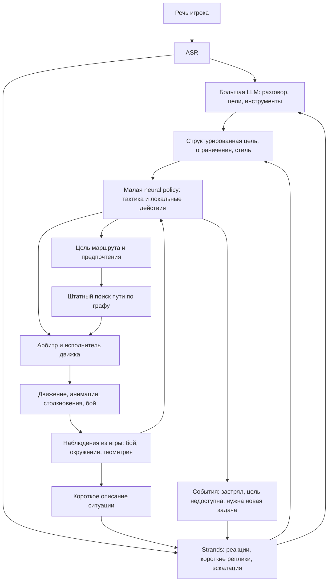

# Нейросеть для управления NPC в Gothic

Исследование на 13 октября 2026 года. Задача — выбрать архитектуру небольшой обучаемой модели для боя, тактического перемещения и обхода препятствий с учётом текущих LLM, Strands Decider и удалённого сервера `dev-ubuntu` с RTX 3090.

**Для первой версии я бы взял специализированную policy network: числовые признаки состояния → небольшой энкодер → GRU → выбор допустимого боевого действия и цели.** Начальный диапазон — примерно 0,5–2 млн параметров, один или два слоя памяти, общие веса для NPC и отдельное состояние памяти для каждого. Обучение: сначала имитация существующего контроллера и человеческих действий, затем recurrent PPO в ограниченных боевых сценариях. Это проектный выбор для Gothic, который предстоит проверить, а не установленный бенчмарком победитель.

**Основной альтернативный кандидат — Mamba-2.** Из более новых архитектур особенно интересны xLSTM и Mamba-3. У Mamba-3 есть существенная практическая оговорка: официальный быстрый пошаговый инференс пока проверен только на H100. Поэтому начинать разработку с зависимости от него на RTX 3090 рискованнее, чем с GRU. [Mamba-3 paper](https://arxiv.org/abs/2603.15569), [официальный `step`](https://github.com/state-spaces/mamba/blob/main/mamba_ssm/modules/mamba3.py).

Глобальный поиск пути, физику, столкновения и исполнение анимаций разумно сохранить в движке. Нейросеть выбирает, **как сражаться и куда переместиться**, а движок обеспечивает выполнимость действия. Большая LLM остаётся главным интеллектом, а Strands — быстрым семантическим управляющим слоем. Ни одна новая сеть сама по себе не заменяет датасет, среду обучения и доступ к состоянию боя.

## Что сейчас есть в проекте

Название модели в репозитории — **Strands Decider**, далее Strands. Она получает текстовое описание ситуации и типизированные вопросы, за один проход оценивает предложенные ответы. Короткие реакции во время разговора устроены как выбор категории `voice`, после которого сервер выбирает готовую реплику. Этот механизм подходит для «ага», «хм», жеста и решения об эскалации к LLM. [Описание сервиса](../decider-service/README.md), [рефлексы](../server/src/gothic_ai/brain/reflex.py).

Текущий backbone уже использует Gated DeltaNet: интеграция включает соответствующие fused kernels. Поэтому вопрос состоит в выборе **маленькой специализированной политики для числового состояния**, а не просто в замене обычного Transformer на Mamba. Модель по умолчанию и реально развёрнутый дообученный checkpoint могут различаться; для архитектурного выбора это несущественно. [Код движка модели](../decider-service/src/gothic_decider/engines/strands.py), [установка kernels](../decider-service/deploy/install.sh).

Измеренные 20–30 мс нельзя автоматически переносить на управление боем множества NPC. Документированный замер 11 октября — запрос с Mac через Tailscale, один вопрос `react`; сеть занимает около 5 мс. При 10 запросах/с urgent p50/p95 составляют 29/31 мс; при 40 запросах/с — 33/88 мс, а background p95 достигает 188 мс. Существующий планировщик рассчитывает примерно на 11 запросов/с **для всего острова**. [Замеры](../decider-service/README.md), [планировщик](../docs/npc-scheduler.md).

Выбор `fight` сейчас запускает `ZS_ATTACK`, а `flee` — `ZS_FLEE`. Дальше работает родной ИИ. `FightAlgo` уже умеет выбирать движение, отскок, удары, шаги в стороны, блок, ожидание и поворот. Это естественная граница для подключения обучаемой тактики. `ArcherAi` показывает полезное разделение: верхний контроллер решает выстрелить, а нижний каждый кадр прицеливается и исполняет выстрел. [Bridge actions](../OpenGothic/ai_bridge/npcobserver.cpp), [примитивы `FightAlgo`](../OpenGothic/common/game/fightalgo.h), [выбор примитивов](../OpenGothic/common/game/fightalgo.cpp), [ArcherAi](../OpenGothic/common/game/archerai.h).

Главный пробел сейчас — наблюдения и команды для нового слоя. Автоматический `snapshot` прикреплённого NPC и `npc_roster` обновляются раз в 500 мс, `npc_views` — раз в 1000 мс; snapshot свободного NPC можно запросить отдельно. В bridge нет интерфейса для выбора отдельных блоков, вариантов удара или локального steering с маской допустимых действий. Для боевой политики понадобятся более частые числовые наблюдения, фазы анимаций, скорости, геометрия и новый action API. Само наличие быстрой сети этот пробел не закрывает. [Snapshot](../OpenGothic/ai_bridge/npccontroller.cpp), [Roster](../OpenGothic/ai_bridge/npcobserver.cpp), [Views](../OpenGothic/ai_bridge/npcview.cpp).

## Предлагаемые слои управления



Ниже — начальные частоты для прототипа, которые нужно подобрать по окнам атак и анимациям Gothic.

| Слой | Ответственность | Когда работает |
|---|---|---|
| ASR | Понимание речи через текст | Поток речи |
| Большая LLM | Разговор, намерение, план, сложные инструменты | По обращению и эскалации |
| Strands | Социальная реакция, короткая реплика, режим поведения, необходимость LLM | По событиям и редким проверкам |
| Тактический контроллер | Выбор противника, позиции, навыка, локальной цели | Например, 2–5 Гц и по событиям |
| Быстрая policy | Удар, блок, отступление, шаг в сторону, локальный обход | Сначала 10–20 Гц для активного боя |
| Исполнитель | Физика, анимационные ограничения, движение по маршруту | Каждый игровой кадр |

Тактический и быстрый контроллер сначала могут быть одной сетью с разными головами. Отдельную иерархию сетей стоит вводить, когда измерения покажут, что задачи мешают друг другу. Структурированная цель уже задаёт более медленный масштаб управления.

Пример: LLM ставит задачу «проводи героя до монастыря, избегай боя, при опасности защищай его». Strands определяет, что ситуация стала опасной. Policy выбирает позицию между героем и противником, блокирует удар и отступает к доступной точке. Поиск пути строит маршрут до этой точки. Если проход недоступен, policy сообщает событие наверх; ей не требуется самой понимать новую текстовую инструкцию.

У тела должен быть один владелец управления. Сюжетные запреты и допустимость действий проверяет движок; боевая реакция может прервать разговорную позу. LLM меняет цель асинхронно, без ожидания её ответа в каждом боевом тике. Память о персонаже и отношениях остаётся в семантическом слое, точные HP, cooldowns и состояние дверей — в игре.

## Сравнение нейросетевых архитектур

Здесь сравнивается временная часть policy. Энкодер геометрии или соседних NPC можно сочетать с любой из этих архитектур. Приоритеты — инженерная оценка для нашего проекта.

| Архитектура | Сильная сторона | Ограничение для Gothic | Место в выборе |
|---|---|---|---|
| **MLP с текущим состоянием** | Самый простой один проход | Не помнит скрытые события; качество зависит от полноты признаков | Обязательный baseline |
| **MLP со стеком 4–8 наблюдений** | Короткая история без recurrent state | Окно ограничено, вход растёт с его длиной | Обязательный baseline |
| **GRU или LSTM** | Компактная нелинейная память, зрелый runtime | Обучение длинных последовательностей последовательное; память конечна | **GRU — первая версия**, LSTM — проверенная альтернатива |
| **minGRU или minLSTM** | Простое обновление, parallel scan при обучении | Упрощённые gates; большой training speedup не гарантирует самый быстрый step | Дешёвый дополнительный эксперимент |
| **Mamba-1** | Selective SSM, фиксированное состояние | Есть более новые варианты; качество RL зависит от задачи и реализации | Историческая база |
| **Mamba-2** | SSD, эффективное обучение последовательностей, постоянный по длине истории cache | Cache может быть больше GRU; преимущество короткого step нужно измерять | **Главный SSM кандидат** |
| **Mamba-3** | Улучшенное state tracking, SISO/MIMO, дизайн под inference | Быстрый официальный `step` проверен только на H100 | Кандидат после проверки kernels на 3090 |
| **xLSTM** | sLSTM для нелинейной памяти, mLSTM для матричной ассоциативной памяти | Более сложные kernels и выбор конфигурации; action benchmarks крупнее нашей сети | Сильный следующий кандидат |
| **RWKV-7** | Recurrent matrix state, generalized delta rule | Основная доказательная база относится к языковым моделям | Второй круг исследований |
| **Gated DeltaNet, KDA, GDN-2** | Ассоциативное чтение и обновление памяти | Успех длинного текстового retrieval не доказывает успех боя | Второй круг исследований |
| **Небольшой Transformer** | Явный доступ к окну истории; удобные связи между сущностями | Временной cache растёт с окном, больше внимания к latency | Полезный сравнительный кандидат |
| **TCN или причинная 1D CNN** | Ограниченная история и простое feed-forward исполнение | Нет памяти за пределами receptive field | Если короткой истории достаточно |
| **CfC и liquid networks** | Работа с временными зависимостями и нерегулярными интервалами | Нужен отдельный control benchmark, готовой Gothic policy нет | Для специфической проблемы с временем |

Основные первоисточники: [GRU runtime](https://docs.pytorch.org/docs/stable/generated/torch.nn.GRU.html), [minGRU](https://arxiv.org/abs/2410.01201), [Mamba](https://arxiv.org/abs/2312.00752), [Mamba-2](https://arxiv.org/abs/2405.21060), [Mamba-3](https://arxiv.org/abs/2603.15569), [xLSTM](https://arxiv.org/abs/2405.04517), [RWKV-7](https://arxiv.org/abs/2503.14456), [Gated DeltaNet](https://arxiv.org/abs/2412.06464), [Kimi Linear](https://arxiv.org/abs/2510.26692), [GDN-2](https://arxiv.org/abs/2605.22791), [TCN](https://arxiv.org/abs/1803.01271), [CfC](https://arxiv.org/abs/2106.13898).

**GNN и attention по сущностям решают другую часть задачи.** Они помогают представить отношения между несколькими противниками, союзниками, препятствиями или точками графа. Можно использовать entity attention → GRU или graph encoder → Mamba. Для первой версии достаточно общего MLP для каждой видимой сущности и pooling; усложнение оправдано, если policy путает цели или плохо координируется в группе. AlphaStar использовал entity encoder и рекуррентную память совместно. [AlphaStar](https://deepmind.google/blog/alphastar-mastering-the-real-time-strategy-game-starcraft-ii/).

## Почему Mamba не становится победителем автоматически

Mamba-2 опубликована 31 мая 2024 года. Её SSD formulation и ускорение относительно первой Mamba полезны прежде всего для вычисления последовательностей. Заявленные авторами 2–8 раз относятся к SSM core в их условиях. Для нашей задачи один новый снимок игры должен обновить память и сразу выдать действие. GRU тоже делает это без повторного прохода по всей истории. [Mamba-2](https://arxiv.org/abs/2405.21060).

Когда сеть мала, существенными становятся запуск kernels, перенос данных, пакетирование, очередь и сеть. Асимптотическое преимущество на тысячах токенов может почти не влиять на policy с одним новым вектором состояния. Это причина сравнивать архитектуры на реальном интерфейсе Gothic.

### Актуальность Mamba-3 и поддержка 3090

Mamba-3 опубликована 16 марта 2026 года и представлена на ICLR 2026. Она меняет рекуррентное обновление, использует комплексное состояние и MIMO formulation; авторы показывают улучшение state tracking и языковых задач. Их decode benchmark использует **H100, batch 128, модель 1,5B, ширину 2048**. Эти цифры не являются оценкой tiny policy на 3090. [Полный текст, раздел 4.4 и приложение G](https://arxiv.org/html/2603.15569v1).

Официальный `Mamba3.step()` содержит предупреждение «Only tested on H100» и использует CuTe DSL. Реализация Mamba-3 в Flash Linear Attention импортирует тот же step kernel. Это **не доказательство несовместимости с 3090**, но поддержку нужного режима нельзя считать подтверждённой. Сначала нужен небольшой smoke test recurrent inference на сервере, включая согласованность `forward` и `step`. [Официальный код](https://github.com/state-spaces/mamba/blob/main/mamba_ssm/modules/mamba3.py), [FLA layer](https://github.com/fla-org/flash-linear-attention/blob/main/fla/layers/mamba3.py).

### Постоянная память может быть большой

Ниже — расчёт для выбранных размеров, **не измерение и не сравнение одинакового качества**. Учтён только cache, без весов и runtime.

| Пример модели | Cache одного NPC |
|---|---:|
| GRU, 2 слоя, hidden 256, FP32 | 2 KiB |
| Mamba-2, 2 слоя, width 256, expand 2, head 64, state 64, FP32 | 256 KiB SSM state плюс convolution cache |
| Transformer, 2 слоя, width 256, окно 64, обычная MHA, FP16 | 128 KiB KV cache |

Формулы: GRU — `layers × hidden × bytes`; Mamba-2 — `layers × heads × head_dim × state_dim × bytes`; обычный Transformer — `2 × layers × window × width × bytes`. Для 300 NPC приведённый Mamba cache составит около 75 MiB. Это умеренный объём, но показывает: constant memory означает независимость от длины истории, а не меньшую память при любых настройках. [Mamba-2 allocation](https://github.com/state-spaces/mamba/blob/main/mamba_ssm/modules/mamba2.py).

### Что дают новые recurrent модели

minGRU/minLSTM упрощают gates и позволяют parallel scan. Их громкие ускорения обучения получены на T4 и длинных последовательностях, с отдельной реализацией сравниваемых RNN; это не обещание превосходства над optimized single-step GRU. Их стоит включить как недорогой эксперимент. [Were RNNs All We Needed](https://arxiv.org/html/2410.01201v3).

Для xLSTM есть непосредственно action-model исследование **A Large Recurrent Action Model**, ICLR 2025: сравнения на Atari, Procgen, роботических и других задачах. Но это модели 16M–206M, а замеры задержки выполнены на A100. Результат поддерживает исследование xLSTM, особенно sLSTM, но не устанавливает превосходство нашей 1M policy. Официальные sLSTM CUDA kernels требуют compute capability от 8.0 и предусматривают архитектуру 8.6. [LRAM](https://arxiv.org/abs/2410.22391), [xLSTM runtime](https://github.com/NX-AI/xlstm).

CfC — полезный отдельный кандидат, если наблюдения приходят с нерегулярными интервалами. В отличие от исходных Liquid Time-constant Networks, CfC позволяет избежать численного ODE solver и явно использует время в обновлении. Это преимущество над ODE-based моделями, а не установленное ускорение относительно GRU. Сначала стоит проверить обычную GRU с `Δt` на входе; continuous-time модель не компенсирует устаревшее наблюдение. [CfC, Nature Machine Intelligence 2022](https://www.nature.com/articles/s42256-022-00556-7), [официальный код](https://github.com/raminmh/CfC).

RWKV-7, KDA и GDN-2 развивают матричную память и обновления delta rule. GDN-2 — свежая работа мая 2026 года. Пока их убедительные результаты в основном относятся к language modeling и retrieval. Для numeric combat policy нет основания выбирать их раньше GRU/Mamba-2. При выборе реализации также нужно проверять лицензию: NVIDIA GDN-2 repository использует NC-лицензию, FLA — отдельную MIT-реализацию. [RWKV-7](https://arxiv.org/abs/2503.14456), [KDA](https://arxiv.org/abs/2510.26692), [GDN-2 paper](https://arxiv.org/abs/2605.22791), [GDN-2 repository](https://github.com/NVlabs/GatedDeltaNet-2), [FLA](https://github.com/fla-org/flash-linear-attention).

Рекуррентное состояние не гарантирует точного хранения любой истории. Теоретические ограничения зависят от конкретного типа переходов, gates и арифметики; результаты о ранних диагональных SSM нельзя переносить на все новые модели. Для Gothic практическое следствие простое: точные счётчики и известные факты передавать из движка, а hidden state использовать для временных закономерностей и неполного восприятия. [The Illusion of State](https://arxiv.org/abs/2404.08819), [On the Expressiveness of State Space Models via Temporal Logics, 2026](https://arxiv.org/abs/2601.19467).

## Что подтверждают игровые исследования

| Работа | Результат авторов | Что переносимо в Gothic |
|---|---|---|
| **Human-like Bots for Tactical Shooters**, modl.ai и Riot Games, 2024/2025 | Лучевые сенсоры и structured features → CNN/dense → LSTM; минимальная модель около 628 тысяч параметров. Инференс 1,95 ± 0,35 мс на i7-10700KF; BC на 48,6 часа человеческой игры | Маленькая сеть с памятью и игровыми сенсорами — реалистичная конструкция. Минимальный вариант самый быстрый; более крупные модели лучше по части метрик сходства поведения. Это не замер 3090 или удалённого полного цикла. [Paper](https://arxiv.org/html/2501.00078v1) |
| **MLMove**, 2024 | Entity Transformer управляет перемещением десяти игроков CS:GO. Один запрос — median 6,9 мс на Intel 8375C; вызывается раз в 125 мс. Прицеливание и стрельба остаются правилами | Spatial attention и гибрид исполнения полезны. Заявленные 0,5 мс на игровой шаг — амортизированное время, не latency запроса. Обучение ограничено Dust2 и фазой после установки бомбы; бот оценивается в Retakes. [Paper](https://arxiv.org/html/2408.13934v1) |
| **AMD Schola BT+RL**, preprint 2025 | BT переключает небольшие skills; MLP width 64, depth 2; 2–12 млн шагов на навык. Против aggressive opponent win rate BT 0,59, hybrid 0,53, monolithic curriculum 0,41 | Модульные навыки помогают управлять сложностью. Нейросеть не обязана превосходить качественный scripted AI. [Paper](https://arxiv.org/html/2510.14154v1) |
| **OpenAI Five**, 2019 | Structured observations, LSTM, PPO, self-play и частично scripted mechanics | Полезны recurrent actor, выбор из структурированных действий и пул противников. Модель 159M и масштаб обучения нам не подходят. [Paper](https://cdn.openai.com/dota-2.pdf) |
| **AlphaStar**, 2019 | Entity representation, recurrent core, imitation и multi-agent RL | Разделять представление сущностей, память и action heads; выбирать цель из доступных объектов. Полный стек слишком велик для нашей первой версии. [Описание авторов](https://deepmind.google/blog/alphastar-mastering-the-real-time-strategy-game-starcraft-ii/) |

У **Memory Gym, JMLR 2025** GRU существенно превосходит Transformer-XL на endless memory tasks, а на конечных задачах Transformer-XL выигрывает только с дополнительным reconstruction objective. Это показывает, что архитектура и режим обучения работают совместно; современность модели не определяет победителя. [Memory Gym](https://www.jmlr.org/papers/v26/24-0043.html).

Прямой сравнительный preprint **RLBenchNet** использует PPO с MLP, GRU, LSTM, Transformer и Mamba. Его «Mamba быстрее в 4,5 раза» относится к training throughput. Средняя inference latency в таблице: GRU 0,971 мс, LSTM 1,006 мс, Mamba 1,304 мс, Mamba-2 1,489 мс, на A5000/Xeon. Более того, авторы признают отсутствие корректного сброса Mamba state между эпизодами и возможную утечку информации. Поэтому работа полезна как предварительный ориентир, но недостаточна для выбора победителя; статус принятия ICLR 2026 не подтверждён. [RLBenchNet, разделы 3.1, 4.5, 4.8](https://arxiv.org/html/2505.15040v1).

## Конкретная сеть для первого прототипа

**Проектная конфигурация:** общий actor на людей с conditioning по оружию, навыку и стилю; отдельные policy для существенно другой механики монстров можно добавить позже. Первую задачу ограничить дуэлью с оружием ближнего боя.

```text
Свой NPC                  → небольшой MLP ─────────────┐
Видимые сущности           → shared MLP + pooling ──────┤
Локальная геометрия        → rays/features encoder ────┼→ MLP → GRU 256
Задача и стиль            → categorical embeddings ───┤           │
Предыдущее действие и Δt  ────────────────────────────┘           ├→ primitive
                                                                 ├→ target
                                                                 ├→ локальная цель
                                                                 ├→ steering
                                                                 └→ value, только обучение
```

Стартовые размеры: скрытые MLP 64–256, GRU hidden 256, сначала один слой; 8 ближайших релевантных сущностей с масками; 16–32 луча или другой компактный набор признаков препятствий. Диапазон 0,5–2M параметров — бюджет эксперимента, его нужно уточнить по окончательной схеме входов. Картинка игры и текстовые токены в быстрый цикл не нужны.

Для выбора цели сохраняем также **отдельные embeddings сущностей до pooling**. Scorer, conditioned на GRU и действие, оценивает каждую допустимую цель; ID используется для сопоставления ответа с объектом игры. Одно pooled представление не сохраняет привязку к конкретному противнику. В первой дуэли цель можно зафиксировать и добавить этот head при переходе к нескольким противникам.

### Наблюдения

| Группа | Признаки для первой версии |
|---|---|
| Сам NPC | HP, оружие, навык, скорость, направление, текущий primitive, фаза атаки/восстановления, возможность прерывания |
| Противник | Относительная позиция и скорость, расстояние, направление, видимость, оружие, наблюдаемая фаза замаха/блока |
| Окружение | Ближайшие стены и свободные направления, перепад высоты, доступность опоры, текущая точка маршрута |
| Задача | `fight`, `protect`, `retreat`, `follow`, target ID, допустимая зона, ограничения на агрессию |
| Стиль | Храбрость, агрессивность, желаемая дистанция, уровень мастерства |
| История | Предыдущее реально принятое действие и результат, время с последнего события, `Δt` |

Координаты — преимущественно относительно NPC, величины нормализованы, отсутствующие сущности замаскированы. Не передавать абсолютный ID персонажа как единственный способ выучить его поведение. Такой ID позволяет запомнить конкретные дуэли вместо механики.

Нужно определить честную границу восприятия: policy не должна видеть цель за стеной только потому, что движок знает её координаты. Последняя известная позиция и время её наблюдения могут приходить из внешней памяти. Если используются privileged observations для critic при обучении, actor в production должен получать тот же доступный набор признаков, что и во время обучения.

### Действия и ограничения

Первая policy выбирает из готовых примитивов `FightAlgo`: подход, отскок назад, шаг в сторону, удар, блок, поворот, ожидание. Здесь отскок — короткий `MV_JUMPBACK`/`MoveBack`; длительное тактическое отступление потребует отдельного управления перемещением, `RUN_BACK` пока отмечен как TODO. Примитивы существуют внутри движка, но их ещё нужно выставить через новый API. Конкретный список и длительности зависят от исполнительного интерфейса. Сеть не вычисляет положение каждого сустава и не переобучает анимации.

Action mask исключает действительно невозможные варианты: блок без нужного оружия, удар в несовместимой фазе анимации, исчезнувшую цель, движение через непроходимую геометрию. Стратегически неудачные, но допустимые действия остаются для обучения. После ответа сетью движок повторно проверяет допустимость: мир мог измениться за время запроса.

Раздельные головы `action` и `target` должны учитывать зависимость между ними. Нельзя независимо выбрать удар и неподходящую цель. Простой вариант — оценивать набор допустимых пар `(primitive, target)`; другой — conditional heads и masks. При PPO mask должен совпадать при sampling и расчёте log-probability. [Invalid Action Masking](https://arxiv.org/abs/2006.14171).

Начатый удар или движение имеет условия завершения и прерывания. Перевыбор команды каждый тик не должен сбрасывать анимацию. Для новых задач можно использовать skills с явными initiation, termination и interrupt conditions — временную абстракцию уровня options. [Options framework](https://www.sciencedirect.com/science/article/pii/S0004370299000521).

## Навигация и обход препятствий

Сейчас `World::wayTo` выбирает доступную начальную точку, а `WayMatrix::wayTo` ищет маршрут по графу связей с учётом длины. В бою уже есть переход к waypoint pathfinding при преграде между NPC и целью. Это существующий полезный исполнитель. [World navigation](../OpenGothic/common/world/world.cpp), [WayMatrix](../OpenGothic/common/world/waymatrix.cpp), [бой и движение](../OpenGothic/common/world/objects/npc.cpp).

Для Gothic имеет смысл разделить три задачи:

1. **Выбор назначения и предпочтений.** Policy решает занять боковую позицию, отступить к союзнику, обойти опасный участок или держаться рядом с героем.
2. **Глобальный маршрут.** Штатный поиск строит путь по доступному графу. Позже сеть может ранжировать кандидатные точки или добавлять неотрицательные стоимости опасных рёбер.
3. **Локальное исполнение.** Движок следует маршруту, проверяет столкновения; policy помогает выбрать сторону обхода, восстановиться после застревания, уступить проход другому NPC.

Для оценки опасности использовать сведения, доступные NPC. Базовая геометрическая стоимость остаётся положительной; добавление угрозы меняет задачу поиска, но не означает, что сеть гарантирует оптимальный или достижимый путь.

Neural A* — пример обучения guidance при сохранении процедуры поиска, а не замены карты одной recurrent сетью. Исследование Ubisoft о RL-навигации полезно для сложных способностей вроде прыжков и телепортации; его результат не означает, что обычный маршрут Gothic нужно учить с нуля. Recast/Detour отдельно выделяет path queries и crowd avoidance, но его подключение потребовало бы интеграции геометрии. [Neural A*](https://arxiv.org/abs/2009.07476), [Deep RL for Navigation in AAA Video Games](https://arxiv.org/abs/2011.04764), [Recast/Detour](https://github.com/recastnavigation/recastnavigation).

## Как обучать policy

### Среда и данные

До длительного обучения нужны воспроизводимые сценарии, reset, фиксированный шаг или точные timestamps, terminal flags и журнал реально выполненных действий. Основная траектория: `(observation, valid_actions, requested_action, accepted_action, outcome, next_observation)` плюс версии задачи и эпизода.

Для PPO дополнительно сохраняем log-probability **выбранного policy действия**, mask и версию behavior policy. `accepted_action` сообщает, что реально сделал исполнитель, но не заменяет sampled action при расчёте PPO ratio. Если движок отверг команду или перешёл на fallback, нельзя записать действие родного AI как будто его выбрала сеть. Такие эпизоды использовать отдельно для BC/оценки либо явно моделировать rejection, delay и fallback как часть среды обучения.

Записывать стоит родной combat AI, специально заданные scripted opponents и человеческое управление, если доступен такой способ разметки. Логи разговоров и LLM toolcalls не содержат достаточных демонстраций момента блока или обхода препятствия. Саму LLM полезнее использовать для генерации описаний сценариев и высокоуровневых задач с проверкой, чем как учителя каждого боевого тика.

Нельзя случайно смешивать соседние кадры одной дуэли между train и test. Разделение — по encounter, позиции на карте, противнику, оружию и отдельным прохождениям. Нужны также состояния после собственных ошибок policy: упёрся в угол, потерял цель, оказался между противниками.

### Последовательность обучения

1. **Behavioral cloning.** Обучить MLP с коротким стеком и GRU на одинаковых demonstrations. Проверить качество целой дуэли и маршрута, а не только совпадение отдельных действий.
2. **DAgger при доступном teacher.** Learner посещает новые состояния, учитель размечает их. Это помогает исправить накопление ошибок и сдвиг распределения относительно исходных demonstrations. [DAgger](https://arxiv.org/abs/1011.0686).
3. **Recurrent PPO.** Сначала выход на дистанцию, затем защита, атака и дуэль; после этого несколько противников, разные виды оружия, тесные проходы и сопровождение. PPO оптимизирует награду в среде; GRU/Mamba — архитектура policy, это разные уровни выбора. [PPO](https://arxiv.org/abs/1707.06347).
4. **Пул противников.** Родной AI, scripted styles, старые checkpoints и текущая policy. Только latest-vs-latest может дать узкую стратегию и забывание прежних противников.
5. **Усложнение памяти.** Для BC использовать общий датасет. Для on-policy PPO каждая сеть собирает собственные rollouts при одинаковых сценариях, seeds и бюджете взаимодействий; сравнить minGRU, Mamba-2, затем xLSTM и небольшой Transformer. Усложнять observation encoder отдельно от temporal backbone.

Recurrent PPO должен обучаться на последовательностях с корректными hidden states и reset по границам эпизодов. Соседние шаги нельзя произвольно перемешивать как независимые строки. Можно начать с обучающих фрагментов 32–64 шагов и burn-in, увеличивая горизонт по наблюдаемым ошибкам памяти. Короткий фрагмент обучения не гарантирует хорошую память на минуты.

### Награды и игровая правдоподобность

Базовые награды: успех задачи, выживание, полезный нанесённый и полученный урон, прогресс до цели, штраф за длительное застревание. Проверять бесконечное уклонение, стояние ради выживания, удары в стену, колебание между целями и эксплуатацию анимаций.

Награда за каждое переключение или попытку удара способна стимулировать спам. Прогресс по маршруту лучше считать относительно согласованной цели и геометрии, чтобы бег по кругу не давал бесконечную выгоду. Коэффициенты следует подбирать по сценариям, а не считать универсальными.

«Умный NPC» для игры не равен максимальному win rate. Задать уровень мастерства и стиль через входы, доступные действия и задержку реакции. Стражник, трус и опытный боец могут использовать общие веса, но разные conditioning. Биографию и отношения не нужно кодировать в hidden state тела.

### Бюджет обучения

Самая большая неизвестная — скорость генерации опыта. Если одна игра даёт 10 решений/с для одного обучаемого агента, сбор 1 млн transitions занимает **27,8 часа**, 10 млн — **11,6 суток**, без учёта reset и обновлений. Это арифметический пример, не требование к достаточному датасету. У нескольких активных агентов transitions суммируются, но они могут быть коррелированы.

Нужен отдельный технический этап для измерения simulator steps/s и проверки ускоренного или headless режима. Простой боевой симулятор может ускорить старт, но финальная проверка нужна в настоящем Gothic: важны точные длительности анимаций, хитбоксы, стены и прерывания. По текущим правилам проекта нельзя просто параллельно запускать много копий игры на Mac.

Sample Factory демонстрирует пользу высокой throughput среды, но его опубликованные FPS не являются прогнозом для Gothic. Для первого прототипа достаточно понятного PPO implementation с проверенными sequences, masks и reset. В SB3 штатные RecurrentPPO и MaskablePPO нельзя автоматически объединить: MaskablePPO не поддерживает recurrent policies. [Sample Factory](https://proceedings.mlr.press/v119/petrenko20a.html), [RecurrentPPO](https://sb3-contrib.readthedocs.io/en/master/modules/ppo_recurrent.html), [MaskablePPO](https://sb3-contrib.readthedocs.io/en/master/modules/ppo_mask.html).

## Размещение и задержка

Однократный read-only снимок `nvidia-smi` 13 октября 2026 года примерно в **12:50 МСК**: RTX 3090, всего 24576 MiB, занято 22081 MiB, свободно 2044 MiB, utilization 100%. Он показывает состояние в момент запроса, а не устойчивую нагрузку. Поэтому планировать обучение исходя из «четырёх свободных гигабайт» нельзя.

Actor на 2M параметров имеет всего около 4 MB весов в FP16/BF16, но CUDA context, allocator, активации и kernels занимают дополнительную память. При обучении добавляются gradients, optimizer state и буферы последовательностей. Даже размещающаяся в VRAM policy может ухудшить ASR/TTS из-за конкуренции за GPU.

Все модели исполняются на `dev-ubuntu`. Для такой маленькой сети имеет смысл сравнить **CPU этого сервера** и RTX 3090: в исследовании modl.ai/Riot маленькие сети оказались чувствительны к GPU overhead. Это не предложение запускать модель на Mac. Выбор места исполнения нужно делать по полной задержке и влиянию на существующие сервисы, а не по числу параметров. [Tactical shooter paper, inference measurements](https://arxiv.org/html/2501.00078v1).

Полная реакция складывается из:

```text
ожидания наблюдения + сериализации + сети + очереди
+ inference + ожидания игрового тика + применения команды
```

При наблюдении раз в 500 мс выигрыш с 2 мс до 0,5 мс на модели почти не решает проблему блока. Обновление состояния 10–20 Гц также добавляет до 50–100 мс ожидания следующего снимка; критические события вроде начала замаха стоит отправлять дополнительно. Более высокую частоту выбирать после измерения реальных окон боя.

Для сервиса нужны общие веса, отдельные recurrent states по NPC и короткие батчи активных бойцов. Собирать всех готовых NPC одним запросом полезнее, чем делать отдельный RPC на каждого. В отличие от background semantic queue, быстрый контур не должен ждать десятки миллисекунд ради большого batch.

Частый policy tick нужен активным NPC рядом с боем. Дальние персонажи продолжают жить по распорядку; предел активных бойцов и снижение частоты при перегрузке определяются бюджетом полного цикла.

Пакет команды содержит `npc_id`, поколение/эпизод, `observation_seq`, `goal_version`, срок актуальности и action. Просроченная команда не применяется. При reset, смерти, загрузке мира или смене поколения память сбрасывается. Потерянные ответы и отмены не должны рассинхронизировать историю: следующий снимок сообщает последнее реально принятое действие. Обновление hidden state должно быть последовательным и идемпотентным по `observation_seq`: повторный RPC не обновляет память второй раз, ответ старого поколения её не заменяет.

При пропуске deadline исполнитель доводит текущий допустимый primitive или передаёт выбор следующего действия родному AI. Переключение владельца отменяет устаревшие neural команды и сохраняет animation lock; две очереди не должны одновременно управлять NPC. Повторный блок по устаревшему состоянию опаснее пропуска решения. Текущее окно 600 мс для semantic threat takeover не подходит как timeout низкого боевого слоя. [Threat fallback](../OpenGothic/ai_bridge/npcobserver.cpp).

## Как выбрать победителя экспериментом

Сначала четыре модели: MLP с текущим состоянием, MLP со стеком, GRU, Mamba-2. Следующие — minGRU, xLSTM и Transformer с окном 32/64. Mamba-3 добавлять после проверки пошагового runtime на 3090. Для сравнения фиксировать encoder, действия, environment и условия оценки; общий BC dataset, собственные on-policy rollouts с одинаковым бюджетом. Давать каждой архитектуре разумную настройку, а не только чужие default hyperparameters.

| Проверка | Что измерять |
|---|---|
| Инференс | B1/8/32, warm p50/p95/p99, cold start отдельно, выделенную и зарезервированную память |
| Полный цикл | Observation-to-accepted-action и event-to-applied-action, возраст снимка, missed deadlines |
| Совместная нагрузка | Те же метрики при работающих ASR, TTS и Strands; задержку самих существующих сервисов |
| Бой | Победу при равных условиях, урон, успешные защиты, исполнение задачи, повторяемые exploits |
| Навигация | Долю достигнутых целей, время, длину пути, stuck rate, восстановление и столкновения |
| Перенос | Незнакомые позиции, противники и оружие; закрывшуюся дверь, тесную толпу, потерю видимости |
| Память | Враг пропал за углом, повторяющаяся тактика, обновлённая задача, долгий эпизод |
| Восприятие игроком | Правдоподобность, разнообразие, отсутствие нечестного всеведения и дёрганья |

Для прототипа можно поставить **целевой p95 собственного model step до 5 мс** и **от готового наблюдения до принятия команды до 20 мс** при оговорённой нагрузке. Это критерии для проектирования, не измеренные результаты. Полная event-to-action задержка будет больше из-за sampling и игрового тика; её допустимый предел определяется механикой боя.

Использовать несколько seeds и достаточно эпизодов, чтобы небольшая разница win rate не была случайностью. Сравнивать не только модели с одинаковым числом параметров, но и лучшее качество при одинаковом latency budget. Если MLP со стеком уже решает задачу, память не нужно добавлять ради названия. Если GRU проходит критерии, следующий шаг — новые навыки и данные, а не обязательная смена backbone.

## Этапы для нашего проекта

1. **Контракт боя и измерение среды.** Частые наблюдения, примитивы, masks, подтверждение команд, запись trajectories, воспроизводимый reset. Проверить возможность ускоренного сбора опыта.
2. **Одна melee duel policy.** MLP и GRU, BC на родном AI/демонстрациях. Сначала shadow mode, затем исполнение в отдельном сценарии.
3. **Доработка поведения.** DAgger и recurrent PPO; новые противники и условия; контроль правдоподобности и exploits.
4. **Сравнение backbone.** Mamba-2 на тех же сценариях; minGRU и xLSTM по необходимости. Проверка Mamba-3 отдельным небольшим экспериментом.
5. **Навигационные навыки.** Локальная позиция, обход, stuck recovery, сопровождение и тактическая стоимость маршрута поверх штатного поиска.
6. **Интеграция слоёв.** Цели LLM/Strands, единый арбитр тела, прерывания разговора угрозой и бюджет активных NPC.

Полное переобучение физической моторики, больших world models или всех NPC острова не является условием первого полезного результата.

## Когда понадобятся другие подходы

**DreamerV3 и Mamba world models** полезны, если реальные взаимодействия очень дороги и модель динамики может помогать обучению. DRAMA показывает Mamba world model на Atari100k, но это не доказательство превосходства Mamba как боевого actor. Такой стек добавляет обучение мира, imagination и ошибки предсказания. Сначала стоит получить работающий controller с настоящим engine state. [DreamerV3, Nature 2025](https://www.nature.com/articles/s41586-025-08744-2), [DRAMA, ICLR 2025](https://proceedings.iclr.cc/paper_files/paper/2025/hash/bc968adbdff4a2551649d464b83f264a-Abstract-Conference.html).

**Decision Transformer и большие action models** становятся интереснее при богатом датасете разнообразных траекторий. Они не создают недостающие примеры. **Diffusion Policy** хорошо мотивирована для непрерывных многомодальных движений, но итеративная генерация action chunks добавляет сложность для маленького выбора attack/block/move. [Decision Transformer](https://arxiv.org/abs/2106.01345), [Diffusion Policy](https://arxiv.org/abs/2303.04137).

**DeepMimic и AMP** относятся к физически симулируемой моторике и motion priors. Если цель когда-нибудь станет «научить тело само двигать суставами», понадобится articulated physics environment и другой action space. Для выбора существующих анимаций Gothic этот этап не нужен. [DeepMimic](https://arxiv.org/abs/1804.02717), [AMP](https://arxiv.org/abs/2104.02180).

## Решение

**Первое обучение: MLP/entity encoder + GRU-256 + masked action heads, примерно 0,5–2M параметров, BC → recurrent PPO.** Большая LLM задаёт задачи, Strands ведёт быстрые семантические реакции, новая policy управляет боевой тактикой и локальными действиями, движок сохраняет исполнение и глобальную навигацию.

**Mamba-2 — обязательный сильный кандидат для сравнения; xLSTM — следующий кандидат для сложной памяти; Mamba-3 — исследовательский вариант после проверки kernels.** Оснований обещать, что Mamba быстрее или лучше GRU именно в Gothic на 3090, сейчас нет. Основная уверенность — в разделении слоёв и структурированных наблюдениях; точный backbone выбирается измерением.

**Ближайшая работа — observation/action interface и датасет дуэлей.** Они дают возможность проверить все перечисленные архитектуры без переписывания остального NPC-интеллекта.
