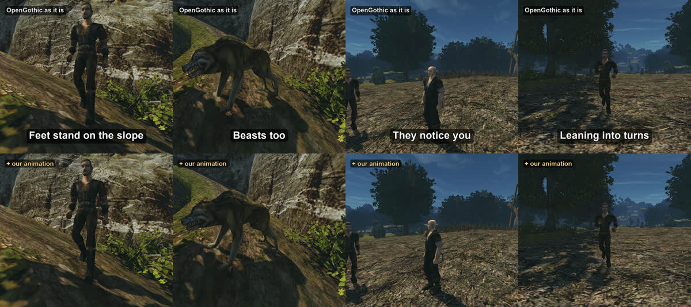

+++
title = "Bodies that react"
summary = "Feet that stand on slopes, eyes that follow you, runners that lean into turns, blows that throw the body back: the same scenes with our animation work off and on."
date = 2026-10-12T23:10:00+03:00
cover = "cover.jpg"
+++
Characters that talk back need bodies that react too. Over the last days the people and creatures of
Gothic II learned to stand on uneven ground, to notice you, to lean when they run and to give way when
they are hit. The short shows the same scenes twice: on top OpenGothic as it is, below with our
animation work switched on.

## What changed

**Feet stand on the ground.** On a slope or a stair both feet touch it: a knee bends, the hips go down.
Wolves and molerats stand on all four paws, and their bodies tilt and roll with the ground.

**They notice you.** In a conversation a character turns to whom it talks to: the head first, the chest
and the waist for larger turns. Outside a conversation it notices the hero coming within a few metres, a
drawn weapon, a fight nearby. It looks for a few seconds, loses interest, and looks again when you have
moved on.

**Runners lean.** Into a turn by how fast they run and how sharply they turn (up to 14 degrees), forward
up a slope and a little back down one.

**Blows throw the body.** Every hit bends the upper body away from where it came from: a sword swung from
the side pushes along the blade, an arrow along its flight, a hit off the middle twists the trunk, and
the head lags behind and swings back. It is as strong as the blow hurt, on top of the game's own stumble,
and it also comes where the game plays no reaction at all. On top of the stumble it is subtle, which is
why the short does not show it.

**Smoother switches between animations.** When a run stops or a walk turns into a run, the new animation
now plays at once and the difference to the old pose fades out instead of a frozen first frame or a jump:
the largest jump of a joint when a run stops went from 70 cm to 20.

All of it runs on top of the animations of the game, as passes over the skeleton the engine has already
posed; nothing in the game's files is changed.

## How it was tested

Each of these was tuned on the test bench: it plays a scenario inside the game, records video and
per-frame metrics, and reports suspicious frames, a foot sinking into a step, a head jerking, a flinch
that does not come back. The bench also found a freeze in the engine itself: under load the renderer
could wait forever for a thread that had missed its signal; it is fixed now.

## What we keep honest

Both halves of every scene are the same scripted run on the same build of the engine, played twice: once
with our animation switched off, once with it on. The top is OpenGothic, not the original game's
executable. The scenes are set up for the camera: the hero cannot be hurt, the farmer is held in place so
that his routine does not take him away. The game's own sound is from the run below; the picture is a
little brighter than the game for phone screens.

## Next

Feet that stay on the ground during sword swings on a slope, and the upper body turning to an enemy
above or below in melee.

The project is not playable yet: it runs from source on macOS and needs your own copy of Gothic II: Night
of the Raven. The engine is [OpenGothic](https://github.com/Try/OpenGothic); the tools that filmed this
are in the repository: [`shorts/compare`](https://github.com/kaifaty/GothicAI/tree/main/shorts/compare)
and the [test bench](https://github.com/kaifaty/GothicAI/tree/main/scripts/bench).
