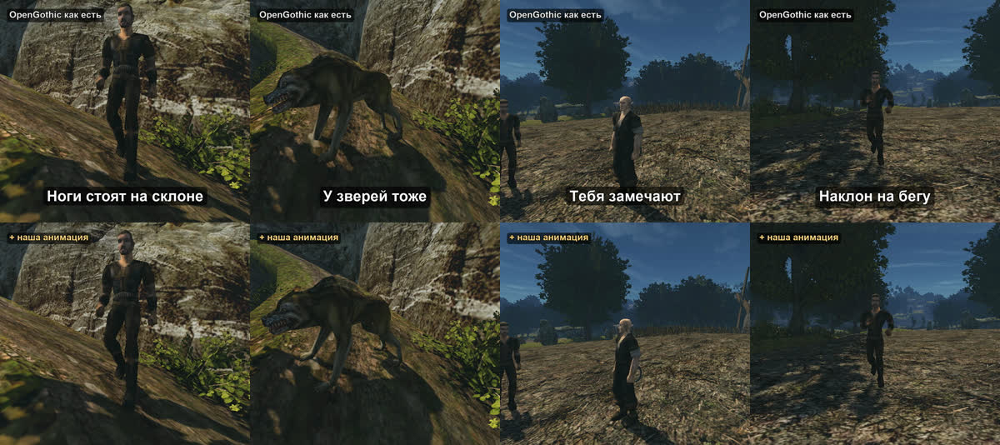

+++
title = "Тела, которые реагируют"
summary = "Ноги стоят на склоне, взгляд провожает героя, бегущий кренится в повороте, удар отбрасывает корпус: одни и те же сцены с нашей анимацией и без неё."
date = 2026-10-12T23:10:00+03:00
cover = "cover.jpg"
youtube = "r4ZYddctjH4"
+++
Персонажам, которые отвечают голосом, нужны и тела, которые реагируют. За последние дни люди и звери
Готики II научились стоять на неровной земле, замечать героя, наклоняться на бегу и подаваться под
ударом. В шортсе одни и те же сцены сняты дважды: сверху OpenGothic как есть, снизу с нашей
анимацией.

## Что изменилось

**Ноги стоят на земле.** На склоне и на ступенях обе стопы касаются опоры: колено сгибается, таз
опускается. Волки и кротокрысы стоят на всех четырёх лапах, а тело наклоняется и кренится вместе с
землёй.

**Тебя замечают.** В разговоре персонаж поворачивается к собеседнику: сначала голова, на больших углах
грудь и поясница. Вне разговора он замечает героя в нескольких метрах, обнажённое оружие, драку рядом.
Смотрит несколько секунд, теряет интерес и снова оглядывается, когда ты отошёл.

**Бегущие наклоняются.** В поворот, по скорости и крутизне поворота (до 14 градусов), вперёд на подъёме
и чуть назад на спуске.

**Удар отбрасывает корпус.** От каждого попадания верх тела отклоняется от удара: меч сбоку толкает
вдоль клинка, стрела по направлению полёта, удар не по центру скручивает корпус, а голова запаздывает
и возвращается. Сила зависит от урона. Это добавляется к спотыканию самой игры и срабатывает там, где
игра не реагирует вовсе. Поверх спотыкания отклик едва заметен, поэтому в шортс он не попал.

**Плавные переходы между анимациями.** Когда бег останавливается или шаг переходит в бег, новая
анимация теперь играет сразу, а разница со старой позой плавно уходит, без застывшего первого кадра и
без скачка: самый большой скачок сустава при остановке бега уменьшился с 70 см до 20.

Всё это работает поверх анимаций игры, как проходы по скелету, который движок уже поставил в позу;
файлы игры не меняются.

## Как это проверяли

Каждую функцию настраивали на тестовом стенде: он играет сценарий внутри игры, пишет видео и метрики по
кадрам и отчёт о подозрительных кадрах: стопа ушла в ступень, голова дёрнулась, отклик не вернулся.
Заодно стенд нашёл зависание в самом движке: под нагрузкой отрисовка могла бесконечно ждать поток,
пропустивший сигнал. Теперь это исправлено.

## Что мы не скрываем

Обе половины каждой сцены — один и тот же сценарий на одной и той же сборке движка, сыгранный дважды:
с выключенной нашей анимацией и с включённой. Сверху OpenGothic, а не исполняемый файл оригинальной игры.
Сцены поставлены под камеру: героя нельзя ранить, крестьянина держат на месте, чтобы распорядок дня его
не увёл. Звук игры взят из нижнего прогона, картинка немного светлее, чем в игре, для экранов телефонов.

## Дальше

Ноги, которые не отрываются от склона во время взмаха мечом, и поворот корпуса к противнику выше или ниже
в ближнем бою.

Поиграть пока нельзя: проект запускается из исходников на macOS и требует своей копии Gothic II: Ночь
Ворона. Движок — [OpenGothic](https://github.com/Try/OpenGothic); инструменты, которыми это снято, лежат
в репозитории: [`shorts/compare`](https://github.com/kaifaty/GothicAI/tree/main/shorts/compare)
и [тестовый стенд](https://github.com/kaifaty/GothicAI/tree/main/scripts/bench).
