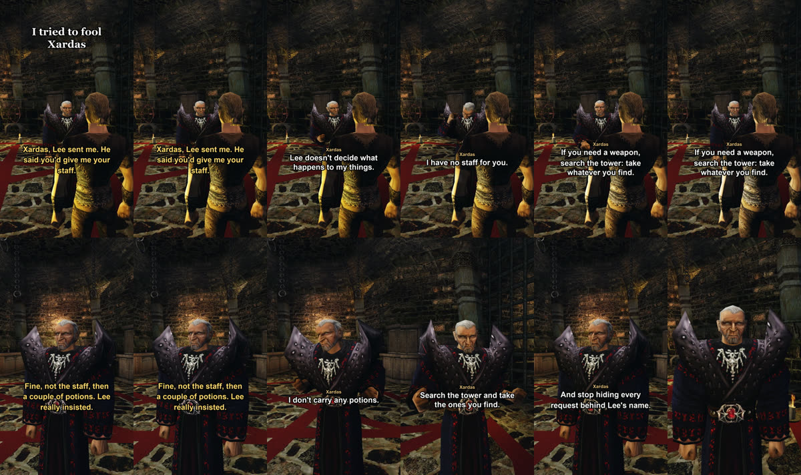

+++
title = "The shorts film themselves"
summary = "A scene is written as a script; the hero speaks with a synthetic voice, the characters hear it through speech recognition and answer live, and the cut comes out as a vertical short."
date = 2026-10-12T20:00:00+03:00
cover = "cover.jpg"
+++
To show what the characters can do we need videos, and recording them by hand is slow: every answer is
different, so a good moment takes several tries. So the coding agent that works on the project now films
the shorts itself, with nobody at the keyboard.

## How a short is made

1. **A script.** A short is a small file: the hook, the hero's lines, where the camera stands. For the first
   one the hero tries to fool Xardas: "Lee sent me. He said you'd give me your staff."
2. **The hero's voice.** The lines are voiced once by text-to-speech with a voice designed from a
   description. Nobody's voice is cloned.
3. **The take.** The game runs on the test bench. The bench holds the talk key while the recording plays;
   the AI server hears it through the same speech recognition as a player's microphone, and Xardas answers
   with the language model, in his voice. The bench films it, together with the game's own sound.
4. **Several takes.** The answers differ every time, so the agent films a few, reads what was said in
   each, and picks the one that carries the idea.
5. **The cut.** The pauses while the model thinks are cut down to a beat, the hero's voice is mixed in,
   subtitles go on, and out comes a 1080×1920 short in Russian or English.

In the take we kept, Xardas refuses twice and then sees through it:

> And stop hiding every request behind Lee's name.

Nobody wrote that line.

## What we keep honest

The answers are not edited and not picked line by line: a take is used whole or not at all. Only the
silence while the model thinks is shortened, and the description of every short says so. The hero's voice
is synthetic and says exactly the script; what the characters heard is in the take's transcript, mistakes
of the speech recognition included.

## What it took

The bench records the game's sound by mixing it into the recording frame by frame instead of playing it,
so the video and the sound never drift apart. The game has to keep to real time while it films, because
the AI server lives in real time; drawing only the recorded frame and encoding on the GPU got it to
96-99% of real time at 972×1728. One of the first takes lost an answer to an overloaded language model;
the summary of every take shows that, and the take is filmed again.

The tool is in the repository, in `shorts/`.
