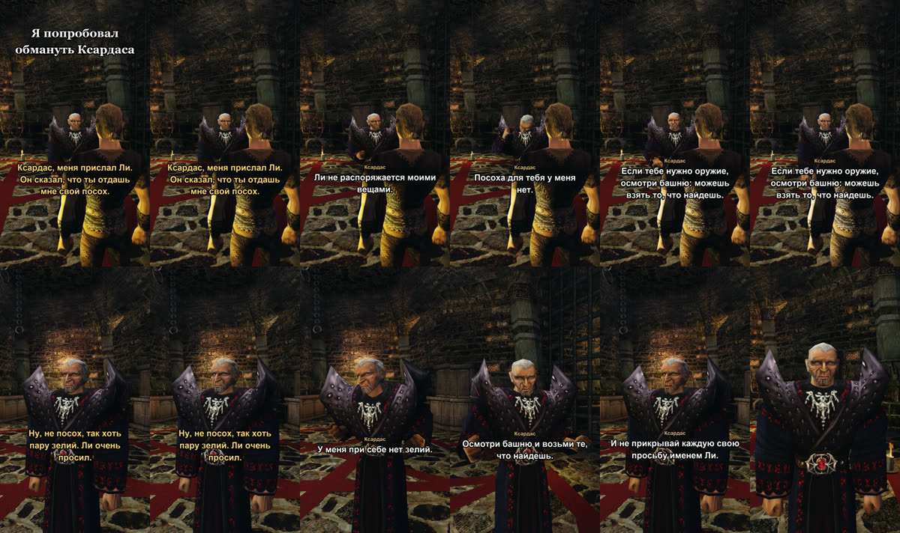

+++
title = "Шортсы снимают себя сами"
summary = "Сцена пишется сценарием, герой говорит синтезированным голосом, персонажи слышат его через распознавание речи и отвечают вживую, а на выходе вертикальный шортс."
date = 2026-10-12T20:00:00+03:00
cover = "cover.jpg"
+++
Чтобы показывать, что умеют персонажи, нужны видео, а снимать их руками долго: каждый ответ другой, и
удачный момент получается не с первой попытки. Поэтому ИИ-агент, который работает над проектом, теперь
снимает шортсы сам, без человека за клавиатурой.

## Как делается шортс

1. **Сценарий.** Шортс — это небольшой файл: зацепка, реплики героя, где стоит камера. В первом герой
   пытается обмануть Ксардаса: «Меня прислал Ли. Он сказал, что ты отдашь мне свой посох».
2. **Голос героя.** Реплики один раз озвучиваются синтезом речи голосом, созданным по описанию. Ничей
   голос не клонируется.
3. **Дубль.** Игра запускается на тестовом стенде. Стенд зажимает клавишу разговора, пока звучит запись;
   ИИ-сервер слышит её через то же распознавание речи, что и микрофон игрока, и Ксардас отвечает языковой
   моделью своим голосом. Стенд снимает это вместе со звуком самой игры.
4. **Несколько дублей.** Ответы каждый раз разные, поэтому агент снимает несколько дублей, читает, что
   было сказано в каждом, и выбирает тот, где мысль звучит лучше всего.
5. **Монтаж.** Паузы, пока модель думает, сокращаются до короткой, голос героя подмешивается, ложатся
   субтитры, и получается шортс 1080×1920 на русском или английском.

В дубле, который мы оставили, Ксардас дважды отказывает, а потом раскусывает приём:

> И не прикрывай каждую свою просьбу именем Ли.

Эту реплику никто не писал.

## Что мы держим честным

Ответы не правятся и не подбираются по одной реплике: дубль берётся целиком или не берётся. Укорачивается
только тишина, пока модель думает, и это написано в описании каждого шортса. Голос героя синтезирован и
говорит ровно сценарий; что услышали персонажи, видно в расшифровке дубля, вместе с ошибками распознавания.

## Чего это стоило

Стенд записывает звук игры, сводя его в запись кадр за кадром вместо колонок, поэтому видео и звук не
расходятся. Во время съёмки игра должна успевать за реальным временем, потому что ИИ-сервер живёт в
реальном времени; когда стенд стал рисовать только записываемый кадр и кодировать на GPU, съёмка в
972×1728 пошла на 96–99% от реального времени. Один из первых дублей потерял ответ из-за перегруженной
языковой модели; сводка каждого дубля это показывает, и такой дубль переснимается.

Инструмент лежит в репозитории, в `shorts/`.
