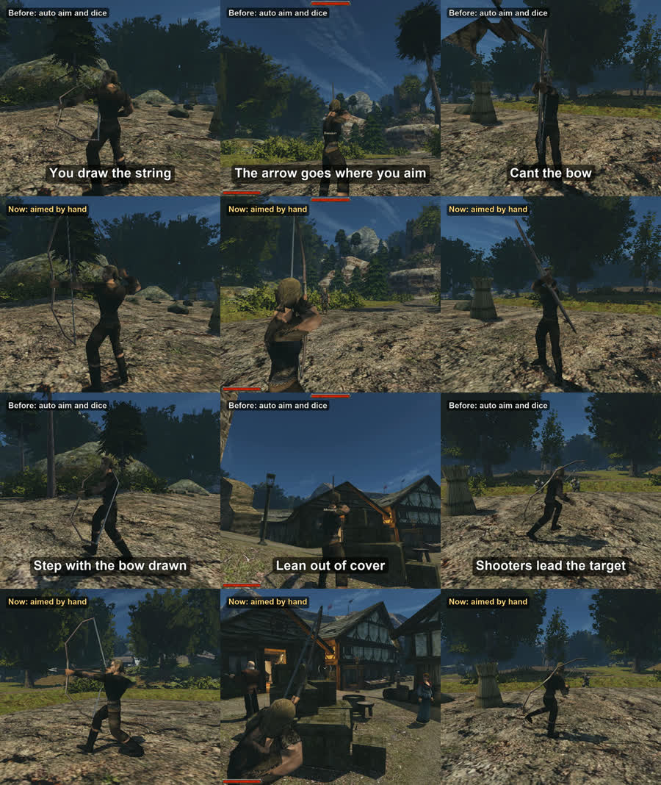

+++
title = "Aiming a bow by hand"
summary = "The bow no longer aims itself and no dice decide the hit: you draw, hold and the arrow flies where you point it. NPC archers aim the same way and lead a runner."
date = 2026-10-13T09:26:58+03:00
cover = "cover.jpg"
youtube = "I8IsAGObAmU"
+++
In Gothic II the bow locks onto a target and a dice roll decides whether the arrow hits. Now you aim it
yourself: hold the button to draw, let go to shoot, and the arrow goes where the bow points. In the short
the same scenes are played twice: on top the bow as the game has it, below aimed by hand.

## How it plays

**The draw.** Holding the left button draws the string, letting go shoots, the right button lowers the bow
without a shot, and Shift holds your breath for a few seconds. A drawn bow sways; held too long, the arms
start to tremble and finally give up. A small crosshair sits where you aim, and its brackets open as far
as the arrow may stray.

**The arrow is real.** It drops over distance, so at 30 m you aim higher. It hits what it touches: zones
fitted to each body's mesh, the head for double damage, the limbs for 0.6. The zone multiplies what got
through the armour.

**Skill shows.** The draw time, the sway, the arrow's speed and the spread on release come from the bow
skill, strength and dexterity, and the trained tiers keep the game's own animations. A crossbow reloads by
strength.

**Stance.** With the bow up, the sneak key crouches (steadier hands), the side steps lean you out of cover,
the mouse wheel cants the bow for a quicker, looser shot, and forward and back step slowly with the bow
still drawn.

**NPC archers aim too.** The fight AI decides when to shoot; the archer draws, holds until the aim settles
and lets go, at the chest, over it for the drop and ahead of a runner. How far it misses comes from the
original dice: the chance at that distance becomes a spread around the chest, so archers hit about as
often per minute as before. Against a runner the difference shows: in this take the paladins' bolts by
the dice missed 16 of 16, aimed by hand they hit 5 of 8.

Where the dice remains (with manual aim switched off in `Gothic.ini`), it now rolls exactly as
Gothic2.exe does. OpenGothic's formula was kinder past 15 m: a bandit archer 16 m away hit 41% of the
time instead of the original 25%.

## Balance

We compared it with the dice on the test bench: four tiers from novice to master, 30 arrows each at 10,
20 and 30 m. Close up, aiming by hand deals about as much damage per second as the dice or a little less,
since drawing takes time; past 15 m it deals more, where the original dice falls off sharply. A master
puts 17 of 30 arrows into a head at 20 m. The bench's aim has no human error, only the bow's sway, so a
person with a mouse will do worse: that is the margin we left.

## What we keep honest

Both halves are the same scenario on the same build, played twice: on top with manual aim off, which is
OpenGothic with the auto aim and the original dice, not the original executable. The test bench's bot
aims, not a person. The scenes are staged: the bandit is held in place and cannot die, the hero cannot be
hurt, the hero keeps the untrained animations, and the head shots use a master's stats, the other scenes
a middling archer's. The game's sound comes from the lower take; the picture is a little brighter for
phone screens.

## Next

Plans: a reaction to an arrow that only just misses, archers that do not shoot through their allies,
whether NPCs should aim at heads, and a balance check with a real player's aim.

Not playable yet: it runs from source on macOS and needs your own copy of Gothic II: Night of the Raven.
The engine is [OpenGothic](https://github.com/Try/OpenGothic); the design and the numbers are in
[`docs/manual-aim.md`](https://github.com/kaifaty/GothicAI/blob/main/docs/manual-aim.md), and the short was
filmed with [`shorts/compare`](https://github.com/kaifaty/GothicAI/tree/main/shorts/compare) on the
[test bench](https://github.com/kaifaty/GothicAI/tree/main/scripts/bench).
