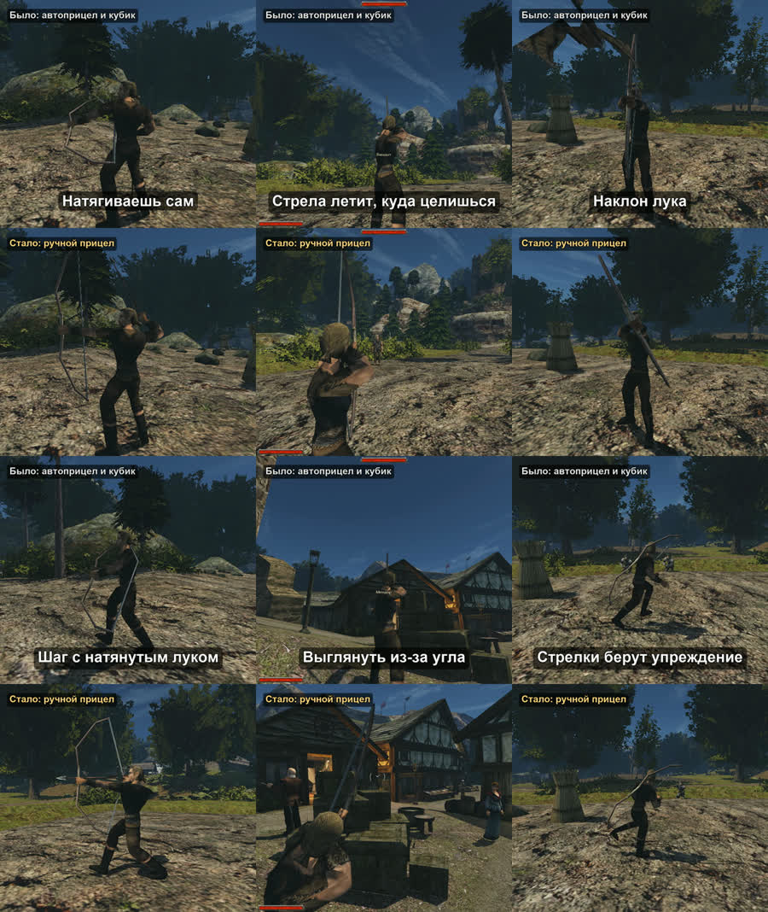

+++
title = "Лук, который наводишь сам"
summary = "Лук больше не наводится сам, и попадание не решает кубик: натягиваешь, держишь, и стрела летит туда, куда направлен лук. NPC-лучники целятся так же и берут упреждение."
date = 2026-10-13T09:26:58+03:00
cover = "cover.jpg"
youtube = "c6psy9xOebc"
+++
В Готике II лук сам наводится на цель, а попала ли стрела, решает бросок кубика. Теперь целишься сам:
держишь кнопку — натягиваешь, отпускаешь — стреляешь, и стрела летит туда, куда направлен лук. В шортсе
одни и те же сцены сыграны дважды: сверху лук, как он есть в игре, снизу ручной прицел.

## Как это играется

**Натяжение.** Левая кнопка, пока держишь, натягивает тетиву, отпустил — выстрел. Правая опускает лук без
выстрела, Shift на несколько секунд задерживает дыхание. Натянутый лук покачивается, а если держать
слишком долго, руки начинают дрожать и в конце концов опускают его. Маленький прицел стоит там, куда
целишься, а его скобки расходятся настолько, насколько может уйти стрела.

**Стрела настоящая.** На расстоянии она падает, поэтому на 30 м целишься выше. Попадает в то, чего
коснулась: зоны подогнаны под сетку каждого тела, голова — двойной урон, руки и ноги — 0,6. Множитель
зоны применяется к тому, что прошло сквозь броню.

**Навык заметен.** Время натяжения, покачивание, скорость стрелы и разброс при отпускании зависят от
навыка, силы и ловкости, а обученные ступени сохраняют анимации самой игры. Арбалет перезаряжается тем
быстрее, чем больше сила.

**Стойка.** При поднятом луке клавиша «красться» сажает героя (руки твёрже), шаги вбок выглядывают из-за
укрытия, колесо мыши наклоняет лук для быстрого, но менее точного выстрела, а вперёд и назад можно
медленно шагать, не опуская натянутый лук.

**NPC-лучники тоже целятся.** Когда стрелять, решает боевой ИИ игры. Лучник натягивает, держит, пока
прицел не успокоится, и отпускает: в грудь, выше на падение стрелы и с упреждением по бегущему. Насколько
он промахивается, берётся из оригинального кубика: шанс на этом расстоянии превращается в разброс вокруг
груди, поэтому в минуту лучники попадают примерно столько же, сколько раньше. По бегущей цели разница
видна сразу: в этом дубле паладины с кубиком промахнулись всеми 16 болтами, а целясь сами, попали 5 раз
из 8.

Там, где кубик остался (если выключить ручной прицел в `Gothic.ini`), он теперь бросается в точности как в
Gothic2.exe. Формула OpenGothic была щедрее после 15 м: бандит-лучник с 16 м попадал в 41% случаев вместо
оригинальных 25%.

## Баланс

Сравнили с кубиком на тестовом стенде: четыре ступени от новичка до мастера, по 30 стрел на 10, 20 и 30 м.
Вблизи ручной прицел даёт в секунду столько же урона, сколько кубик, или чуть меньше: натяжение занимает
время. Дальше 15 м — больше, потому что там оригинальный кубик резко падает. Мастер на 20 м кладёт в
голову 17 стрел из 30. У стенда в прицеле нет человеческой ошибки, только качка лука, поэтому человек с
мышью будет стрелять хуже: это и есть оставленный запас.

## Что мы не скрываем

Обе половины каждой сцены — один и тот же сценарий на одной и той же сборке, сыгранный дважды. Сверху
ручной прицел выключен: это OpenGothic с автоприцелом и оригинальным кубиком, а не исполняемый файл
оригинальной игры. Целится бот тестового стенда, а не человек. Сцены поставлены: бандита держат на месте,
и он не может умереть, героя нельзя ранить, у героя анимации необученного лучника, в выстрелах в голову у
него характеристики мастера, в остальных сценах — середняка. Звук игры взят из нижнего прогона, картинка
немного светлее, чем в игре, для экранов телефонов.

## Дальше

Это планы: реакция на стрелу, просвистевшую рядом, лучники, которые не стреляют сквозь своих, решение,
целиться ли NPC в голову, и проверка баланса на прицеле живого игрока.

Поиграть пока нельзя: проект запускается из исходников на macOS и требует своей копии Gothic II: Ночь
Ворона. Движок — [OpenGothic](https://github.com/Try/OpenGothic); устройство и цифры — в
[`docs/manual-aim.md`](https://github.com/kaifaty/GothicAI/blob/main/docs/manual-aim.md), шортс снят
инструментом [`shorts/compare`](https://github.com/kaifaty/GothicAI/tree/main/shorts/compare) на
[тестовом стенде](https://github.com/kaifaty/GothicAI/tree/main/scripts/bench).
