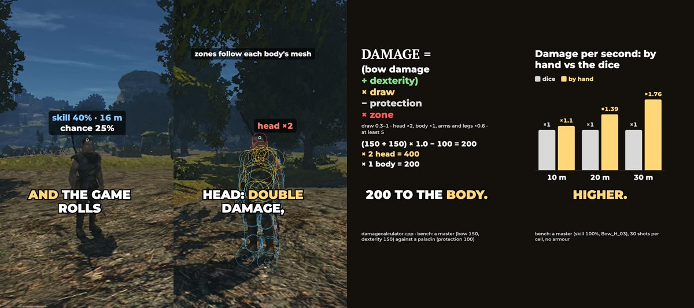

+++
title = "How the bow works now: the numbers"
summary = "What decides an arrow's damage now, what skill, dexterity and strength do, and how it compares with Gothic's dice: the formulas behind the short."
date = 2026-10-13T21:58:47+03:00
cover = "cover.jpg"
youtube = "zWc96M9lQK4"
+++
The [last post](https://kaifaty.github.io/GothicAI/posts/archery/) showed the bow aimed by hand. This one is about the numbers behind it. If you
aim the arrow yourself, what is left for the hero's skill, dexterity and strength? Gothic is an RPG after
all. The short answers that in 80 seconds (a Russian voice with English subtitles); here are the formulas.

## The dice it replaces

In Gothic II the bow aims itself and one roll decides the hit. The chance comes from the bow skill and the
distance, as Gothic2.exe computes it. Up close it is 100%, falling to the skill at 15 m. Past 15 m it is
`H − H·d/45 m` (H is the skill), so it drops at once to two thirds of the skill and reaches zero at 45 m.
A bandit with 40% skill hits from 16 m a quarter of the time. That formula, taken from the executable, is
the yardstick for everything below.

## Damage

The arrow is a real projectile: it leaves along the line of the bow, drops over distance and hits what it
touches, with zones fitted to each body's mesh. The damage keeps Gothic's own rule (the bow's damage plus
dexterity) and adds three factors:

**damage = max(5, ((bow damage + dexterity) × draw − protection) × zone)**

- **draw**: 0.3 to 1; a shorter draw does not shoot;
- **protection**: the target's protection against arrows; it never takes the damage below 0;
- **zone**: head 2, trunk 1, arms and legs 0.6. It applies after the armour, so a head shot always deals
  twice a body shot;
- each step is rounded, and at least 5 is dealt, as in Gothic.

A master (a bow of 150, dexterity 150) at full draw against a paladin in plate (protection 100): 400 in the
head, 200 in the trunk, 120 in a limb. The test bench measured the same.

## What the stats do

From novice to master (skill 0 to 100%, dexterity 0 to 150):

| Stat | What it changes |
|---|---|
| Bow skill | **Accuracy**: the sway at full draw 0.9° → 0.25°, the scatter on release 0.6° → 0.1°, the aim settles after a turn in 0.6 → 0.2 s, the breath holds 2 → 5 s. **Training**: Gothic's trained archers' animations are kept, so the reload animation takes 1.16 / 1.08 / 0.92 s on the three tiers |
| Dexterity | The damage (above) and the **tempo**: the draw 1.2 → 0.5 s, the reload's pace ×0.85 → ×1.6 |
| Strength | **Holding a heavy bow**: a bow needs 0.6 of its damage in strength, or its own requirement. Short of it, the bow sways more (×(1 + the shortfall)), draws slower and trembles sooner: it holds steady for 1.5 s at half the strength it needs and 6 s at twice. A crossbow cocks at ×0.75 → ×1.4 the pace |

## Against the dice

On the test bench: four tiers from novice to master, 30 shots per cell, no armour. Damage per second aiming
by hand, divided by the dice's at the same tier:

| Tier (skill, bow, strength/dexterity) | 10 m | 20 m | 30 m |
|---|---|---|---|
| novice (10%, Bow_L_01, 10/10) | 0.86 | 4.0 | 4.1 |
| apprentice (30%, Bow_L_03, 30/30) | 0.79 | 1.65 | 1.57 |
| middling (60%, Bow_M_01, 60/60) | 0.79 | 1.16 | 1.25 |
| master (100%, Bow_H_03, 150/150) | 1.10 | 1.39 | 1.76 |

Close up, aiming by hand is a little slower than the dice: drawing takes time. Past 15 m it deals more,
because the dice cuts the chance there in one step (a novice is left with a few percent) and physics does not. A
master puts 17 of 30 arrows into a head at 20 m.

## What we keep honest

- Every number on screen is computed, not typed in: the chance and roll over the bandit are the ones the
  game threw in that take, the formula card works its example out the way the engine does, and the charts
  come from the bench's log.
- The bench's bot aims with no human error, only the bow's own sway. A person with a mouse will do worse;
  that is the margin we left.
- The balance table was measured without armour; the paladin example is with it.
- The scenes are staged: the bandit is held in place and cannot die. The arrow's flight is slowed down.
- The voice is a person's recording, not a synthetic one. The music is Gothic II's (Kai Rosenkranz); the
  game's own sound is cut out of the inserts.

## Next

Plans: whether NPCs should aim at heads, and a balance check with a real player's aim instead of the bot's.

Not playable yet: it runs from source on macOS and needs your own copy of Gothic II: Night of the Raven.
The engine is [OpenGothic](https://github.com/Try/OpenGothic). The design and the measurements are in
[`docs/manual-aim.md`](https://github.com/kaifaty/GothicAI/blob/main/docs/manual-aim.md), the numbers in
[`archery.cpp`](https://github.com/kaifaty/GothicAI/blob/main/OpenGothic/common/game/archery.cpp) and
[`damagecalculator.cpp`](https://github.com/kaifaty/GothicAI/blob/main/OpenGothic/common/game/damagecalculator.cpp).
The short was filmed on the [test bench](https://github.com/kaifaty/GothicAI/tree/main/scripts/bench) and
drawn with [`shorts/explain`](https://github.com/kaifaty/GothicAI/tree/main/shorts/explain).
