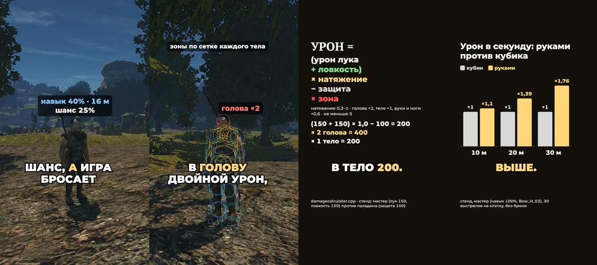

+++
title = "Как теперь устроен лук: формулы и цифры"
summary = "От чего теперь зависит урон стрелы, что дают навык, ловкость и сила и как это соотносится с кубиком Готики: формулы, стоящие за шортсом."
date = 2026-10-13T21:58:47+03:00
cover = "cover.jpg"
youtube = "ggKav_2_6E8"
+++
В [прошлом посте](https://kaifaty.github.io/GothicAI/ru/posts/archery/) лук наводили руками. Этот пост про цифры за ним. Если стрелу направляешь
сам, что остаётся навыку, ловкости и силе героя? Готика всё-таки RPG. Шортс отвечает на это за 80 секунд,
а здесь формулы.

## Кубик, который мы заменили

В Готике II лук наводится сам, а попадание решает один бросок. Шанс считается от навыка и расстояния, как в
Gothic2.exe. Вблизи он 100% и к 15 м спускается до навыка. Дальше 15 м работает формула `H − H·d/45 м`
(H — навык): шанс сразу падает до двух третей навыка и к 45 м доходит до нуля. Бандит с навыком 40% с 16 м
попадает в четверти случаев. Эта формула, взятая из самого exe, служит меркой для всего, что ниже.

## Урон

Стрела теперь настоящая: вылетает по линии лука, падает с расстоянием и попадает в то, чего коснулась, а
зоны подогнаны под сетку каждого тела. Урон сохраняет правило самой Готики (урон лука плюс ловкость) и
добавляет три множителя:

**урон = max(5, ((урон лука + ловкость) × натяжение − защита) × зона)**

- **натяжение**: от 0,3 до 1; если натянуть слабее, выстрела нет;
- **защита**: защита цели от стрел; ниже 0 урон из-за неё не уходит;
- **зона**: голова 2, корпус 1, руки и ноги 0,6. Множится после брони, поэтому в голову всегда вдвое
  больше, чем в корпус;
- каждый шаг округляется, и урон не меньше 5, как в Готике.

Мастер (лук 150, ловкость 150) на полном натяжении против паладина в латах (защита 100): в голову 400, в
корпус 200, в руку или ногу 120. Стенд намерил то же самое.

## Что дают характеристики

От новичка до мастера (навык от 0 до 100%, ловкость от 0 до 150):

| Характеристика | Что меняет |
|---|---|
| Навык владения луком | **Точность**: качка на полном натяжении 0,9° → 0,25°, разброс при выпуске 0,6° → 0,1°, прицел успокаивается после поворота за 0,6 → 0,2 с, дыхание задерживается на 2 → 5 с. **Выучка**: анимации обученных лучников Готики сохранены, поэтому анимация перезарядки длится 1,16 / 1,08 / 0,92 с на трёх ступенях |
| Ловкость | Урон (см. выше) и **темп**: натяжение 1,2 → 0,5 с, темп перезарядки ×0,85 → ×1,6 |
| Сила | **Удержать тугой лук**: луку нужна сила в 0,6 его урона или его собственное требование. Если силы не хватает, лук качается сильнее (×(1 + нехватка)), натягивается медленнее и раньше начинает дрожать: ровно держится 1,5 с при половине нужной силы и 6 с при двойной. Арбалет взводится в темпе ×0,75 → ×1,4 |

## Против кубика

Замеры на стенде: четыре ступени от новичка до мастера, по 30 выстрелов на клетку, без брони. Урон в секунду
при стрельбе руками, делённый на урон кубика на той же ступени:

| Ступень (навык, лук, сила/ловкость) | 10 м | 20 м | 30 м |
|---|---|---|---|
| новичок (10%, Bow_L_01, 10/10) | 0,86 | 4,0 | 4,1 |
| ученик (30%, Bow_L_03, 30/30) | 0,79 | 1,65 | 1,57 |
| середняк (60%, Bow_M_01, 60/60) | 0,79 | 1,16 | 1,25 |
| мастер (100%, Bow_H_03, 150/150) | 1,10 | 1,39 | 1,76 |

Вблизи руками чуть медленнее, чем кубиком: натягивать лук нужно время. Дальше 15 м руками выгоднее, потому
что кубик срезает там шанс одной ступенькой (новичку остаётся несколько процентов), а физика так не делает. Мастер с 20 м
попадает в голову 17 раз из 30.

## Что мы не скрываем

- Все цифры на экране посчитаны, а не вписаны руками: шанс и бросок над бандитом — те, что игра выбросила в
  этом дубле, пример в карточке с формулой считается так же, как в движке, графики построены по логу стенда.
- Целится бот стенда, у него нет человеческой ошибки, только собственная качка лука. Живой игрок с мышью
  будет попадать хуже, и это заложенный запас.
- Таблица баланса снята без брони, пример с паладином — с бронёй.
- Сцены постановочные: бандит удерживается на месте и не может умереть. Полёт стрелы замедлен.
- Голос в шортсе записан человеком, он не синтезирован. Музыка из Готики II (Кай Розенкранц), игровой звук
  со вставок убран.

## Дальше

В планах: стоит ли NPC целиться в голову и проверка баланса с прицелом живого игрока вместо бота.

Поиграть пока нельзя: проект запускается из исходников на macOS и требует своей копии Gothic II: Ночь
Ворона. Движок — [OpenGothic](https://github.com/Try/OpenGothic). Устройство и замеры описаны в
[`docs/manual-aim.md`](https://github.com/kaifaty/GothicAI/blob/main/docs/manual-aim.md), числа лежат в
[`archery.cpp`](https://github.com/kaifaty/GothicAI/blob/main/OpenGothic/common/game/archery.cpp) и
[`damagecalculator.cpp`](https://github.com/kaifaty/GothicAI/blob/main/OpenGothic/common/game/damagecalculator.cpp).
Шортс снят на [тестовом стенде](https://github.com/kaifaty/GothicAI/tree/main/scripts/bench) и нарисован
с помощью [`shorts/explain`](https://github.com/kaifaty/GothicAI/tree/main/shorts/explain).
