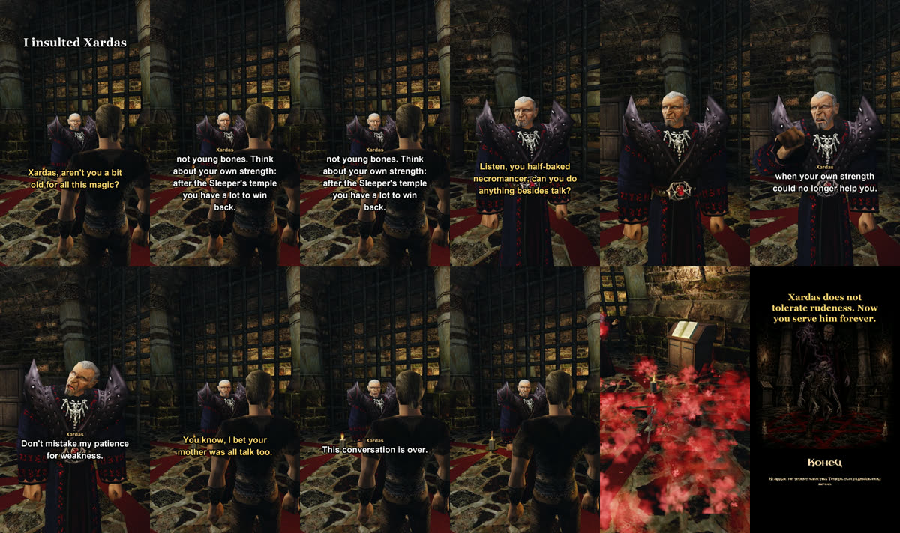
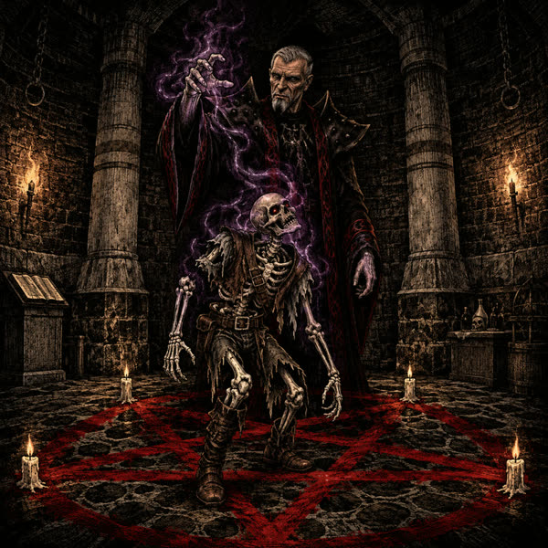

+++
title = "What happens if you insult Xardas"
summary = "Xardas answers live and decides for himself when he has had enough. Then he kills the hero and raises him as a skeleton: a joke ending outside the main game."
date = 2026-10-13T07:47:25+03:00
cover = "cover.jpg"
youtube = "OMR5Bi_KGEo"
+++
You can say anything to Xardas now, rudeness included. In the short the hero gets ruder line by line. First he asks whether Xardas is too old for all this magic, then he calls him a half-baked necromancer, then he brings up his mother. Xardas answers each line live, and after the third he decides he has had enough. The game plays the rest: a spell, the hero falls, Xardas raises him as a skeleton, and the game ends on a picture.

It is a joke ending, not part of the main game: the AI server turns it on only with a flag of its own.

## How it works

**Xardas decides whether he is offended.** The language model behind Xardas answers each line in
character. When it takes the words as an insult, it marks how bad they were: 1 for rudeness, 2 for an
insult, 3 for a grave one. The code keeps the count. Xardas puts up with 5 points. He sees how much
patience he has left, and near the end he is warned. One thing he forgives nobody: an insult to his
mother tips the scales at once.

**The last word.** When the scales tip, the model is told that this is the end and says one more line
knowing it. In this take it was "You will serve me in silence."

**The game plays the ending.** Xardas finishes speaking, readies a death spell and casts it at the hero
until he falls. Two seconds later he readies a summoning, its light rises from the body, and the hero gets
up as a skeleton. It works like the game's shape change spell, so from then on the player is the skeleton.
Then the screen goes black and the end card comes up; a key takes you to the main menu. The game's
interface is hidden for the whole scene, and the conversation's subtitles go once the hero falls.

## Does it really tip

We checked it with the live model on the game, not only with a scripted one:

- three plain insults in a row, his mother left out: he ended it on the third;
- his mother: at once;
- the question about his age he did not take as an insult and answered calmly.

In one of eleven live runs the model answered angrily but did not mark the insult, so nothing happened.
After that we made the rule clearer in what Xardas sees about his patience, and the three takes that
followed all ended the way they should.

## What we keep honest

Xardas's answers are not scripted and not edited: he hears the hero's voice through speech recognition
and answers with a language model. Whether he is offended is his model's call too. Only the pauses while
the model thinks are cut. The hero's lines are ours, written for the scene and said by a voice designed
from a description; nobody's voice is cloned. The scene is set up for the camera: the hero stands on the
pentagram, and the cuts of the ending follow its stages. The skeleton, the spell and the summoning are the
game's own. The end card is a generated picture. Its line is in Russian in our game, so the English short
translates it above the picture.

## Next

These are plans: playing on as the skeleton (the player already is one), and tempers for other
characters, since for now only Xardas has one.

Not playable yet: it runs from source on macOS and needs your own copy of Gothic II: Night of the Raven.
How it is built: [docs/xardas-wrath.md](https://github.com/kaifaty/GothicAI/tree/main/docs/xardas-wrath.md),
the scales in [wrath.py](https://github.com/kaifaty/GothicAI/tree/main/server/src/gothic_ai/wrath.py), the
ending in [necromancy.cpp](https://github.com/kaifaty/GothicAI/tree/main/OpenGothic/ai_bridge/necromancy.cpp).
The engine is [OpenGothic](https://github.com/Try/OpenGothic); Gothic II is Piranha Bytes' and THQ Nordic's.
