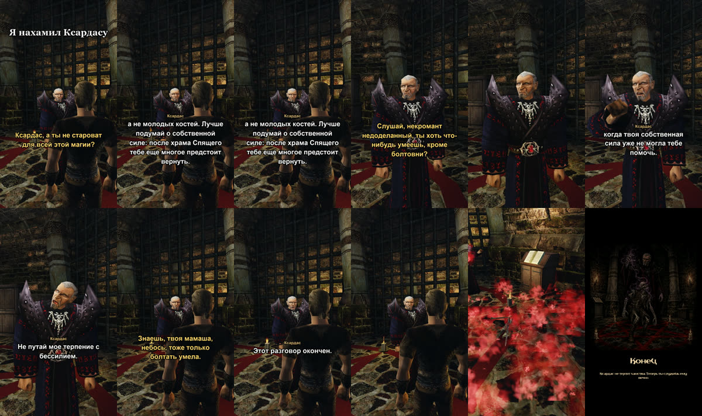

+++
title = "Что будет, если нахамить Ксардасу"
summary = "Ксардас отвечает вживую и сам решает, когда с него хватит. А потом убивает героя и поднимает его скелетом. Это шуточная концовка вне основной игры."
date = 2026-10-13T07:47:25+03:00
cover = "cover.jpg"
youtube = "LhIPXyVvhH0"
+++
Ксардасу теперь можно сказать что угодно, в том числе нахамить. В шортсе герой хамит всё сильнее. Сначала спрашивает, не староват ли Ксардас для всей этой магии, потом называет его недоделанным некромантом, потом вспоминает его мать. Ксардас отвечает на каждую реплику вживую, а после третьей решает, что с него хватит. Дальше всё разыгрывает игра: заклинание, герой падает, Ксардас поднимает его скелетом, и игра заканчивается картинкой.

Это шуточная концовка, в основную игру она не входит: ИИ-сервер включает её только отдельным флагом.

## Как это устроено

**Обиделся ли Ксардас, решает он сам.** Языковая модель Ксардаса отвечает на каждую реплику в
характере. Если сочтёт слова оскорблением, отмечает, насколько оно серьёзное: 1 — дерзость, 2 —
оскорбление, 3 — тяжкое оскорбление. Счёт ведёт код. Ксардас готов стерпеть 5 очков. Он видит, сколько
терпения у него осталось, а на пределе получает предупреждение. Одного он не прощает никому: после
оскорбления матери чаша переполняется сразу.

**Последнее слово.** Когда чаша переполнена, модель узнаёт, что это конец, и говорит ещё одну фразу,
уже зная это. В этом дубле — «Ты послужишь мне молча».

**Концовку разыгрывает игра.** Ксардас договаривает, готовит смертельное заклинание и бьёт им, пока
герой не упадёт. Через две секунды он готовит вызов, у тела вспыхивает его свет, и герой встаёт скелетом.
Это работает как игровое заклинание превращения, так что дальше игрок и есть скелет. Потом экран уходит в
чёрное и появляется финальная картинка; по клавише игра выходит в главное меню. На всю сцену интерфейс
игры скрыт, а субтитры разговора пропадают, как только герой падает.

## Правда ли его можно довести

Мы проверяли на игре с живой моделью, а не только со сценарной:

- три обычных оскорбления подряд, без матери: сорвался на третьем;
- оскорбление матери: сразу;
- вопрос про возраст он оскорблением не счёл и спокойно ответил.

В одном прогоне из одиннадцати модель ответила зло, но оскорбление не отметила, и ничего не произошло.
После этого мы сделали правило понятнее там, где Ксардас видит своё терпение, и все три следующих дубля
закончились как надо.

## Что мы не скрываем

Ответы Ксардаса не прописаны заранее и не правились: он слышит голос героя через распознавание речи и
отвечает языковой моделью. Обиделся ли он, тоже решает его модель. Вырезаны только паузы, пока модель
думает. Реплики героя наши, написаны для сцены и сказаны голосом, созданным по описанию; ничей голос не
клонирован. Сцена поставлена под камеру: герой стоит на пентаграмме, склейки концовки идут по её стадиям.
Скелет, заклинание и вызов — из самой игры. Финальная картинка сгенерирована.

## Дальше

Это планы: играть дальше за скелета (игрок им уже становится) и нрав у других персонажей, пока он
есть только у Ксардаса.

Поиграть пока нельзя: проект запускается из исходников на macOS и требует своей копии Gothic II: Ночь
Ворона. Как это сделано: [docs/xardas-wrath.md](https://github.com/kaifaty/GothicAI/tree/main/docs/xardas-wrath.md),
чаша весов — в [wrath.py](https://github.com/kaifaty/GothicAI/tree/main/server/src/gothic_ai/wrath.py),
концовка — в [necromancy.cpp](https://github.com/kaifaty/GothicAI/tree/main/OpenGothic/ai_bridge/necromancy.cpp).
Движок — [OpenGothic](https://github.com/Try/OpenGothic); Gothic II принадлежит Piranha Bytes и THQ Nordic.
